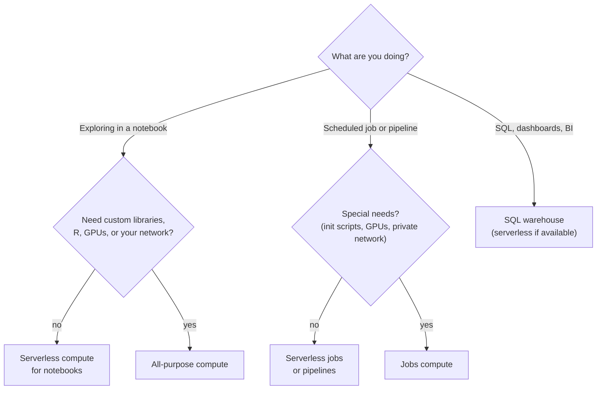

# Compute Types

Mastery: `INPUT[inlineSelect(option(new), option(learning), option(solid)):mastery]`

> [!story] Previously
> We now have an engine: the [[Databricks Runtime]] with [[Photon]] inside. Next question: what machines run it? On Hadoop there was one big shared [[Cluster|cluster]] managed by [[YARN]], and everyone queued for it. Databricks gives you several kinds of compute, each shaped for a different job, and picking the right one is the biggest lever on both speed and cost.

> [!eli5] In one breath
> "Compute" means the computers that do the work. Databricks lets you rent them in a few different ways: a set you keep on while you experiment, a set that turns on just for one scheduled task, computers Databricks manages completely so they start in seconds, and computers tuned only for answering database questions.

> [!analogy] Analogy: ways to get around a city
> - **[[All-Purpose Compute]]** is a rental car. You pick it up, drive around exploring, and pay while you have it, even when it sits parked.
> - **[[Jobs Compute]]** is a delivery van booked for one route. It shows up, does the run, and goes back. Cheaper per hour than the rental car.
> - **[[Serverless Compute]]** is a ride-hail app. A car arrives in moments, and you never see a garage or a mechanic.
> - **[[SQL Warehouses]]** are a shuttle bus line built for one purpose (SQL), running many passengers' trips together.

## Why it exists

Different work has different shapes:

- A data scientist exploring data wants a machine **on and ready** for hours, with instant feedback.
- A nightly pipeline wants a machine **for 20 minutes**, then nothing.
- A dashboard wants **many small queries at once** from many people, fast.

One kind of cluster cannot do all of these well and cheaply. So Databricks offers several compute types, priced differently (see [[DBUs]]), and lets admins steer users toward the right one with [[Compute Policies]].

## What it actually is

| Type | What it is for | Where it runs | Starts in | Who manages it |
|---|---|---|---|---|
| **[[All-Purpose Compute]]** | Interactive notebooks, exploration, shared by a team | Classic (your cloud) | A few minutes | You configure it |
| **[[Jobs Compute]]** | Automated [[Lakeflow Jobs\|jobs]]: created for a run, terminated after | Classic (your cloud) | A few minutes | You configure it; the job creates and deletes it |
| **[[Serverless Compute]]** | Notebooks, jobs, and [[Lakeflow Spark Declarative Pipelines\|pipelines]] with no cluster settings | Serverless (Databricks) | Seconds | Databricks |
| **[[SQL Warehouses]]** | SQL queries, dashboards, BI tools | Serverless, or classic/pro in your cloud | Seconds (serverless) to minutes | Databricks tunes it; you pick size and scaling |

Other compute you will meet later: **instance pools** (pre-warmed idle VMs that make classic clusters start faster), [[AI Runtime]] for deep learning, compute for [[Model Serving]], and compute for [[Databricks Apps]] and [[Lakebase]].

### Access modes: who can share a cluster

Every classic cluster has an **access mode**, which decides who can use it and how [[Unity Catalog]] is enforced. Databricks renamed these modes:

| Current name | Old name | API value | What it means |
|---|---|---|---|
| **Standard** | Shared | `USER_ISOLATION` | Many users share it, with isolation between them. Recommended for most work. Python, SQL, and Scala. |
| **Dedicated** | Single user | `SINGLE_USER` | Assigned to one user or one group. Needed for R, RDD APIs, and ML runtime on GPUs. |
| **Auto** (default) | | `DATA_SECURITY_MODE_AUTO` | Databricks picks Standard, unless you choose an ML runtime, a GPU instance, or a runtime older than 14.3, in which case it picks Dedicated. |
| No isolation shared, credential passthrough | same | | **Legacy.** Not recommended and not compatible with Unity Catalog. |

Standard mode isolates each user's code with a technology Databricks calls **Lakeguard**, the same isolation used by serverless compute.

## How it works



Databricks' own compute selection guidance points the same way: start with serverless wherever it is available, and use classic compute when you need something serverless does not support.

You can list what exists in a workspace with the [[Databricks CLI]]:

```bash
databricks clusters list          # all-purpose and recent jobs clusters
databricks warehouses list        # SQL warehouses
databricks cluster-policies list  # policies admins have defined
```

Settings that matter on every classic cluster:

- **[[Auto Termination]]**: shut down after N idle minutes. Always set it on all-purpose compute.
- **[[Autoscaling]]**: a minimum and maximum number of workers.
- **Node type and count**: the VM size of the driver and workers (see [[Driver and Executors]]).
- **Photon**: on or off ([[Photon]]).
- **[[Spot Instances|Spot instances]]**: cheaper, interruptible VMs for workers.

> [!smallbiz] For a small business
> A simple, cost-safe setup for a small team:
> 1. **One serverless SQL warehouse** (smallest size, auto-stop on) for dashboards and SQL.
> 2. **Serverless notebooks** for day-to-day exploration.
> 3. **Serverless jobs** for scheduled pipelines.
> 4. **No always-on clusters.** If you must create an all-purpose cluster, give it a 30-minute auto-termination and a [[Compute Policies|policy]] limiting its size.
>
> Then watch usage in [[Budgets and Usage Dashboards]] for the first month. See [[Cost Management Basics]].

## On each cloud

> [!azure]- Azure Databricks
> Classic compute runs as Azure VMs in your subscription; you need enough vCPU quota for the VM family in your region. Serverless compute and serverless SQL warehouses are available in most, but not all, Azure regions. Check the region availability page before choosing a region.

> [!aws]- Databricks on AWS
> Classic compute runs as EC2 instances in your account, including Graviton and spot options (see [[EC2 Instance Types and Graviton]]). AWS usually gets new serverless features first.

> [!gcp]- Databricks on Google Cloud
> Classic compute runs as Compute Engine VMs in your project (see [[Compute on Google Cloud]]). Serverless compute is available on Google Cloud, but some serverless features and regions arrive later; check availability.

## Going deeper

> [!deepdive]- Expert notes (301–401)
> - **Dedicated mode and fine-grained access.** On dedicated compute, Unity Catalog row filters, column masks, and views the user cannot fully read are enforced by sending that part of the query to serverless compute. This requires serverless to be enabled.
> - **Dedicated to a group.** Dedicated compute can be assigned to a group, so a small team can share a cluster that still runs as "dedicated" for R or GPU workloads.
> - **Default access mode for jobs.** Admins can set the default access mode for jobs compute in workspace settings, which matters when job definitions omit it.
> - **Standard-mode limits.** Standard compute restricts some things for isolation: no RDD APIs, limited Spark configs, no direct access to the driver's local filesystem for other users, and libraries/init scripts governed by an allowlist.
> - **Simple form.** The compute UI has a simple form that hides most options and picks sensible defaults; admins can enforce it with policies.
> - **Cost attribution.** Every compute resource can carry custom tags that flow into billing system tables. See [[Tagging for Chargeback]].

## Common confusions

> [!confusion] "Cluster" vs "compute"
> Databricks now says *compute* for anything that runs your code. A *cluster* is classic compute: a driver plus workers you configure. Serverless compute and SQL warehouses are also compute, but you do not manage their clusters.

> [!confusion] "Shared" and "single user" are the old names
> Old blog posts and Terraform code say *shared* and *single user*. Today they are *standard* and *dedicated*. The API values (`USER_ISOLATION`, `SINGLE_USER`) did not change.

## Recall

Name the four main Databricks compute types.::All-purpose compute, jobs compute, serverless compute, and SQL warehouses.
Which compute type is created for one job run and then terminated?::Jobs compute.
What is the current name for "shared" access mode?::Standard.
What is the current name for "single user" access mode?::Dedicated.
Which access mode is needed for R or RDD APIs?::Dedicated.
What isolation technology protects users from each other on standard compute and serverless?::Lakeguard.
Which compute should a small team start with for dashboards?::A small serverless SQL warehouse with auto-stop on.
Which access modes are legacy and not compatible with Unity Catalog?::No isolation shared and credential passthrough.

## Where next

> [!path] Learning path
> **Needs first:** [[Cluster]], [[Control Plane and Compute Plane]], [[Databricks Runtime]]
> **Unlocks next:** [[All-Purpose Compute]], [[Jobs Compute]], [[Serverless Compute]], [[SQL Warehouses]]

> [!nextup] Up next in the story
> Let's look at each type in turn, starting with the original: the interactive cluster you keep running while you explore, [[All-Purpose Compute]].

> [!sources]- Sources (last verified: 2026-10-25)
> - [Compute (AWS)](https://docs.databricks.com/aws/en/compute/)
> - [Compute selection recommendations (AWS)](https://docs.databricks.com/aws/en/compute/choose-compute)
> - [Compute configuration reference (AWS)](https://docs.databricks.com/aws/en/compute/configure)
> - [Compute configuration reference (Azure Databricks)](https://learn.microsoft.com/en-us/azure/databricks/compute/configure)
> - [Standard compute overview (AWS)](https://docs.databricks.com/aws/en/compute/standard-overview)
> - [Standard compute requirements and limitations (Azure Databricks)](https://learn.microsoft.com/en-us/azure/databricks/compute/standard-limitations)
> - [Fine-grained access control on dedicated compute (AWS)](https://docs.databricks.com/aws/en/compute/single-user-fgac)
> - [Dedicated compute group access (AWS)](https://docs.databricks.com/aws/en/compute/group-access)
> - [Default access mode for jobs compute (AWS)](https://docs.databricks.com/aws/en/admin/workspace-settings/default-access-mode)
> - [Use the simple form to manage compute (Google Cloud)](https://docs.databricks.com/gcp/en/compute/simple-form)
