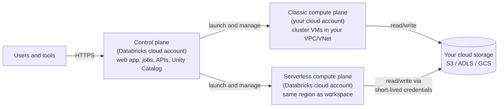

# Control Plane and Compute Plane

Mastery: `INPUT[inlineSelect(option(new), option(learning), option(solid)):mastery]`

> [!story] Previously
> In [[Accounts and Workspaces]] we saw that a workspace creates things in your own cloud account: a bucket, a network, a role. But the web page you log into clearly is not running in your account. So Databricks must be split in two. This note draws the line between the half Databricks runs and the half that touches your data.

> [!eli5] In one breath
> Databricks has a "brain" and "muscles". The brain is the website, the scheduler, and the list of who can do what, and Databricks keeps it in its own cloud. The muscles are the computers that actually read and crunch your data. They either run inside your own cloud account, or Databricks runs them for you in a fenced-off area of its own.

> [!analogy] Analogy: a staffing agency and your kitchen
> - **The control plane** is the agency's head office. It takes your orders, keeps the schedule, and remembers your preferences. It never cooks.
> - **The classic compute plane** is your own kitchen. The agency sends cooks to it, but the stoves, pantry, and doors are yours. You decide the locks.
> - **The serverless compute plane** is the agency's own catering kitchen. You send the order, the food comes back fast, and you never maintain a stove. The agency keeps each client's food separate.
> - **The pantry** is your cloud storage. In both cases the ingredients (your data) stay in your pantry unless you choose otherwise.

## Why it exists

Before managed platforms, you ran everything yourself on [[Apache Hadoop|Hadoop]]: the scheduler, the web UI, the metadata database, and the worker machines, all on your servers. That gave full control but endless maintenance (see [[The Pain of Hadoop]]).

A pure software-as-a-service model ([[SaaS PaaS and IaaS]]) would move everything into the vendor's cloud, data included. Many companies, especially regulated ones, would not accept that.

Databricks split the difference, building on the cloud idea of [[Storage vs Compute|separating storage from compute]]:

- **Databricks runs the management software** (the control plane), so you never patch a scheduler.
- **Your data stays in your cloud storage**, and the machines that process it can run in your own network (classic) or in an isolated Databricks-run network (serverless).

## What it actually is

The official architecture docs describe two planes, and the compute plane comes in two forms.

| | **Control plane** | **Classic compute plane** | **Serverless compute plane** |
|---|---|---|---|
| Who runs it | Databricks | You (in your cloud account), launched by Databricks | Databricks, in its own cloud account |
| What lives there | Web app, notebooks' source, job scheduler, cluster manager, REST APIs, Unity Catalog service, query history | VMs for all-purpose and jobs clusters, classic and pro SQL warehouses | Serverless notebooks, jobs, pipelines, serverless SQL warehouses, model serving |
| Network | Databricks-managed | Your VPC or VNet | A network boundary per workspace, managed by Databricks |
| Isolation | Multi-tenant service | Naturally isolated: it is in your account | Several layers of isolation between customers' workspaces, plus controls between clusters of the same customer |
| You pay | Included in DBUs | DBUs to Databricks plus VM bills to your cloud | DBUs only (infrastructure included) |

Your **storage** sits outside both compute planes: the workspace storage bucket or account, and the cloud storage that holds your Unity Catalog tables. On newer serverless-first setups, Databricks can also provide default storage it manages for you.

## How it works

Three paths of network traffic matter, and the docs name them:

1. **Inbound (front-end):** users, BI tools, and scripts reaching the control plane. You can restrict it with [[IP Access Lists]] and private connectivity ([[AWS PrivateLink]], [[Azure Private Link]], [[Private Service Connect]]).
2. **Classic (control plane ↔ classic compute):** with [[Secure Cluster Connectivity]], cluster VMs have no public IP addresses. They open an outbound connection to the control plane rather than the control plane reaching in.
3. **Outbound from serverless:** serverless compute reaching your storage and other resources. You control it with network connectivity configurations (NCCs), private endpoints, and serverless egress controls. See [[Serverless Network Security]].

A walk-through of one query on classic compute:

1. You run a cell in a notebook. The browser sends the command to the **control plane**.
2. The control plane forwards it to the cluster's driver VM in the **classic compute plane** (in your VPC).
3. The driver asks Unity Catalog (control plane) for permission and a short-lived credential for the table's files.
4. The cluster reads the files directly from **your storage**, computes, and returns results to the control plane, which shows them in your browser.

On serverless, steps 2–4 happen the same way, except the VMs belong to Databricks' serverless fleet instead of your account.

> [!smallbiz] For a small business
> The practical question is "do I want to manage a network?"
> - **Serverless** means no VPC, no subnets, and no VM quotas to think about. Databricks recommends it for most new work, and it is the easiest way to start.
> - **Classic** matters when you need compute inside your own network: for example, reaching an on-premises database over a VPN, or a security rule that says "all processing in our account".
>
> Either way, your tables stay in your own cloud storage. You can mix both: serverless SQL for dashboards and a classic cluster for one special job.

## On each cloud

The model is identical on all three clouds. What changes is the name of "your cloud account" and the network building blocks.

> [!azure]- Azure Databricks
> - The classic compute plane runs in your **Azure subscription**, inside the workspace's [[Managed Resource Group|managed resource group]] or your own VNet with [[VNet Injection]].
> - Secure cluster connectivity is also called **No Public IP (NPIP)** on Azure.
> - Private access to the control plane uses [[Azure Private Link]]. Serverless outbound access to your storage uses NCCs with private endpoints. See [[Network Security Overview]].

> [!aws]- Databricks on AWS
> - The classic compute plane runs in your **AWS account**, in a Databricks-managed VPC or a [[Customer-Managed VPC on AWS]].
> - The control plane launches EC2 instances using the [[Cross-Account IAM Role|cross-account IAM role]].
> - Private connectivity uses [[AWS PrivateLink]] for both front-end and back-end traffic.

> [!gcp]- Databricks on Google Cloud
> - The classic compute plane runs in your **Google Cloud project**, in a Databricks-managed or [[Customer-Managed VPC on Google Cloud|customer-managed VPC]]. Compute runs on Compute Engine VMs (see [[Compute on Google Cloud]]).
> - The docs note that traffic between the control plane and the serverless compute plane always uses the cloud provider's network backbone, not the public internet.
> - Private connectivity uses [[Private Service Connect]].

## Going deeper

> [!deepdive]- Expert notes (301–401)
> - **"Data plane" is the old name.** Older docs and diagrams call the compute plane the *data plane*. Same thing.
> - **What the control plane stores.** Notebook source, job definitions, query text and results caches, and workspace configuration live in the control plane, encrypted. Customer-managed keys can cover managed services data (control plane) and workspace storage separately. See [[Customer-Managed Keys on AWS]], [[Customer-Managed Keys on Azure]], and [[Customer-Managed Keys on Google Cloud]].
> - **Serverless isolation.** Serverless compute runs in the same region as the workspace, inside a per-workspace network boundary. User code on serverless and on standard access mode clusters is isolated by Lakeguard (see [[Compute Types]]).
> - **Egress control.** On classic, outbound traffic follows your VPC's routes and firewalls. On serverless, you restrict outbound internet with serverless network policies and reach private resources through NCC private endpoints. Plan this before a security review, not after.
> - **Regional control planes.** Each cloud region has its own control plane deployment. Control plane IPs and endpoints differ per region, which matters for firewall allowlists.
> - **Compliance.** Hardened setups combine private connectivity, customer-managed keys, and the [[Compliance Security Profile]].

## Common confusions

> [!confusion] "Serverless means my data leaves my account"
> Not by default. Serverless compute runs in Databricks' account, but it reads and writes your tables in *your* storage through short-lived, scoped credentials. What moves is the processing, not where the data lives.

> [!confusion] The control plane does not process your data
> It schedules and manages. The heavy work (reading files, joining tables) happens in a compute plane. Results shown in the UI do pass back through the control plane.

## Recall

What runs in the Databricks control plane?::Backend services Databricks manages: the web app, notebooks' source, job scheduler, cluster manager, REST APIs, and Unity Catalog.
Where does the classic compute plane run?::In the customer's own cloud account (AWS account, Azure subscription, or Google Cloud project), in their VPC or VNet.
Where does the serverless compute plane run?::In Databricks' cloud account, in the same region as the workspace, inside a per-workspace network boundary.
What is the old name for the compute plane?::The data plane.
What does secure cluster connectivity do?::Classic cluster VMs get no public IPs and open outbound connections to the control plane instead of accepting inbound ones.
How do you control outbound traffic from serverless compute to your resources?::With network connectivity configurations (NCCs), private endpoints, and serverless network policies.
With classic compute, who sends you a VM bill?::Your cloud provider, in addition to the Databricks DBU charges.

## Where next

> [!path] Learning path
> **Needs first:** [[Accounts and Workspaces]], [[Storage vs Compute]], [[VPC and VNet]]
> **Unlocks next:** [[Network Security Overview]], [[Serverless Compute]], [[Secure Cluster Connectivity]]

> [!nextup] Up next in the story
> Every classic cluster that the control plane launches boots the same software image. What is in it, and how do you pick a version? See [[Databricks Runtime]].

> [!sources]- Sources (last verified: 2026-10-25)
> - [High-level architecture (AWS)](https://docs.databricks.com/aws/en/getting-started/high-level-architecture)
> - [High-level architecture (Azure Databricks)](https://learn.microsoft.com/en-us/azure/databricks/getting-started/high-level-architecture)
> - [High-level architecture (Google Cloud)](https://docs.databricks.com/gcp/en/getting-started/high-level-architecture)
> - [Network reference architecture overview (AWS)](https://docs.databricks.com/aws/en/security/network/deployment-architecture/)
> - [Network reference architecture overview (Azure Databricks)](https://learn.microsoft.com/en-us/azure/databricks/security/network/deployment-architecture/)
> - [Networking security architecture (Google Cloud)](https://docs.databricks.com/gcp/en/security/network/concepts/architecture)
> - [Networking security architecture (Azure Databricks)](https://learn.microsoft.com/en-us/azure/databricks/security/network/concepts/architecture)
