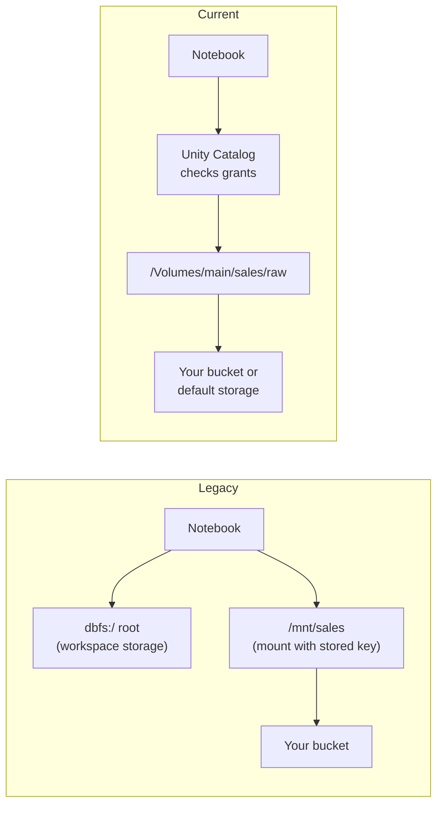

# DBFS

Mastery: `INPUT[inlineSelect(option(new), option(learning), option(solid)):mastery]`

> [!story] Context
> [[Init Scripts]] noted that scripts stored in DBFS have reached end of life. DBFS (the Databricks File System) is the original way Databricks presented cloud storage as a file system. It predates [[Unity Catalog]], and Databricks now deprecates both the DBFS root and DBFS mounts. This note explains what DBFS is so you can recognize it in older code and move off it.

> [!eli5] Summary
> DBFS is an older way of storing and finding files in Databricks. It made cloud storage look like folders on a computer, but it did not control well who could see which files. Databricks now recommends storing files in governed folders called volumes instead.

## Background

Databricks launched before Unity Catalog. Early workspaces needed a place for uploaded files, libraries, job output, and tables, plus a way to read data in the customer's [[Object Storage|object storage]] with file-system paths. DBFS provided both, in the style of [[HDFS]]:

- The DBFS root: a storage location created with each classic workspace, addressed as `dbfs:/`.
- Mounts: shortcuts under `/mnt/` that point to a bucket or container, using credentials stored with the mount.

Neither had per-user access control. Any user on any cluster could read any file in the DBFS root or under a mount. That conflicts with the account-level governance model of Unity Catalog.

## Overview

| Component | Path form | Status | Replacement |
|---|---|---|---|
| DBFS root | `dbfs:/FileStore/...`, `dbfs:/user/hive/warehouse/...` | Deprecated, not recommended | [[Volumes]] for files, [[Managed vs External Tables\|managed tables]] for data |
| DBFS mounts | `dbfs:/mnt/<name>` or `/mnt/<name>` | Deprecated, not compatible with Unity Catalog or serverless compute | [[Storage Credentials and External Locations\|External locations]] and external volumes |
| Init scripts on DBFS | `dbfs:/...` | End of life | Volumes or workspace files (see [[Init Scripts]]) |
| Code and small files in DBFS | `dbfs:/...` | Not recommended | Workspace files (see [[Git Folders and Workspace Files]]) |
| `dbfs:/Volumes/...` | Volume paths with the `dbfs:` scheme | Supported | Same as `/Volumes/...` |

Status as of October 2026:

- Databricks documents DBFS root and DBFS mounts as deprecated. New accounts are provisioned without access to these features.
- Accounts created after December 18, 2025 (Azure Databricks release notes) or December 19, 2025 (AWS legacy features page) have legacy features disabled by default. The same setting also disables the [[Hive Metastore]], no-isolation shared clusters, and Databricks Runtime versions below 13.3 LTS.
- [[Serverless Workspaces and Default Storage|Serverless workspaces]] have limited DBFS access.

## How it works



A legacy mount on Azure looked like this. Recognize it in old code. Do not create new mounts.

```python
# Legacy pattern: do not use for new work
dbutils.fs.mount(
    source="abfss://raw@contosodata.dfs.core.windows.net/",
    mount_point="/mnt/raw",
    extra_configs={
        "fs.azure.account.auth.type": "OAuth",
        "fs.azure.account.oauth.provider.type":
            "org.apache.hadoop.fs.azurebfs.oauth2.ClientCredsTokenProvider",
        "fs.azure.account.oauth2.client.id": "<application-id>",
        "fs.azure.account.oauth2.client.secret":
            dbutils.secrets.get(scope="adls", key="sp-secret"),
        "fs.azure.account.oauth2.client.endpoint":
            "https://login.microsoftonline.com/<tenant-id>/oauth2/token",
    },
)
df = spark.read.csv("/mnt/raw/orders/")
```

The Unity Catalog replacement:

```sql
-- One-time setup by an admin (credential created beforehand)
CREATE EXTERNAL LOCATION raw_landing
  URL 'abfss://raw@contosodata.dfs.core.windows.net/'
  WITH (STORAGE CREDENTIAL contoso_connector);

CREATE EXTERNAL VOLUME main.sales.raw
  LOCATION 'abfss://raw@contosodata.dfs.core.windows.net/';

GRANT READ VOLUME ON VOLUME main.sales.raw TO `analysts`;
```

```python
df = spark.read.csv("/Volumes/main/sales/raw/orders/")
```

### Migrate off DBFS

1. Inventory references to `dbfs:/`, `/dbfs/`, and `/mnt/` in notebooks, jobs, init scripts, and table locations.
2. Move non-tabular files from the DBFS root to volumes.
3. Move code and small configuration files to workspace files.
4. Replace each mount with an external location and, for file access, an external volume.
5. Upgrade tables in `hive_metastore` that live in the DBFS root or under mounts. See [[Hive Metastore Migration to Unity Catalog]].
6. Update code paths to `/Volumes/...` or table names.
7. Disable DBFS root and mounts in the workspace: **Settings**, **Workspace admin**, **Security**.

Jobs, notebooks, or scripts that still reference DBFS root or mounts fail after step 7 until the setting is reverted.

## Small-business considerations

> [!smallbiz] Small-business considerations
> - If you are starting on Databricks now, you can skip DBFS. New accounts do not have it. Use volumes for files and Unity Catalog tables for data.
> - If you inherited an older workspace, search the code for `/mnt/` and `dbfs:/` first. These paths are the main blocker for moving jobs to [[Serverless Compute|serverless compute]].
> - Do not keep production data, libraries, or scripts in the DBFS root. Databricks recommends against it.

## Cloud differences

The DBFS root is stored in a different resource on each cloud.

> [!azure]- Azure Databricks
> - The DBFS root is a Blob storage instance in the workspace storage account, inside the workspace's [[Managed Resource Group|managed resource group]]. The same account holds workspace system data and, in some cases, the Unity Catalog workspace catalog.
> - The storage account is encrypted with Microsoft-managed keys by default. You can use customer-managed keys stored in Azure Key Vault. See [[Customer-Managed Keys on Azure]].
> - Legacy mounts to [[Azure Data Lake Storage]] Gen2 use `abfss://` with OAuth and require hierarchical namespace on the storage account.
> - Mounts that use a secret are not refreshed automatically. A rotated or expired secret causes errors (such as 401 Unauthorized) until you unmount and remount.

> [!aws]- Databricks on AWS
> - The DBFS root lives in the [[Workspace Storage Bucket]], the S3 bucket configured when the classic workspace was created.
> - Legacy mounts point to [[Amazon S3]] buckets. Replace them with [[S3 Access via Unity Catalog|external locations backed by an IAM role]].

> [!gcp]- Databricks on Google Cloud
> - Nothing in the deprecation or migration path differs. Replace mounts to [[Google Cloud Storage]] with [[GCS Access via Unity Catalog|external locations]] that use `gs://` paths.

## Advanced topics

> [!deepdive]- Advanced topics (301–401)
> - Two settings: the account-level **Disable legacy features** setting applies to new workspaces. The workspace-level **Disable DBFS root and mounts** setting applies to existing workspaces.
> - Volume paths through DBFS APIs: volumes remain reachable as `dbfs:/Volumes/...` and as the POSIX path `/Volumes/...`, so tools that expect the `dbfs:` scheme keep working after DBFS root is disabled.
> - Unity Catalog and DBFS root: Databricks recommends not using DBFS root with Unity Catalog except to migrate files and data stored there into Unity Catalog.
> - Mount refresh: on classic compute, a mount created on one cluster becomes visible on other running clusters only after `dbutils.fs.refreshMounts()`.
> - Path schemes: Spark and `dbutils.fs` take URIs such as `dbfs:/...`, while local file APIs on classic compute use the `/dbfs/...` path. Use the form the API expects. For volumes, `/Volumes/...` works with both.
> - Azure storage retirement: Microsoft lists DBFS storage accounts among the legacy Blob Storage accounts it migrates to general-purpose v2 automatically, in waves after the October 13, 2026 retirement date.

## Common misconceptions

> [!confusion] DBFS is not a separate storage system
> DBFS is an abstraction over cloud object storage. The DBFS root is a bucket or storage account; a mount is a pointer to another one.

> [!confusion] `dbfs:/Volumes` is not DBFS root
> A path that starts with `dbfs:/Volumes/` is a Unity Catalog volume, governed by Unity Catalog grants, even though it uses the `dbfs:` scheme.

> [!confusion] Default storage is not the DBFS root
> Default storage in a serverless workspace is Databricks-managed storage governed by Unity Catalog. See [[Serverless Workspaces and Default Storage]].

## Recall

What is DBFS?::The legacy Databricks File System: an abstraction that exposes cloud object storage as `dbfs:/` paths, made up of the DBFS root and mounts.
What is the status of DBFS root and DBFS mounts?::Deprecated and not recommended. New accounts are provisioned without access to them.
What replaces a DBFS mount?::A Unity Catalog external location, plus an external volume for file access.
What replaces non-tabular files in the DBFS root?::Unity Catalog volumes.
Where should code and small files from DBFS go?::Workspace files.
Why are mounts a governance problem?::Any user on any cluster can read files under a mount, using the mount's stored credentials, with no per-user grants.
Where is the DBFS root stored on Azure?::In the workspace storage account in the workspace's managed resource group.
What happens to code that references `/mnt/` after you disable DBFS root and mounts?::It fails until the setting is reverted.
Does `dbfs:/Volumes/...` keep working after DBFS root is disabled?::Yes. It is a Unity Catalog volume path.

## Next steps

> [!path] Learning path
> **Needs first:** [[Object Storage]], [[Accounts and Workspaces]]
> **Unlocks next:** [[Volumes]], [[Storage Credentials and External Locations]], [[Hive Metastore Migration to Unity Catalog]]

> [!nextup] Next
> [[Chapter 07 - Unity Catalog and Governance]] covers the governance layer that replaces DBFS, workspace metastores, and cluster-level credentials.

> [!sources]- Sources (last verified: 2026-10-25)
> - [What is DBFS? (AWS)](https://docs.databricks.com/aws/en/dbfs/)
> - [What is DBFS? (Azure Databricks)](https://learn.microsoft.com/en-us/azure/databricks/dbfs/)
> - [Best practices for DBFS and Unity Catalog (AWS)](https://docs.databricks.com/aws/en/dbfs/unity-catalog)
> - [Disable access to DBFS root and mounts in your existing Databricks workspace (AWS)](https://docs.databricks.com/aws/en/dbfs/disable-dbfs-root-mounts)
> - [Disable access to DBFS root and mounts (Azure Databricks)](https://learn.microsoft.com/en-us/azure/databricks/dbfs/disable-dbfs-root-mounts)
> - [Mounting cloud object storage on Databricks (AWS)](https://docs.databricks.com/aws/en/dbfs/mounts)
> - [Mounting cloud object storage on Azure Databricks](https://learn.microsoft.com/en-us/azure/databricks/dbfs/mounts)
> - [What are the root directories? (AWS)](https://docs.databricks.com/aws/en/dbfs/root-locations)
> - [Recommendations for working with DBFS root (Azure Databricks)](https://learn.microsoft.com/en-us/azure/databricks/dbfs/dbfs-root)
> - [Disable access to legacy features in new workspaces (AWS)](https://docs.databricks.com/aws/en/admin/account-settings/legacy-features)
> - [December 2025 release notes (Azure Databricks)](https://learn.microsoft.com/en-us/azure/databricks/release-notes/product/2025/december)
> - [Customer-managed keys for DBFS root (Azure Databricks)](https://learn.microsoft.com/en-us/azure/databricks/security/keys/customer-managed-keys-dbfs/)
> - [Legacy Blob Storage account retirement overview (Azure Storage)](https://learn.microsoft.com/en-us/azure/storage/common/legacy-blob-storage-account-migration-overview)
> - [Work with files on Databricks (AWS)](https://docs.databricks.com/aws/en/files/)
