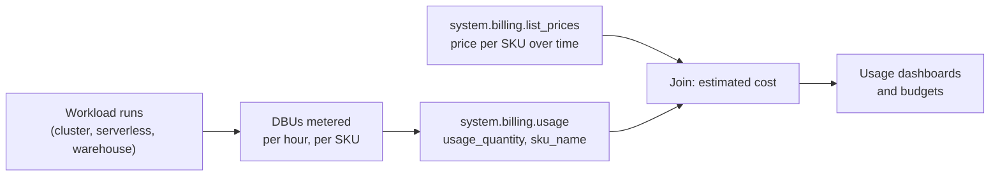

# DBUs

Mastery: `INPUT[inlineSelect(option(new), option(learning), option(solid)):mastery]`

> [!story] Context
> This chapter introduced several kinds of compute, from [[All-Purpose Compute|all-purpose clusters]] to [[Serverless Compute|serverless]] and [[SQL Warehouses|SQL warehouses]]. Each is billed in the same unit: the Databricks Unit, or DBU. Understanding the DBU is the first step to predicting and controlling a Databricks bill.

> [!eli5] Summary
> A DBU is how Databricks counts the work its computers do, similar to how an electricity meter counts kilowatt-hours. Bigger or faster machines use more DBUs per hour. Your bill is the number of DBUs you used multiplied by the price of each one.

> [!analogy]- Analogy: an electricity meter
> | Electricity | Databricks |
> |---|---|
> | Kilowatt-hour | DBU |
> | A heater uses more than a light bulb | Large clusters use more DBUs per hour than small ones |
> | Different tariffs (day, night, business) | Different DBU prices per product, tier, and SKU |
> | Meter reading | `system.billing.usage` |
> | Prepaid energy plan | Committed-use contracts, such as Azure Databricks Commit Units |

## Background

Databricks runs on many cloud VM types, across three clouds, in several product types. A per-VM price list would be large and would change every time a cloud released a new instance. The DBU normalizes this. Each VM type and each serverless size is assigned a DBU rate per hour, and each product (for example, jobs compute or SQL warehouses) has a price per DBU.

## Overview

The Databricks glossary defines a DBU as a normalized unit of processing power on the Databricks platform, used for measurement and pricing purposes.

The number of DBUs a workload consumes depends on:

| Factor | Effect |
|---|---|
| **Compute size** | More or larger nodes (or a larger warehouse size) consume more DBUs per hour |
| **Run time** | DBUs accrue while compute runs, including idle time on classic clusters |
| **Compute type** | All-purpose, jobs, serverless, and SQL warehouses have different DBU rates and prices |
| **Photon** | Enabling [[Photon]] increases the DBU rate on classic compute, and usually shortens run time |
| **Performance mode** | Serverless standard mode consumes fewer DBUs than performance-optimized mode |
| **Pricing tier and cloud** | Prices per DBU vary by tier, cloud, and region |

### What a DBU covers

| Compute | Databricks bill (DBUs) | Cloud provider bill |
|---|---|---|
| **Classic** (all-purpose, jobs, pro and classic warehouses) | Databricks software | VMs, disks, and networking in your cloud account |
| **Serverless** (notebooks, jobs, pipelines, serverless warehouses) | Databricks software and the compute | Storage in your account; serverless networking may appear as separate Databricks charges |

Compare total cost, not DBU price alone. Serverless DBU rates differ from classic rates, but serverless DBUs include the VMs and remove cluster idle time.

Prices are published on the official [Databricks pricing page](https://www.databricks.com/product/pricing). This vault does not list prices because they change and vary by contract. See [[How Databricks Pricing Works]].

## How it works



Every metered record lands in the billable usage [[System Tables|system table]], `system.billing.usage`. Key columns:

| Column | Meaning |
|---|---|
| `usage_quantity` | Number of units consumed |
| `usage_unit` | The unit, `DBU` for most records |
| `sku_name` | The product and tier that sets the price |
| `billing_origin_product` | The product that generated the usage, such as jobs or SQL |
| `usage_metadata` | IDs such as cluster, job, warehouse, or notebook |
| `custom_tags` | Tags from compute or serverless usage policies |

`system.billing.list_prices` keeps a history of list prices for each SKU, with a new record for every price change. Its `usage_unit` can be `DBU`, `DSU`, `HOUR`, or `GB`.

DBUs by product for the last 30 days:

```sql
SELECT
  billing_origin_product,
  sku_name,
  SUM(usage_quantity) AS dbus
FROM system.billing.usage
WHERE usage_unit = 'DBU'
  AND usage_date >= current_date() - INTERVAL 30 DAYS
GROUP BY ALL
ORDER BY dbus DESC;
```

Estimated list cost by joining prices:

```sql
SELECT
  u.sku_name,
  SUM(u.usage_quantity * p.pricing.default) AS est_list_cost
FROM system.billing.usage u
JOIN system.billing.list_prices p
  ON u.sku_name = p.sku_name
 AND u.usage_start_time >= p.price_start_time
 AND (p.price_end_time IS NULL OR u.usage_start_time < p.price_end_time)
WHERE u.usage_date >= current_date() - INTERVAL 30 DAYS
GROUP BY u.sku_name
ORDER BY est_list_cost DESC;
```

List prices exclude negotiated discounts, so this is an estimate.

## Small-business considerations

> [!smallbiz] Small-business considerations
> 1. **Prefer serverless and auto-stop:** Most surprise bills come from classic clusters left running. DBUs accrue while compute runs, whether or not it is busy.
> 2. **Use jobs compute or serverless jobs for scheduled work**, not all-purpose clusters. All-purpose DBUs are priced higher.
> 3. **Tag everything** (`team`, `project`) so that `custom_tags` in `system.billing.usage` shows who spent what. See [[Tagging for Chargeback]].
> 4. **Set a budget** with alerts in the account console. See [[Budgets and Usage Dashboards]].
> 5. **Estimate before you commit:** Run a representative week, sum the DBUs, and multiply by the official prices. See [[Estimating Costs for a Small Business]].

## Cloud differences

> [!azure]- Azure Databricks
> - DBU charges appear on your Azure invoice as "Azure Databricks". Per-cluster detail is in `system.billing.usage`.
> - **Databricks Commit Units (DBCUs)** are a prepurchase plan for 1 or 3 years, bought in the Azure portal. They form a prepaid pool that usage draws down regardless of workload or tier, at each workload's DBU list-price ratio. They cover only DBU charges; VMs, storage, and networking are billed separately.
> - The prepurchase does not need to be assigned to workspaces, and it cannot be split or merged. See [[Azure Billing and Commit Units]].

> [!aws]- Databricks on AWS
> - DBUs are billed by Databricks directly or through AWS Marketplace, depending on how you subscribed, and EC2, EBS, and networking for classic compute are billed by AWS. See [[AWS Marketplace and Billing]].

> [!gcp]- Databricks on Google Cloud
> - DBUs are billed through Google Cloud Marketplace, and Compute Engine resources for classic compute are billed by Google Cloud. See [[Google Cloud Marketplace and Billing]].

## Advanced topics

> [!deepdive]- Advanced topics (301–401)
> - **Several records per workload:** Serverless workloads can produce multiple usage records in the same hour. Sum them to get a run's consumption.
> - **Other units:** Not everything is metered in DBUs. `list_prices` also shows `DSU`, `HOUR`, and `GB`, used by some products that are not metered in DBUs.
> - **Price history:** Joining on `price_start_time` and `price_end_time` gives the price in effect at the time of usage, not today's price.
> - **Photon trade-off:** Photon raises the DBU rate on classic compute but can reduce total DBUs when it shortens run time enough. Measure on your own workloads.
> - **Commit contracts:** Committed-use agreements change the effective price per DBU, not the DBU count. Usage tables still show DBUs consumed.

## Common misconceptions

> [!confusion] A DBU is not a fixed amount of money
> A DBU is a unit of work. Its price depends on the product, tier, cloud, region, and contract.

> [!confusion] The DBU is not the whole bill on classic compute
> On classic compute, your cloud provider also bills you for the VMs. On serverless, the DBU price includes the compute.

> [!confusion] An idle cluster still consumes DBUs
> Classic compute meters DBUs while it is running, even with no queries. Use [[Auto Termination]] and auto stop.

## Recall

What does DBU stand for?::Databricks Unit.
How does Databricks define a DBU?::A normalized unit of processing power used for measurement and pricing.
Which system table records DBU consumption?::`system.billing.usage`.
Which system table holds historical list prices per SKU?::`system.billing.list_prices`.
Which column in `system.billing.usage` holds the number of units consumed?::`usage_quantity`.
On classic compute, what is billed separately from DBUs?::The cloud VMs, disks, and networking, billed by the cloud provider.
What are Azure Databricks Commit Units?::A 1- or 3-year prepurchase pool that DBU usage draws down, covering DBU charges only.
Does enabling Photon change the DBU rate on classic compute?::Yes. It increases the DBU rate, though it often shortens run time.
Which serverless performance mode consumes fewer DBUs?::Standard mode.

## Next steps

> [!path] Learning path
> **Needs first:** [[Compute Types]]
> **Unlocks next:** [[How Databricks Pricing Works]], [[Budgets and Usage Dashboards]], [[Cost Management Basics]], [[Estimating Costs for a Small Business]]

> [!nextup] Next
> [[Libraries and Environments]] covers installing Python packages and pinning dependencies, the last piece needed to run real code on this compute.

> [!sources]- Sources (last verified: 2026-10-25)
> - [Databricks technical terminology glossary (AWS)](https://docs.databricks.com/aws/en/resources/glossary)
> - [Azure Databricks technical terminology glossary (Azure Databricks)](https://learn.microsoft.com/en-us/azure/databricks/resources/glossary)
> - [Databricks pricing](https://www.databricks.com/product/pricing)
> - [Billable usage system table reference (AWS)](https://docs.databricks.com/aws/en/admin/system-tables/billing)
> - [Billable usage system table reference (Azure Databricks)](https://learn.microsoft.com/en-us/azure/databricks/admin/system-tables/billing)
> - [Pricing system table reference (AWS)](https://docs.databricks.com/aws/en/admin/system-tables/pricing)
> - [Monitor the cost of serverless compute (Google Cloud)](https://docs.databricks.com/gcp/en/admin/system-tables/serverless-billing)
> - [Best practices for serverless compute (AWS)](https://docs.databricks.com/aws/en/compute/serverless/best-practices)
> - [Optimize Azure Databricks costs with a prepurchase (Microsoft Cost Management)](https://learn.microsoft.com/en-us/azure/cost-management-billing/reservations/prepay-databricks-reserved-capacity)
> - [Azure Databricks pricing](https://azure.microsoft.com/en-us/pricing/details/databricks/)
> - [Best Practices for Cost Management on Databricks (Databricks blog)](https://www.databricks.com/blog/best-practices-cost-management-databricks)
> - [Attribute usage with serverless usage policies (AWS)](https://docs.databricks.com/aws/en/admin/usage/budget-policies)
