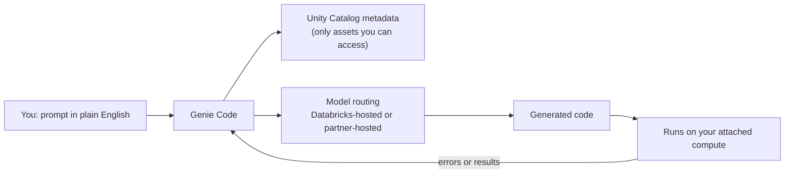

# Databricks Assistant (Genie Code)

Mastery: `INPUT[inlineSelect(option(new), option(learning), option(solid)):mastery]`

> [!story] Context
> [[Notebooks]] are where code gets written. Genie Code is the AI agent inside them, and inside the SQL editor, pipeline editor, and dashboards, that writes, runs, explains, and fixes that code using the context of your tables in [[Unity Catalog]].

> [!eli5] Summary
> Genie Code is a helper built into Databricks that you talk to in plain English. You describe what you want, such as "clean up this sales table and chart it by month," and it writes the instructions for you, runs them, and fixes them when they break.

> [!renamed] Renamed
> **Databricks Assistant** was renamed **Genie Code** on March 11, 2026, when Databricks added expanded agentic capabilities for multi-step data tasks. This note keeps the old filename so existing links work. Older docs, blog posts, and admin settings may still say "Assistant."

> [!analogy]- Analogy: a pair programmer who knows the filing cabinet
> | Pair programmer | Genie Code |
> |---|---|
> | Sits next to you at your desk | Side panel in the notebook, SQL editor, or dashboard |
> | Knows where the company files are | Reads Unity Catalog metadata for tables you can access |
> | Writes a draft for you to review | Generates code into cells |
> | Runs it and reads the error | Agent mode runs cells and debugs failures |
> | Cannot open drawers you are locked out of | Respects your Unity Catalog permissions |

## Background

General AI coding tools do not know your tables, column names, or permissions. Databricks Assistant was introduced to add that context: it reads Unity Catalog metadata so that generated SQL and Python refer to real tables and columns. The 2026 rename to Genie Code reflects a shift from answering one prompt at a time to an [[AI Agent|agent]] that plans and executes multi-step tasks.

## Overview

Genie Code is the developer-facing member of the Genie product family. It is easy to confuse with the business-facing members, so start with the distinction:

| Product | Audience | What it does | Former name |
|---|---|---|---|
| **Genie Code** | Engineers, analysts, data scientists | Generates and runs code, builds pipelines and dashboards, debugs errors | Databricks Assistant |
| **[[Genie\|Genie Agents]]** | Business users, configured by data teams | Answers business questions about curated data in a chat interface | Genie spaces (renamed July 2026) |
| **Genie One** | Business users | Simplified chat interface for business users | |

Genie Code helps build Genie Agents. When you create a Genie Agent, Genie Code launches automatically and suggests context such as table descriptions and example queries.

### Where Genie Code runs

| Surface | Typical use |
|---|---|
| [[Notebooks]] | Generate, explain, fix, and run Python and SQL cells |
| [[SQL Editor]] | Write and optimize queries |
| Lakeflow Pipelines Editor | Build [[Lakeflow Spark Declarative Pipelines\|declarative pipelines]] |
| [[AI-BI Dashboards]] | Analyze data and create dashboards |
| [[MLflow]] | Work with experiments and models |

**Agent mode** is generally available for data science, data engineering, and dashboard authoring. In agent mode, Genie Code plans steps, runs code, reads the results and errors, and iterates.

## How it works

1. You write a request in the Genie Code panel, for example: "Find the top 10 customers by revenue in `sales.orders.daily` for 2026 and plot it."
2. Genie Code reads the metadata of tables you have permission to see in Unity Catalog.
3. It routes the task to a model. Databricks says Genie Code selects among multiple models and tools for each task.
4. It writes code into the notebook or editor. In agent mode it runs the code and fixes errors.
5. You review and accept the result. Generated code runs with your identity, so it cannot read data you are not granted.

### Model hosting and admin controls

| Setting state | Autocomplete | Agentic capabilities |
|---|---|---|
| **Partner-powered AI features on** (default) | Databricks-hosted model | Served by Azure OpenAI Service and Anthropic on Databricks |
| **Partner-powered AI features off** | Databricks-hosted model | Not available. Genie Code still works with a Databricks-hosted model. |

- Account admins can turn partner-powered AI features off for all workspaces or enforce the setting account-wide. Workspace admins can turn it off for their workspace unless the account admin enforces it.
- Databricks states that its model partners do not retain submitted data, even for abuse monitoring, and that partner-powered features use zero data retention endpoints.
- If Genie Code cannot be enabled, the account setting **Enforce data processing within workspace Geography for AI features** may need to be disabled.

## Small-business considerations

> [!smallbiz] Small-business considerations
> Genie Code is most valuable on a team with one data person, because it shortens the time spent looking up syntax and debugging.
> 1. **Add table and column comments in Unity Catalog.** Genie Code uses that metadata, so good descriptions produce better code.
> 2. **Review before running in production.** Treat generated code as a draft, and test it as you would a colleague's code. Models can [[Hallucination|hallucinate]].
> 3. **Check the billing model.** Azure Databricks docs state that starting July 8, 2026, Genie Code is billed pay-as-you-go with a per-user free monthly allowance. Monitor usage in the first month. See [[How Databricks Pricing Works]].
> 4. **Decide on partner-hosted models** with whoever owns compliance. The setting is on by default.

## Cloud differences

> [!azure]- Azure Databricks
> - Agentic capabilities use Azure OpenAI Service and Anthropic on Databricks when partner-powered AI features are enabled.
> - The Azure Databricks docs carry the pay-as-you-go billing note (from July 8, 2026), with a per-user free monthly allowance.

> [!aws]- Databricks on AWS
> - Same feature set and admin controls. The AWS docs list compliance-standard rules for the Databricks-hosted fallback that differ in detail from the Google Cloud page; check the partner-powered AI features page for your compliance profile.

> [!gcp]- Databricks on Google Cloud
> - Genie Code is documented for Google Cloud with the same admin controls. Check the Google Cloud partner-powered AI features page for the compliance rules that apply.

## Advanced topics

> [!deepdive]- Advanced topics (301–401)
> - **Context quality drives output quality.** Unity Catalog comments, tags, and [[Metric Views]] give Genie Code business meaning that column names alone do not.
> - **Governance is inherited.** Genie Code sees only metadata the user can access, and generated code runs as the user. No separate permission model exists.
> - **Unattended use.** Databricks has described running Genie Code as a [[Lakeflow Jobs]] task and from a terminal CLI. The status of these surfaces was not confirmed in official docs for this note; treat them as preview features.
> - **Data residency.** Workspaces with strict geography requirements must reconcile the data-processing-geography setting with partner-hosted models.

## Common misconceptions

> [!confusion] Genie Code is not Genie
> **Genie Code** (formerly Databricks Assistant) is for people who write code. **[[Genie]]**, through Genie Agents (formerly Genie spaces), is for business users who ask questions of curated data without writing code.

> [!confusion] Genie Code does not bypass permissions
> It cannot read tables or columns that you cannot read. Generated code runs under your identity.

> [!confusion] Turning off partner-powered AI does not remove Genie Code
> It removes the agentic capabilities. Genie Code continues to work with a Databricks-hosted model.

## Recall

What is the current name of Databricks Assistant?::Genie Code (renamed March 11, 2026).
What is the difference between Genie Code and Genie Agents?::Genie Code helps developers write and run code; Genie Agents (formerly Genie spaces) let business users ask questions of curated data.
Name three surfaces where Genie Code runs.::Notebooks, the SQL editor, the Lakeflow Pipelines Editor, AI/BI dashboards, and MLflow (any three).
What does agent mode add?::Genie Code plans multi-step tasks, runs code, reads results and errors, and iterates.
What happens when partner-powered AI features are turned off?::Agentic capabilities are unavailable, but Genie Code still works with a Databricks-hosted model.
Is the partner-powered AI features setting on or off by default?::On.
Can Genie Code read a table you have no grant on?::No. It uses only metadata you can access and runs code as you.

## Next steps

> [!path] Learning path
> **Needs first:** [[Notebooks]], [[Unity Catalog]]
> **Unlocks next:** [[Genie]], [[AI-BI Dashboards]], [[Lakeflow Spark Declarative Pipelines]]

> [!nextup] Next
> [[Git Folders and Workspace Files]] covers putting notebooks and code under Git version control.

> [!sources]- Sources (last verified: 2026-10-25)
> - [Genie Code (AWS)](https://docs.databricks.com/aws/en/genie-code/)
> - [Genie Code (Google Cloud)](https://docs.databricks.com/gcp/en/genie-code/)
> - [Genie Code (Azure Databricks)](https://learn.microsoft.com/en-us/azure/databricks/genie-code/)
> - [Genie Code features and capabilities (Azure Databricks)](https://learn.microsoft.com/en-us/azure/databricks/genie-code/use-genie-code)
> - [Use Genie Code (AWS)](https://docs.databricks.com/aws/en/notebooks/use-databricks-assistant)
> - [March 2026 release notes (AWS)](https://docs.databricks.com/aws/en/release-notes/product/2026/march)
> - [Introducing Genie Code (Databricks blog)](https://www.databricks.com/blog/introducing-genie-code)
> - [Databricks Launches Genie Code (Databricks press release)](https://www.databricks.com/company/newsroom/press-releases/databricks-launches-genie-code-bringing-agentic-engineering-data)
> - [Partner-powered AI features (AWS)](https://docs.databricks.com/aws/en/databricks-ai/partner-powered)
> - [Partner-powered AI features (Azure Databricks)](https://learn.microsoft.com/en-us/azure/databricks/databricks-ai/partner-powered)
> - [Partner-powered AI features (Google Cloud)](https://docs.databricks.com/gcp/en/databricks-ai/partner-powered)
> - [Databricks AI assistive features (AWS)](https://docs.databricks.com/aws/en/databricks-ai/)
> - [Genie (AWS)](https://docs.databricks.com/aws/en/genie/)
> - [Create and manage a Genie Agent (AWS)](https://docs.databricks.com/aws/en/genie-agents/set-up)
> - [July 2026 release notes (AWS)](https://docs.databricks.com/aws/en/release-notes/product/2026/july)
