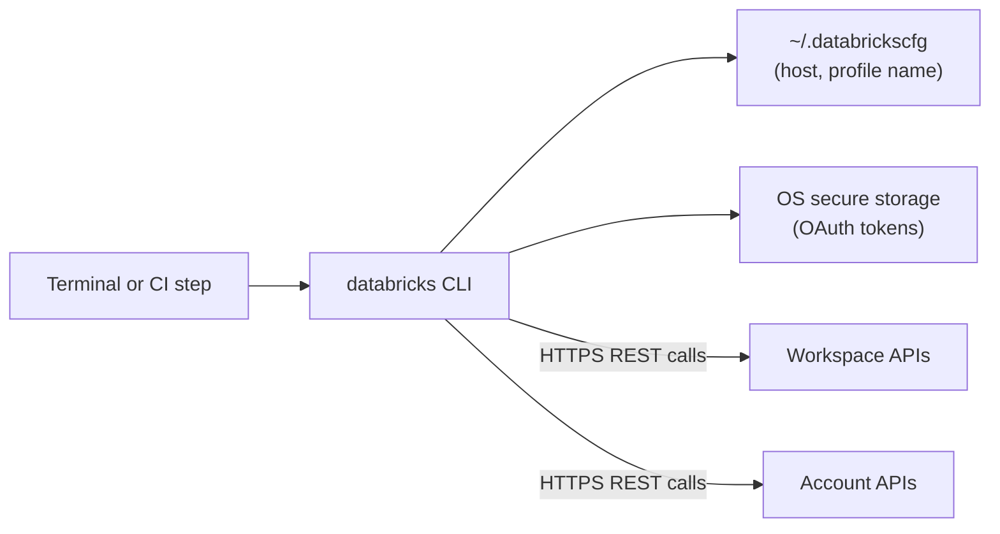

# Databricks CLI

Mastery: `INPUT[inlineSelect(option(new), option(learning), option(solid)):mastery]`

> [!story] Context
> [[Declarative Automation Bundles]] are deployed with `databricks bundle deploy`. That command belongs to the Databricks CLI, a single binary that also covers clusters, jobs, warehouses, Unity Catalog, identities, and nearly every other workspace and account API.

> [!eli5] Summary
> The Databricks CLI lets you control Databricks by typing short commands in a terminal instead of clicking through the website. Because commands can be saved in a script, the same steps can run again later without a person doing them.

> [!analogy]- Analogy: a TV remote with a macro button
> | Remote | Databricks CLI |
> |---|---|
> | Buttons for each channel | Command groups (`clusters`, `jobs`, `bundle`) |
> | Pairing the remote with the TV | `databricks auth login` |
> | Saved favorites for different TVs | Profiles in `~/.databrickscfg` |
> | Macro button | A shell script or CI step |

## Background

Databricks has published a CLI for years. The original Python-based tool is now called the **legacy Databricks CLI** (versions 0.18 and below) and used `databricks configure`. The current CLI is a new tool distributed as a standalone binary, starting at version 0.205.0 and now numbered 1.x. It adds unified authentication, bundles, and command groups generated from the REST API, so it stays in step with new features. The two share the command name `databricks`, so check which one is on your path.

## Overview

| Area | Example command groups |
|---|---|
| Authentication | `auth` (`login`, `logout`, `profiles`, `switch`, `describe`, `token`) |
| Compute | `clusters`, `cluster-policies`, `instance-pools`, `warehouses` |
| Jobs and pipelines | `jobs`, `pipelines` |
| Unity Catalog | `catalogs`, `schemas`, `tables`, `grants`, `volumes` |
| Identity and access | `users`, `groups`, `service-principals` |
| Workspace content | `workspace`, `repos`, `fs` |
| Projects | `bundle` |
| Any REST endpoint | `api` |

Run `databricks -h` for the full list, or `databricks <group> -h` for one group.

## How it works



### Install

| Platform | Command |
|---|---|
| macOS or Linux (Homebrew) | `brew tap databricks/tap`, then `brew install databricks` |
| Windows (WinGet) | `winget install Databricks.DatabricksCLI` |
| Linux, macOS, or WSL (curl) | `curl -fsSL https://raw.githubusercontent.com/databricks/setup-cli/main/install.sh \| sh` |

Homebrew 6.0.0 requires third-party taps to be trusted. Either run `brew trust databricks/tap` after tapping, or install directly with `brew install databricks/tap/databricks`. Chocolatey is also listed as an option.

Verify the install:

```bash
databricks -v    # must print 0.205.0 or later; 0.18 or earlier is the legacy CLI
```

### Authenticate

The default method is OAuth user-to-machine (U2M) login in the browser:

```bash
# Workspace-level login; creates or updates a profile
databricks auth login --host https://<workspace-url> --profile dev

# Account-level login (add your account ID)
databricks auth login --host <account-console-url> --account-id <account-id>

databricks auth profiles        # list profiles and whether each is valid
databricks auth switch          # choose the default profile
databricks auth describe        # show who you are and how you authenticated
```

- Profiles are stored in `~/.databrickscfg`. Override the path with the `DATABRICKS_CONFIG_FILE` environment variable.
- For U2M, OAuth tokens are kept in the operating system's secure storage. The config file holds only non-secret values such as the host and profile name.
- Select a profile per command with `-p` or `--profile`.
- `databricks auth logout` clears cached tokens. Add `--delete` to remove the profile as well.
- For automation, use OAuth machine-to-machine with a [[Users Groups and Service Principals|service principal]]. On Azure, Azure CLI and managed identity authentication are also supported.

### Everyday commands

```bash
databricks clusters list -p dev
databricks jobs list --output json
databricks jobs run-now 123456
databricks warehouses list
databricks fs cp ./data.csv dbfs:/Volumes/main/raw/files/data.csv
databricks api get /api/2.2/jobs/list     # call any REST endpoint directly
```

## Small-business considerations

> [!smallbiz] Small-business considerations
> 1. **Install the CLI on the laptop of whoever owns the platform.** It makes bulk tasks (listing clusters, checking jobs) faster than the UI.
> 2. **Create one profile per workspace,** such as `dev` and `prod`, and always pass `-p` in scripts.
> 3. **Do not paste personal access tokens into scripts.** Use `databricks auth login` locally and a service principal with OAuth in CI.
> 4. **Use the CLI to run bundle commands** once you adopt [[Declarative Automation Bundles]].

## Cloud differences

> [!azure]- Azure Databricks
> - In addition to Databricks OAuth, the CLI supports Azure CLI authentication, Microsoft Entra ID service principals, and Azure managed identities.
> - Workspace URLs look like `https://adb-<id>.<n>.azuredatabricks.net`.

> [!aws]- Databricks on AWS
> - Uses Databricks OAuth (U2M or M2M) or personal access tokens. Workspace URLs typically end in `cloud.databricks.com`.

> [!gcp]- Databricks on Google Cloud
> - Uses Databricks OAuth or tokens, and Google Cloud identity options documented for the CLI. Workspace URLs typically end in `gcp.databricks.com`.

## Advanced topics

> [!deepdive]- Advanced topics (301–401)
> - **Unified authentication.** The CLI, the [[Databricks SDKs and REST API|SDKs]], and the Terraform provider read the same `~/.databrickscfg` profiles and environment variables (`DATABRICKS_HOST`, `DATABRICKS_CLIENT_ID`, `DATABRICKS_CLIENT_SECRET`). Configure once, use everywhere.
> - **Generated commands.** Most command groups map one to one onto REST API operations. Complex request bodies are passed with `--json '{...}'` or `--json @file.json`.
> - **`databricks api`.** A raw escape hatch for any endpoint, useful for new APIs before you learn their dedicated command.
> - **Legacy migration.** Scripts that use `databricks configure --token` or legacy command syntax need updating. The legacy CLI is archived.

## Common misconceptions

> [!confusion] There are two different `databricks` CLIs
> The legacy Python CLI (0.18 and below) and the current CLI (0.205 and above, now 1.x) share a command name but differ in syntax and authentication. Check the version before following a tutorial.

> [!confusion] The config file does not hold OAuth secrets
> With `databricks auth login`, tokens live in the OS secure store. `~/.databrickscfg` holds the host and profile name.

## Recall

What is the minimum version number of the current (non-legacy) Databricks CLI?::0.205.0.
Which versions are the legacy Databricks CLI?::0.18 and below.
How do you log in to a workspace with the CLI?::`databricks auth login --host <workspace-url>`.
Where are CLI profiles stored by default?::`~/.databrickscfg`.
Which environment variable changes the config file path?::`DATABRICKS_CONFIG_FILE`.
Where does U2M login store OAuth tokens?::In the operating system's secure storage.
How do you choose a profile for one command?::Add `-p <profile>` or `--profile <profile>`.
Which command group calls any REST endpoint directly?::`databricks api`.
How do you install the CLI on Windows with WinGet?::`winget install Databricks.DatabricksCLI`.

## Next steps

> [!path] Learning path
> **Needs first:** [[Accounts and Workspaces]], [[Authentication - Tokens and OAuth]]
> **Unlocks next:** [[Declarative Automation Bundles]], [[Databricks SDKs and REST API]], [[CI-CD for Data Pipelines]]

> [!nextup] Next
> [[Databricks SDKs and REST API]] covers the same operations from Python, Java, Go, and plain HTTP, for when a script outgrows shell commands.

> [!sources]- Sources (last verified: 2026-10-25)
> - [Install or update the Databricks CLI (AWS)](https://docs.databricks.com/aws/en/dev-tools/cli/install)
> - [Install or update the Databricks CLI (Azure Databricks)](https://learn.microsoft.com/en-us/azure/databricks/dev-tools/cli/install)
> - [Databricks CLI tutorial (AWS)](https://docs.databricks.com/aws/en/dev-tools/cli/tutorial)
> - [Databricks CLI tutorial (Azure Databricks)](https://learn.microsoft.com/en-us/azure/databricks/dev-tools/cli/tutorial)
> - [Authentication for the Databricks CLI (AWS)](https://docs.databricks.com/aws/en/dev-tools/cli/authentication)
> - [Authentication for the Databricks CLI (Azure Databricks)](https://learn.microsoft.com/en-us/azure/databricks/dev-tools/cli/authentication)
> - [auth command group (AWS)](https://docs.databricks.com/aws/en/dev-tools/cli/reference/auth-commands)
> - [auth command group (Google Cloud)](https://docs.databricks.com/gcp/en/dev-tools/cli/reference/auth-commands)
> - [Databricks CLI commands (AWS)](https://docs.databricks.com/aws/en/dev-tools/cli/commands)
> - [Legacy Databricks CLI (Azure Databricks)](https://learn.microsoft.com/en-us/azure/databricks/archive/dev-tools/cli/)
