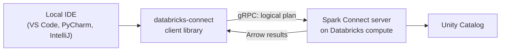

# Databricks Connect

Mastery: `INPUT[inlineSelect(option(new), option(learning), option(solid)):mastery]`

> [!story] Context
> The [[Databricks SDKs and REST API|SDKs]] manage Databricks resources from your own machine. Databricks Connect does the same for data code: you write [[PySpark]] or Scala in a local IDE, and the DataFrame work executes on Databricks compute. It is the Databricks extension of open-source [[Spark Connect]].

> [!eli5] Summary
> Databricks Connect lets you write data code on your own laptop, in the editor you already like, while the heavy work happens on Databricks computers. You get your own tools, such as step-by-step debugging, and Databricks handles the large data.

> [!analogy]- Analogy: a remote control for a factory
> | Factory | Databricks Connect |
> |---|---|
> | Control panel in your office | Local IDE running your Python or Scala |
> | Instructions sent to the factory | Unresolved logical plans over gRPC |
> | The factory floor | Databricks cluster or serverless compute |
> | Finished goods shipped back | Results returned as Apache Arrow data on `collect()` or `show()` |

## Background

Developers prefer local IDEs for refactoring, debugging, unit tests, and Git. Notebooks in the browser are good for exploration but weaker for software engineering. An earlier Databricks Connect for Databricks Runtime 12.2 LTS and below used a different architecture and is now legacy. Apache Spark 3.4 introduced Spark Connect, a client-server protocol for Spark. Databricks Connect for Runtime 13.3 LTS and above is built on it.

## Overview

| Aspect | Detail |
|---|---|
| Languages | Python, Scala, and R |
| Protocol | Spark Connect: unresolved logical plans and Apache Arrow over gRPC |
| Targets | Classic clusters and [[Serverless Compute\|serverless compute]] |
| Runtimes | Databricks Runtime 13.3 LTS and above (older runtimes use the legacy client) |
| Latest major version | 19 (19.0.0 for Python released July 31, 2026, adding Databricks Runtime 19 support; 19.1 on August 14, 2026) |
| IDE integration | The Databricks extension for VS Code sets up a matching local environment and debugging |

### What runs where

| Runs locally | Runs on Databricks |
|---|---|
| Your Python or Scala code, control flow, local libraries | DataFrame transformations and Spark SQL |
| Debugger breakpoints | Reads and writes of Unity Catalog tables |
| Results after `collect()`, `show()`, `toPandas()` | Joins, aggregations, and shuffles |

## How it works



DataFrame code is [[Lazy Evaluation|lazy]]: transformations build a plan on the client, and nothing executes until an action such as `show()` sends it to the server.

### Set up for Python

1. Authenticate with the [[Databricks CLI]]: `databricks auth login --host https://<workspace-url>`.
2. Create a virtual environment with a Python version that matches the target compute. Databricks Connect 18.0 through 19.0 require Python 3.12 for cluster compute.
3. Install a client version that matches the target: `pip install "databricks-connect==19.0.*"`.
4. Create a session in code.

```python
from databricks.connect import DatabricksSession

# Option A: explicit serverless
spark = DatabricksSession.builder.serverless().getOrCreate()

# Option B: use the DEFAULT profile in ~/.databrickscfg.
# Set cluster_id there for a cluster, or serverless_compute_id = auto for serverless.
# spark = DatabricksSession.builder.getOrCreate()

df = spark.read.table("samples.nyctaxi.trips")
df.groupBy("pickup_zip").count().orderBy("count", ascending=False).show(5)
```

Example `~/.databrickscfg` profile for serverless:

```ini
[DEFAULT]
host = https://<workspace-url>
serverless_compute_id = auto
```

### Version matching

Each serverless environment version pairs with a Databricks Connect major version. Environment version 5 includes Databricks Connect 18. Environment version 6 (September 3, 2026) includes Databricks Connect 19 with Python 3.12.3. For clusters, match the client's major and minor version to the cluster's Databricks Runtime version.

## Small-business considerations

> [!smallbiz] Small-business considerations
> Databricks Connect is optional for a small team. Notebooks cover most needs.
> 1. **Adopt it when you write tested Python packages,** for example shared cleaning functions with unit tests (see [[Testing Data Pipelines]]).
> 2. **Target serverless compute** so that no cluster stays on between debugging sessions.
> 3. **Use the VS Code extension** to avoid managing Python and package versions by hand.

## Cloud differences

> [!azure]- Azure Databricks, AWS, and Google Cloud
> Databricks Connect works the same way on all three clouds. Only the workspace host and authentication options differ (for example Microsoft Entra ID or Azure CLI authentication on Azure). See [[Databricks CLI]] for the authentication setup on each cloud.

## Advanced topics

> [!deepdive]- Advanced topics (301–401)
> - **Spark Connect API surface only.** Like serverless notebooks, Databricks Connect supports DataFrame and SQL APIs, not RDDs or direct `SparkContext` access.
> - **Debugging limits.** You can step through your own code locally, but you cannot debug the Spark engine on the server.
> - **Databricks Utilities.** Databricks Connect for Python exposes a subset of `dbutils` (such as file system and secrets) through the Databricks SDK's `WorkspaceClient`.
> - **Scala.** Databricks Connect 17 for Scala works only with Spark 4 and Scala 2.13.
> - **Apps.** [[Databricks Apps]] can use Databricks Connect to query data from a local development server before deployment.
> - **User-defined functions.** Python UDFs defined locally are serialized and executed on the server, so the server environment must have their dependencies.

## Common misconceptions

> [!confusion] Your laptop does not process the data
> Only your client code and final results run locally. Joins and aggregations run on Databricks compute.

> [!confusion] Databricks Connect is not the SDK
> The SDK manages resources such as clusters and jobs. Databricks Connect runs Spark DataFrame code.

> [!confusion] The legacy client is a different product
> Databricks Connect for Runtime 12.2 LTS and below used an older design. Tutorials that mention `databricks-connect configure` refer to it.

## Recall

What open-source protocol is Databricks Connect built on?::Spark Connect.
Which languages does Databricks Connect support?::Python, Scala, and R.
What does Spark Connect send from client to server?::Unresolved logical plans over gRPC, with results returned as Apache Arrow.
How do you create a serverless session in Python?::`DatabricksSession.builder.serverless().getOrCreate()`.
Which config setting routes a default session to serverless?::`serverless_compute_id = auto` in the profile.
When was Databricks Connect 19.0.0 for Python released?::July 31, 2026.
Which Databricks Runtime versions use the current (Spark Connect based) client?::13.3 LTS and above.
Which serverless environment version includes Databricks Connect 19?::Environment version 6.

## Next steps

> [!path] Learning path
> **Needs first:** [[Spark Connect]], [[PySpark]], [[Databricks CLI]]
> **Unlocks next:** [[Testing Data Pipelines]], [[Databricks Apps]], [[CI-CD for Data Pipelines]]

> [!nextup] Next
> [[DBUs]] covers the Databricks Unit, the meter that every compute choice in this chapter is billed in.

> [!sources]- Sources (last verified: 2026-10-25)
> - [Databricks Connect (AWS)](https://docs.databricks.com/aws/en/dev-tools/databricks-connect)
> - [Databricks Connect (Azure Databricks)](https://learn.microsoft.com/en-us/azure/databricks/dev-tools/databricks-connect/)
> - [Databricks Connect usage requirements (AWS)](https://docs.databricks.com/aws/en/dev-tools/databricks-connect/requirements)
> - [Databricks Connect usage requirements (Google Cloud)](https://docs.databricks.com/gcp/en/dev-tools/databricks-connect/requirements)
> - [Databricks Connect release notes (AWS)](https://docs.databricks.com/aws/en/release-notes/dbconnect/)
> - [Databricks Connect release notes (Azure Databricks)](https://learn.microsoft.com/en-us/azure/databricks/release-notes/dbconnect/)
> - [Compute configuration for Databricks Connect (AWS)](https://docs.databricks.com/aws/en/dev-tools/databricks-connect/cluster-config)
> - [Tutorial: Run Python code on serverless compute (AWS)](https://docs.databricks.com/aws/en/dev-tools/databricks-connect/python/tutorial-serverless)
> - [Databricks Utilities with Databricks Connect for Python (AWS)](https://docs.databricks.com/aws/en/dev-tools/databricks-connect/python/databricks-utilities)
> - [Tutorial: Develop a Databricks app locally with Databricks Connect (AWS)](https://docs.databricks.com/aws/en/dev-tools/databricks-connect/python/tutorial-apps)
> - [Debug code using Databricks Connect for the Databricks IDE extension (AWS)](https://docs.databricks.com/aws/en/dev-tools/vscode-ext/databricks-connect)
> - [Limitations with Databricks Connect for Scala (AWS)](https://docs.databricks.com/aws/en/dev-tools/databricks-connect/scala/limitations)
> - [Databricks Connect for Databricks Runtime 12.2 LTS and below (AWS)](https://docs.databricks.com/aws/en/dev-tools/databricks-connect-legacy)
> - [Environment versions (AWS)](https://docs.databricks.com/aws/en/release-notes/serverless/environment-version/)
