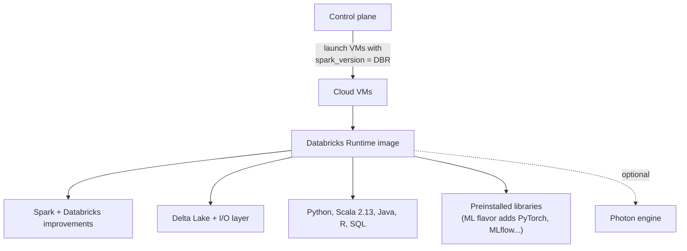

# Databricks Runtime

Mastery: `INPUT[inlineSelect(option(new), option(learning), option(solid)):mastery]`

> [!story] Context
> In [[Control Plane and Compute Plane]], the control plane launches virtual machines into the compute plane. A bare VM has no data software installed. The Databricks Runtime turns it into a Spark node with a tested Python version, Delta Lake version, and Databricks performance improvements.

> [!eli5] Summary
> The Databricks Runtime is the software package that every Databricks computer starts with. It bundles the data engine, the programming languages, and hundreds of common tools, all tested together. You pick a version number when you create a cluster, similar to choosing which version of an app to install.

> [!analogy]- Analogy: a pre-built PC
> | PC | Databricks Runtime |
> |---|---|
> | Box of parts you select and test yourself | Open-source [[Apache Spark]] |
> | Pre-built, tested PC with tuned drivers | The Databricks Runtime |
> | Model year; a model the maker repairs for three years | Version number; an **LTS** version |
> | Edition with extra creative software preinstalled | The ML runtime (PyTorch, scikit-learn, [[MLflow]]) |

## Background

When you run Spark yourself, you choose versions of Spark, Scala, Java, Python, Hadoop connectors, Delta Lake, and every Python package, and you are responsible for their compatibility. A small mismatch, such as a library built for the wrong Scala version, breaks a job at run time.

The Databricks Runtime (DBR) removes that problem:

- Everything in one version is **tested together**.
- It includes **Databricks-only improvements** to Spark and Delta (faster I/O, caching, [[Photon]]).
- It has a **clear support lifecycle**, so you know how long a version gets security fixes.

## Overview

A Databricks Runtime version is a machine image plus software stack that classic compute boots. Each version includes:

- **Apache Spark**, with Databricks improvements (Runtime 19 is built on Spark 4.2.0, Runtime 18 LTS on Spark 4.1.0).
- **Delta Lake** and the Databricks I/O layer.
- **Languages:** Python, [[Scala]] (Runtime 17 and later support only Scala 2.13), Java ([[JVM]]), SQL, and R.
- **System libraries** on Ubuntu, and a large set of preinstalled Python, Java, Scala, and R packages.
- **Optional [[Photon]]**, the native query engine, turned on per cluster.

There are two main flavors:

| Flavor | What is added | Use it for |
|---|---|---|
| **Databricks Runtime** | The standard stack | Data engineering, SQL, general Python |
| **Databricks Runtime for Machine Learning** (DBR ML) | ML libraries such as PyTorch, TensorFlow, scikit-learn, XGBoost, plus [[MLflow]]; GPU builds for [[AI Runtime]] | Training and experimentation |

### Versions and support (as of October 2026)

Databricks' release lifecycle runs from **Beta**, to **GA** for roughly six months of feature development, to **LTS** (long-term support) with **three years** of stability and security fixes.

| Version | Spark | Status | End of support |
|---|---|---|---|
| **19** | 4.2.0 | GA since July 23, 2026 (Beta from June 15, 2026) | Not yet set |
| **18 LTS** | 4.1.0 | LTS (listed June 10, 2026) | June 10, 2029 |
| **17.3 LTS** | 4.0 | LTS | October 22, 2028 |
| **16.4 LTS** | 3.5 | LTS | May 9, 2028 |
| **15.4 LTS** | 3.5 | LTS | August 19, 2027 |
| **14.3 LTS** | 3.5 | LTS | February 1, 2027 |

Recent changes:

- **One release line per major version.** From Runtime 18 onward, Databricks documents a major version on one page that collects all features shipped during its release cycle, instead of a separate page per minor version.
- **Java 21.** Runtime 18 defaults to JDK 21 instead of JDK 17, with a fallback to JDK 17 for compatibility problems.

## How it works



You choose the runtime with the `spark_version` field when you create compute. The value is a version key such as `17.3.x-scala2.13`. List the keys your workspace offers with the [[Databricks CLI]]:

```bash
# List the runtime versions available in this workspace
databricks clusters spark-versions -o json | jq -r '.versions[] | "\(.key)\t\(.name)"' | grep LTS
```

A cluster definition for a jobs cluster, pinned to an LTS runtime with Photon (cloud node types differ, see below):

```json
{
  "cluster_name": "nightly-etl",
  "spark_version": "17.3.x-scala2.13",
  "runtime_engine": "PHOTON",
  "node_type_id": "i3.xlarge",
  "num_workers": 2,
  "data_security_mode": "USER_ISOLATION"
}
```

`data_security_mode: USER_ISOLATION` is the API name for *standard* access mode (see [[Compute Types]]).

To check the version from Python on a running cluster:

```python
spark.version                                    # Spark version, e.g. '4.0.0'
spark.conf.get("spark.databricks.clusterUsageTags.sparkVersion")  # DBR key
```

### Choosing a version

- **Production jobs:** the newest **LTS** that your libraries support. You get three years of fixes without unexpected behavior changes.
- **Exploration and new features:** the newest GA version.
- **Upgrades:** read the "behavioral changes" section of the release notes. For example, Runtime 19 makes Python UDFs use Arrow-based serialization by default, which can change type handling in some UDFs.

## Small-business considerations

> [!smallbiz] Small-business considerations
> [[Serverless Compute]] and [[SQL Warehouses]] select and upgrade the runtime for you, which is the simplest option for a small team. If you run classic clusters, **pin your scheduled jobs to an LTS version** and set a calendar reminder a few months before it reaches end of support.

## Cloud differences

> [!azure]- Azure Databricks
> Runtime versions and support dates are the same as on the other clouds. Node types are Azure VM sizes, for example `Standard_D4ds_v5`. Release notes are mirrored on Microsoft Learn.

> [!aws]- Databricks on AWS
> Same versions. Node types are EC2 instance types, for example `i3.xlarge` or Graviton types (see [[EC2 Instance Types and Graviton]]). Graviton support depends on the runtime version and features, so check the docs.

> [!gcp]- Databricks on Google Cloud
> Same versions. Node types are Compute Engine machine types, for example `n2-highmem-4`. See [[Compute on Google Cloud]].

## Advanced topics

> [!deepdive]- Advanced topics (301–401)
> - **Maintenance updates.** Within a version, Databricks ships maintenance updates (security patches and bug fixes) automatically when a cluster restarts. Long-running clusters do not pick them up until they restart.
> - **Serverless uses runtime versions managed by Databricks.** Serverless compute tracks recent runtime code (serverless releases in August–September 2026 included updates from Runtime 19). You pin a client-side *environment version* instead of a runtime. See [[Serverless Compute]] and [[Libraries and Environments]].
> - **Databricks Connect matches the runtime.** The [[Databricks Connect]] package version should match the runtime major/minor version of the cluster it talks to.
> - **Scala 2.13 only from 17.** JARs compiled for Scala 2.12 must be rebuilt for Runtime 17 and later.
> - **Standard access mode restrictions.** In Runtime 19, several Spark configuration properties are restricted on standard access mode clusters, and creating a cluster that sets them fails.
> - **End of support.** After end of support, a version gets no fixes and is eventually removed from the version list. Jobs pinned to it must be upgraded.
> - **Custom images.** Databricks Container Services lets you boot a custom Docker image on classic compute. It is rarely needed now that environments and init scripts in volumes cover most cases.

## Common misconceptions

> [!confusion] DBR version is not the Spark version
> Runtime 18 LTS runs Spark 4.1.0. The DBR number tracks Databricks' release, and each one maps to a Spark version listed in its release notes.

> [!confusion] "LTS" does not mean "newest"
> LTS means long-term support. The newest version may not be LTS yet. Pick LTS for stability and the newest GA for features.

## Recall

What is the Databricks Runtime?::The tested software image (Spark, Delta Lake, languages, libraries, optional Photon) that classic Databricks compute boots.
How long is an LTS runtime supported?::Three years.
Which Spark version does Databricks Runtime 18 LTS use?::Apache Spark 4.1.0.
Which Spark version does Databricks Runtime 19 use?::Apache Spark 4.2.0.
Which Scala version do Runtime 17 and later support?::Scala 2.13 only.
What does DBR ML add?::Machine learning libraries such as PyTorch, TensorFlow, scikit-learn, XGBoost, and MLflow, with GPU builds.
Which cluster field selects the runtime?::`spark_version`, for example `17.3.x-scala2.13`.
Which runtime should production jobs use?::The newest LTS version your libraries support.
Which JDK does Runtime 18 use by default?::JDK 21.

## Next steps

> [!path] Learning path
> **Needs first:** [[Apache Spark]], [[Control Plane and Compute Plane]]
> **Unlocks next:** [[Photon]], [[Compute Types]], [[Libraries and Environments]]

> [!nextup] Next
> [[Photon]] covers the C++ execution engine that Databricks built to replace Spark's [[JVM]]-based execution for supported operations.

> [!sources]- Sources (last verified: 2026-10-25)
> - [Databricks Runtime release notes versions and compatibility (AWS)](https://docs.databricks.com/aws/en/release-notes/runtime/)
> - [Databricks Runtime 19 (AWS)](https://docs.databricks.com/aws/en/release-notes/runtime/19)
> - [Databricks Runtime 19 (Azure Databricks)](https://learn.microsoft.com/en-us/azure/databricks/release-notes/runtime/19)
> - [Databricks Runtime 18 LTS (AWS)](https://docs.databricks.com/aws/en/release-notes/runtime/18)
> - [Databricks Runtime 18 LTS (Google Cloud)](https://docs.databricks.com/gcp/en/release-notes/runtime/18)
> - [Databricks Runtime 16.4 LTS (AWS)](https://docs.databricks.com/aws/en/release-notes/runtime/16.4lts)
> - [Serverless compute release notes (AWS)](https://docs.databricks.com/aws/en/release-notes/serverless)
> - [Databricks platform release notes (AWS)](https://docs.databricks.com/aws/en/release-notes/product)
> - [Compute configuration reference (AWS)](https://docs.databricks.com/aws/en/compute/configure)
