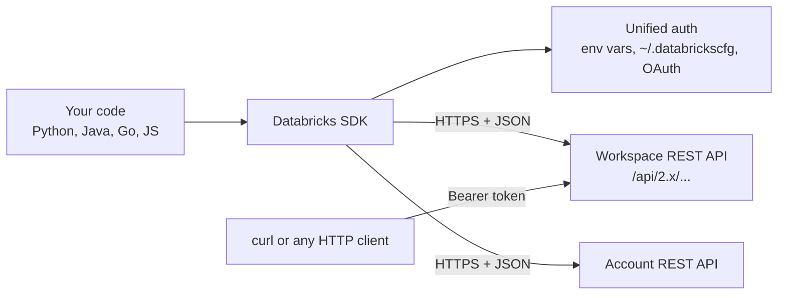

# Databricks SDKs and REST API

Mastery: `INPUT[inlineSelect(option(new), option(learning), option(solid)):mastery]`

> [!story] Context
> The [[Databricks CLI]] is convenient for shell scripts. Applications, internal tools, and complex automation need the same operations from a programming language, with typed objects, retries, and error handling. Every Databricks feature is exposed through a [[REST]] API, and the official SDKs wrap that API for Python, Java, Go, and JavaScript.

> [!eli5] Summary
> Everything you can click in Databricks can also be done by a program sending it messages over the internet. The SDKs are ready-made code libraries that write those messages for you, so your program can say "start this job" in one line.

> [!analogy]- Analogy: a restaurant's ordering system
> | Restaurant | Databricks |
> |---|---|
> | The kitchen | Databricks control plane |
> | The order slip format | REST API request and response JSON |
> | Calling in an order by phone | `curl` against an endpoint |
> | A waiter who knows the menu | An SDK such as `databricks-sdk` for Python |
> | Showing your membership card | Authentication (OAuth token) |

## Background

Every Databricks UI action calls an HTTP endpoint in the control plane (see [[Control Plane and Compute Plane]]). Early automation called these endpoints directly with hand-built JSON, and each team wrote its own retry and pagination logic. Databricks now publishes SDKs generated from the same API definitions as the CLI and the [[Terraform Provider]], so all tools share one authentication model and stay in step with new APIs.

## Overview

### The REST API

| Aspect | Detail |
|---|---|
| Base URL | Your workspace URL, for example `https://<workspace-url>/api/2.0/...` |
| Versioning | Per API family in the path, for example `/api/2.0/clusters/...` or `/api/2.2/jobs/...` |
| Scope | Workspace APIs (clusters, jobs, SQL, Unity Catalog) and account APIs (workspaces, identities, billing) |
| Format | JSON over HTTPS |
| Auth | Bearer token from OAuth (recommended) or a personal access token |
| Reference | `docs.databricks.com/api/workspace/...` and `docs.databricks.com/api/account/...` |

For jobs, Databricks recommends **Jobs API 2.2** for new and existing clients. Version 2.1 added multi-task jobs. Version 2.0 is still documented, and its list endpoint is deprecated.

### The SDKs

| SDK | Status | Typical use |
|---|---|---|
| **Databricks SDK for Python** (`databricks-sdk`) | Official | Automation, notebooks, apps |
| **Databricks SDK for Java** | Official | Enterprise and JVM integrations |
| **Databricks SDK for Go** | Official | Cloud-native tools and services |
| **Databricks SDK for JavaScript** | Official (listed on the SDKs page) | Web and Node.js integrations |
| **Databricks SDK for R** | Databricks Labs | Data science workflows in R |

Each SDK has two entry points: a **workspace client** for workspace-level APIs and an **account client** for account-level APIs.

## How it works



### Python SDK

Install and authenticate:

```bash
pip install databricks-sdk
databricks auth login --host https://<workspace-url>   # creates the DEFAULT profile
```

Use the workspace client:

```python
from databricks.sdk import WorkspaceClient

w = WorkspaceClient()   # no arguments: uses the default authentication process

print(w.current_user.me().user_name)

for c in w.clusters.list():
    print(c.cluster_name, c.state)

# Trigger a job and wait for it to finish
run = w.jobs.run_now(job_id=123456).result()
print(run.state.result_state)
```

Ways to configure the client:

1. **No arguments.** The SDK tries environment variables, then the `DEFAULT` profile in `~/.databrickscfg`, then other supported methods.
2. **A profile:** `WorkspaceClient(profile="prod")`.
3. **Service principal OAuth:** `WorkspaceClient(host=..., client_id=..., client_secret=...)`.
4. **Host and token:** supported, but Databricks does not recommend hard-coding tokens because they can leak through version control.
5. **Custom credentials:** pass a `credentials_strategy` for federated identity setups.

Inside a Databricks notebook, `WorkspaceClient()` picks up the notebook's own authentication automatically.

### Plain REST with curl

```bash
curl -s -X POST "https://<workspace-url>/api/2.2/jobs/run-now" \
  -H "Authorization: Bearer $DATABRICKS_TOKEN" \
  -H "Content-Type: application/json" \
  -d '{"job_id": 123456}'
```

## Small-business considerations

> [!smallbiz] Small-business considerations
> 1. **Start with the CLI,** and switch to the Python SDK when a script needs loops, conditions, or error handling.
> 2. **Run automation as a [[Users Groups and Service Principals|service principal]]** with OAuth machine-to-machine credentials, not as a person.
> 3. **Keep secrets out of code.** Use environment variables in CI, or [[Secrets Management|Databricks secrets]] inside notebooks.
> 4. **Use the SDK inside notebooks for admin chores,** such as listing idle clusters or exporting job settings.

## Cloud differences

The API surface is the same on all clouds. Differences are the workspace URL format and the authentication options.

> [!azure]- Azure Databricks
> - Workspace URLs look like `https://adb-<id>.<n>.azuredatabricks.net`.
> - The SDKs support Microsoft Entra ID service principals, Azure CLI credentials, and managed identities in addition to Databricks OAuth. See [[Microsoft Entra ID Integration]].

> [!aws]- Databricks on AWS
> - Account APIs include AWS-specific resources such as credential configurations and storage configurations used to create workspaces. See [[Account Setup on AWS]].

> [!gcp]- Databricks on Google Cloud
> - Authentication can use Google identity tokens and service accounts as documented for the SDKs. See [[Google Service Accounts]].

## Advanced topics

> [!deepdive]- Advanced topics (301–401)
> - **Long-running operations.** SDK methods that start work (such as `jobs.run_now` or `clusters.create`) return a waiter. Calling `.result()` polls until completion.
> - **Pagination.** List methods return iterators that fetch further pages automatically.
> - **Rate limits.** APIs enforce limits. For example, a workspace can create at most 10,000 jobs per hour, including `runs submit`. Design batch automation to back off on HTTP 429 responses.
> - **Account vs workspace.** Account-level operations (creating workspaces, managing account identities, reading billable usage) require the account client and an account admin identity.
> - **Workload identity federation.** For CI systems such as GitHub Actions or Azure DevOps, OAuth token federation exchanges the CI system's identity token for a Databricks token, so no long-lived secret is stored.

## Common misconceptions

> [!confusion] The SDK is not Databricks Connect
> The SDKs manage Databricks resources (clusters, jobs, permissions). [[Databricks Connect]] runs Spark DataFrame code from your machine on Databricks compute. Many projects use both.

> [!confusion] There is not one API version number
> Each API family has its own version in the path. Jobs uses 2.2, while many other APIs use 2.0 or 2.1.

## Recall

Which languages have official Databricks SDKs?::Python, Java, Go, and JavaScript, plus an R SDK from Databricks Labs.
What is the pip package name of the Python SDK?::`databricks-sdk`.
Which Python class calls workspace-level APIs?::`WorkspaceClient`.
Which class calls account-level APIs?::`AccountClient`.
What happens when you call `WorkspaceClient()` with no arguments?::The SDK uses its default authentication process (environment variables, config profiles, and other supported methods).
Which Jobs API version does Databricks recommend?::Jobs API 2.2.
How does a REST call authenticate?::With a bearer token in the `Authorization` header, preferably from OAuth.
What is the hourly limit on jobs created in one workspace?::10,000, including runs submit.

## Next steps

> [!path] Learning path
> **Needs first:** [[APIs]], [[REST]], [[Databricks CLI]]
> **Unlocks next:** [[Databricks Connect]], [[Databricks Apps]], [[CI-CD for Data Pipelines]]

> [!nextup] Next
> [[Databricks Connect]] covers running Spark code from a local IDE against Databricks compute.

> [!sources]- Sources (last verified: 2026-10-25)
> - [Databricks SDKs (AWS)](https://docs.databricks.com/aws/en/dev-tools/sdks)
> - [Databricks SDKs (Azure Databricks)](https://learn.microsoft.com/en-us/azure/databricks/dev-tools/sdks)
> - [Databricks SDK for Python (AWS)](https://docs.databricks.com/aws/en/dev-tools/sdk-python)
> - [Azure Databricks reference documentation (Azure Databricks)](https://learn.microsoft.com/en-us/azure/databricks/reference/api)
> - [Databricks REST API (AWS)](https://docs.databricks.com/aws/en/dev-tools/rest-api)
> - [Jobs API reference](https://docs.databricks.com/api/workspace/jobs)
> - [Jobs API 2.0 (AWS)](https://docs.databricks.com/aws/en/reference/jobs-2.0-api)
> - [Updating from Jobs API 2.0 to 2.1 (AWS)](https://docs.databricks.com/aws/en/reference/jobs-api-2-1-updates)
> - [Authorize user access to Databricks with OAuth (AWS)](https://docs.databricks.com/aws/en/dev-tools/auth/oauth-u2m)
> - [Authorize user access to Azure Databricks with OAuth (Azure Databricks)](https://learn.microsoft.com/en-us/azure/databricks/dev-tools/auth/oauth-u2m)
> - [Authenticate with an identity provider token (Google Cloud)](https://docs.databricks.com/gcp/en/dev-tools/auth/oauth-federation-exchange)
> - [Develop on Databricks (AWS)](https://docs.databricks.com/aws/en/developers/)
