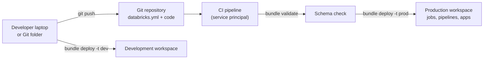

# Declarative Automation Bundles

Mastery: `INPUT[inlineSelect(option(new), option(learning), option(solid)):mastery]`

> [!story] Context
> [[Git Folders and Workspace Files|Git folders]] put code under version control, but jobs, pipelines, and their settings still had to be created by hand in each workspace. Declarative Automation Bundles describe those resources as [[YAML]] files in the same Git repository, so one command deploys the same project to development, staging, and production.

> [!eli5] Summary
> A bundle is a folder of code plus a written recipe that says which scheduled tasks and data pipelines to create. Databricks reads the recipe and sets everything up the same way every time, so the test copy and the real copy match.

> [!renamed] Renamed
> **Databricks Asset Bundles** (DABs) were renamed **Declarative Automation Bundles** on March 16, 2026. The change is non-breaking: the `databricks bundle` command and existing configuration files are unchanged. Databricks stated that the word "assets" was confusing because it has more than one meaning in Databricks.

> [!analogy]- Analogy: a building blueprint
> | Construction | Bundles |
> |---|---|
> | Blueprint | `databricks.yml` and included YAML files |
> | Building materials | Notebooks, Python files, wheels in the repo |
> | Building sites (test lot, real lot) | Targets (`dev`, `prod`) |
> | Inspection before building | `databricks bundle validate` |
> | Construction crew | `databricks bundle deploy` |
> | Record of what was built | Deployment state |

## Background

Without bundles, teams promoted Databricks work in one of three ways:

1. **Manual setup** in the UI for each workspace, which drifts over time (see [[Drift]]).
2. **Scripts against the REST API** (see [[Databricks SDKs and REST API]]), which each team wrote differently.
3. **The [[Terraform Provider]]**, which works well for platform resources but is a separate tool and language from the code it deploys.

Bundles combine source code and resource definitions in one project, deployed by the [[Databricks CLI]]. This is [[Infrastructure as Code|infrastructure as code]] scoped to data and AI projects.

## Overview

A bundle is a directory with a `databricks.yml` file at its root. It contains:

| Part | Purpose |
|---|---|
| `bundle` | The bundle name and settings, including the deployment engine |
| `include` | Extra YAML files to merge, for example `resources/*.yml` |
| `resources` | Jobs, pipelines, apps, and other Databricks objects to create |
| `targets` | Named environments (such as `dev` and `prod`) with their workspace and overrides |
| `variables` | Values that differ by target |

Resources a bundle can manage include [[Lakeflow Jobs]], [[Lakeflow Spark Declarative Pipelines]], [[Databricks Apps]], and other objects listed in the bundle resources reference. Some resources, such as cluster policies and Unity Catalog catalogs, require the direct deployment engine.

## How it works



A minimal `databricks.yml` needs a name and at least one target. Exactly one target can be the default.

```yaml
bundle:
  name: sales_reporting

include:
  - resources/*.yml

targets:
  dev:
    mode: development
    default: true
    workspace:
      host: https://<dev-workspace-url>
  prod:
    mode: production
    workspace:
      host: https://<prod-workspace-url>
```

A job definition in `resources/nightly.yml`:

```yaml
resources:
  jobs:
    nightly_sales:
      name: nightly_sales
      schedule:
        quartz_cron_expression: "0 0 6 * * ?"
        timezone_id: UTC
      tasks:
        - task_key: build_tables
          notebook_task:
            notebook_path: ../src/build_tables.ipynb
```

The workflow:

1. Create a project from a template with `databricks bundle init`.
2. Check the configuration with `databricks bundle validate`. Validation checks settings and resource definitions against their schemas.
3. Deploy to the default target with `databricks bundle deploy`, or to another with `databricks bundle deploy -t prod`.
4. Run a resource by its key: `databricks bundle run -t prod nightly_sales`.
5. Preview changes with `databricks bundle plan`.

You can also deploy bundles and run jobs from the workspace UI, which is useful for teams without a CI system.

### Deployment engines

| Engine | Status |
|---|---|
| `direct` | The current engine. In CLI 1.20.0 and later, `bundle.engine` accepts only `direct`. |
| `terraform` | Removed in Databricks CLI 1.20.0. Earlier CLI versions used it. |

To move an existing bundle that was deployed with Terraform:

1. Run `databricks bundle deployment migrate` for each target (Public Preview).
2. Run `databricks bundle deploy` to complete the migration.
3. Run `databricks bundle plan` to verify that no unexpected changes remain.

Migrate each target's state before deploying. The docs warn that otherwise deployment can silently fall back to the Terraform engine on CLI versions that still include it. Docs pages differ on timing (one says the engine was removed in 1.20.0, another says it will be disabled in new releases in September 2026), so check the current page for your CLI version.

## Small-business considerations

> [!smallbiz] Small-business considerations
> Adopt bundles when you have more than one environment or more than a handful of scheduled jobs.
> 1. **Start from `databricks bundle init`** with the default Python template rather than writing YAML from scratch.
> 2. **Use two targets**, `dev` and `prod`. Even a single workspace can host both, with development mode prefixing resource names per user.
> 3. **Deploy production from a [[Users Groups and Service Principals|service principal]]**, not a personal account, so jobs do not break when someone leaves.
> 4. **Without a CI system,** deploy from the workspace UI until you set one up.

## Cloud differences

> [!azure]- Azure Databricks, AWS, and Google Cloud
> Bundle configuration, commands, and engines are the same on all clouds. Differences appear only in cloud-specific resource settings inside the YAML (for example VM node types on classic job clusters) and in how the CI pipeline authenticates, such as Microsoft Entra ID service principals on Azure. See [[Authentication - Tokens and OAuth]].

## Advanced topics

> [!deepdive]- Advanced topics (301–401)
> - **Development vs production mode.** `mode: development` marks the target for iteration (for example, it prefixes deployed resource names so developers do not collide). `mode: production` applies stricter checks suited to production deployments.
> - **Splitting configuration.** Large projects keep one YAML file per resource under `resources/`, included with a glob.
> - **Target overrides.** A target can override any resource field, such as the cluster size or schedule, so dev runs smaller.
> - **Terraform coexistence.** Use the [[Terraform Provider]] for platform resources (workspaces, networking, metastores) and bundles for project resources (jobs, pipelines, apps). The two serve different layers.
> - **State.** Each target keeps deployment state that records what the bundle created. Change bundle-managed resources through the bundle, not by hand in the UI, so state and reality stay in sync.

## Common misconceptions

> [!confusion] Bundles are not a Terraform wrapper anymore
> Early versions used Terraform under the hood. CLI 1.20.0 removed the Terraform engine, and the `direct` engine calls Databricks APIs itself.

> [!confusion] The rename did not change the command
> The product is Declarative Automation Bundles, but the command is still `databricks bundle`, and existing `databricks.yml` files need no edits.

> [!confusion] Bundles do not replace Git folders
> Git folders are for interactive editing in the workspace. Bundles are for deploying a versioned project to environments. Most teams use both.

## Recall

What is the current name of Databricks Asset Bundles?::Declarative Automation Bundles (renamed March 16, 2026).
Did the rename change the CLI command?::No. It is still `databricks bundle`.
What is the root configuration file of a bundle?::`databricks.yml`.
What does a minimal bundle configuration need?::A bundle name and at least one target.
How many targets can be marked as default?::Exactly one.
How do you deploy a bundle to the prod target?::`databricks bundle deploy -t prod`.
In which CLI version was the Terraform deployment engine removed?::1.20.0.
Which command migrates a bundle from the Terraform engine to the direct engine?::`databricks bundle deployment migrate`, followed by `databricks bundle deploy`.
Which command previews what a deploy will change?::`databricks bundle plan`.

## Next steps

> [!path] Learning path
> **Needs first:** [[Git Folders and Workspace Files]], [[YAML]], [[Lakeflow Jobs]]
> **Unlocks next:** [[CI-CD for Data Pipelines]], [[Databricks CLI]], [[Testing Data Pipelines]]

> [!nextup] Next
> [[Databricks CLI]] covers the command-line tool that runs bundle commands and scripts every other part of Databricks.

> [!sources]- Sources (last verified: 2026-10-25)
> - [What are Declarative Automation Bundles? (AWS)](https://docs.databricks.com/aws/en/dev-tools/bundles/)
> - [Declarative Automation Bundles FAQs (AWS)](https://docs.databricks.com/aws/en/dev-tools/bundles/faqs)
> - [Declarative Automation Bundles feature release notes (AWS)](https://docs.databricks.com/aws/en/release-notes/dev-tools/bundles)
> - [Declarative Automation Bundles feature release notes (Azure Databricks)](https://learn.microsoft.com/en-us/azure/databricks/release-notes/dev-tools/bundles)
> - [Declarative Automation Bundles configuration (AWS)](https://docs.databricks.com/aws/en/dev-tools/bundles/settings)
> - [Declarative Automation Bundles configuration (Azure Databricks)](https://learn.microsoft.com/en-us/azure/databricks/dev-tools/bundles/settings)
> - [Configuration reference (AWS)](https://docs.databricks.com/aws/en/dev-tools/bundles/reference)
> - [Declarative Automation Bundles resources (AWS)](https://docs.databricks.com/aws/en/dev-tools/bundles/resources)
> - [Develop a job with Declarative Automation Bundles (AWS)](https://docs.databricks.com/aws/en/dev-tools/bundles/jobs-tutorial)
> - [Deploy bundles and run workflows from the workspace (AWS)](https://docs.databricks.com/aws/en/dev-tools/bundles/workspace-deploy)
> - [Migrate to the direct deployment engine (AWS)](https://docs.databricks.com/aws/en/dev-tools/bundles/direct)
> - [Migrate to the direct deployment engine (Azure Databricks)](https://learn.microsoft.com/en-us/azure/databricks/dev-tools/bundles/direct)
> - [bundle command group (AWS)](https://docs.databricks.com/aws/en/dev-tools/cli/bundle-commands)
