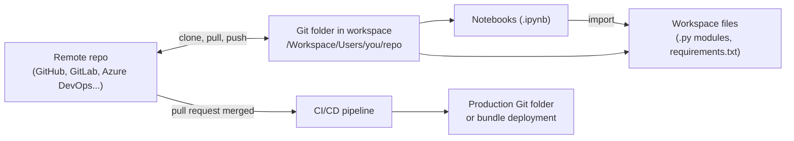

# Git Folders and Workspace Files

Mastery: `INPUT[inlineSelect(option(new), option(learning), option(solid)):mastery]`

> [!story] Context
> [[Notebooks]] and [[Genie Code|Genie Code]] make it fast to write code in the workspace. Once more than one person edits that code, it needs version control, code review, and a path from development to production. Git folders connect the workspace to a [[Git]] provider, and workspace files let you keep ordinary Python modules and config files next to notebooks.

> [!eli5] Summary
> A Git folder is a folder in Databricks that stays in sync with a shared code library on a site such as GitHub. Workspace files are ordinary files, like Python scripts or settings files, that you keep in that folder alongside notebooks.

> [!renamed] Renamed
> Git folders were previously called **Repos** (Databricks Repos). Older docs, the REST API (`/api/2.0/repos`), and the CLI command group `databricks repos` still use the old name.

> [!analogy]- Analogy: a synced shared drive
> | Shared drive | Git folders |
> |---|---|
> | Master copy in the cloud | Remote repository (GitHub, GitLab, and others) |
> | Your local synced copy | Git folder in your workspace |
> | Working on your own draft | Working on a branch |
> | Submitting changes for review | Commit, push, and open a pull request |
> | Files of any type | Workspace files (`.py`, `.yml`, `.md`) |

## Background

Early Databricks notebooks lived only in the workspace, with built-in revision history but no Git workflow. Teams exported notebooks to commit them, which broke code review and made [[CI-CD]] hard. Databricks Repos added Git integration. Later, support for arbitrary files (workspace files) let teams keep Python modules, tests, and `requirements.txt` files in the same folder, so code in Databricks could look like a normal software project. Repos was then renamed Git folders.

## Overview

| Concept | What it is |
|---|---|
| **Git folder** | A workspace folder linked to a remote Git repository and a branch |
| **Workspace file** | Any non-notebook file in the workspace, such as `.py`, `.sql`, `.yml`, `.md`, or `.txt` |
| **Git credential** | A token or OAuth link that lets Databricks act on your behalf with the Git provider |

### Supported Git providers

| Type | Providers |
|---|---|
| Cloud | GitHub (including GitHub Enterprise Cloud), GitLab and GitLab Enterprise Edition, Atlassian Bitbucket Cloud, Microsoft Azure DevOps (Azure Repos), AWS CodeCommit |
| Self-hosted | GitHub Enterprise Server, Bitbucket Server and Data Center, GitLab Self-Managed, Azure DevOps Server |

Self-hosted servers must be reachable from Databricks. For Azure DevOps Server domains other than `dev.azure.com` or `visualstudio.com`, a workspace admin must allowlist the URL.

### Limits

| Limit | Value |
|---|---|
| Workspace file size | 500 MB |
| Working branch size | 1 GB (some older pages say 500 MB) |
| Largest file viewable in the UI | 10 MB |
| Memory and disk per Git operation | 2 GB memory, 4 GB disk writes |
| Recommended assets per Git folder | Under 20,000 |

## How it works



Set up a Git folder:

1. In the workspace, open **Settings > Linked accounts** and add a Git credential for your provider (OAuth app or personal access token, plus your Git provider email).
2. In the **Workspace** browser, select **Create > Git folder**.
3. Paste the repository URL, choose the provider, and create the folder.
4. Use the **Git** dialog in the folder to switch or create branches, pull, commit, and push.
5. Open a pull request in your Git provider for review.

The [[Databricks CLI]] can do the same, which is useful for automation:

```bash
# Create a Git folder linked to a GitHub repo
databricks repos create https://github.com/acme/analytics gitHub \
  --path /Workspace/Users/someone@acme.com/analytics

# Point an existing Git folder at the latest main branch
databricks repos update <repo-id> --branch main
```

### Importing modules from workspace files

Notebooks in a Git folder can import Python files from the same folder:

```python
# Repo layout:
#   analytics/
#     utils/cleaning.py
#     notebooks/daily_report.ipynb
from utils.cleaning import normalize_emails

df = normalize_emails(spark.read.table("raw.crm.contacts"))
```

When the same package exists in several places, Databricks resolves it in this order: Git folder libraries first, then notebook-scoped `%pip` libraries, then compute-scoped libraries, then libraries bundled with the runtime (see [[Libraries and Environments]]).

## Small-business considerations

> [!smallbiz] Small-business considerations
> 1. **Use Git from the first shared notebook:** A free GitHub or GitLab repository is enough.
> 2. **Each person works in their own Git folder** under `/Workspace/Users/<name>/`, on a branch. Merge through pull requests.
> 3. **Move shared logic into `.py` files** and import it, rather than copying cells between notebooks.
> 4. **Store small code and config files only:** Data files belong in [[Volumes]] or tables, not in workspace files (500 MB per file limit).
> 5. **For production, deploy with [[Declarative Automation Bundles]]** instead of editing a production folder by hand.

## Cloud differences

> [!azure]- Azure Databricks
> - **Azure DevOps with Microsoft Entra ID:** The Azure Databricks docs state that when you sign in with Entra ID and the Azure DevOps organization is linked to the same Entra ID tenant as the workspace, Azure DevOps authentication happens automatically. The AWS-hosted docs state that Entra ID tokens are not supported and a personal access token is required. Verify in your workspace.
> - **Cross-tenant:** If the Azure DevOps project is in a different tenant, use an Azure DevOps personal access token.
> - **Conditional access:** If an Entra ID conditional access policy blocks Databricks, cloning fails with an access error. Add an exclusion for Azure Databricks IP addresses or users. See [[Microsoft Entra ID Integration]].
> - **Automation:** For Azure DevOps pipelines, the docs recommend federated credentials with an OIDC token instead of stored personal access tokens.

> [!aws]- Databricks on AWS
> - AWS CodeCommit is a supported provider. Connecting Azure DevOps from Databricks on AWS uses a personal access token.

> [!gcp]- Databricks on Google Cloud
> - Same providers and workflow. The Google Cloud resource limits page lists older limits (500 MB working branch, 10,000 files per Git folder); check the current page for your workspace.

## Advanced topics

> [!deepdive]- Advanced topics (301–401)
> - **Service principals:** For CI/CD, give a [[Users Groups and Service Principals|service principal]] its own Git credential, and let it update a production Git folder or run a bundle deployment. Databricks recommends a read-only token for a group's Git credential.
> - **Notebook state:** Git operations that change notebook source can clear outputs and revision history. Source-format notebooks also drop notebook dashboard information, so use `.ipynb` if you need it.
> - **Self-hosted Git servers:** The AWS docs state that self-hosted servers work when they are reachable from the internet. A server on a private network needs extra network setup; plan it with your network team and check the Git folders setup docs for your cloud.
> - **Repository size:** Current AWS and Azure docs state no hard limit on repository size, but per-branch and per-operation limits apply. Keep large binary files out of the repository.

## Common misconceptions

> [!confusion] A Git folder is not the remote repository
> Changes in a Git folder are local to the workspace until you commit and push. Other people see them only after they pull.

> [!confusion] Workspace files are not a data store
> Workspace files hold code and small config files. Store data in [[Volumes]] or Unity Catalog tables.

> [!confusion] "Repos" and "Git folders" are the same feature
> The UI name changed. The API path and CLI command group still say `repos`.

## Recall

What was the previous name of Git folders?::Repos (Databricks Repos).
Name four supported cloud Git providers.::GitHub, GitLab, Bitbucket Cloud, Azure DevOps, AWS CodeCommit (any four).
What is the maximum size of a workspace file?::500 MB.
What is the working branch size limit in current docs?::1 GB.
Where do you add a Git credential in the workspace?::Settings, then Linked accounts.
Which CLI command group manages Git folders?::`databricks repos`.
When a package exists in a Git folder and is also installed with `%pip`, which wins?::The Git folder library.
On Azure, when does Azure DevOps authentication happen automatically?::When you sign in with Entra ID and the DevOps organization is linked to the same Entra ID tenant as the workspace.

## Next steps

> [!path] Learning path
> **Needs first:** [[Git]], [[Notebooks]]
> **Unlocks next:** [[Declarative Automation Bundles]], [[CI-CD for Data Pipelines]], [[Testing Data Pipelines]]

> [!nextup] Next
> [[Declarative Automation Bundles]] covers defining jobs, pipelines, and apps as YAML in the same Git repository and deploying them to each environment.

> [!sources]- Sources (last verified: 2026-10-25)
> - [Databricks Git folders concepts (Google Cloud)](https://docs.databricks.com/gcp/en/repos/git-folders-concepts)
> - [Azure Databricks Git folders concepts (Azure Databricks)](https://learn.microsoft.com/en-us/azure/databricks/repos/git-folders-concepts)
> - [Databricks Git folder limits and reference (AWS)](https://docs.databricks.com/aws/en/repos/limits)
> - [Azure Databricks Git folder limits and reference (Azure Databricks)](https://learn.microsoft.com/en-us/azure/databricks/repos/limits)
> - [Create and manage Git folders (AWS)](https://docs.databricks.com/aws/en/repos/git-operations-with-repos)
> - [Configure Git integration for Git folders (AWS)](https://docs.databricks.com/aws/en/repos/repos-setup)
> - [Configure Git integration for Git folders (Azure Databricks)](https://learn.microsoft.com/en-us/azure/databricks/repos/repos-setup)
> - [Connect your Git provider to Databricks (Azure Databricks)](https://learn.microsoft.com/en-us/azure/databricks/repos/get-access-tokens-from-git-provider)
> - [Authorize a service principal to access Git folders (Azure Databricks)](https://learn.microsoft.com/en-us/azure/databricks/repos/automate-with-sp)
> - [What are workspace files? (AWS)](https://docs.databricks.com/aws/en/files/workspace)
> - [Recommendations for files in volumes and workspace files (AWS)](https://docs.databricks.com/aws/en/files/files-recommendations)
> - [Resource limits (Azure Databricks)](https://learn.microsoft.com/en-us/azure/databricks/resources/limits)
> - [Resource limits (Google Cloud)](https://docs.databricks.com/gcp/en/resources/limits)
> - [Configure the serverless environment (AWS)](https://docs.databricks.com/aws/en/compute/serverless/dependencies)
