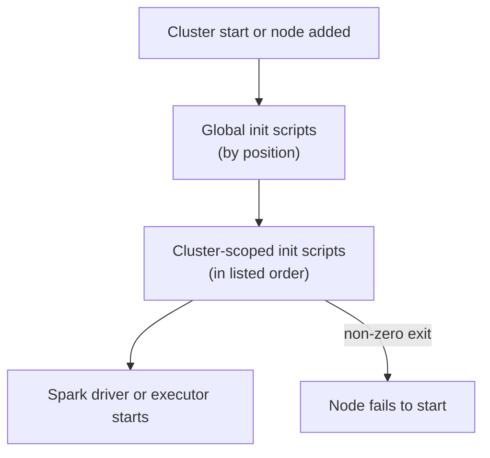

# Init Scripts

Mastery: `INPUT[inlineSelect(option(new), option(learning), option(solid)):mastery]`

> [!story] Context
> [[Instance Pools]] shortened how long a classic cluster takes to get machines. Some workloads also need each machine prepared before Spark starts: an operating-system package installed, a monitoring agent configured, or a certificate copied in. An init script is a shell script that runs on every node during startup to do that preparation.

> [!eli5] Summary
> An init script is a short list of setup commands that runs on every computer in a cluster each time the cluster starts. It is used for setup that normal package installs cannot do. Serverless compute does not run init scripts.

## Background

[[Libraries and Environments|Libraries]] cover most dependency needs: `%pip install`, compute-scoped libraries, and serverless environments. Some setup happens below the Python or JVM layer, for example:

- Installing a Linux package with `apt-get`.
- Installing and configuring a monitoring or security agent.
- Adding a trusted certificate authority to the operating system.
- Setting system-level configuration before the Spark driver or executors start.

Init scripts run as part of node startup on classic compute, before the Spark [[JVM]] starts, so they can make these changes.

## Overview

| Type | Scope | Who configures it | Status |
|---|---|---|---|
| Cluster-scoped | One cluster, in its configuration | The cluster creator | Recommended |
| Global | Every cluster in the workspace (dedicated and no-isolation access modes) | Workspace admins | Supported, use sparingly |
| Legacy global | Every cluster, from `dbfs:/databricks/init` | Not visible in the UI | Disabled (Azure Databricks disabled them on September 1, 2023) |
| DBFS-stored | Any script stored in DBFS | | End of life. Clusters cannot start with them. |

### Where to store cluster-scoped scripts

| Location | Use when | Requirements |
|---|---|---|
| Unity Catalog [[Volumes\|volume]] | Recommended for Unity Catalog workspaces | [[Databricks Runtime]] 13.3 LTS or above, dedicated or standard access mode |
| Workspace files | No Unity Catalog | Databricks Runtime 11.3 LTS or above. Workspace files have a 500 MB limit. See [[Git Folders and Workspace Files]]. |
| Cloud object storage | Runtime 10.4 LTS and below | Access configured for the cluster |

Volumes are not supported on no-isolation shared access mode.

## How it works



1. Databricks acquires the node, from the cloud or from an [[Instance Pools|instance pool]].
2. Global init scripts run first, in ascending order of their position (0 runs first).
3. Cluster-scoped init scripts run next, sequentially, in the order listed in the cluster configuration.
4. If a script exits with a non-zero status, the node fails, and later scripts are skipped. If enough nodes fail, the cluster fails to start.
5. Spark starts on the node.

Scripts run on every node, including nodes added by [[Autoscaling|autoscaling]] and nodes replaced after a failure.

### Write a script

```bash
#!/bin/bash
set -euo pipefail

# Install an OS package on every node
apt-get update -y
apt-get install -y libpq-dev

# Run driver-only setup
if [ "$DB_IS_DRIVER" = "TRUE" ]; then
  echo "Configuring driver at $DB_DRIVER_IP"
fi
```

Init scripts can read environment variables that Databricks sets, including `DB_IS_DRIVER` (whether the node is the driver) and `DB_DRIVER_IP` (the driver's IP address). On Databricks Runtime 19 and above in standard access mode, init scripts see only a predefined set of environment variables.

### Attach a script stored in a volume

1. Upload `install-libpq.sh` to a volume, for example `/Volumes/main/platform/init_scripts/`.
2. In standard access mode, have a metastore admin add the script path to the Unity Catalog allowlist.
3. Grant the cluster owner `READ VOLUME` on the volume.
4. Open the cluster configuration, expand **Advanced**, and open the **Init scripts** tab.
5. Select **Volumes** as the source, enter the path, and click **Add**.
6. Restart the cluster.

The same configuration in the Clusters API or a bundle:

```json
{
  "init_scripts": [
    { "volumes":   { "destination": "/Volumes/main/platform/init_scripts/install-libpq.sh" } },
    { "workspace": { "destination": "/Shared/init/configure-agent.sh" } }
  ]
}
```

The `dbfs` destination type is deprecated. Use `volumes` or `workspace`.

### Logs

If the cluster has a log delivery destination, init script output is written under that destination in a folder for the cluster ID and an `init_scripts` subfolder. Check these logs first when a cluster fails with an init script error.

## Small-business considerations

> [!smallbiz] Small-business considerations
> - Avoid init scripts unless a requirement forces them. They run only on classic compute, add start-up time, and can stop a cluster from starting.
> - Install Python packages with `%pip` or a serverless environment instead. See [[Libraries and Environments]].
> - If you need one, store it in a volume, keep it in version control, and put the path in a [[Compute Policies|compute policy]] so every cluster uses the same approved script.
> - Do not create global init scripts on a small team. One broken global script blocks every cluster that runs it.

## Cloud differences

> [!azure]- Azure Databricks
> - Legacy global init scripts in `dbfs:/databricks/init` were disabled for all Azure Databricks workspaces on September 1, 2023.
> - Script storage, ordering, and environment variables are otherwise the same as on AWS.

> [!aws]- Databricks on AWS
> - Nothing differs in how init scripts run. Cloud storage locations use `s3://` paths and need access configured for the cluster, for example through an [[Instance Profiles|instance profile]].

> [!gcp]- Databricks on Google Cloud
> - Nothing differs in how init scripts run. Cloud storage locations use `gs://` paths.

## Advanced topics

> [!deepdive]- Advanced topics (301–401)
> - Allowlist: on standard access mode (formerly shared), init scripts must be on the Unity Catalog allowlist (Databricks Runtime 13.3 LTS and above). The allowlist is managed in Catalog Explorer by a metastore admin.
> - Identity: on standard access mode, init scripts run with the cluster owner's identity when reading from a volume, so the owner needs `READ VOLUME`.
> - Global script scope: global init scripts apply to dedicated and no-isolation clusters, not to standard access mode clusters.
> - Global script failures: a fetch failure (missing file or permission) or a non-zero exit in a global script raises `GLOBAL_INIT_SCRIPT_FAILURE`. Because admins own global scripts, an admin usually has to fix it.
> - Changes require restart: running clusters pick up changes to global or cluster-scoped scripts only after a restart.
> - Policies: [[Compute Policies]] can fix init scripts by index, for example `init_scripts.0.volumes.destination` with type `fixed`. Indexed policy entries must not skip indices.
> - Migration from DBFS: DBFS init scripts have reached end of life. Move them to volumes (Runtime 13.3 LTS and above with Unity Catalog), workspace files (Runtime 11.3 LTS and above), or cloud storage (Runtime 10.4 LTS and below). Some workspaces still show a DBFS option in the UI for legacy workloads; Databricks does not recommend it.
> - Serverless: serverless compute does not support compute-scoped init scripts. Workloads that require them stay on classic compute.

## Common misconceptions

> [!confusion] Init scripts are not the way to install Python packages
> Use `%pip`, compute-scoped libraries, or serverless environments. Init scripts are for operating-system and agent setup.

> [!confusion] Init scripts run on every node, not once per cluster
> A script runs on the driver and on each worker. Use `DB_IS_DRIVER` to limit a step to the driver.

> [!confusion] A script that fails does not log a warning and continue
> A non-zero exit fails the node. Test scripts on a small cluster before adding them to production jobs.

## Recall

What is an init script?::A shell script that runs on each classic cluster node during startup, before Spark starts.
Which runs first, global or cluster-scoped init scripts?::Global init scripts, by position; then cluster-scoped scripts in listed order.
Where should you store cluster-scoped init scripts in a Unity Catalog workspace?::In a Unity Catalog volume (Databricks Runtime 13.3 LTS and above).
What is the status of init scripts stored in DBFS?::End of life. Clusters cannot start with them.
Which environment variable tells a script it is running on the driver?::`DB_IS_DRIVER`.
What must happen before a standard access mode cluster can run an init script from a volume?::The script must be on the Unity Catalog allowlist, and the cluster owner needs `READ VOLUME`.
What happens when an init script exits with a non-zero status?::The node fails to start and later scripts are skipped; enough failures fail the cluster.
Does serverless compute run init scripts?::No.

## Next steps

> [!path] Learning path
> **Needs first:** [[All-Purpose Compute]], [[Libraries and Environments]], [[Volumes]]
> **Unlocks next:** [[Compute Policies]], [[DBFS]], [[Hive Metastore Migration to Unity Catalog]]

> [!nextup] Next
> [[DBFS]] covers the legacy Databricks File System and mounts, and why Unity Catalog volumes replace them.

> [!sources]- Sources (last verified: 2026-10-25)
> - [What are init scripts? (AWS)](https://docs.databricks.com/aws/en/init-scripts/)
> - [What are init scripts? (Azure Databricks)](https://learn.microsoft.com/en-us/azure/databricks/init-scripts/)
> - [What are init scripts? (Google Cloud)](https://docs.databricks.com/gcp/en/init-scripts/)
> - [Cluster-scoped init scripts (AWS)](https://docs.databricks.com/aws/en/init-scripts/cluster-scoped)
> - [Cluster-scoped init scripts (Azure Databricks)](https://learn.microsoft.com/en-us/azure/databricks/init-scripts/cluster-scoped)
> - [Set and use environment variables with init scripts (AWS)](https://docs.databricks.com/aws/en/init-scripts/environment-variables)
> - [Set and use environment variables with init scripts (Azure Databricks)](https://learn.microsoft.com/en-us/azure/databricks/init-scripts/environment-variables)
> - [Allowlist libraries and init scripts on compute with standard access mode (AWS)](https://docs.databricks.com/aws/en/data-governance/unity-catalog/manage-privileges/allowlist)
> - [Global init scripts (legacy) (Azure Databricks)](https://learn.microsoft.com/en-us/azure/databricks/archive/init-scripts/legacy-global)
> - [Global Init Scripts API](https://docs.databricks.com/api/global-init-scripts/v2/global-init-script)
> - [Classic compute termination error codes (AWS)](https://docs.databricks.com/aws/en/compute/troubleshooting/cluster-error-codes)
> - [Cluster API reference](https://docs.databricks.com/api/clusters/v2/cluster)
> - [Compute policy reference (Azure Databricks)](https://learn.microsoft.com/en-us/azure/databricks/admin/clusters/policy-definition)
> - [Serverless compute limitations (AWS)](https://docs.databricks.com/aws/en/compute/serverless/limitations)
