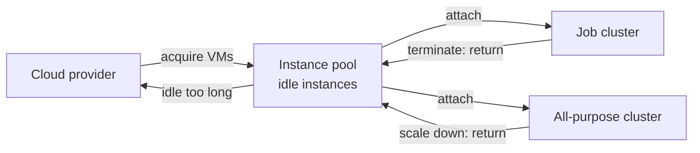

# Instance Pools

Mastery: `INPUT[inlineSelect(option(new), option(learning), option(solid)):mastery]`

> [!story] Context
> [[dbutils and Widgets]] covered tools you use inside a running notebook. Before code can run on classic compute, the cluster must start, and acquiring virtual machines from the cloud provider takes most of that time. An instance pool keeps a set of machines ready so clusters can start and scale faster.

> [!eli5] Summary
> An instance pool is a set of cloud computers that are already switched on and waiting. When a cluster needs machines, it takes them from the pool instead of ordering new ones, so it starts sooner. When the cluster is done, the machines go back to the pool.

> [!analogy]- Analogy: a taxi queue at a station
> | Taxi queue | Instance pool |
> |---|---|
> | Taxis waiting at the rank | Idle instances |
> | Minimum number of taxis kept at the rank | Min Idle |
> | Taxis leave if they wait too long | Idle instance auto termination |
> | Rank capacity | Max Capacity |

## Background

A classic cluster ([[All-Purpose Compute]] or [[Jobs Compute]]) runs on [[Virtual Machine|virtual machines]] that Databricks requests from your cloud provider. Requesting and booting those machines takes several minutes, and it happens again each time a cluster starts or [[Autoscaling|autoscales]] up. For short scheduled jobs, start-up can take longer than the work itself.

Instance pools reduce this delay by keeping released machines available for reuse.

## Overview

A pool holds two kinds of instances, all of the same instance type:

- Idle instances: running, not attached to any cluster, ready to be assigned.
- Used instances: currently attached to clusters that draw from the pool.

When a cluster attached to a pool starts or scales up, it takes idle instances first. If none are idle, the pool requests new instances from the cloud provider. When a cluster terminates or scales down, its instances return to the pool.

### Configuration

| Setting | API field | Meaning |
|---|---|---|
| Min Idle | `min_idle_instances` | Instances the pool keeps idle at all times. These do not auto-terminate. When a cluster takes them, the pool provisions replacements. |
| Max Capacity | `max_capacity` | Ceiling on idle plus used instances. A request that would exceed it fails. |
| Idle Instance Auto Termination | `idle_instance_autotermination_minutes` | Minutes an instance above Min Idle can stay idle before it is terminated. Accepts 0 to 10000. |
| Instance type | `node_type_id` | One type per pool. Cannot be changed after creation. |
| Preloaded runtime | `preloaded_spark_versions` | A [[Databricks Runtime]] version installed on idle instances, so clusters using it start faster. |
| Tags | `custom_tags` | Tags applied to the pool's cloud instances. |
| Availability | cloud-specific | On-demand or [[Spot Instances\|spot]] (preemptible on Google Cloud). |

### Billing

Databricks does not charge [[DBUs]] for instances that are idle in a pool. Your cloud provider bills for those VMs while they run. When an instance is attached to a cluster, the cluster's normal DBU rate applies. Set Min Idle with that cloud cost in mind.

## How it works



### Create a pool with the CLI

```bash
databricks instance-pools create --json '{
  "instance_pool_name": "jobs-small",
  "node_type_id": "m6i.xlarge",
  "min_idle_instances": 0,
  "max_capacity": 20,
  "idle_instance_autotermination_minutes": 30,
  "preloaded_spark_versions": ["15.4.x-scala2.12"],
  "custom_tags": {"team": "data"}
}'
```

The `node_type_id` above is an AWS type. Use an Azure VM size (for example `Standard_D4ds_v5`) or a Google Cloud machine type on those clouds.

### Attach a job cluster to a pool

In a [[Declarative Automation Bundles|bundle]], reference the pool instead of a node type:

```yaml
resources:
  jobs:
    nightly_sales:
      name: nightly_sales
      job_clusters:
        - job_cluster_key: main
          new_cluster:
            spark_version: 15.4.x-scala2.12
            instance_pool_id: ${var.worker_pool_id}
            driver_instance_pool_id: ${var.driver_pool_id}
            num_workers: 2
```

A cluster that uses a pool takes its instance type and availability settings from the pool, so the cluster spec does not set its own `node_type_id`.

## Small-business considerations

> [!smallbiz] Small-business considerations
> Most small teams do not need instance pools.
> - Use [[Serverless Compute]] first. Serverless already starts in seconds from a pool that Databricks manages, and you do not pay for idle machines.
> - Consider a pool only if you run many short classic jobs (for example, every 15 minutes) where start-up time matters, or you need classic compute for R, Scala notebooks, or GPUs.
> - Set Min Idle to 0 to avoid paying your cloud provider for idle VMs, and set a moderate idle auto termination (for example, 15 to 30 minutes) so consecutive jobs reuse warm instances.
> - Put cost-allocation tags on the pool, not only on the cluster. See [[Tagging for Chargeback]].

## Cloud differences

> [!azure]- Azure Databricks
> - Pools support Azure Spot VMs. Azure can evict spot VMs with at least 30 seconds of notice.
> - If evicted spot instances cannot be reacquired, Databricks falls back to on-demand, but only for spot instances that were fully acquired and running.
> - Flexible node types let a pool fall back to other instance types at launch through the `node_type_flexibility` field. Pools do not use fallback types to maintain Min Idle, and fallback settings cannot be changed after the pool is created.

> [!aws]- Databricks on AWS
> - Pools set the [[Availability Zone|availability zone]], spot or on-demand, and the maximum spot price (as a percentage of the on-demand price, default 100%). Clusters attached to the pool inherit these settings.
> - The zone can be `auto`. The pool moves to the best zone before each scale-up from zero, then stays in that zone while it has instances.
> - See [[EC2 Instance Types and Graviton]] for choosing a type.

> [!gcp]- Databricks on Google Cloud
> - Availability can be all preemptible, preemptible with on-demand fallback, or on-demand (the default).
> - Zone options include a specific zone, `HA` (spread across zones), or `auto`.
> - The Google Cloud pool reference states that idle instance auto termination is not supported for pools on Google Cloud. Plan Min Idle and Max Capacity accordingly.
> - See [[Compute on Google Cloud]].

## Advanced topics

> [!deepdive]- Advanced topics (301–401)
> - Driver and worker pools: use separate pools when the driver and workers need different types. Do not run the driver on spot. If workers use a spot pool, point `driver_instance_pool_id` at an on-demand pool.
> - Spot versus on-demand: spot pools suit interactive clusters and cost-first jobs. On-demand pools suit short jobs with strict deadlines, where losing an instance to the spot market is costly.
> - One pool per shape: Databricks recommends a pool for each instance type and runtime your teams commonly use, so idle instances match cluster requests.
> - Warm-up without Min Idle: with Min Idle at 0, a small starter job scheduled before the main workload fills the pool, and idle auto termination keeps the instances for the following jobs.
> - Max Capacity: set it only for a strict quota or budget constraint, because requests at the ceiling fail rather than queue.
> - Tag propagation: pool and cluster tags both appear in DBU usage records. Cloud instances from a pool carry the pool's tags, not the cluster's, so put required cloud tags on the pool.
> - Governance: [[Compute Policies]] can require `instance_pool_id` to be a fixed value, forcing users onto approved pools.
> - Serverless: instance pools are not supported on serverless compute. Serverless keeps its own warm capacity in the serverless compute plane.

## Common misconceptions

> [!confusion] A pool is not a cluster
> A pool holds machines. It does not run Spark. Clusters attach to a pool and run Spark on the instances they take from it.

> [!confusion] Idle pool instances are not free
> Databricks charges no DBUs for idle instances, but your cloud provider bills for the running VMs.

> [!confusion] Pools do not change the cluster's DBU rate
> A cluster from a pool bills the same DBUs as an identical cluster without one. The pool only shortens acquisition time.

## Recall

What is an instance pool?::A set of idle, ready-to-use VMs of one instance type that classic clusters draw from to start and scale faster.
What does Min Idle control?::The number of instances the pool always keeps idle. They do not auto-terminate.
What happens when a request exceeds Max Capacity?::The request fails.
Does Databricks charge DBUs for idle pool instances?::No. The cloud provider still bills for the running VMs.
Which tags do cloud instances from a pool carry?::The pool's tags, not the cluster's.
Why use a separate driver pool?::So the driver can run on on-demand instances while workers use spot instances.
Can you change a pool's instance type after creation?::No.
Do pools work with serverless compute?::No. Serverless compute does not support instance pools.

## Next steps

> [!path] Learning path
> **Needs first:** [[Compute Types]], [[All-Purpose Compute]], [[Jobs Compute]]
> **Unlocks next:** [[Compute Policies]], [[Cost Optimization Checklist]], [[Tagging for Chargeback]]

> [!nextup] Next
> [[Init Scripts]] covers shell scripts that run on every classic cluster node at startup, and where to store them.

> [!sources]- Sources (last verified: 2026-10-25)
> - [Pool configuration reference (AWS)](https://docs.databricks.com/aws/en/compute/pools)
> - [Pool configuration reference (Azure Databricks)](https://learn.microsoft.com/en-us/azure/databricks/compute/pools)
> - [Pool configuration reference (Google Cloud)](https://docs.databricks.com/gcp/en/compute/pools)
> - [Pool best practices (AWS)](https://docs.databricks.com/aws/en/compute/pool-best-practices)
> - [Pool best practices (Azure Databricks)](https://learn.microsoft.com/en-us/azure/databricks/compute/pool-best-practices)
> - [Instance Pool API reference](https://docs.databricks.com/api/instance-pools/v2/instance-pool)
> - [Create a new instance pool (API)](https://docs.databricks.com/api/instance-pools/v2/create-instance-pool)
> - [instance-pools command group (AWS)](https://docs.databricks.com/aws/en/dev-tools/cli/reference/instance-pools-commands)
> - [Improve compute launch reliability using flexible node types (Azure Databricks)](https://learn.microsoft.com/en-us/azure/databricks/compute/flexible-node-types)
> - [Build workloads with Azure Spot Virtual Machines (Azure Architecture Center)](https://learn.microsoft.com/en-us/azure/architecture/guide/spot/spot-eviction)
> - [Compute configuration reference (Google Cloud)](https://docs.databricks.com/gcp/en/compute/configure)
> - [Serverless compute limitations (AWS)](https://docs.databricks.com/aws/en/compute/serverless/limitations)
