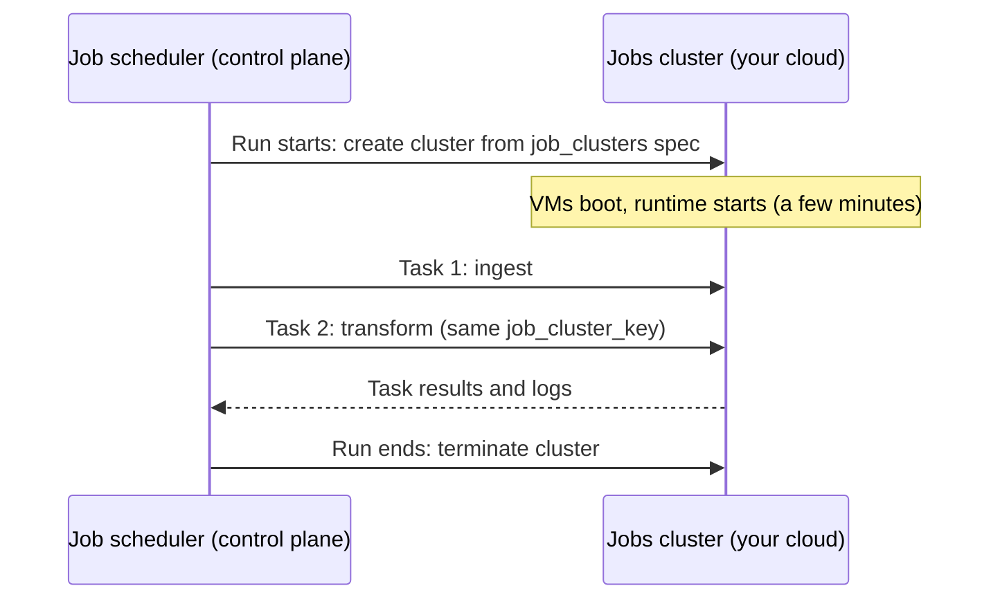

# Jobs Compute

Mastery: `INPUT[inlineSelect(option(new), option(learning), option(solid)):mastery]`

> [!story] Context
> [[All-Purpose Compute]] provides an always-on cluster for interactive work, at a higher rate and with idle time billed. Scheduled work needs neither. A nightly pipeline needs machines only for the length of its run, with no other users on them. Jobs compute provides that.

> [!eli5] Summary
> Jobs compute is a set of computers that turns on only to run one scheduled task, then turns itself off. Nobody works on it by hand, so it costs less per hour than the computers people use interactively.

> [!analogy]- Analogy: a catering crew
> | Catering | Databricks |
> |---|---|
> | Restaurant kitchen open all day in case someone orders | All-purpose cluster |
> | Crew hired for one event, then gone | Jobs compute |
> | You pay for the event, not the whole day | Billing covers one run |
> | Event plan: what to cook, in what order, with how many cooks | The [[Lakeflow Jobs\|job]] definition |

## Background

Running scheduled pipelines on interactive clusters causes three problems:

1. **Cost:** All-purpose compute has a higher [[DBUs|DBU]] rate and often sits idle between runs.
2. **Interference:** An analyst's heavy query can slow down the nightly job sharing the cluster, and an analyst can change a library the job depends on.
3. **Reproducibility:** A cluster that people modify by hand is not a stable production environment.

Jobs compute solves all three. Each run gets **fresh, isolated machines with a fixed configuration**, defined in code, at a lower rate.

## Overview

Jobs compute is classic compute that a [[Lakeflow Jobs|Lakeflow Job]] (the job scheduler, formerly called Databricks Workflows) creates when a run starts and terminates when the run ends.

| | All-purpose compute | Jobs compute |
|---|---|---|
| Created by | A person | The job, at run start |
| Lifetime | Until stopped or auto-terminated | One job run |
| DBU rate | Higher | Lower |
| Shared with | Interactive users | Only the tasks of that run |
| Can you restart it? | Yes | No. A new run creates a new cluster |
| Typical use | Development | Production schedules |

Inside a job, a cluster definition is declared once under `job_clusters` with a `job_cluster_key`, and several tasks can share it. That saves the start-up time of a new cluster per task.

## How it works



A job with one shared jobs cluster, defined in a [[Declarative Automation Bundles|Declarative Automation Bundle]] (`resources/nightly.job.yml`):

```yaml
resources:
  jobs:
    nightly_sales:
      name: nightly-sales
      schedule:
        quartz_cron_expression: "0 0 5 * * ?"   # 05:00 every day
        timezone_id: America/Chicago
      job_clusters:
        - job_cluster_key: etl
          new_cluster:
            spark_version: 17.3.x-scala2.13
            node_type_id: i3.xlarge
            num_workers: 2
            runtime_engine: PHOTON
            data_security_mode: USER_ISOLATION
      tasks:
        - task_key: ingest
          job_cluster_key: etl
          notebook_task:
            notebook_path: ../src/ingest.ipynb
        - task_key: transform
          depends_on:
            - task_key: ingest
          job_cluster_key: etl
          notebook_task:
            notebook_path: ../src/transform.ipynb
```

Deploy and run it with the [[Databricks CLI]]:

```bash
databricks bundle deploy -t prod
databricks bundle run nightly_sales -t prod
```

If you remove the `job_clusters` block and the `job_cluster_key` lines, the same tasks run on [[Serverless Compute|serverless jobs compute]] instead, where the workspace has serverless enabled.

## Small-business considerations

> [!smallbiz] Small-business considerations
> Run every scheduled workload on jobs compute or serverless jobs, not on an all-purpose cluster.
> - **Serverless jobs** require no cluster settings and start quickly.
> - **Jobs compute** is worth it when a job needs something serverless does not support (custom init scripts, a specific VM type, GPUs, or access to a private network), or when a long, steady job is cheaper on [[Spot Instances|spot]] workers.
>
> In both cases, the job's run history shows the duration of each run, which you can use to estimate cost per run. See [[Estimating Costs for a Small Business]].

## Cloud differences

> [!azure]- Azure Databricks
> Same behavior. Node types are Azure VM sizes, and `azure_attributes` sets spot vs on-demand (`SPOT_WITH_FALLBACK_AZURE`). Jobs compute VMs appear in the [[Managed Resource Group|managed resource group]] only for the length of the run.

> [!aws]- Databricks on AWS
> Same behavior. `aws_attributes` controls spot (`SPOT_WITH_FALLBACK`), the number of on-demand nodes (`first_on_demand`), and availability zone. See [[EC2 Instance Types and Graviton]].

> [!gcp]- Databricks on Google Cloud
> Same behavior. `gcp_attributes` sets preemptible capacity and the service account. See [[Compute on Google Cloud]].

## Advanced topics

> [!deepdive]- Advanced topics (301–401)
> - **Start-up time:** Each new jobs cluster pays a VM boot cost of a few minutes. Share one `job_cluster_key` across tasks, use instance pools, or switch to serverless when start-up time matters.
> - **Access mode default:** If a jobs cluster spec omits `data_security_mode`, the workspace's *default access mode for jobs compute* setting applies. Set it explicitly in code.
> - **Run as:** Production jobs should run as a [[Users Groups and Service Principals|service principal]] (`run_as`) so they do not break when the author leaves.
> - **Policies:** A [[Compute Policies|compute policy]] with `cluster_type` fixed to `job` can restrict which VM types and sizes job authors may use, and can force tags for chargeback.
> - **Existing cluster option:** A task can point at an `existing_cluster_id` (an all-purpose cluster). It works, but you lose isolation and pay the all-purpose rate. Use it for development only.
> - **Pipelines have their own compute:** [[Lakeflow Spark Declarative Pipelines]] create their own clusters (or run serverless), configured in the pipeline settings rather than in `job_clusters`.

## Common misconceptions

> [!confusion] "Jobs compute" vs "a job"
> A **job** is the definition (tasks, schedule, retries) in [[Lakeflow Jobs]]. **Jobs compute** is one possible kind of machine the job runs on. The same job could instead use serverless compute or an existing cluster.

> [!confusion] Jobs compute is not serverless
> Jobs compute still runs VMs in *your* cloud account with settings you choose. The job creates and deletes them automatically.

## Recall

What is jobs compute?::Classic compute that a job creates when a run starts and terminates when the run ends.
Why is jobs compute cheaper than all-purpose compute?::It has a lower DBU rate and never sits idle between runs.
How can several tasks in one job share a cluster?::Declare it once under `job_clusters` and give the tasks the same `job_cluster_key`.
Can you restart a jobs cluster after its run?::No. Each run creates a new cluster.
What happens if you omit cluster settings from a job task in a serverless-enabled workspace?::The task runs on serverless jobs compute.
Who should production jobs run as?::A service principal, set with `run_as`.
What was Lakeflow Jobs called before?::Databricks Workflows (Jobs).

## Next steps

> [!path] Learning path
> **Needs first:** [[Compute Types]], [[All-Purpose Compute]]
> **Unlocks next:** [[Lakeflow Jobs]], [[Serverless Compute]], [[Cost Optimization Checklist]]

> [!nextup] Next
> [[Serverless Compute]] removes the remaining configuration: Databricks chooses the machines and starts them in seconds.

> [!sources]- Sources (last verified: 2026-10-25)
> - [Compute configuration reference (AWS)](https://docs.databricks.com/aws/en/compute/configure)
> - [Default access mode for jobs compute (AWS)](https://docs.databricks.com/aws/en/admin/workspace-settings/default-access-mode)
> - [Compute selection recommendations (AWS)](https://docs.databricks.com/aws/en/compute/choose-compute)
> - [Classic compute configuration best practices (AWS)](https://docs.databricks.com/aws/en/compute/cluster-config-best-practices)
> - [Declarative Automation Bundles resources (AWS)](https://docs.databricks.com/aws/en/dev-tools/bundles/resources)
> - [Develop a job with Declarative Automation Bundles (Azure Databricks)](https://learn.microsoft.com/en-gb/azure/databricks/dev-tools/bundles/jobs-tutorial)
