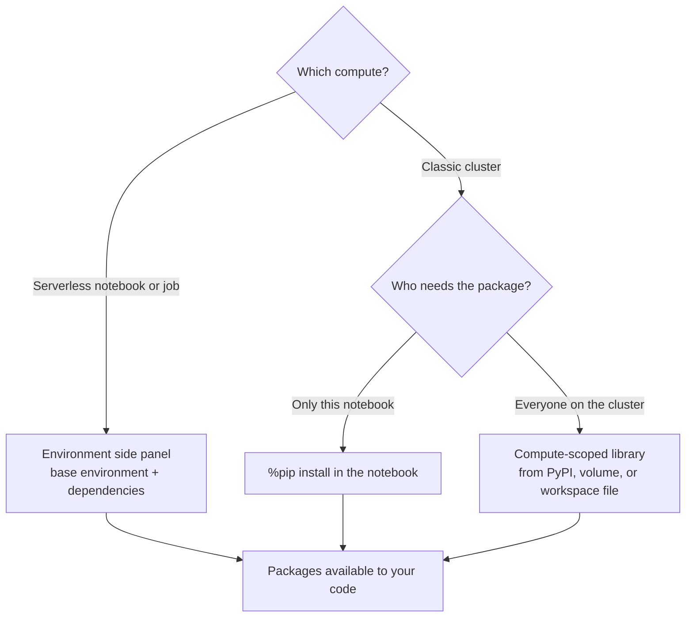

# Libraries and Environments

Mastery: `INPUT[inlineSelect(option(new), option(learning), option(solid)):mastery]`

> [!story] Context
> The [[Databricks Runtime]] and serverless environment versions include hundreds of common packages, and [[DBUs]] explain what running code costs. Real projects also need packages that are not preinstalled, at pinned versions, installed the same way every time. This note covers where libraries can be installed and which method fits each compute type.

> [!eli5] Summary
> A library is a ready-made toolkit of code that someone else wrote, such as a tool for reading Excel files. Databricks lets you add toolkits to one notebook, to a whole computer that many notebooks share, or to a saved setup that serverless computers load every time.

> [!analogy]- Analogy: a kitchen
> | Kitchen | Databricks |
> |---|---|
> | Standard equipment every kitchen has | Libraries bundled with the runtime or environment version |
> | A tool you bring for one recipe | Notebook-scoped library (`%pip`) |
> | Equipment installed for the whole shared kitchen | Compute-scoped library on a cluster |
> | A packing list you bring to any kitchen | Serverless environment (dependencies list) |
> | Your own recipe binder | Python modules in a Git folder |

## Background

On a laptop, Python packages are installed into a virtual environment with `pip` or `conda`. On a distributed [[Cluster|cluster]], every node needs the same packages, and different users on a shared cluster may need different versions. Databricks evolved several scopes for this. Some older methods are now discouraged: storing libraries in the DBFS root, installing them with init scripts, and `%conda` commands (legacy).

## Overview

| Method | Scope | Persists | Classic compute | Serverless |
|---|---|---|---|---|
| **Bundled libraries** | Everything on that runtime or environment version | Yes | Yes | Yes |
| **Notebook-scoped** (`%pip`, or `%uv` on environment version 5 and above) | Current notebook and its job runs | No, reinstalled each session | Yes | Yes |
| **Compute-scoped** (cluster libraries) | Every notebook on that cluster | Yes, while configured | Yes | No |
| **Serverless environment** (Environment side panel) | One notebook or job task | Yes, saved with the notebook or task | Environments mode only | Yes |
| **Git folder modules** | Code imported from the same Git folder | Yes | Yes | Yes |

### Precedence

When the same package is available from several places, Databricks uses the first match in this order:

1. Libraries in the Git folder
2. Notebook-scoped `%pip` libraries
3. Compute-scoped libraries
4. Libraries bundled with Databricks Runtime

### Library sources

Compute-scoped libraries can come from:

- Package repositories: PyPI, Maven, or CRAN
- [[Git Folders and Workspace Files|Workspace files]]
- Unity Catalog [[Volumes|volumes]]
- Cloud object storage
- A file on your local machine (uploaded)

Databricks recommends workspace files, Unity Catalog volumes, or package repositories. Libraries stored in the DBFS root are deprecated and disabled by default on recent runtimes (the docs cite Databricks Runtime 15.0 in one place and 15.1 in another), because any workspace user can modify files in DBFS.

## How it works



### Serverless notebooks

1. Open the notebook and attach it to **Serverless**.
2. Open the **Environment** side panel.
3. Choose a **base environment** (environment version). Databricks recommends the latest.
4. Add dependencies in any format valid in a `requirements.txt` file, for example `openpyxl==3.1.5` or a path to a wheel in a volume.
5. Apply. Check the **Installed** tab to confirm versions.

Databricks caches the notebook's virtual environment, so packages are not reinstalled each time you reopen it. Do not install PySpark on serverless, because that stops the session.

### Notebook-scoped libraries

```python
%pip install openpyxl==3.1.5 xlsxwriter==3.2.0
```

```python
# Install from a requirements file stored as a workspace file or in a volume
%pip install -r /Volumes/main/shared/libs/requirements.txt
```

- `%pip` applies only to the current notebook, not to other notebooks on the same cluster.
- Installs are lost when the session ends or the notebook detaches.
- In a SQL, Scala, or R notebook, use `%python` with `%pip` to manage the Python environment.

### Serverless job tasks

A serverless job task references an environment. In a [[Declarative Automation Bundles|bundle]]:

```yaml
resources:
  jobs:
    nightly_sales:
      name: nightly_sales
      environments:
        - environment_key: default
          spec:
            environment_version: "4"
            dependencies:
              - openpyxl==3.1.5
              - /Volumes/main/shared/libs/acme_utils-0.2.0-py3-none-any.whl
      tasks:
        - task_key: load
          environment_key: default
          spark_python_task:
            python_file: ../src/load.py
```

Older configurations use the field `client` instead of `environment_version`. Check the bundle configuration reference for the field your CLI version expects.

## Small-business considerations

> [!smallbiz] Small-business considerations
> 1. **On serverless, use the Environment side panel** for anything a notebook needs every time.
> 2. **Pin versions** (`package==x.y.z`). Unpinned packages can resolve differently on a new environment version and slow installs.
> 3. **Keep one `requirements.txt`** in your Git folder and install from it, so notebooks and jobs agree.
> 4. **Put your own wheels in a Unity Catalog volume,** not in DBFS.
> 5. **Avoid init scripts for installing packages:** Databricks advises against it, and serverless does not support them.

## Cloud differences

> [!azure]- Azure Databricks, AWS, and Google Cloud
> Library scopes, sources, and precedence are the same on all clouds. The only difference is the cloud object storage path format for libraries stored outside Unity Catalog (`abfss://` on Azure, `s3://` on AWS, `gs://` on Google Cloud). Unity Catalog volume paths (`/Volumes/...`) are identical everywhere.

## Advanced topics

> [!deepdive]- Advanced topics (301–401)
> - **Base environments:** Workspace admins can define serverless base environments (a curated dependency list on top of an environment version) and make one the default, so teams start from an approved set.
> - **Environments mode on classic compute:** Classic compute offers an Environments dependency mode that manages dependencies through base environments and the same side panel as serverless, instead of cluster libraries. Check the docs for its current release status.
> - **Access modes:** Libraries from volumes work on standard and dedicated access mode from Databricks Runtime 13.3 LTS. DBFS libraries are not supported in standard access mode. On standard access mode, JARs must be on the Unity Catalog allowlist (13.3 LTS and above).
> - **Serverless limits:** Serverless does not support compute-scoped libraries, Maven coordinates, or JARs in notebooks. Custom Spark data sources and Spark extensions that depend on compute-scoped installs need classic compute.
> - **Caching:** Serverless notebook environments are cached; notebook-scoped `%pip` installs are not cached across sessions.
> - **Databricks Connect:** With [[Databricks Connect]], local packages run on your machine, but packages used inside UDFs must also exist in the remote environment.

## Common misconceptions

> [!confusion] `%pip` does not install for everyone on the cluster
> Notebook-scoped libraries affect only the notebook that installed them. Use compute-scoped libraries for cluster-wide packages.

> [!confusion] Serverless has no cluster libraries
> Serverless compute has no cluster to attach libraries to. Use the Environment side panel or `%pip`.

> [!confusion] An environment version is not a Python virtualenv you build yourself
> The environment version fixes the Python version and bundled packages. You add your dependencies on top.

## Recall

What are the main ways to install libraries on Databricks?::Notebook-scoped (`%pip`), compute-scoped (cluster libraries), serverless environments (Environment side panel), and Git folder modules.
Do notebook-scoped libraries persist across sessions?::No. They must be reinstalled when a session starts or the notebook detaches.
Does serverless compute support compute-scoped libraries?::No.
In what format can you list serverless dependencies?::Any format valid in a `requirements.txt` file.
What is the library precedence order?::Git folder libraries, then notebook-scoped `%pip`, then compute-scoped, then runtime-bundled libraries.
Where does Databricks recommend storing library files?::Workspace files, Unity Catalog volumes, or package repositories, not DBFS.
Why should you not install PySpark on serverless?::It stops the session.
Which magic installs packages with uv on serverless environment version 5 and above?::`%uv`.

## Next steps

> [!path] Learning path
> **Needs first:** [[Notebooks]], [[Serverless Compute]], [[Databricks Runtime]]
> **Unlocks next:** [[Unity Catalog]], [[Lakeflow Jobs]], [[Testing Data Pipelines]]

> [!nextup] Next
> [[Serverless Workspaces and Default Storage]] covers workspaces that run only on serverless compute and store data in Databricks-managed storage, with no cloud setup.

> [!sources]- Sources (last verified: 2026-10-25)
> - [Install libraries (AWS)](https://docs.databricks.com/aws/en/libraries/)
> - [Install libraries (Azure Databricks)](https://learn.microsoft.com/en-us/azure/databricks/libraries/)
> - [Notebook-scoped Python libraries (AWS)](https://docs.databricks.com/aws/en/libraries/notebooks-python-libraries)
> - [Notebook-scoped Python libraries (Azure Databricks)](https://learn.microsoft.com/en-us/azure/databricks/libraries/notebooks-python-libraries)
> - [Compute-scoped libraries (Azure Databricks)](https://learn.microsoft.com/en-us/azure/databricks/libraries/cluster-libraries)
> - [Compute-scoped libraries (Google Cloud)](https://docs.databricks.com/gcp/en/libraries/cluster-libraries)
> - [Install libraries from object storage (AWS)](https://docs.databricks.com/aws/en/libraries/object-storage-libraries)
> - [Configure the serverless environment (AWS)](https://docs.databricks.com/aws/en/compute/serverless/dependencies)
> - [Configure the serverless environment (Azure Databricks)](https://learn.microsoft.com/en-us/azure/databricks/compute/serverless/dependencies)
> - [Manage dependencies using environments (AWS)](https://docs.databricks.com/aws/en/compute/environments-mode)
> - [Manage serverless base environments (Google Cloud)](https://docs.databricks.com/gcp/en/admin/workspace-settings/base-environment)
> - [Serverless compute limitations (AWS)](https://docs.databricks.com/aws/en/compute/serverless/limitations)
> - [Databricks Runtime 15.0 (EoS) release notes (AWS)](https://docs.databricks.com/aws/en/release-notes/runtime/15.0)
> - [What is DBFS? (AWS)](https://docs.databricks.com/aws/en/dbfs/)
> - [Manage libraries with %conda commands (legacy) (Google Cloud)](https://docs.databricks.com/gcp/en/archive/legacy/conda)
> - [Best practices for serverless compute (AWS)](https://docs.databricks.com/aws/en/compute/serverless/best-practices)
