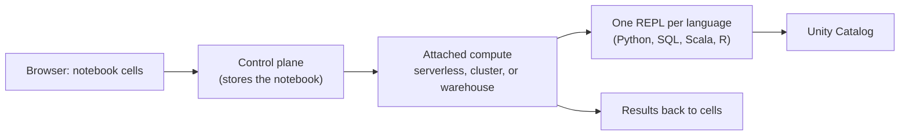

# Notebooks

Mastery: `INPUT[inlineSelect(option(new), option(learning), option(solid)):mastery]`

> [!story] Context
> [[SQL Warehouses]] and [[Serverless Compute]] provide the machines. A notebook is where most people write the code that runs on them. It is the default interactive interface of a Databricks [[Accounts and Workspaces|workspace]] for exploration, data engineering, and data science.

> [!eli5] Summary
> A notebook is a web page where you write small pieces of instructions, run them one at a time, and see the answer right under each piece. You can add notes and charts in between, so the page explains itself to the next reader.

> [!analogy]- Analogy: a lab notebook
> | Lab notebook | Databricks notebook |
> |---|---|
> | One experiment step per paragraph | One cell per step |
> | Measurements written under each step | Output shown under each cell |
> | Margin notes | Markdown cells (`%md`) |
> | Lab bench the notebook sits on | Attached compute |
> | Photocopies of earlier pages | Version history |

## Background

Interactive notebooks became the standard tool for data analysis through the Jupyter project (see [[Python for Data]]). Running notebooks against a [[Cluster|cluster]], however, used to mean setting up a server, connecting a kernel, and sharing files by email. Databricks notebooks run in the browser, attach directly to Databricks compute, and are stored in the workspace with permissions, comments, and version history.

## Overview

A Databricks notebook is a sequence of **cells**. Each cell holds code or Markdown, and you run cells individually or all at once.

| Capability | What it means |
|---|---|
| **Multiple languages** | Python, SQL, Scala, and R. Each notebook has a default language, and a cell can override it. |
| **Attach to compute** | Run on [[Serverless Compute\|serverless compute]], [[All-Purpose Compute\|all-purpose compute]], or a [[SQL Warehouses\|SQL warehouse]] for SQL. |
| **Rich output** | Tables, built-in visualizations, and widgets for parameters. |
| **AI help** | [[Genie Code\|Genie Code]] generates, explains, and fixes code in cells. |
| **Version control** | Built-in version history, plus [[Git Folders and Workspace Files\|Git folders]] for Git. |
| **Scheduling** | A notebook can run as a task in [[Lakeflow Jobs]]. |
| **File format** | New notebooks are created as `.ipynb` (Jupyter) files by default since December 20, 2024. |

## How it works



Each language runs in its own REPL on the attached compute. Variables defined in a Python cell are not visible in a Scala cell. Data passes between languages through tables or temporary views.

### Magic commands

A cell that starts with `%` changes how the cell is interpreted:

| Command | Effect |
|---|---|
| `%python`, `%sql`, `%scala`, `%r` | Run this cell in a different language |
| `%md` | Render the cell as Markdown |
| `%pip install ...` | Install notebook-scoped Python libraries (see [[Libraries and Environments]]) |
| `%run ./other_notebook` | Run another notebook inline, so its functions and variables become available. Must be alone in its cell. |
| `%sh` | Run a shell command on the driver node |
| `%fs` | Run `dbutils.fs` file system commands |

A short example that mixes Python and SQL:

```python
# Cell 1 (Python)
df = spark.read.table("samples.nyctaxi.trips")
df.createOrReplaceTempView("trips")
```

```sql
-- Cell 2 (%sql)
SELECT pickup_zip, COUNT(*) AS rides
FROM trips
GROUP BY pickup_zip
ORDER BY rides DESC
LIMIT 10;
```

### Modularizing code

There are two ways to call one notebook from another:

1. **`%run`** runs the target inline. It is quick for prototypes but couples notebooks tightly and does not pass parameters.
2. **`dbutils.notebook.run("path", timeout_seconds, {"param": "value"})`** runs the target as a separate run and passes parameters.

For reusable code, Databricks recommends Python modules stored as workspace files and imported normally (see [[Git Folders and Workspace Files]]).

### Notebook formats

| Format | Stores | Use when |
|---|---|---|
| **IPYNB** (default) | Code, environment, visualizations, widgets, and optionally outputs | You want outputs and dashboards preserved |
| **Source** (`.py`, `.sql`, `.scala`, `.r`) | Code only | You want small, clean Git diffs |

You can change the default to source format in **Settings > Developer**.

## Small-business considerations

> [!smallbiz] Small-business considerations
> 1. **Attach notebooks to serverless compute.** No cluster runs while nobody is working.
> 2. **Use Markdown cells as documentation.** A notebook that opens with a short `%md` explanation is easier for the next person to maintain.
> 3. **Promote stable notebooks to jobs.** Once a notebook produces a reliable report, schedule it with [[Lakeflow Jobs]] instead of running it by hand.
> 4. **Put shared notebooks in a Git folder** once more than one person edits them.

## Cloud differences

> [!azure]- Azure Databricks, AWS, and Google Cloud
> Notebooks work identically on all three clouds. Language support, magic commands, formats, and limits are the same. Differences come only from the attached compute, for example serverless region availability.

## Advanced topics

> [!deepdive]- Advanced topics (301–401)
> - **Scala and R on serverless.** Serverless notebooks support Python and SQL. Scala and R notebooks need classic compute.
> - **`%sh` runs on the driver only.** It does not distribute work across workers.
> - **Notebook-scoped libraries are not persistent.** `%pip` installs disappear when the session ends or the notebook detaches. Use the Environment side panel on serverless to persist dependencies.
> - **Git and notebook state.** Git operations that change notebook source can clear cell outputs and version history. Source-format notebooks do not keep notebook dashboard information.
> - **Local development.** The Databricks IDE extension for VS Code runs notebook cells locally, with DataFrame operations sent to Databricks through [[Databricks Connect]].

## Common misconceptions

> [!confusion] Variables are not shared across languages
> Each language has its own REPL. Share data between Python and SQL with a temporary view or a table, not a variable.

> [!confusion] Notebooks are not only for exploration
> A notebook can run as a production job task. Many teams schedule notebooks directly and keep shared logic in Python modules.

> [!confusion] The SQL editor is a different tool
> The [[SQL Editor]] is a SQL-only editor that runs on SQL warehouses. Notebooks support several languages and several compute types.

## Recall

Which languages do Databricks notebooks support?::Python, SQL, Scala, and R.
How do you run one cell in a language other than the notebook default?::Start the cell with a language magic such as `%sql` or `%python`.
What does `%pip install` do?::Installs notebook-scoped Python libraries for the current notebook session.
What is the difference between `%run` and `dbutils.notebook.run()`?::`%run` runs another notebook inline and shares its variables; `dbutils.notebook.run()` runs it separately and can pass parameters.
What is the default format for new Databricks notebooks?::IPYNB (Jupyter), since December 20, 2024.
Can a Python variable be read in a `%scala` cell?::No. Each language has its own REPL.
Where does a `%sh` command run?::On the driver node only.

## Next steps

> [!path] Learning path
> **Needs first:** [[Accounts and Workspaces]], [[Compute Types]]
> **Unlocks next:** [[Genie Code]], [[Git Folders and Workspace Files]], [[Libraries and Environments]], [[Lakeflow Jobs]]

> [!nextup] Next
> [[Genie Code]] (now Genie Code) covers the AI helper built into notebooks that writes, explains, and fixes code.

> [!sources]- Sources (last verified: 2026-10-25)
> - [Develop code in Databricks notebooks (AWS)](https://docs.databricks.com/aws/en/notebooks/notebooks-code)
> - [Basic editing in Databricks notebooks (AWS)](https://docs.databricks.com/aws/en/notebooks/basic-editing)
> - [Orchestrate Databricks notebooks and modularize code (AWS)](https://docs.databricks.com/aws/en/notebooks/notebook-workflows)
> - [Orchestrate Databricks notebooks and modularize code (Azure Databricks)](https://learn.microsoft.com/en-us/azure/databricks/notebooks/notebook-workflows)
> - [Manage Databricks notebook format (AWS)](https://docs.databricks.com/aws/en/notebooks/notebook-format)
> - [Manage Databricks notebook format (Google Cloud)](https://docs.databricks.com/gcp/en/notebooks/notebook-format)
> - [December 2024 release notes (AWS)](https://docs.databricks.com/aws/en/release-notes/product/2024/december)
> - [Notebook-scoped Python libraries (AWS)](https://docs.databricks.com/aws/en/libraries/notebooks-python-libraries)
> - [Run and debug notebook cells with Databricks Connect using the Databricks IDE extension (AWS)](https://docs.databricks.com/aws/en/dev-tools/vscode-ext/notebooks)
> - [Serverless compute limitations (AWS)](https://docs.databricks.com/aws/en/compute/serverless/limitations)
