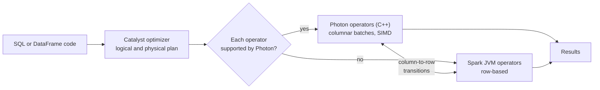

# Photon

Mastery: `INPUT[inlineSelect(option(new), option(learning), option(solid)):mastery]`

> [!story] Previously
> The [[Databricks Runtime]] gave every cluster a tested Spark stack. But Spark's engine runs on the [[JVM]], and over time the JVM became the bottleneck: storage and networks had become fast enough that CPU time spent interpreting rows dominated. To make the lakehouse fast enough to replace a warehouse, Databricks rewrote the execution engine.

> [!eli5] In one breath
> Photon is a faster engine that Databricks put under the hood. You write the same queries as before, but instead of handling one row at a time, Photon handles big batches of values at once, using modern processors efficiently. Most queries just finish sooner.

> [!analogy] Analogy: a cashier vs a conveyor scanner
> - **Row-at-a-time Spark** is a cashier who picks up each item, looks at it, and types its price.
> - **Photon** is a conveyor scanner that reads a whole tray of items in one sweep. Same groceries, same receipt, much less time per item.
> - **The store's manager** ([[Catalyst Optimizer|Catalyst]]) still decides what goes on the belt and in what order. Photon only replaces the scanning.
> - **Odd items** (a hand-written [[UDF]]) still go to the human cashier. Photon hands them back to regular Spark.

## Why it exists

The lakehouse promise was "warehouse performance on open files". Spark already had a strong optimizer ([[Catalyst Optimizer]]) and code generation ([[Tungsten]]), but it still ran on the JVM:

- Generated Java code is hard to tune for modern CPU features such as SIMD (one instruction on many values).
- Garbage collection pauses hurt large memory-heavy queries.
- Real-world lake data is messy (many small files, strings, nulls, nested types). Code generation for every query shape is complex.

Cloud data warehouses with native C++ engines were faster on SQL. Databricks needed an engine that matched them while reading [[Delta Lake]] and [[Apache Parquet]] files directly. Photon was announced as generally available in 2022 (see the July 2022 release notes).

## What it actually is

The docs define Photon as Databricks' **native vectorized query engine**, written entirely in **C++**, and compatible with Apache Spark APIs. The key points:

| Property | What it means |
|---|---|
| **Native** | Compiled C++, not JVM code. No garbage collection for data processing. |
| **Vectorized** | Processes data in **columnar batches** (many values of one column at a time) instead of row by row. See [[Columnar Storage]]. |
| **Spark-compatible** | Runs your existing SQL and DataFrame code with no changes. The Spark optimizer still builds the plan. |
| **Partial by design** | Supported operators run in Photon; anything unsupported falls back to regular Spark in the same query. |

Where you get it:

- **On by default:** [[SQL Warehouses]] (all types) and [[Serverless Compute]].
- **Opt in:** classic clusters, from Databricks Runtime 9.1 LTS and later, using the **Photon acceleration** checkbox (or `runtime_engine: PHOTON` in the API).

What it accelerates:

- SQL queries and DataFrame operations: scans, filters, joins, aggregations, sorts, window functions.
- Writes to Delta and Parquet, including `MERGE`, `UPDATE`, `DELETE` (see [[MERGE and Upserts]]).
- ETL pipelines and stateless streaming workloads.

What it does not accelerate:

- Python and Scala [[UDF|UDFs]], RDD code, and other row-level user code. Those run in normal Spark.
- Work that is dominated by something else, such as a tiny query or a slow external source.

## How it works



1. Spark parses your query and the [[Catalyst Optimizer|Catalyst optimizer]] builds a physical plan, as always.
2. Databricks walks the plan and replaces each supported operator with its Photon version.
3. Photon operators pass **columnar batches** between each other. Tight C++ loops over a batch of one column let the CPU use SIMD instructions and caches well.
4. If an operator is unsupported, Photon converts batches back to rows and hands them to Spark. Each conversion costs time, so a plan that switches back and forth often gains less.

Turning it on for a classic cluster, with the CLI and a JSON spec:

```bash
databricks clusters create --json '{
  "cluster_name": "etl-photon",
  "spark_version": "17.3.x-scala2.13",
  "runtime_engine": "PHOTON",
  "node_type_id": "i3.xlarge",
  "num_workers": 2,
  "autotermination_minutes": 30
}'
```

Checking whether a query used Photon:

- In a SQL warehouse or serverless notebook, open the **query profile**. Photon operators are labeled as Photon, and the summary shows the share of task time spent in Photon.
- On classic compute, the [[Spark UI]] SQL tab shows Photon node names in the plan. `EXPLAIN` output also marks Photon operators:

```sql
EXPLAIN SELECT store_id, SUM(amount) FROM sales.orders.daily GROUP BY store_id;
-- Look for operators such as PhotonGroupingAgg and PhotonScan in the plan
```

> [!smallbiz] For a small business
> You will likely use Photon without thinking about it: it is already on in SQL warehouses and serverless compute. The only decision is on **classic clusters**, where Photon uses a higher [[DBUs|DBU]] rate. A rule of thumb:
> - **Turn it on** for SQL-heavy ETL and large joins and aggregations. Faster runs often cost less overall, because you pay for fewer minutes.
> - **Leave it off** for clusters that mostly run Python UDFs, pandas code, or ML training, where Photon cannot help.
>
> Test one real job both ways and compare total cost, not just speed. See [[How Databricks Pricing Works]].

## On each cloud

> [!azure]- Azure Databricks
> Photon behaves the same on all three clouds. On classic compute, use Photon-capable VM families recommended in the docs. The Azure docs cite vendor TPC-DS benchmark results for price-performance; treat those as Databricks' own claims.

> [!aws]- Databricks on AWS
> Same engine. Choose instance types the compute UI shows as Photon-capable. Graviton instances support Photon on recent runtimes; check [[EC2 Instance Types and Graviton]].

> [!gcp]- Databricks on Google Cloud
> Same engine and the same on/off controls. See [[Compute on Google Cloud]] for machine types.

## Going deeper

> [!deepdive]- Expert notes (301–401)
> - **Interpreted vectorization, not code generation.** Spark's [[Tungsten]] generates Java code per query (whole-stage codegen). Photon instead uses pre-compiled, specialized C++ kernels that run over column batches. (Unconfirmed against official sources: the design rationale published in Databricks' Photon research paper.)
> - **Adaptivity at run time.** Photon specializes kernels by batch properties, for example taking a fast path when a batch has no nulls or when strings are all ASCII. This complements Spark's [[Adaptive Query Execution]], which re-plans between stages.
> - **Memory management.** Photon manages its own memory outside the JVM heap and cooperates with Spark's memory manager. Very large hash joins and aggregations can still [[Spill|spill]] to disk.
> - **Transitions are the tax.** A plan that alternates Photon and non-Photon operators pays for column-to-row conversions. Replacing a Python UDF with a built-in SQL function often lets the whole stage stay in Photon.
> - **Photon plus Delta features.** Photon pairs with Delta [[Deletion Vectors]], [[Liquid Clustering]], and [[Data Skipping]]; much of the speed in practice comes from reading less data, then processing what remains quickly.
> - **Not in open source.** Photon exists only in Databricks. The same code runs on open-source Spark, just without Photon's speed-ups. That matters when you compare Databricks performance with self-managed Spark.

## Common confusions

> [!confusion] Photon is not a separate product you program
> There is no Photon API. You write normal SQL or DataFrame code. Photon is an execution engine that Databricks swaps in under Spark.

> [!confusion] "Photon on" does not mean "everything is in Photon"
> Unsupported operators and UDFs run in regular Spark inside the same query. Check the query profile to see how much actually ran in Photon.

## Recall

What is Photon?::Databricks' native vectorized query engine, written in C++ and compatible with Spark APIs.
Does Photon require code changes?::No. Existing SQL and DataFrame code runs unchanged.
Where is Photon on by default?::SQL warehouses and serverless compute.
From which runtime version can classic clusters use Photon?::Databricks Runtime 9.1 LTS and above.
Which API field enables Photon on a cluster?::`runtime_engine: PHOTON`.
What happens to an operator Photon does not support?::It falls back to regular Spark execution within the same query.
Name two kinds of code Photon does not speed up.::Python or Scala UDFs, and RDD-based code.
What does "vectorized" mean in Photon?::It processes columnar batches of values at a time instead of one row at a time.
Which Spark component does Photon complement rather than replace?::The Catalyst optimizer, which still builds the query plan.

## Where next

> [!path] Learning path
> **Needs first:** [[Databricks Runtime]], [[Catalyst Optimizer]], [[Columnar Storage]]
> **Unlocks next:** [[SQL Warehouses]], [[Query Performance and Caching]], [[Compute Types]]

> [!nextup] Up next in the story
> Photon and the runtime are the engine. But Databricks offers several very different kinds of machines to run that engine on. Here is the map: [[Compute Types]].

> [!sources]- Sources (last verified: 2026-10-25)
> - [What is Photon? (Azure Databricks)](https://learn.microsoft.com/en-us/azure/databricks/compute/photon)
> - [SQL warehouse types (AWS)](https://docs.databricks.com/aws/en/compute/sql-warehouse/warehouse-types)
> - [Best practices for reliability (AWS)](https://docs.databricks.com/aws/en/lakehouse-architecture/reliability/best-practices)
> - [July 2022 platform release notes](https://docs.databricks.com/release-notes/product/2022/july.html)
> - [Azure Databricks technical terminology glossary](https://learn.microsoft.com/en-us/azure/databricks/resources/glossary)
