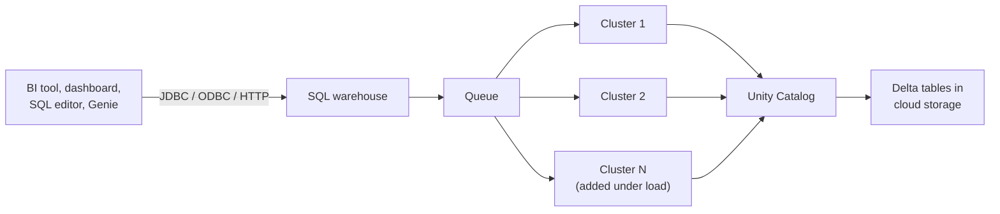

# SQL Warehouses

Mastery: `INPUT[inlineSelect(option(new), option(learning), option(solid)):mastery]`

> [!story] Context
> [[Serverless Compute]] covers notebooks, jobs, and pipelines. SQL and BI workloads have a different shape: many short queries from many users at once, often from tools outside Databricks such as Power BI or Tableau. A SQL warehouse is the compute type built for that pattern.

> [!eli5] Summary
> A SQL warehouse is a group of computers that only answers database questions. Analysts, dashboards, and reporting tools send it questions, and it adds or removes computers as the number of questions goes up and down.

> [!analogy]- Analogy: a bank with tellers
> | Bank | SQL warehouse |
> |---|---|
> | One teller window | One cluster in the warehouse |
> | Size of each window's team | Cluster size (2X-Small to 4X-Large) |
> | Opening more windows when the line grows | Scaling out to more clusters |
> | Customers waiting in line | Queued queries |
> | Closing the branch after hours | Auto stop |

## Background

Traditional [[Data Warehouses|data warehouses]] bundled storage and compute in one system. On Databricks, table data stays in cloud storage as [[Delta Lake]] files, and compute is separate (see [[Storage vs Compute]]). A SQL warehouse is the compute half for SQL. It was previously called a **SQL endpoint**.

General-purpose clusters can run SQL, but they are not tuned for high concurrency, and BI tools need a stable connection target with [[JDBC and ODBC]] drivers. SQL warehouses provide that target, with [[Photon]] enabled and query queuing built in.

## Overview

A SQL warehouse runs SQL from the [[SQL Editor]], [[AI-BI Dashboards]], [[Genie]], notebooks attached to a warehouse, [[Lakeflow Jobs]] SQL tasks, and external [[BI Tools]]. There are three types:

| | Serverless | Pro | Classic |
|---|---|---|---|
| Where compute runs | Databricks serverless compute plane | Your cloud account | Your cloud account |
| Start-up time | Typically 2 to 6 seconds | About 4 minutes | About 4 minutes |
| Scaling | Fast, using Intelligent Workload Management | Slower, manual cluster limits | Slower, manual cluster limits |
| Photon | Yes | Yes | Yes |
| Predictive IO | Yes | Yes | No |
| Intelligent Workload Management | Yes | No | No |
| Typical use | Most workloads (recommended) | Serverless unavailable in region, or custom networking | Entry-level performance |

**Defaults differ by interface.** The UI creates serverless warehouses by default (pro in workspaces without serverless support). The API creates classic warehouses unless you set `enable_serverless_compute` to `true` and `warehouse_type` to `PRO`.

## How it works



A warehouse has three main settings:

1. **Cluster size.** The resources of each cluster, from 2X-Small to 4X-Large. A 5X-Large size exists but is labeled Public Preview in one page and Beta in another, so check before relying on it. Increase the size when queries [[Spill|spill]] to disk.
2. **Scaling (minimum and maximum clusters).** More clusters serve more concurrent queries. Size controls how fast a single query runs; cluster count controls how many queries run at once.
3. **Auto stop.** Idle minutes before the warehouse stops.

| Setting | Serverless | Pro and classic |
|---|---|---|
| Auto stop default | 10 minutes | 45 minutes |
| Auto stop minimum (UI) | 5 minutes | 10 minutes |
| Scale out | Intelligent Workload Management queues, places, and autoscales queries | Adds a cluster after queries wait in the queue; scales down after about 15 minutes of low load |

Create a small serverless warehouse with the [[Databricks CLI]]:

```bash
databricks warehouses create --json '{
  "name": "analytics-small",
  "cluster_size": "2X-Small",
  "min_num_clusters": 1,
  "max_num_clusters": 2,
  "auto_stop_mins": 10,
  "enable_serverless_compute": true,
  "warehouse_type": "PRO"
}'
```

Check warehouse configuration history with the warehouses [[System Tables|system table]]:

```sql
SELECT warehouse_name, warehouse_type, warehouse_size, auto_stop_minutes
FROM system.compute.warehouses
WHERE delete_time IS NULL;
```

## Small-business considerations

> [!smallbiz] Small-business considerations
> One small serverless warehouse covers most small teams.
> 1. **Start at 2X-Small or X-Small** with a maximum of one or two clusters.
> 2. **Keep auto stop at 10 minutes or lower.** Serverless restarts in seconds, so a short timer costs little in waiting time.
> 3. **Watch the Peak Queued Queries metric.** If queries queue, raise the maximum cluster count. If single queries are slow or spill, raise the size.
> 4. **Point Power BI or Tableau at the same warehouse** through its connection details page (see [[Connecting Power BI]]).
>
> Warehouses bill in [[DBUs]] per hour based on size and running time. See [[How Databricks Pricing Works]] for the official rates.

## Cloud differences

The warehouse model and SQL are the same on all clouds. Differences are in availability and the BI ecosystem.

> [!azure]- Azure Databricks
> - Serverless SQL warehouses are available in most Azure regions. In regions without serverless, use a pro warehouse.
> - Power BI has a native Azure Databricks connector and is the most common BI pairing. See [[Power BI on Azure Databricks]].

> [!aws]- Databricks on AWS
> - Pro and classic warehouses run EC2 instances in your AWS account, so they need EC2 quota in your region.
> - Pro warehouses are the option when you need warehouse compute inside your own VPC.

> [!gcp]- Databricks on Google Cloud
> - Pro and classic warehouses run Compute Engine VMs in your project. Check serverless SQL availability for your region; some regions receive it later.

## Advanced topics

> [!deepdive]- Advanced topics (301–401)
> - **Sizing strategy.** Databricks suggests starting larger and scaling down. Size and count are independent axes: a 4X-Large warehouse with one cluster runs large single queries; a Small warehouse with ten clusters serves high concurrency.
> - **Caching.** Warehouses use result caching and disk caching. Repeated dashboard queries often return from cache. See [[Query Performance and Caching]].
> - **API constraints.** API `auto_stop_mins` values must be `0` (no auto stop) or at least `10` for non-serverless warehouses. The serverless create guide documents lower values. Treat the exact minimum as version dependent.
> - **Observability.** Query history and the `system.query.history` and `system.compute.warehouses` tables show who ran what, on which warehouse, and for how long.
> - **Governance.** Every query runs as the calling user (or the BI tool's identity), and [[Unity Catalog]] enforces grants, row filters, and column masks.

## Common misconceptions

> [!confusion] A SQL warehouse does not store data
> Despite the name, a SQL warehouse is only compute. Tables live in cloud storage and are governed by Unity Catalog. Stopping or deleting a warehouse does not delete data.

> [!confusion] Bigger size does not mean more concurrent users
> Cluster size speeds up individual queries. Concurrency comes from the number of clusters.

> [!confusion] "SQL endpoint" is the old name
> Older docs, Terraform code, and APIs refer to SQL endpoints. They are the same thing as SQL warehouses.

## Recall

What is a SQL warehouse?::A Databricks compute resource that runs SQL for the SQL editor, dashboards, Genie, and BI tools.
What are the three SQL warehouse types?::Serverless, pro, and classic.
Which SQL warehouse type does Databricks recommend for most workloads?::Serverless.
How fast does a serverless SQL warehouse typically start?::2 to 6 seconds.
How long do pro and classic warehouses take to start?::About 4 minutes.
Which type does the API create by default?::Classic, unless `enable_serverless_compute` is true and `warehouse_type` is PRO.
What setting increases concurrency on a SQL warehouse?::The maximum number of clusters.
What is the default auto stop for a serverless SQL warehouse?::10 minutes.
What was a SQL warehouse called before?::A SQL endpoint.

## Next steps

> [!path] Learning path
> **Needs first:** [[Compute Types]], [[SQL]]
> **Unlocks next:** [[Databricks SQL]], [[SQL Editor]], [[AI-BI Dashboards]], [[Connecting Power BI]]

> [!nextup] Next
> [[Notebooks]] covers the main interactive interface for writing Python and SQL against this compute.

> [!sources]- Sources (last verified: 2026-10-25)
> - [SQL warehouse types (AWS)](https://docs.databricks.com/aws/en/compute/sql-warehouse/warehouse-types)
> - [SQL warehouse types (Azure Databricks)](https://learn.microsoft.com/en-us/azure/databricks/compute/sql-warehouse/warehouse-types)
> - [SQL warehouse sizing, scaling, and queuing behavior (AWS)](https://docs.databricks.com/aws/en/compute/sql-warehouse/warehouse-behavior)
> - [Create a SQL warehouse (AWS)](https://docs.databricks.com/aws/en/compute/sql-warehouse/create)
> - [Warehouses system table reference (AWS)](https://docs.databricks.com/aws/en/admin/system-tables/warehouses)
> - [Create a warehouse (REST API reference)](https://docs.databricks.com/api/warehouses/v1/create-warehouse)
> - [Compute selection recommendations (AWS)](https://docs.databricks.com/aws/en/compute/choose-compute)
