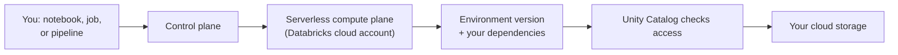

# Serverless Compute

Mastery: `INPUT[inlineSelect(option(new), option(learning), option(solid)):mastery]`

> [!story] Context
> [[Jobs Compute]] removed idle cost from scheduled work, but you still choose VM types, worker counts, and runtime versions, and you wait minutes for every cluster to start. Serverless compute removes cluster configuration entirely: Databricks keeps a pool of warm machines in its own cloud account and assigns capacity to your workload in seconds.

> [!eli5] Summary
> Serverless compute means you press "run" and Databricks finds the computers for you. You do not pick machine sizes or wait for them to turn on, and you pay only while your work is running.

> [!analogy]- Analogy: a taxi rank instead of a car fleet
> | Taxi rank | Serverless compute |
> |---|---|
> | Taxis already waiting at the rank | Warm compute pool kept by Databricks |
> | You state the destination, not the car model | You submit code, not a cluster spec |
> | The meter runs only during the trip | Billing in [[DBUs]] only while work runs |
> | The taxi company maintains the cars | Databricks patches and upgrades the runtime |
> | Fixed set of car models | Fixed set of environment versions |

## Background

On classic compute (see [[All-Purpose Compute]] and [[Jobs Compute]]), each [[Cluster|cluster]] is a set of [[Virtual Machine|virtual machines]] that Databricks launches in your cloud account. That model has three costs for a small team:

- **Start-up time.** A classic cluster takes several minutes to provision.
- **Configuration work.** Someone has to choose instance types, [[Autoscaling|autoscaling]] limits, [[Auto Termination|auto termination]], and a [[Databricks Runtime]] version, and then keep them current.
- **Idle spend.** A cluster that someone forgets to stop keeps billing.

Serverless compute moves the machines into the serverless compute plane, which Databricks operates (see [[Control Plane and Compute Plane]]). Databricks handles provisioning, scaling, and runtime upgrades.

## Overview

Serverless compute is available for these workload types:

| Workload | Where you select it | Notes |
|---|---|---|
| Notebooks | Compute drop-down, **Serverless** | Interactive Python and SQL |
| [[Lakeflow Jobs]] | Task compute set to **Serverless** | Supports a cost-saving standard performance mode |
| [[Lakeflow Spark Declarative Pipelines]] | Pipeline setting **Serverless** | Supports standard performance mode |
| [[SQL Warehouses]] | Warehouse type **Serverless** | A separate product with its own sizing model |

Other serverless products, such as [[Model Serving]] and [[Databricks Apps]], use the same serverless compute plane but are covered in their own notes.

### Performance modes

Serverless jobs and pipelines offer two performance modes:

| Mode | Start-up | Use for | Available for |
|---|---|---|---|
| **Performance optimized** (default) | Typically seconds | Interactive work, time-sensitive jobs | Notebooks, jobs, pipelines |
| **Standard** | About 4 to 6 minutes | Cost-sensitive batch work | Jobs and pipelines only |

Both modes bill under the same SKU. Standard mode consumes fewer DBUs for the same work.

### Environment versions

Serverless compute does not use Databricks Runtime version numbers. Instead, you select an **environment version**, which defines a stable client API based on [[Spark Connect]] plus a fixed set of Python packages. Databricks upgrades the server side independently, without code changes on your side. Each version is supported for three years from its release.

| Version | Released | Includes |
|---|---|---|
| 4 | August 13, 2025 | |
| 5 | February 25, 2026 | Databricks Connect 18 |
| 6 | September 3, 2026 | Python 3.12.3, Scala 2.13.18, Databricks Connect 19 |

## How it works



1. You attach a notebook to **Serverless**, or set a job task's compute to serverless.
2. The control plane assigns capacity from a warm pool in the serverless compute plane.
3. The environment version and any dependencies from the **Environment** side panel are loaded (see [[Libraries and Environments]]).
4. [[Unity Catalog]] authorizes every read and write. Serverless compute always runs with Unity Catalog enforced.
5. When the work finishes, the capacity returns to the pool. Billing stops.

A serverless job task defined in a [[Declarative Automation Bundles|bundle]] needs no cluster block. Omitting compute settings is enough, and you can pin the environment:

```yaml
resources:
  jobs:
    nightly_sales:
      name: nightly_sales
      tasks:
        - task_key: load
          notebook_task:
            notebook_path: ../src/load_sales.ipynb
      # No job_clusters or new_cluster block. In a workspace with serverless
      # enabled, a notebook task without compute settings runs on serverless.
```

### What serverless does not support

The serverless limitations page lists the main gaps. Use classic compute when you need any of them:

- R, and Scala in notebooks. (JAR tasks in jobs are supported.)
- [[RDDs|RDD]] APIs. Only Spark Connect APIs are available.
- Init scripts, compute policies, and compute-scoped libraries. Use the Environment side panel or `%pip` instead.
- Maven coordinates for libraries.
- VPC or VNet peering. Private access uses private endpoints instead (see [[Serverless Network Security]]).

## Small-business considerations

> [!smallbiz] Small-business considerations
> Serverless is the default choice for a team without a dedicated platform engineer.
> 1. **Use serverless notebooks for exploration.** No cluster runs while nobody is working.
> 2. **Use serverless jobs in standard mode for nightly batch work** where a few minutes of start-up delay does not matter. It consumes fewer DBUs.
> 3. **Create a serverless usage policy** so that each notebook and job carries a tag such as `team: finance`. The tags appear in the `custom_tags` column of `system.billing.usage`. The feature is in Public Preview as of October 2026.
> 4. **Set a budget alert** in the account console. See [[Budgets and Usage Dashboards]].
>
> Serverless DBU rates differ from classic rates, but classic compute also bills you separately for the VMs. Compare total cost, not the DBU rate alone. See [[How Databricks Pricing Works]].

## Cloud differences

Serverless compute works the same way on all three clouds. The differences are availability and network billing.

> [!azure]- Azure Databricks
> - Serverless compute is available in most, but not all, Azure regions. Check the region availability page before choosing a [[Region|region]].
> - Serverless [[Egress|egress]] control uses network policies. On Azure, the default network policy applies only to Premium tier workspaces.
> - Per-GB private connectivity charges for serverless are waived for now. Hourly private endpoint fees are billed.

> [!aws]- Databricks on AWS
> - Private access from serverless to resources in your VPC uses private endpoints configured through a network connectivity configuration (NCC). Each account can have up to 20 NCCs per region.
> - New serverless features usually reach AWS first.

> [!gcp]- Databricks on Google Cloud
> - Networking charges for serverless are currently waived on Google Cloud, and Databricks states it will give notice before any change.
> - The serverless outbound IP set can change, so Databricks recommends automating firewall allowlist updates.

## Advanced topics

> [!deepdive]- Advanced topics (301–401)
> - **Spark Connect client.** Serverless notebooks and jobs talk to the engine through [[Spark Connect]]. This is why RDD APIs and direct SparkContext access are unavailable, and why the same environment version pairs with a specific [[Databricks Connect]] version.
> - **Multiple usage records.** A single serverless workload can produce several billing records in `system.billing.usage`. Sum them to get the DBU consumption of a run.
> - **Networking cost.** Networking charges apply only to serverless, because classic compute traffic is billed by your cloud provider directly.
> - **Migration.** Databricks recommends running a migrated workload in performance-optimized mode while validating it, then choosing the mode that fits before production. Workloads that depend on R, Scala notebooks, RDDs, or init scripts stay on classic compute.
> - **Package pinning.** Pin Python package versions in the environment. Unpinned packages can resolve differently across environment versions and add install latency.

## Common misconceptions

> [!confusion] "Serverless" does not mean "no servers"
> Machines still run your code. Databricks owns and operates them in the serverless compute plane instead of launching them in your cloud account.

> [!confusion] Serverless SQL warehouses and serverless compute are configured differently
> A serverless [[SQL Warehouses|SQL warehouse]] has a T-shirt size, cluster scaling limits, and an auto-stop timer. Serverless compute for notebooks and jobs has no size setting at all.

> [!confusion] Environment versions are not Databricks Runtime versions
> Environment version 6 is not related to Databricks Runtime 6. Environment versions are a separate numbering for serverless only.

## Recall

What is serverless compute?::Compute that Databricks provisions and scales in its own serverless compute plane, starting in seconds, with no cluster configuration.
Which workloads can use serverless compute?::Notebooks, Lakeflow Jobs, Lakeflow Spark Declarative Pipelines, and SQL warehouses (plus serving and apps).
What are the two serverless performance modes?::Performance optimized (default, starts in seconds) and standard (about 4 to 6 minutes start-up, fewer DBUs, jobs and pipelines only).
What does a serverless environment version define?::A stable client API based on Spark Connect plus a fixed set of packages.
How long is a serverless environment version supported?::Three years from its release date.
When was serverless environment version 6 released?::September 3, 2026.
Name three things serverless compute does not support.::R, Scala notebooks, RDD APIs, init scripts, compute policies, compute-scoped libraries, Maven coordinates (any three).
How do you attribute serverless spend to a team?::Assign a serverless usage policy, whose tags land in `custom_tags` in `system.billing.usage`.

## Next steps

> [!path] Learning path
> **Needs first:** [[Compute Types]], [[Control Plane and Compute Plane]]
> **Unlocks next:** [[SQL Warehouses]], [[Libraries and Environments]], [[Serverless Network Security]]

> [!nextup] Next
> [[SQL Warehouses]] covers the compute type built only for SQL and BI, available in serverless, pro, and classic types.

> [!sources]- Sources (last verified: 2026-10-25)
> - [Best practices for serverless compute (AWS)](https://docs.databricks.com/aws/en/compute/serverless/best-practices)
> - [Best practices for serverless compute (Azure Databricks)](https://learn.microsoft.com/en-us/azure/databricks/compute/serverless/best-practices)
> - [Serverless compute limitations (AWS)](https://docs.databricks.com/aws/en/compute/serverless/limitations)
> - [Serverless compute limitations (Google Cloud)](https://docs.databricks.com/gcp/en/compute/serverless/limitations)
> - [Environment versions (AWS)](https://docs.databricks.com/aws/en/release-notes/serverless/environment-version/)
> - [Serverless compute release notes (AWS)](https://docs.databricks.com/aws/en/release-notes/serverless)
> - [Run your Lakeflow Jobs with serverless compute for workflows (AWS)](https://docs.databricks.com/aws/en/jobs/run-serverless-jobs)
> - [Migrate from classic compute to serverless compute (AWS)](https://docs.databricks.com/aws/en/compute/serverless/migration)
> - [Attribute usage with serverless usage policies (AWS)](https://docs.databricks.com/aws/en/admin/usage/budget-policies)
> - [Understand Databricks networking costs (AWS)](https://docs.databricks.com/aws/en/security/network/serverless-network-security/cost-management)
> - [Understand Databricks networking costs (Azure Databricks)](https://learn.microsoft.com/en-us/azure/databricks/security/network/serverless-network-security/cost-management)
> - [Understand Databricks serverless networking costs (Google Cloud)](https://docs.databricks.com/gcp/en/security/network/serverless-network-security/cost-management)
> - [Manage network policies for serverless egress control (Azure Databricks)](https://learn.microsoft.com/en-us/azure/databricks/security/network/serverless-network-security/manage-network-policies)
> - [Configure private connectivity to AWS-managed resources (AWS)](https://docs.databricks.com/aws/en/security/network/serverless-network-security/pl-aws-resources)
