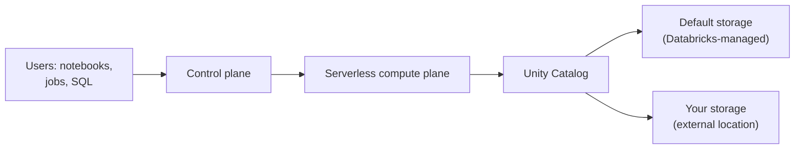

# Serverless Workspaces and Default Storage

Mastery: `INPUT[inlineSelect(option(new), option(learning), option(solid)):mastery]`

> [!story] Context
> [[Libraries and Environments]] showed how serverless compute installs code without a cluster. A classic workspace still needs cloud resources that you create and own: a storage bucket or storage account, credentials, and often a network. A serverless workspace removes that setup. Databricks provides both the compute and the storage.

> [!eli5] Summary
> A serverless workspace is a Databricks workspace that comes ready to use. Databricks runs the computers and also keeps the data in storage it manages, so you do not set up anything in your own cloud account before you start.

> [!analogy]- Analogy: a furnished apartment
> | Furnished apartment | Serverless workspace |
> |---|---|
> | Furniture and utilities included | Serverless compute and default storage included |
> | You can still bring your own furniture | You can still connect your own cloud storage |
> | The landlord maintains the building | Databricks operates the compute and storage |

## Background

A classic workspace depends on resources in your cloud account:

- A storage location for workspace system data and the legacy [[DBFS]] root: the [[Workspace Storage Bucket]] on AWS, or a storage account in the [[Managed Resource Group]] on Azure.
- Credentials that let Databricks launch [[Virtual Machine|virtual machines]] in your account.
- Optionally, a customer-managed network such as [[VNet Injection]] or a [[Customer-Managed VPC on AWS|customer-managed VPC]].

Each of these is a setup step and an ongoing responsibility. For a team that only needs notebooks, jobs, and SQL, that work has no direct benefit.

## Overview

A serverless workspace is deployed in your Databricks account with [[Serverless Compute|serverless compute]] and default storage preconfigured. You do not provide credentials, storage, or network resources.

| Term | Definition |
|---|---|
| Serverless workspace | A workspace that runs only serverless compute. Selected at creation as compute mode `SERVERLESS` (API) or workspace type **Serverless** (Azure portal). |
| Default storage | Fully managed object storage in Databricks' cloud account, in the same [[Region\|region]] as the workspace. |
| Default catalog | The [[Unity Catalog]] catalog created with the workspace. Its managed tables and volumes live in default storage. |

Status: serverless workspaces became generally available in January 2026 (January 29 in the AWS release notes, January 30 in the Azure Databricks release notes).

Default storage is used for:

- Internal workspace storage (system data such as job output and logs).
- The default catalog created with the workspace.
- Any additional catalogs you create on default storage.

You can also create catalogs on your own cloud object storage through [[Storage Credentials and External Locations|external locations]], in the same workspace.

## How it works



1. You create the workspace with the serverless option.
2. Databricks provisions the workspace, the default catalog, and default storage in the selected region.
3. Every notebook, job, pipeline, and SQL warehouse runs on serverless compute.
4. Unity Catalog authorizes access to tables and volumes, whether they sit in default storage or in your own storage.

### Create a serverless workspace (AWS and Google Cloud)

1. Sign in to the [[Account Console|account console]].
2. Open the **Workspace** tab.
3. Click **Create workspace**.
4. Enter a name and a region.
5. Select the option to use serverless compute and default storage.
6. Click **Create**.

You can also create one with the account API (compute mode `SERVERLESS`) or the [[Terraform Provider]]. Customer-managed keys for managed services can be set at creation only through the API or Terraform.

### First objects in a new workspace

```sql
-- Managed objects in the default catalog land in default storage
CREATE SCHEMA IF NOT EXISTS sales;

CREATE TABLE sales.orders (
  order_id   BIGINT,
  order_date DATE,
  amount     DECIMAL(10, 2)
);

-- A managed volume for CSV uploads, also in default storage
CREATE VOLUME IF NOT EXISTS sales.landing;
```

### Recovery of dropped data

When you drop a managed table or volume on default storage, Databricks keeps the data files for a 7-day recovery window. Use `UNDROP TABLE` within that window. After it ends, the files are purged within 48 hours. Storage billing continues during the recovery window.

```sql
DROP TABLE sales.orders;
SHOW TABLES DROPPED IN sales;
UNDROP TABLE sales.orders;
```

### Limitations

Serverless workspaces inherit all [[Serverless Compute|serverless compute limitations]] (no R, no Scala notebooks, no RDD APIs, no init scripts). Default storage adds its own:

| Limitation | Detail |
|---|---|
| Classic compute | Classic compute cannot read or write data in default storage. |
| Cross-workspace access | Default-storage catalogs are visible only in the creating workspace by default. Other workspaces can be granted access but must use serverless compute. |
| Sharing | Partitioned tables cannot be shared through [[OpenSharing]]. Other assets can be shared only with Databricks recipients on the same cloud, who must use serverless compute. |
| External engines | Credential vending is not supported, so external engines cannot read default storage through the Unity REST API or Iceberg REST catalog. |
| ODBC with front-end Private Link | Queries returning more than about 5 MiB from default-storage tables fail, because Cloud Fetch does not support front-end Private Link. |
| DBFS | DBFS access is limited. Use volumes instead. |

## Small-business considerations

> [!smallbiz] Small-business considerations
> A serverless workspace is the shortest path to a working Databricks environment for a team without a cloud engineer.
> - Choose it when your work is SQL, Python notebooks, scheduled jobs, and dashboards.
> - Keep your raw source files in a managed volume in the default catalog. You do not need to create a bucket.
> - Choose a classic or hybrid workspace instead if you need R, Scala notebooks, GPU clusters, init scripts, a custom network, or direct access from external engines to your tables.
> - Storage in default storage is billed by Databricks rather than by your cloud provider. See [[How Databricks Pricing Works]] and the official pricing page for the meter.

## Cloud differences

> [!azure]- Azure Databricks
> - In the Azure portal, search for **Azure Databricks**, click **+ Create**, choose a resource group, name, and region, and set the workspace type to **Serverless**.
> - The Azure CLI documents that serverless mode does not support custom VNet configuration, custom encryption, access connectors, default catalog properties, or managed resource groups. Those require the hybrid (classic) mode.
> - Some regions do not support serverless workspaces or default storage. Check the Azure Databricks feature region support page. The default storage sharing feature is not supported in `southcentralus`, `uksouth`, and `westus2`.
> - See [[Creating an Azure Databricks Workspace]] for the classic flow.

> [!aws]- Databricks on AWS
> - Create the workspace from the account console, the account API, or Terraform. No cross-account IAM role or customer bucket is needed. Compare with [[Account Setup on AWS]].
> - Your own S3 data remains reachable through external locations (see [[S3 Access via Unity Catalog]]).

> [!gcp]- Databricks on Google Cloud
> - The creation flow matches AWS: account console, account API, or Terraform. Compare with [[Account Setup on Google Cloud]].
> - The serverless limitations page notes that access to Google Cloud Storage and BigQuery over Private Service Connect requires classic compute.

## Advanced topics

> [!deepdive]- Advanced topics (301–401)
> - Workspace limits: the Enterprise tier allows up to 2000 serverless workspaces per account, compared with 1000 classic workspaces.
> - Mixed estates: a classic workspace can be granted access to a default-storage catalog, but only its serverless compute can read the data. Plan workspace bindings with [[Unity Catalog]] workspace-catalog binding.
> - Recovery period: the dropped-table recovery period can be set per catalog or schema to 0 hours or 7 to 30 days (Public Preview as of October 2026). The schema setting overrides the catalog setting.
> - Network controls: outbound access from serverless compute is governed by network policies and network connectivity configurations. See [[Serverless Network Security]].
> - Interop: because credential vending is unavailable on default storage, place tables that external engines must read in your own storage as managed tables of a catalog with its own managed location.

## Common misconceptions

> [!confusion] Default storage is not DBFS
> [[DBFS]] root is a legacy file system on storage in your cloud account. Default storage is Databricks-managed storage governed by Unity Catalog and addressed through catalogs and `/Volumes` paths.

> [!confusion] A serverless workspace can still use your own storage
> Default storage is the starting point, not a restriction. You can create external locations and catalogs on your own buckets or storage accounts in the same workspace.

> [!confusion] Free Edition is a different product
> [[Databricks Free Edition and Trials|Databricks Free Edition]] also runs on serverless, but it has its own quotas and is not a production workspace type.

## Recall

What is a serverless workspace?::A workspace preconfigured with serverless compute and Databricks-managed default storage, requiring no customer credentials, storage, or network.
Where does default storage live?::In Databricks' cloud account, in the same region as the workspace.
When did serverless workspaces become generally available?::January 2026.
Can classic compute read data in default storage?::No. Only serverless compute can access default-storage data.
How long are files kept after you drop a managed table on default storage?::A 7-day recovery window, then purged within 48 hours.
Which API setting creates a serverless workspace?::Compute mode `SERVERLESS`.
Can a serverless workspace use your own cloud storage?::Yes, through storage credentials and external locations.
Why can external engines not read default-storage tables through the Iceberg REST catalog?::Credential vending is not supported for default storage.

## Next steps

> [!path] Learning path
> **Needs first:** [[Accounts and Workspaces]], [[Serverless Compute]]
> **Unlocks next:** [[Unity Catalog]], [[Managed vs External Tables]], [[Your First 30 Days on Databricks]]

> [!nextup] Next
> [[dbutils and Widgets]] covers the notebook utility library for files, secrets, task values, and notebook parameters.

> [!sources]- Sources (last verified: 2026-10-25)
> - [Create a serverless workspace (AWS)](https://docs.databricks.com/aws/en/admin/workspace/serverless-workspaces)
> - [Create a serverless workspace (Azure Databricks)](https://learn.microsoft.com/en-us/azure/databricks/admin/workspace/serverless-workspaces)
> - [Create a serverless workspace (Google Cloud)](https://docs.databricks.com/gcp/en/admin/workspace/serverless-workspaces)
> - [Best practices for serverless workspaces (AWS)](https://docs.databricks.com/aws/en/admin/workspace/serverless-workspaces-best-practices)
> - [Default storage in Databricks (AWS)](https://docs.databricks.com/aws/en/storage/default-storage)
> - [Default storage in Databricks (Azure Databricks)](https://learn.microsoft.com/en-us/azure/databricks/storage/default-storage)
> - [Default storage in Databricks (Google Cloud)](https://docs.databricks.com/gcp/en/storage/default-storage)
> - [January 2026 release notes (AWS)](https://docs.databricks.com/aws/en/release-notes/product/2026/january)
> - [January 2026 release notes (Azure Databricks)](https://learn.microsoft.com/en-us/azure/databricks/release-notes/product/2026/january)
> - [Serverless compute limitations (AWS)](https://docs.databricks.com/aws/en/compute/serverless/limitations)
> - [Serverless compute limitations (Google Cloud)](https://docs.databricks.com/gcp/en/compute/serverless/limitations)
> - [Features with limited regional availability (Azure Databricks)](https://learn.microsoft.com/en-us/azure/databricks/resources/feature-region-support)
> - [az databricks workspace (Azure CLI)](https://learn.microsoft.com/en-us/cli/azure/databricks/workspace?view=azure-cli-latest)
> - [ALTER CATALOG (AWS)](https://docs.databricks.com/aws/en/sql/language-manual/sql-ref-syntax-ddl-alter-catalog)
> - [UNDROP (AWS)](https://docs.databricks.com/aws/en/sql/language-manual/sql-ref-syntax-ddl-undrop-table)
> - [Create a workspace (Account API)](https://docs.databricks.com/api/workspaces/v1/create-workspace-public)
