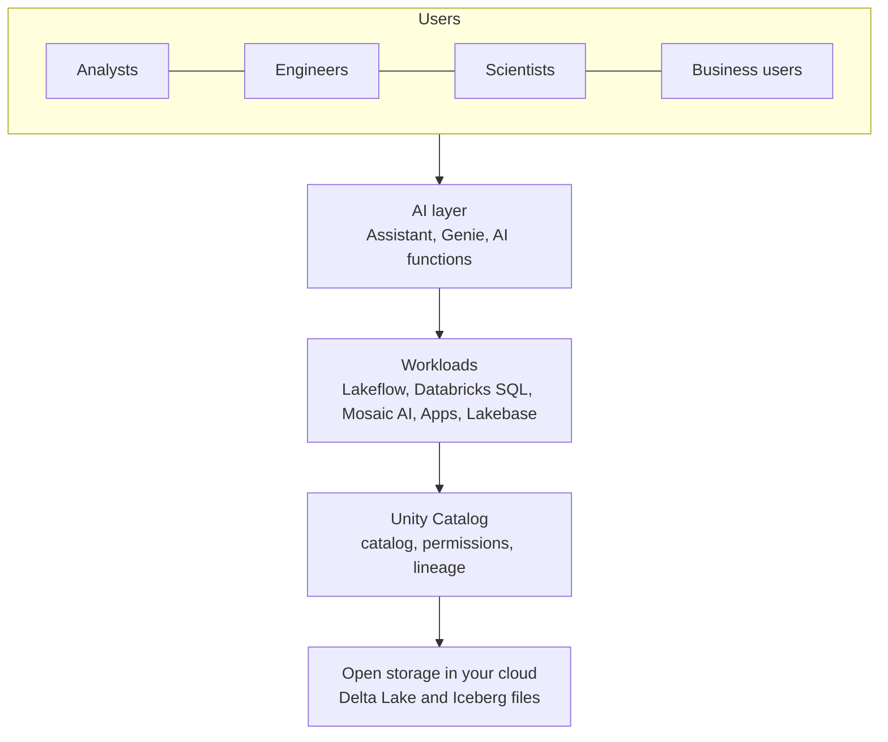

# The Data Intelligence Platform

Mastery: `INPUT[inlineSelect(option(new), option(learning), option(solid)):mastery]`

> [!story] Previously
> In [[The Founding of Databricks]] we saw a company start as "Spark in the cloud" and then pick up open table formats, a governance layer, and an AI research team along the way. By 2023 the product was much more than Spark. It needed a name that said what all those pieces add up to.

> [!eli5] In one breath
> Databricks is one place where a company keeps all its data, cleans it, asks questions of it, and builds smart tools on top of it. "Data intelligence" means the system also learns what your data means, so you can ask it questions in normal words and it understands your business terms.

> [!renamed] Name check
> Databricks introduced the name **Data Intelligence Platform** in late 2023. By 2026 the AWS and Azure documentation and databricks.com describe the product as the **Databricks Data + AI Platform**, while some pages (for example, parts of the Google Cloud docs) still say Data Intelligence Platform. We could not find an official date for the switch. Both names mean the same product. Before 2023 the usual term was the **Lakehouse Platform**.

> [!analogy] Analogy: a well-run office building
> - **The foundation and floors** are the [[The Lakehouse Idea|lakehouse]]: all data sits in one place, in open files ([[Delta Lake]] or [[Apache Iceberg]]) in your own cloud storage.
> - **The front desk and key cards** are [[Unity Catalog]]: one list of every room and one set of rules for who may enter.
> - **The departments** are the workloads: data engineering, SQL and dashboards, machine learning, apps.
> - **The office manager who knows everyone** is the "intelligence": an AI layer that has read the directory, knows that "rev" means `net_revenue`, and can answer "how did sales do last week?" for you.

## Why it exists

The lakehouse solved a storage problem: stop copying data between a lake and a warehouse ([[The Two-Tier Architecture Problem]]). But two problems remained.

1. **Data is hard to understand.** A company may have thousands of tables with cryptic names. Only a few people know which one is correct. Everyone else waits for them.
2. **Generative AI changed expectations.** After large language models ([[LLM]]) arrived, people expected to ask questions in plain English. A general chatbot does not know *your* tables, *your* definitions of "active customer", or *your* permissions.

Databricks' answer was to put an AI layer *inside* the platform, next to the data and the catalog. It can use your metadata, lineage, usage history, and permissions to understand your data specifically. That is the "intelligence" in the name.

## What it actually is

It is not a separate product you install. It is the name for the whole Databricks platform. The official docs describe Databricks as a unified, open platform for data, analytics, and AI, with AI features that tailor it to your data, which integrates with storage and security in your cloud account and manages the cloud infrastructure for you.

Think of it in three layers:

| Layer | What it does | Main pieces (notes) |
|---|---|---|
| **Open storage** | Your data, in open formats, in your cloud account | [[Delta Lake]], [[Apache Iceberg]], [[Delta UniForm]], [[Volumes]] |
| **Unified governance** | One catalog, one permission model, lineage, audit | [[Unity Catalog]], [[System Tables]], [[OpenSharing]] |
| **Workloads on shared compute** | Everything people actually do | [[Lakeflow]] (ingest, pipelines, jobs), [[Databricks SQL]], [[AI-BI Dashboards]], [[Genie]], [[Lakebase]], [[Databricks Apps]], Mosaic AI ([[Model Serving]], [[Agent Bricks]]) |

The "intelligence" sits across all three layers. Users meet it as:

- **[[Databricks Assistant]]**: an AI helper in notebooks and the SQL editor that writes, explains, and fixes code (renamed Genie Code in 2026).
- **[[Genie]]**: a chat interface where business users ask questions about data in plain language.
- **AI-generated documentation**: suggested table and column comments in Unity Catalog.
- **Engine features that tune themselves**: for example, predictive optimization that runs [[OPTIMIZE and VACUUM]] for you, and [[Liquid Clustering]] that picks clustering keys automatically.

## How it works



The design choices that hold it together:

1. **One copy of the data.** Every workload reads the same tables. An analyst's dashboard and a data scientist's model use the same `sales.orders` table, not two exports.
2. **One governance layer.** The AI features go through Unity Catalog like everyone else. Genie and the Assistant only see what the asking user is allowed to see.
3. **Metadata as fuel.** Table comments, lineage, popular queries, and certified [[Metric Views]] are what let the AI give answers that match your business. A well-documented catalog makes the "intelligence" smarter.
4. **Managed compute.** You pick a compute type ([[Compute Types]]) and Databricks runs it, increasingly as [[Serverless Compute|serverless]].

A small example of the AI layer meeting the data layer, using an [[AI Functions in SQL|AI function]] in plain SQL:

```sql
-- Classify free-text support tickets without building a model yourself
SELECT ticket_id,
       ai_classify(body, ARRAY('billing', 'shipping', 'product defect')) AS topic
FROM support.tickets.raw
LIMIT 10;
```

> [!smallbiz] For a small business
> The pitch to a small company is "one platform instead of five tools". In practice:
> - Your data lands in one place (often your own cloud storage).
> - The same tables feed your [[Dashboard|dashboards]], your spreadsheets via [[BI Tools]], and any AI experiments.
> - Business users can try [[Genie]] to ask questions directly, if someone first documents the key tables.
>
> The platform is broad, and you will not use most of it. Start with SQL, a few pipelines, and dashboards. Billing is usage-based in [[DBUs]]; see [[How Databricks Pricing Works]] rather than any number quoted in a blog post.

## On each cloud

> [!azure]- Azure Databricks
> Same platform and the same layers. On Azure, it also plugs into Microsoft services: [[Microsoft Entra ID Integration|Entra ID]] for identity, [[Azure Data Lake Storage|ADLS Gen2]] for storage, and [[Power BI on Azure Databricks|Power BI]] for reports. For how it compares with Microsoft's own analytics suite, see [[Microsoft Fabric and OneLake vs Databricks]].

> [!aws]- Databricks on AWS
> Same platform. Storage is [[Amazon S3]]. AWS is usually first to receive new features.

> [!gcp]- Databricks on Google Cloud
> Same platform. Storage is [[Google Cloud Storage]]. Some docs pages on this cloud still use the "Data Intelligence Platform" name. A few AI and serverless features reach Google Cloud later than the other two clouds, so check the feature's availability page.

## Going deeper

> [!deepdive]- Expert notes (301–401)
> - **Marketing name, not an architecture.** "Data Intelligence Platform" and "Data + AI Platform" are product-family names. Nothing in the API or CLI is called that. When you read docs, follow the concrete product names (Unity Catalog, Lakeflow, Databricks SQL, Mosaic AI).
> - **Where the intelligence lives.** Most AI features are served from the [[Control Plane and Compute Plane|control plane]] or serverless compute, and some use partner-hosted models. Admins can switch off partner-powered AI features at the account and workspace level, which also disables some Assistant capabilities.
> - **Semantics are the bottleneck.** The quality of Genie answers depends on table comments, primary and foreign keys, example queries, and [[Metric Views]]. The 2026 Unity Catalog additions (business glossary terms, domains) push in the same direction. See [[Semantic Layer]].
> - **Scope of the platform.** The well-architected framework's "scope" page is a good map of which capabilities belong to which persona and which are optional.

## Common confusions

> [!confusion] "Data intelligence" is not one AI product
> It is the name for the whole platform with AI features built in. The individual AI products are [[Databricks Assistant]], [[Genie]], AI functions, and Mosaic AI.

> [!confusion] Lakehouse vs Data Intelligence Platform
> The [[The Lakehouse Idea|lakehouse]] is the architecture (open tables that work as both lake and warehouse). The Data Intelligence Platform is Databricks' product built on that architecture, plus governance and AI.

## Recall

What does Databricks mean by "data intelligence"?::An AI layer built into the platform that uses your metadata, lineage, usage, and permissions to understand your specific data.
What name was the platform called before "Data Intelligence Platform"?::The Databricks Lakehouse Platform.
What name do the AWS and Azure docs use for the platform in 2026?::The Databricks Data + AI Platform.
What are the three layers of the platform?::Open storage (Delta/Iceberg), unified governance (Unity Catalog), and workloads on managed compute.
Why does a well-documented catalog make Genie better?::Genie uses table comments, keys, example queries, and metric definitions to translate business questions into correct SQL.
Do AI features bypass Unity Catalog permissions?::No. They act as the asking user and only see what that user can see.

## Where next

> [!path] Learning path
> **Needs first:** [[The Lakehouse Idea]], [[Delta Lake]]
> **Unlocks next:** [[Accounts and Workspaces]], [[Unity Catalog]], [[Compute Types]]

> [!nextup] Up next in the story
> That is the platform from 10,000 feet. When a company actually signs up, what does it get? Start with the two containers everything lives in: [[Accounts and Workspaces]].

> [!sources]- Sources (last verified: 2026-10-25)
> - [What is Databricks? (AWS)](https://docs.databricks.com/aws/en/introduction)
> - [What is Azure Databricks?](https://learn.microsoft.com/en-us/azure/databricks/introduction/)
> - [The scope of the Databricks platform](https://docs.databricks.com/aws/en/lakehouse-architecture/scope)
> - [Databricks AI/BI (AWS)](https://docs.databricks.com/aws/en/ai-bi)
> - [Databricks Data + AI Platform product page](https://www.databricks.com/product/data-intelligence-platform)
> - [What is a data intelligence platform (Databricks blog)](https://www.databricks.com/blog/what-is-a-data-intelligence-platform)
> - [Data guides (Google Cloud docs)](https://docs.databricks.com/gcp/en/guides/)
