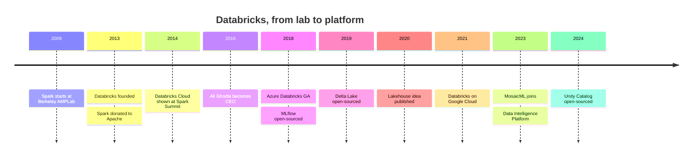

# The Founding of Databricks

Mastery: `INPUT[inlineSelect(option(new), option(learning), option(solid)):mastery]`

> [!story] Previously
> [[Chapter 06 - The Databricks Platform|Chapter 06]] opens where [[Chapter 05 - The Lakehouse|chapter 05]] left off. We now have fast engines ([[Apache Spark]]), cheap storage ([[Data Lakes]]), and a design for reliable tables on top of it ([[Delta Lake]]). What we do not have is a way for an ordinary company to *run* all of it without hiring a team of cluster experts. That gap is where a company comes in.

> [!eli5] In one breath
> A group of university researchers built a very fast tool for crunching huge amounts of data and gave it away for free. Companies loved it but found it hard to set up and keep running. So in 2013 the same researchers started a company, Databricks, that runs the tool for you on rented computers in the cloud.

> [!analogy] Analogy: the recipe and the restaurant
> - **The recipe** is [[Apache Spark]]. It is published for free, and anyone can cook it.
> - **Cooking at home** is running Spark yourself on [[Apache Hadoop|Hadoop]] clusters: you buy the pots, fix the stove, and wash up.
> - **The restaurant** is Databricks. The people who wrote the recipe open a kitchen where you just order. They keep the stoves lit, buy the ingredients in bulk, and add dishes that are not in the free cookbook.
> - **The free cookbook keeps growing.** The restaurant still publishes new recipes ([[Delta Lake]], [[MLflow]]), which is why other cooks trust it.

## Why it exists

By 2013, [[Apache Spark]] was the most exciting project in big data. It came out of UC Berkeley's AMPLab (see [[AMPLab and the Birth of Spark]]) and ran many jobs far faster than [[MapReduce]] because it kept data in memory.

But using Spark in practice still meant living with [[The Pain of Hadoop]]:

- You had to buy or rent servers, install Hadoop and Spark, tune memory settings, and patch them.
- Clusters sat idle and cost money at night, or were too small at month end.
- Data scientists, engineers, and analysts used different tools and passed files around.
- The commercial Hadoop vendors ([[Cloudera and Hortonworks]]) sold software for your own data center, not a service in the cloud.

The Spark creators saw that the cloud ([[Servers and the Cloud]]) made a different model possible: rent computers by the minute, start a [[Cluster|cluster]] when you need it, and throw it away when you are done. Someone had to make that easy. They decided to be that someone.

## What it actually is

Databricks, Inc. was founded in **2013** in San Francisco by seven people from the Berkeley AMPLab:

| Co-founder | Known for |
|---|---|
| **Matei Zaharia** | Started Spark as a PhD student in 2009. Chief Technologist. |
| **Ion Stoica** | Berkeley professor and AMPLab co-director. First CEO, later Executive Chairman. |
| **Ali Ghodsi** | Researcher on Spark and cluster scheduling. CEO since 2016. |
| **Reynold Xin** | Led much of Spark SQL and the DataFrame work. Chief Architect. |
| **Patrick Wendell** | Spark release manager. Engineering leadership. |
| **Andy Konwinski** | Early Spark and Mesos contributor, ran early community events. |
| **Arsalan Tavakoli-Shiraji** | Business and field leadership. |

The founding bet had two halves, and both still define the company:

1. **Keep the core open.** The same year it was founded, the team donated Spark to the [[Apache Software Foundation]]. Spark became a top-level Apache project in early 2014. Later projects followed the same pattern: [[MLflow]] (2018), [[Delta Lake]] (2019), and [[Unity Catalog]] (open-sourced in 2024).
2. **Sell the service, not the software.** Databricks does not sell a box to install. It sells a managed cloud platform that runs open engines on the customer's cloud account, plus features that exist only in the service (like [[Photon]] and serverless compute).

## How it works

The company's story is a series of answers to the pains in chapters 02–05:

A few turning points are worth knowing:

- **A hosted notebook on AWS (2014–2015).** The first product was "Databricks Cloud": a web page with notebooks attached to Spark clusters that Databricks started and stopped for you on Amazon Web Services. This is the seed of today's [[Notebooks]] and [[All-Purpose Compute]].
- **Azure as a first-party service (2018).** Microsoft and Databricks built **Azure Databricks** together. It is sold and billed by Microsoft and appears in the Azure portal like any other Azure service. See [[Azure Databricks Overview]] and [[First-Party Microsoft Service]].
- **The lakehouse (2020).** After years of customers copying data from lakes into warehouses ([[The Two-Tier Architecture Problem]]), Databricks argued that one open table format could do both jobs. See [[The Lakehouse Idea]] and [[The Lakehouse Paper]].
- **Google Cloud (2021).** The third cloud arrived, completing the "same platform on every major cloud" story. See [[Databricks on Google Cloud Overview]].
- **The AI turn (2023 onward).** Databricks acquired MosaicML in 2023 to train and serve large models ([[MosaicML and Open Models]]) and began calling its product the [[The Data Intelligence Platform|Data Intelligence Platform]].

> [!smallbiz] For a small business
> Why should a 10-person company care about a founding story? Two reasons:
> - **Open formats lower your risk.** Because Delta Lake, Spark, and MLflow are open source, your data sits in your own cloud storage in open files. If you leave Databricks, the files stay readable. That is a real answer to [[Vendor Lock-In]].
> - **You are buying operations, not software.** The whole reason Databricks exists is that running Spark yourself is hard. If you only have a few gigabytes in spreadsheets, you may not need it yet. See [[When Databricks Is Not the Right Fit]] and [[Databricks vs Alternatives for Small Teams]].

## On each cloud

> [!azure]- Azure Databricks
> Azure Databricks became generally available in 2018. It is a [[First-Party Microsoft Service|first-party Microsoft service]]: you create it in the Azure portal, Microsoft bills it on your Azure invoice, and support runs through Microsoft. See [[Azure Databricks Overview]].

> [!aws]- Databricks on AWS
> AWS was the original cloud. Databricks on AWS is sold by Databricks directly or through AWS Marketplace. See [[Databricks on AWS Overview]].

> [!gcp]- Databricks on Google Cloud
> The newest of the three, launched in 2021 and sold directly or through Google Cloud Marketplace. See [[Databricks on Google Cloud Overview]].

## Going deeper

> [!deepdive]- Expert notes (301–401)
> - **The open-core pattern.** Databricks open-sources the engine or format and competes on the managed service: performance (Photon, Predictive I/O), operations (serverless), and governance (the hosted Unity Catalog). Watch for this split whenever you evaluate a feature. Ask whether it is in the open project or only in the service.
> - **Research DNA.** Many core features started as papers: Spark (RDDs), Spark SQL, Delta Lake, the lakehouse, and Photon each have a research paper (venues and years unconfirmed against databricks.com). Reading them explains design choices the docs take for granted.
> - **Acquisitions shape the product map.** MosaicML (2023) became much of Mosaic AI. Tabular, the company started by the creators of [[Apache Iceberg]], joined in 2024, which is why Databricks now treats Iceberg and Delta as peers (see [[Delta UniForm]]). The Postgres company Neon joined in 2025 and underpins [[Lakebase]]. (Acquisition years in this bullet are unconfirmed against databricks.com news pages.)
> - **Founders' roles.** Sources differ slightly on titles and dates (for example, when Ion Stoica handed the CEO role to Ali Ghodsi, usually given as early 2016). Treat titles as approximate.

## Common confusions

> [!confusion] Databricks is not Apache Spark
> **Spark** is a free, open-source engine owned by the Apache Software Foundation. **Databricks** is a company and a paid cloud platform that runs Spark (and much more). Databricks employees write a large share of Spark's code, but Spark does not belong to Databricks.

> [!confusion] Databricks is not "just hosted Spark" anymore
> It started that way. Today the platform includes SQL warehouses, governance, pipelines, dashboards, a Postgres database, and AI tools. Many users never write Spark code at all.

## Recall

When was Databricks founded?::2013.
Where did the Databricks founders work before starting the company?::UC Berkeley's AMPLab, where Apache Spark was created.
Name the seven Databricks co-founders.::Ali Ghodsi, Andy Konwinski, Arsalan Tavakoli-Shiraji, Ion Stoica, Matei Zaharia, Patrick Wendell, and Reynold Xin.
Who started Spark as a PhD student?::Matei Zaharia, in 2009.
What did the founders do with Spark the year Databricks was founded?::Donated it to the Apache Software Foundation.
What was Databricks' first product?::A hosted notebook service ("Databricks Cloud") that ran Spark clusters on AWS for you.
Which three open-source projects did Databricks create after Spark?::MLflow (2018), Delta Lake (2019), and the open-source Unity Catalog (2024).
In what year did Azure Databricks become generally available?::2018.

## Where next

> [!path] Learning path
> **Needs first:** [[AMPLab and the Birth of Spark]], [[Apache Spark]]
> **Unlocks next:** [[The Data Intelligence Platform]], [[Accounts and Workspaces]]

> [!nextup] Up next in the story
> The company began as "Spark in the cloud" and grew into something much bigger. What does Databricks mean today when it calls itself [[The Data Intelligence Platform|a data intelligence platform]]?

> [!sources]- Sources (last verified: 2026-10-25)
> - [What is Databricks? (AWS)](https://docs.databricks.com/aws/en/introduction)
> - [What is Azure Databricks?](https://learn.microsoft.com/en-us/azure/databricks/introduction/)
> - [What is a data intelligence platform (Databricks blog)](https://www.databricks.com/blog/what-is-a-data-intelligence-platform)
> - **Unconfirmed (2026-10-25):** the founding year, the list of seven co-founders, their titles, and the timeline dates on this page have not yet been confirmed against databricks.com company or blog pages. Treat them as unconfirmed until re-checked.
