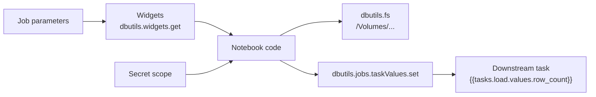

# dbutils and Widgets

Mastery: `INPUT[inlineSelect(option(new), option(learning), option(solid)):mastery]`

> [!story] Context
> [[Serverless Workspaces and Default Storage]] gave you a workspace with compute and storage ready to use. Inside a notebook, you still need to list files, read a password without printing it, accept a parameter such as a date, and pass a result to the next job task. Databricks Utilities (`dbutils`) and widgets cover these tasks.

> [!eli5] Summary
> `dbutils` is a built-in toolbox in every Databricks notebook. It lets your code look at files, fetch passwords safely, and hand small results from one step of a job to the next. Widgets are input boxes at the top of a notebook, so the same notebook can run for a different date or store without editing the code.

## Background

[[Notebooks]] run Python, SQL, Scala, or R against [[Apache Spark|Spark]]. Spark does not include helpers for workspace tasks such as reading a secret, calling another notebook, or reading job parameters. Databricks added `dbutils` as a notebook-scoped object that is available without an import in Python, Scala, and R notebooks.

## Overview

`dbutils` is organized into modules. Run `dbutils.help()` or `dbutils.<module>.help()` in a notebook to list commands.

| Module | Purpose | Common commands |
|---|---|---|
| `dbutils.fs` | Work with files in [[Volumes]], workspace files, cloud storage, and legacy [[DBFS]] | `ls`, `cp`, `mv`, `rm`, `mkdirs`, `head`, `put` |
| `dbutils.secrets` | Read secrets from secret scopes without exposing them | `get`, `getBytes`, `list`, `listScopes` |
| `dbutils.widgets` | Create and read notebook parameters | `text`, `dropdown`, `combobox`, `multiselect`, `get`, `getAll`, `remove`, `removeAll` |
| `dbutils.notebook` | Run another notebook and return a value | `run`, `exit` |
| `dbutils.jobs.taskValues` | Pass values between tasks in a job run (Python only) | `set`, `get` |

### Widget types

| Type | Behavior |
|---|---|
| `text` | Free-text input |
| `dropdown` | Select one value from a list |
| `combobox` | Select from a list or type a value |
| `multiselect` | Select one or more values from a list |

Every widget takes a name, a default value, and an optional label. All types except `text` also take a list of choices.

## How it works



### Parameterize a notebook with widgets

```python
# Python: create widgets once at the top of the notebook
dbutils.widgets.text("run_date", "2026-10-01", "Run date")
dbutils.widgets.dropdown("store", "north", ["north", "south", "online"], "Store")

run_date = dbutils.widgets.get("run_date")
store = dbutils.widgets.get("store")

df = spark.read.table("sales.orders").where(
    f"order_date = '{run_date}' AND store = '{store}'"
)
```

In SQL cells and the [[SQL Editor]], reference a widget value with a named parameter marker:

```sql
SELECT * FROM sales.orders WHERE store = :store;
```

When a [[Lakeflow Jobs|job]] runs the notebook, job and task parameters with the same names fill the widgets. A widget's default value applies only when no parameter is passed.

### Read a secret

```python
# The value is shown as [REDACTED] if printed in notebook output
pg_password = dbutils.secrets.get(scope="shop-db", key="postgres-password")

orders = (spark.read.format("postgresql")
          .option("host", "db.example.internal")
          .option("database", "shop")
          .option("dbtable", "orders")
          .option("user", "reporting")
          .option("password", pg_password)
          .load())
```

Redaction applies only to the literal secret value. A transformed value (for example, the secret reversed or split) is not masked. See [[Secrets Management]].

### Work with files

```python
dbutils.fs.ls("/Volumes/main/sales/landing/")
dbutils.fs.cp("/Volumes/main/sales/landing/orders.csv",
              "/Volumes/main/sales/archive/orders.csv")
```

### Pass values between job tasks

```python
# In task "load"
dbutils.jobs.taskValues.set(key="row_count", value=orders.count())
```

In a downstream task, reference the value as a dynamic value, `{{tasks.load.values.row_count}}`, in a task parameter or an If/else condition. Databricks recommends this pattern over calling `dbutils.jobs.taskValues.get()`. A job run can set up to 250 task values, and each JSON-serialized value can be up to 48 KiB.

### Run another notebook

```python
result = dbutils.notebook.run("./clean_orders", 600, {"run_date": "2026-10-01"})
```

`dbutils.notebook.run` starts an ephemeral job and returns the string that the child notebook passes to `dbutils.notebook.exit()`. Parameters and return values must be strings, so return structured results as JSON. For production pipelines, prefer separate tasks in a [[Lakeflow Jobs|job]].

## Small-business considerations

> [!smallbiz] Small-business considerations
> - Put every password and API key in a secret scope and read it with `dbutils.secrets.get`. Never paste credentials into a notebook.
> - Add a `run_date` widget to each notebook that loads data. Re-running a past day then needs no code change, which makes [[Backfill|backfills]] routine.
> - Use `/Volumes/...` paths with `dbutils.fs`. Avoid `dbfs:/` and `/mnt/` paths in new code (see [[DBFS]]).
> - Skip `dbutils.notebook.run` chains for scheduled work. Define tasks in a job so each step has its own logs and retries.

## Cloud differences

> [!azure]- Azure Databricks
> Secret scopes can be backed by Azure Key Vault. `dbutils.secrets.get` reads them the same way as Databricks-backed scopes. See [[Azure Key Vault Secret Scopes]]. Otherwise nothing differs.

> [!aws]- Databricks on AWS
> Nothing differs. `dbutils` behaves the same on all three clouds.

> [!gcp]- Databricks on Google Cloud
> Nothing differs. `dbutils` behaves the same on all three clouds.

## Advanced topics

> [!deepdive]- Advanced topics (301–401)
> - Local development: through [[Databricks Connect]] and the [[Databricks SDKs and REST API|Databricks SDK for Python]], only `dbutils.fs`, `dbutils.secrets`, `dbutils.widgets`, and `dbutils.jobs` are available.
> - Driver only: call `dbutils` on the driver. Calls from inside executors (for example in a UDF) can produce errors or unexpected results.
> - Asynchronous code: do not read widget state inside threads, subprocesses, or `foreachBatch` functions, because the value can change while the code runs. Read the value once and pass it as an argument.
> - Cross-language widgets: passing a value set in a Python cell to a SQL cell works when you run cells one at a time, but not with **Run all** or in a job.
> - Limits: a notebook can have up to 512 widgets, and a `dropdown`, `combobox`, or `multiselect` widget can have up to 1024 choices. Widget values are always strings.
> - Deprecations: `dbutils.widgets.getArgument` is deprecated; use `dbutils.widgets.get`. `dbutils.fs.mount` is not compatible with serverless compute; use [[Storage Credentials and External Locations|external locations]] and volumes.
> - `getAll`: `dbutils.widgets.getAll()` returns all widget values as a map and requires Databricks Runtime 13.3 LTS or above.
> - Streaming: a background Structured Streaming query keeps a notebook run alive after `dbutils.notebook.exit()`.

## Common misconceptions

> [!confusion] Widgets are not typed
> A widget always returns a string, including `"2026-10-01"` and `"42"`. Cast the value in your code.

> [!confusion] `dbutils.secrets` is not the Secrets API
> `dbutils.secrets` only reads secrets inside a notebook or job. Create scopes and write secrets with the [[Databricks CLI]], the SDK, or the REST API.

> [!confusion] SQL warehouses do not have `dbutils`
> `dbutils` exists in notebooks on clusters and serverless compute. In the SQL editor, use named parameter markers such as `:store`.

## Recall

What is `dbutils`?::Databricks Utilities, a built-in notebook object with modules for files, secrets, widgets, notebook chaining, and job task values.
Name the four widget types.::`text`, `dropdown`, `combobox`, and `multiselect`.
What does `dbutils.secrets.get` print if you display the value?::`[REDACTED]`.
How does a job pass parameters into a notebook?::Job and task parameters fill the widgets with the same names, read with `dbutils.widgets.get`.
How does a downstream task reference a task value?::With the dynamic value `{{tasks.<task_name>.values.<key>}}`.
How many task values can a job run set, and how large can each be?::Up to 250 values, each up to 48 KiB.
Which deprecated widget command replaces `getArgument`?::`dbutils.widgets.get`.
What type does every widget value have?::String.
Which `dbutils` modules work through Databricks Connect?::`fs`, `secrets`, `widgets`, and `jobs`.

## Next steps

> [!path] Learning path
> **Needs first:** [[Notebooks]], [[Volumes]]
> **Unlocks next:** [[Lakeflow Jobs]], [[Tasks Triggers and Schedules]], [[Secrets Management]]

> [!nextup] Next
> [[Instance Pools]] covers pre-warmed virtual machines that shorten classic cluster start times.

> [!sources]- Sources (last verified: 2026-10-25)
> - [Databricks Utilities (dbutils) reference (AWS)](https://docs.databricks.com/aws/en/dev-tools/databricks-utils)
> - [Databricks Utilities (dbutils) reference (Azure Databricks)](https://learn.microsoft.com/en-us/azure/databricks/dev-tools/databricks-utils)
> - [Databricks Utilities (dbutils) reference (Google Cloud)](https://docs.databricks.com/gcp/en/dev-tools/databricks-utils)
> - [Databricks widgets (AWS)](https://docs.databricks.com/aws/en/notebooks/widgets)
> - [Databricks widgets (Azure Databricks)](https://learn.microsoft.com/en-us/azure/databricks/notebooks/widgets)
> - [Use task values to pass information between tasks (AWS)](https://docs.databricks.com/aws/en/jobs/task-values)
> - [Orchestrate Databricks notebooks and modularize code (AWS)](https://docs.databricks.com/aws/en/notebooks/notebook-workflows)
> - [Secret management (AWS)](https://docs.databricks.com/aws/en/security/secrets/)
> - [Databricks Utilities with Databricks Connect for Python (AWS)](https://docs.databricks.com/aws/en/dev-tools/databricks-connect/python/databricks-utilities)
> - [Known limitations of Databricks notebooks (AWS)](https://docs.databricks.com/aws/en/notebooks/notebook-limitations)
> - [Serverless compute limitations (AWS)](https://docs.databricks.com/aws/en/compute/serverless/limitations)
> - [Work with files on Databricks (AWS)](https://docs.databricks.com/aws/en/files/)
