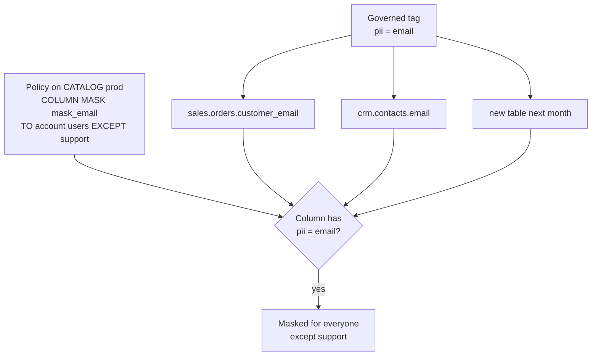

# Attribute-Based Access Control

Mastery: `INPUT[inlineSelect(option(new), option(learning), option(solid)):mastery]`

> [!story] Context
> [[Row Filters and Column Masks]] are set one table at a time. An organization with an email column in hundreds of tables must apply the same mask to each, and new tables are unprotected until someone does so. Attribute-based access control (ABAC) attaches the rule to tags instead of to tables.

> [!eli5] Summary
> You label sensitive data with tags, such as "personal email", and write one rule for the whole catalog, such as "mask personal emails except for the support team". Any table or column that receives the tag is covered by the rule immediately.

> [!analogy]- Analogy: airport security by baggage label
> - **Tags** are labels on luggage: "fragile", "liquids", "diplomatic".
> - **A policy** is a rule at the checkpoint: "Bags labelled *liquids* go through the extra scanner, except for crew."
> - **The scope** is which terminal the rule applies to (a catalog or schema).
> - **New bags** are covered the moment they are labelled. Nobody writes a new rule per suitcase.
> - **The rule is posted by airport security**, not by each passenger, so owners of individual bags cannot opt out.

## Background

[[Role-Based Access Control|Role-based]] grants specify which group can read which table. They do not express rules about *kinds of data*, such as:

- "Mask every column that holds personal data, everywhere, unless you are in `privacy-officers`."
- "Rows tagged with a region are visible only to that region's managers."

With table-level filters and masks, each rule is copied onto each table, and a table owner can remove it. ABAC defines the rule centrally, inherits it down the hierarchy, and enforces it regardless of table ownership.

## Overview

**Attribute-based access control (ABAC)** in Unity Catalog is a policy model where access decisions use **attributes (governed tags)** on data, applied by **policies** attached at a catalog, schema, or table.

Three building blocks:

| Block | What it is |
|---|---|
| **Governed tags** | Account-level, controlled key-value tags (for example `pii = email`). Admins define allowed keys and values and who may assign them. Policies reference them with `has_tag()` and `has_tag_value()`. |
| **UDFs** | The same SQL functions used for [[Row Filters and Column Masks]]: a boolean filter function or a masking function. |
| **Policies** | A rule that says: on this scope, for these principals (except these), apply this filter or mask to tables or columns matching these tags. |

Policy types listed in the docs: **row filter**, **column mask**, **GRANT**, and **DENY**.

Status as of October 2026:

- ABAC row filter and column mask policies, **governed tags**, and automated **[[Data Classification]]** are **generally available** (Databricks announced GA in 2026).
- **GRANT policies** vary by securable type: GA for models and some AI services, Beta for others.
- **DENY policies** and **metastore-level policies** are in **Beta**.

Check the current docs before relying on a Beta feature in production.

## How it works



```sql
-- 1. Tag the data (governed tag `pii` must exist at the account level)
ALTER TABLE prod.sales.orders  ALTER COLUMN customer_email SET TAGS ('pii' = 'email');
ALTER TABLE prod.crm.contacts  ALTER COLUMN email          SET TAGS ('pii' = 'email');

-- 2. The masking function (same kind of UDF as a table-level mask)
CREATE OR REPLACE FUNCTION gov.policies.mask_email(email STRING)
RETURNS STRING
RETURN concat('***@', split_part(email, '@', 2));

-- 3. One policy for the whole catalog
CREATE POLICY mask_emails
ON CATALOG prod
COMMENT 'Mask emails for everyone except support'
COLUMN MASK gov.policies.mask_email
TO `account users`
EXCEPT `support`
FOR TABLES
MATCH COLUMNS has_tag_value('pii', 'email') AS email_col
ON COLUMN email_col;

-- A row filter policy: only tables tagged as region-scoped
CREATE POLICY region_rows
ON SCHEMA prod.sales
ROW FILTER gov.policies.region_filter
TO `account users`
EXCEPT `admins`
FOR TABLES
WHEN has_tag('region_scoped')
MATCH COLUMNS has_tag('geo_region') AS r
USING COLUMNS (r);

```

Creating a policy needs ownership of, or `MANAGE` on, the securable it is attached to, plus `EXECUTE` on the function. Policies attached at the metastore level need a metastore admin (Beta).

Column tags do **not** inherit from the parent table; tag the column itself. [[Data Classification]] can apply many of these tags automatically.

## Small-business considerations

> [!smallbiz] Small-business considerations
> ABAC reduces ongoing work for a small team, because a rule defined once covers every table that receives the tag. A minimal setup:
> 1. Create one governed tag, `pii`, with values `email`, `phone`, `address`, `name`.
> 2. Enable [[Data Classification]] so Databricks detects sensitive columns and can apply tags.
> 3. Create one masking policy on the main catalog, with a small `privacy` group as the exception.
>
> New tables are masked as soon as their columns are tagged. ABAC has no separate charge; policy functions run on the compute that runs the query.

## Cloud differences

> [!azure]- Azure Databricks, AWS, and Google Cloud
> Nothing differs in the model or SQL. Release timing for previews can differ slightly by cloud, so check your cloud's ABAC page for the status of DENY and metastore-level policies.

## Advanced topics

> [!deepdive]- Advanced topics (301–401)
> - **Precedence:** Policies attached higher up (catalog) apply to everything below. Table owners cannot override, modify, or remove them. That is the main governance advantage over table-level filters.
> - **Design tags to be unambiguous:** If several policies could match the same column, the outcome gets hard to reason about. Keep tag values mutually exclusive so each column matches one mask.
> - **Secure by default with control tags:** The docs describe a pattern where new tables get a control tag that denies or masks access until someone reviews and re-tags them. It pairs well with [[Data Classification]].
> - **Multi-domain masking:** For sensitivity tiers (public, internal, confidential, restricted) define one tag with ordered values and a mask function per tier; the docs have a worked example.
> - **Performance:** Policy UDFs run per row or value, like table-level ones. Keep them simple, and use `USING COLUMNS` to pass in only what the function needs.
> - **Audit:** Policy creation and changes appear in the [[Audit Logs]] under the `unityCatalog` service, so you can alert on someone weakening a policy.

## Common misconceptions

> [!confusion] Governed tags are not only for search
> Ordinary tags help discovery and [[Tagging for Chargeback|cost reporting]]. **Governed** tags are controlled (allowed values, who may assign) and can drive access. Only governed tags should be used in policies.

> [!confusion] ABAC does not replace grants
> A user still needs `USE CATALOG`, `USE SCHEMA`, and `SELECT` to query a table. ABAC filters and masks *what they see* once they are in (GRANT and DENY policies extend this to the grants themselves).

## Recall

What drives access decisions in Unity Catalog ABAC?::Governed tags on data objects, matched by policies attached at a catalog, schema, or table.
Name the four ABAC policy types.::Row filter, column mask, GRANT, and DENY.
What is the GA status of ABAC row filter and column mask policies as of October 2026?::Generally available, together with governed tags and data classification.
Which ABAC features were still in Beta in October 2026?::DENY policies and metastore-level policies (and some GRANT policy securable types).
Which functions match tags in a policy?::`has_tag()` and `has_tag_value()`.
Can a table owner remove a policy set on its catalog?::No. Higher-level policies cannot be overridden by table owners.
Do column tags inherit from the table?::No. Tag the column directly.
What do you need to create a policy?::Ownership of or MANAGE on the securable, plus EXECUTE on the UDF.

## Next steps

> [!path] Learning path
> **Needs first:** [[Row Filters and Column Masks]], [[Privileges and Grants]]
> **Unlocks next:** [[Data Classification]], [[Audit Logs]]

> [!nextup] Next
> [[Data Lineage]] records how data flows between tables, jobs, and dashboards.

> [!sources]- Sources (last verified: 2026-10-25)
> - [ABAC policies, governed tags, and data classification are now GA (Databricks blog)](https://www.databricks.com/blog/abac-row-filtering-and-column-masking-policies-governed-tags-and-data-classification-are-now)
> - [Core concepts for ABAC (AWS)](https://docs.databricks.com/aws/en/data-governance/unity-catalog/abac/core-concepts)
> - [Create and manage row filter and column mask policies (AWS)](https://docs.databricks.com/aws/en/data-governance/unity-catalog/abac/policies)
> - [ABAC GRANT policies (AWS)](https://docs.databricks.com/aws/en/data-governance/unity-catalog/abac/grant-policies)
> - [Tutorial: Configure ABAC (Azure Databricks)](https://learn.microsoft.com/en-us/azure/databricks/data-governance/unity-catalog/abac/tutorial)
> - [When to use ABAC vs table-level row filters and column masks (Azure Databricks)](https://learn.microsoft.com/en-us/azure/databricks/data-governance/unity-catalog/abac/abac-vs-rls-cm)
> - [Implement multi-domain column masking with sensitivity tiers (Azure Databricks)](https://learn.microsoft.com/en-us/azure/databricks/data-governance/unity-catalog/abac/multi-domain)
> - [Secure new tables by default with control tags (GCP)](https://docs.databricks.com/gcp/en/data-governance/unity-catalog/abac/secure-by-default)
> - [Performance considerations for row filter and column mask policies (AWS)](https://docs.databricks.com/aws/en/data-governance/unity-catalog/abac/performance)
> - [CREATE POLICY (AWS SQL reference)](https://docs.databricks.com/aws/en/sql/language-manual/sql-ref-syntax-ddl-create-policy)
> - [ALTER TABLE ... COLUMN clause, SET TAGS (AWS SQL reference)](https://docs.databricks.com/aws/en/sql/language-manual/sql-ref-syntax-ddl-alter-table-manage-column)
