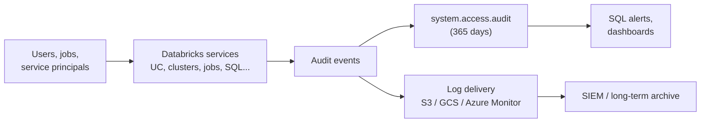

# Audit Logs

Mastery: `INPUT[inlineSelect(option(new), option(learning), option(solid)):mastery]`

> [!story] Context
> [[Data Lineage]] records how data flows between objects. Security and compliance work also requires a record of actions by people and services: sign-ins, permission changes, and data access. Databricks records each action as an event in the audit log.

> [!eli5] Summary
> The audit log is an automatic record of who did what, and when, across the Databricks account. It covers sign-ins, permission changes, data access, and changes to compute and settings.

> [!analogy]- Analogy: a bank's security camera tape
> - **Every teller window and vault door** is a Databricks service (Unity Catalog, jobs, clusters, SQL, sign-in).
> - **Each recorded moment** is one event: who, what action, on what, from which IP address, success or failure.
> - **Watching the tape live** is querying `system.access.audit` or setting a [[SQL Alerts|SQL alert]].
> - **Shipping the tape to an off-site vault** is audit log delivery to your own storage or [[SIEM]].

## Background

A central audit log is required to investigate security events and to satisfy audits. Frameworks such as [[SOC 2]], [[HIPAA]], and [[PCI DSS]] require evidence of who accessed sensitive data and who changed permissions. Databricks audit logs cover:

- **Identity**: sign-ins, token creation, group changes.
- **Data access**: Unity Catalog reads (`getTable`), grants, and policy changes.
- **Compute and code**: cluster and warehouse creation, job runs, notebook actions.
- **Account changes**: workspace creation, network and security settings.

## Overview

An **audit event** is a structured record. The key fields, as they appear in the system table:

| Field | Meaning | Example |
|---|---|---|
| `event_time`, `event_date` | When | `2026-10-24 02:13:55` |
| `workspace_id` | Where (`0` for account-level events) | `1234567890` |
| `service_name` | Which service | `unityCatalog`, `clusters`, `jobs`, `accounts`, `notebook` |
| `action_name` | What happened | `getTable`, `updatePermissions`, `create`, `login` |
| `user_identity.email` | Who | `sam@acme.com` |
| `source_ip_address` | From where | `203.0.113.7` |
| `request_params` | Details (map) | table name, new grants |
| `response.status_code` | Outcome | `200`, `403` |

You get audit logs in two ways:

1. **The `system.access.audit` system table** (recommended). Query it with SQL from any workspace in the region. Free retention is 365 days. Workspace-level events are regional; account-level events are global.
2. **Log delivery** to your own storage, for long-term retention or a SIEM. JSON files are delivered per workspace plus one stream for account-level events. Delivery can take up to an hour to start after setup, then events typically arrive within 15 minutes.

## How it works



Useful queries:

```sql
-- Who read the payroll table in the last 7 days?
SELECT event_time, user_identity.email, source_ip_address, action_name
FROM system.access.audit
WHERE service_name = 'unityCatalog'
  AND action_name = 'getTable'
  AND request_params['full_name_arg'] = 'prod.hr.payroll'  -- check the parameter name in your own events
  AND event_date >= current_date() - INTERVAL 7 DAYS
ORDER BY event_time DESC;

-- Who changed permissions anywhere?
SELECT event_time, user_identity.email, request_params
FROM system.access.audit
WHERE service_name = 'unityCatalog'
  AND action_name = 'updatePermissions'
  AND event_date >= current_date() - INTERVAL 30 DAYS;

-- Failed requests (possible probing)
SELECT user_identity.email, service_name, action_name, count(*) AS failures
FROM system.access.audit
WHERE response.status_code IN (401, 403)
  AND event_date >= current_date() - INTERVAL 1 DAY
GROUP BY ALL
ORDER BY failures DESC;
```

Turn the last query into a [[SQL Alerts|SQL alert]] that emails you when failures pass a threshold.

## Small-business considerations

> [!smallbiz] Small-business considerations
> A SIEM is not required to start. Have an account admin grant the person responsible for security `SELECT` on `system.access.audit`, save the three queries above, and schedule one alert on failed requests and one on `updatePermissions`. This covers the common security-questionnaire item about logging access to customer data, with per-user records for 365 days. Configure delivery to your own storage only when logs must be kept longer than a year or a regulator requires it. System tables have no separate fee; queries use normal compute.

## Cloud differences

The `system.access.audit` table is the same everywhere. **Log delivery** differs.

> [!azure]- Azure Databricks
> - Azure calls them **diagnostic logs**. You deliver them with Azure **diagnostic settings** to a Log Analytics workspace, a storage account, or Event Hubs, where Microsoft Sentinel or another SIEM can read them. See [[Azure Monitor and Diagnostic Logs]].
> - Diagnostic settings are configured per workspace; the system table is usually the easier way to query across workspaces.

> [!aws]- Databricks on AWS
> - Log delivery writes JSON files to an **S3 bucket** you own, configured at the account level (account console or API) with a credential and storage configuration.
> - Accounts using the [[Compliance Security Profile]] (for HIPAA, PCI-DSS, FedRAMP workloads) rely on audit logs as a core control.

> [!gcp]- Databricks on Google Cloud
> - Log delivery writes JSON files to a **GCS bucket** you own, configured at the account level.

## Advanced topics

> [!deepdive]- Advanced topics (301–401)
> - **Verbose audit logs:** Databricks has a workspace setting that logs more detail, such as notebook commands. Its exact scope was not confirmed against current docs for this note, so check the audit log reference before enabling it.
> - **Deleted workspaces:** When a workspace is deleted, its audit events older than 14 days are removed from `system.access.audit`. Use log delivery if you must keep them.
> - **Account vs workspace events:** Account-level events (`workspace_id = 0`) cover account console actions, identity changes, and metastore-level Unity Catalog events.
> - **Joins:** Join audit events with [[System Tables|system.access.table_lineage]] (who wrote what), `system.billing.usage` (what it cost), and `system.query.history` (the query text) for full investigations.
> - **Retention:** The configured system-table retention (Beta) can extend beyond 365 days; log delivery is the classic way to keep logs indefinitely.

## Common misconceptions

> [!confusion] Audit logs are not cloud provider logs
> AWS CloudTrail, Azure Activity Log, and Google Cloud Audit Logs record actions on cloud resources (buckets, VMs). Databricks audit logs record actions inside Databricks. A full investigation often needs both.

> [!confusion] Audit logs vs lineage vs query history
> **Audit**: who did what. **[[Data Lineage|Lineage]]**: how data flowed. **Query history**: the text and performance of queries. They live in different system tables and answer different questions.

## Recall

Which system table holds Databricks audit events?::`system.access.audit`.
What is the free retention period of the audit system table?::365 days.
Which two columns identify what happened in an audit event?::`service_name` and `action_name`.
What `workspace_id` do account-level events have?::`0`.
What service name do Unity Catalog audit events use?::`unityCatalog`.
On Azure, how are audit logs delivered outside Databricks?::As diagnostic logs through Azure diagnostic settings (Log Analytics, storage, or Event Hubs).
On AWS and GCP, where does audit log delivery write?::JSON files to an S3 or GCS bucket you own.
How quickly do delivered audit events usually arrive once delivery is running?::Typically within 15 minutes.
What happens to a deleted workspace's audit events in the system table?::Events older than 14 days are removed.

## Next steps

> [!path] Learning path
> **Needs first:** [[Privileges and Grants]], [[Accounts and Workspaces]]
> **Unlocks next:** [[System Tables]], [[SQL Alerts]], [[Azure Monitor and Diagnostic Logs]]

> [!nextup] Next
> [[System Tables]] expose audit events alongside billing, compute, job, and query data in the `system` catalog.

> [!sources]- Sources (last verified: 2026-10-25)
> - [Audit log system table reference (AWS)](https://docs.databricks.com/aws/en/admin/system-tables/audit-logs)
> - [Audit log system table reference (Azure Databricks)](https://learn.microsoft.com/en-us/azure/databricks/admin/system-tables/audit-logs)
> - [Audit log reference (AWS)](https://docs.databricks.com/aws/en/admin/account-settings/audit-logs)
> - [Diagnostic log reference (Azure Databricks)](https://learn.microsoft.com/en-us/azure/databricks/admin/account-settings/audit-logs)
> - [Configure audit log delivery (AWS)](https://docs.databricks.com/aws/en/admin/account-settings/audit-log-delivery)
> - [Configure diagnostic log delivery (Azure Databricks)](https://learn.microsoft.com/en-us/azure/databricks/admin/account-settings/audit-log-delivery)
> - [System tables reference (AWS)](https://docs.databricks.com/aws/en/admin/system-tables/)
