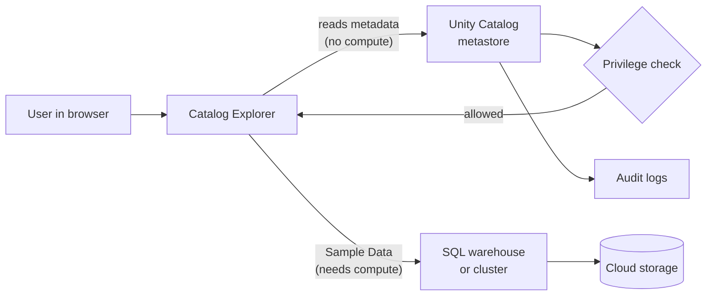

# Catalog Explorer

Mastery: `INPUT[inlineSelect(option(new), option(learning), option(solid)):mastery]`

Catalog Explorer is the Databricks web UI for exploring and managing the data and AI assets registered in [[Unity Catalog]]: catalogs, schemas, tables, volumes, functions, models, and their permissions.

> [!story] Context
> [[Hive Metastore Migration to Unity Catalog]] moved legacy tables into the governed hierarchy. Once data is in Unity Catalog, people need a way to find it, inspect it, and manage access without writing SQL for every task. Catalog Explorer is that interface.

> [!eli5] Summary
> Catalog Explorer is the screen in Databricks where you look through all of your company's data, much like a file browser. You can see what each table contains, who can use it, and where its data came from, and admins can give or remove access with a few clicks.

> [!renamed] Renamed
> **Data Explorer** became **Catalog Explorer** in September 2023. Databricks gave the reason that the tool covers all securable objects in Unity Catalog, not only data objects.

## Background

[[Unity Catalog]] keeps one inventory of every governed asset. Everything in that inventory can be managed with SQL (`SHOW TABLES`, `GRANT`, `DESCRIBE`), the [[Databricks CLI]], or the [[Databricks SDKs and REST API|REST API]]. Those interfaces suit engineers and automation. Analysts, business users, and occasional admins need a visual way to answer common questions:

- Which tables exist, and which one holds the numbers I need?
- What columns does it have, and what do they mean?
- Who owns it, and who can read it?
- Where does it come from, and who uses it?

Catalog Explorer answers these questions in one place. It replaced the earlier data browser called **Data Explorer**.

## Overview

Catalog Explorer opens from **Catalog** in the workspace sidebar. The docs list two primary jobs: managing Unity Catalog and [[OpenSharing]] objects, and generating AI comments on data and AI assets.

| Task | Where in Catalog Explorer |
|---|---|
| Browse the [[Three-Level Namespace\|catalog > schema > object]] tree | Left-hand catalog pane |
| See columns, comments, and properties | Table page: **Columns** and **Details** tabs |
| Preview rows | **Sample Data** tab (needs running compute) |
| Grant and revoke privileges | **Permissions** tab on any securable |
| Trace upstream and downstream | **Lineage** tab (see [[Data Lineage]]) |
| See usage and popular queries | **Insights** tab |
| Review table version history | **History** tab (Delta tables) |
| Check data health | **Quality** tab (see [[Data Quality Monitoring]]) |
| Manage credentials and external locations | **External data** (see [[Storage Credentials and External Locations]]) |
| Create and manage [[Governed Tags]] | **Govern** menu |
| Create shares and recipients | **OpenSharing** pages |

Key facts:

- **Visibility follows privileges:** You see an object only if you hold at least the `BROWSE` privilege on it (or a privilege that implies it). See [[Privileges and Grants]].
- **Browsing does not need compute:** You can navigate the tree and read metadata with no cluster or SQL warehouse running. Previewing sample data requires active compute.
- **AI-generated comments:** Catalog Explorer can draft descriptions for catalogs, schemas, tables, views, materialized views, columns, functions, models, and volumes with a large language model. You review and accept or edit each suggestion. The workspace must have AI-assistive features enabled.

## How it works

Catalog Explorer is a UI over the Unity Catalog APIs. Every action you take in it maps to a SQL statement or API call, and every action is checked against your privileges and recorded in the [[Audit Logs]].



### Find a table and inspect it

1. In the workspace sidebar, click **Catalog**.
2. In the search box at the top of the catalog pane, type part of a table name, such as `orders`.
3. Select the table from the results.
4. Read the table comment, then click the **Columns** tab to read column names, types, and descriptions.
5. Click the **Sample Data** tab and select a compute resource to preview rows.
6. Click the **Lineage** tab to see the tables, jobs, notebooks, and dashboards connected to this table.

### Grant access to a group

1. Open the catalog, schema, or table.
2. Click the **Permissions** tab.
3. Click **Grant**.
4. Enter the name of a group, such as `analysts`.
5. Select the privileges, such as `SELECT`.
6. Click **OK** (some object types label this button **Confirm** or **Grant**).

To revoke, select the granted privilege on the **Permissions** tab, click **Revoke**, and confirm.

The equivalent SQL, which you can run in the [[SQL Editor]] or a notebook:

```sql
GRANT USE CATALOG ON CATALOG sales        TO `analysts`;
GRANT USE SCHEMA  ON SCHEMA  sales.orders TO `analysts`;
GRANT SELECT      ON TABLE   sales.orders.daily_totals TO `analysts`;
```

### Request access to a table you can see but not read

1. Open the object in Catalog Explorer.
2. Click **Request permissions**.
3. Select the privileges you need and add an optional message.
4. Click **Request**.

Access requests are in Public Preview as of October 2026. The request goes to the destination configured for that object, such as the owner's email. If no destination is configured, users cannot request access.

### Make data discoverable

Databricks recommends granting `BROWSE` broadly so people can find data and request access without being able to read it:

```sql
GRANT BROWSE ON CATALOG sales TO `account users`;
```

Users with only `BROWSE` see an object's name, description, and tags. They cannot read rows, and they cannot run `SHOW COLUMNS` or `DESCRIBE TABLE` on it.

## Small-business considerations

> [!smallbiz] Small-business considerations
> Catalog Explorer is included in every workspace at no separate charge. For a small team it often replaces a separate data catalog tool. Three practices keep it useful:
> 1. **Write table and column comments:** Use AI-generated comments as a first draft, then correct them. A described table is one that a new hire can use without asking.
> 2. **Grant `BROWSE` to `account users` on shared catalogs:** People can find data and request access, and the owner decides.
> 3. **Use the Lineage and Insights tabs before changing a table:** They show which dashboards and jobs depend on it.
>
> Skip the access-request setup if one person handles all grants. Sample Data previews run on compute and are billed as normal compute usage; browsing metadata is not.

## Cloud differences

> [!azure]- Azure Databricks, AWS, and Google Cloud
> Catalog Explorer works the same way on all three clouds. The only visible differences are on the **External data** pages, where credential types follow each cloud's identity model (Azure access connectors, AWS IAM roles, Google service accounts). See [[Storage Credentials and External Locations]] and [[Service Credentials]]. The Azure docs note that the newest Catalog Explorer UI is not live in all workspaces yet, so screens can differ slightly.

## Advanced topics

> [!deepdive]- Advanced topics (301–401)
> - **UI and API parity:** Anything you do in Catalog Explorer is also available through SQL, the [[Databricks CLI]], the [[Databricks SDKs and REST API|REST API]], and the [[Terraform Provider]]. Use the UI to explore and the code paths to make repeatable changes.
> - **Insights tab sources:** Usage trends, frequent users, frequent queries, and commonly joined tables come from query history and [[System Tables|system tables]]. The tab covers tables registered in Unity Catalog.
> - **Popularity in schema views:** A schema's **Overview** tab can sort tables by popularity, which helps identify the canonical table among near-duplicates.
> - **Health indicators:** After anomaly detection is enabled on a schema, health indicators appear on schema and table overview pages. See [[Data Quality Monitoring]].
> - **Natural-language sample queries:** The Sample Data tab can generate SQL from a plain-English question using table metadata and sample rows (Public Preview as of October 2026).
> - **Workspace bindings:** Catalogs, credentials, and external locations bound to specific workspaces appear only in those workspaces, even for users who hold privileges on them.

## Common misconceptions

> [!confusion] Catalog Explorer is not where data is stored
> Catalog Explorer displays [[Metadata|metadata]] held by the [[Metastore]]. Table data stays in cloud object storage. Closing or reorganizing the UI never moves data.

> [!confusion] Seeing a table is not the same as reading it
> `BROWSE` lets a user see that a table exists. Reading rows requires `USE CATALOG`, `USE SCHEMA`, and `SELECT`.

> [!confusion] Catalog Explorer permissions are not separate from SQL grants
> A grant made in the **Permissions** tab is the same Unity Catalog grant that `GRANT` creates. `SHOW GRANTS` lists both.

## Recall

What is Catalog Explorer?::The Databricks web UI for exploring and managing data and AI assets registered in Unity Catalog, including their permissions.
How do you open Catalog Explorer?::Click **Catalog** in the workspace sidebar.
What is the minimum privilege needed to see an object in Catalog Explorer?::`BROWSE`.
Do you need running compute to browse Catalog Explorer?::No. Only previewing sample data requires active compute.
Which tab shows upstream and downstream dependencies?::The **Lineage** tab.
Which tab shows usage trends and frequent queries for a table?::The **Insights** tab.
What does Databricks recommend granting to `account users` to make data discoverable?::`BROWSE` on the catalog.
Is a grant made in the Permissions tab different from a SQL `GRANT`?::No. Both create the same Unity Catalog grant.

## Next steps

> [!path] Learning path
> **Needs first:** [[Unity Catalog]], [[Three-Level Namespace]]
> **Unlocks next:** [[Governed Tags]], [[Privileges and Grants]], [[Data Lineage]]

> [!nextup] Next
> [[Governed Tags]] covers the account-level tags you create from the **Govern** menu in Catalog Explorer to classify data and drive policies.

> [!sources]- Sources (last verified: 2026-10-25)
> - [What is Catalog Explorer? (AWS)](https://docs.databricks.com/aws/en/catalog-explorer)
> - [What is Catalog Explorer? (Azure Databricks)](https://learn.microsoft.com/en-us/azure/databricks/catalog-explorer/)
> - [September 2023 platform release notes](https://docs.databricks.com/en/release-notes/product/2023/september.html)
> - [Databricks SQL release notes 2023 (AWS)](https://docs.databricks.com/aws/en/sql/release-notes/2023)
> - [Manage privileges in Unity Catalog (AWS)](https://docs.databricks.com/aws/en/data-governance/unity-catalog/manage-privileges/)
> - [Explore database objects (AWS)](https://docs.databricks.com/aws/en/discover/database-objects)
> - [Explore database objects (Azure Databricks)](https://learn.microsoft.com/en-us/azure/databricks/discover/database-objects)
> - [Data discovery in Unity Catalog (GCP)](https://docs.databricks.com/gcp/en/data-governance/unity-catalog/data-discovery)
> - [View table insights and popularity (AWS)](https://docs.databricks.com/aws/en/discover/table-insights)
> - [Add AI-generated comments to Unity Catalog objects (AWS)](https://docs.databricks.com/aws/en/comments/ai-comments)
> - [Unity Catalog permissions model concepts (AWS)](https://docs.databricks.com/aws/en/data-governance/unity-catalog/access-control/permissions-concepts)
> - [Unity Catalog setup guide (AWS)](https://docs.databricks.com/aws/en/data-governance/unity-catalog/setup-uc)
> - [Unity Catalog best practices (AWS)](https://docs.databricks.com/aws/en/data-governance/unity-catalog/best-practices)
> - [Manage access requests (GCP)](https://docs.databricks.com/gcp/en/data-governance/unity-catalog/manage-privileges/access-request-destinations)
> - [Tutorial: Create your first table and grant privileges (AWS)](https://docs.databricks.com/aws/en/getting-started/create-table)
> - [Anomaly detection (GCP)](https://docs.databricks.com/gcp/en/data-governance/unity-catalog/data-quality-monitoring/anomaly-detection)
