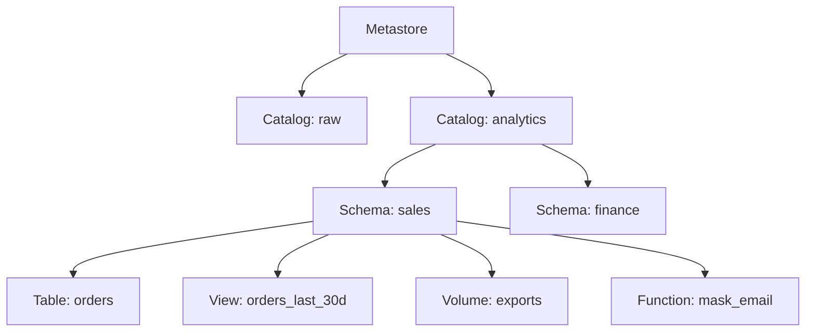

# Catalogs Schemas and Tables

Mastery: `INPUT[inlineSelect(option(new), option(learning), option(solid)):mastery]`

> [!story] Context
> The [[Three-Level Namespace]] defines the `catalog.schema.object` address. This note covers the object types that can exist at each level and the layouts commonly used to organize them.

> [!eli5] Summary
> Catalogs and schemas are containers, like drawers and folders. Tables, views, files, functions, and models go inside them. Each container and object can carry its own access rules, so the layout is also the security model.

> [!analogy]- Analogy: a grocery store
> - **Departments** (produce, dairy, bakery) are catalogs.
> - **Aisles** inside each department are schemas.
> - **Products on the shelf** are tables and views. Loose items in bins, like apples, are files in a [[Volumes|volume]].
> - **Store recipes** posted on the wall are functions and models: things you *use*, not things you read.
> - **Staff badges** decide who can enter the stock room. In Unity Catalog every one of these things is a *securable object* that can carry its own permissions.

## Background

A flat list of thousands of tables is hard to navigate. Without a clear structure, teams copy data into their own areas, names drift (`customers`, `customers_v2`, `customers_final`), and the [[Single Source of Truth|source of truth]] becomes unclear. Unity Catalog gives you containers that also carry **permissions, storage settings, and ownership**, so the structure you choose is also your security model.

## Overview

Catalogs and schemas are the two container levels in Unity Catalog, and tables, views, volumes, functions, and models are the objects stored inside them.

A **securable object** is anything in Unity Catalog you can [[Privileges and Grants|grant privileges]] on. The ones that hold data form the hierarchy:

| Object | Lives in | What it is |
|---|---|---|
| **Catalog** | [[Metastore]] | Top-level container. Usually maps to an environment, business unit, or source. |
| **Schema** | Catalog | Second-level container for related objects. Also called a database. |
| **Table** | Schema | Rows and columns. [[Managed vs External Tables\|Managed or external]], usually [[Delta Lake]] or [[Apache Iceberg]]. |
| **View** | Schema | A saved query over other tables. Holds no data. |
| **[[Materialized Views\|Materialized view]]** | Schema | A query whose results are precomputed and kept up to date. |
| **[[Streaming Tables\|Streaming table]]** | Schema | A table fed incrementally by a pipeline. |
| **[[Metric Views\|Metric view]]** | Schema | Business metrics (measures and dimensions) defined once. |
| **[[Volumes\|Volume]]** | Schema | Governed storage for non-tabular files. |
| **Function** | Schema | A SQL or Python [[UDF\|user-defined function]]. |
| **Model** | Schema | A registered ML model. See [[Models in Unity Catalog]]. |

Catalogs come in a few flavours:

- **Standard catalogs** hold objects you create.
- **Foreign catalogs** mirror an outside database or catalog through [[Lakehouse Federation]].
- **Shared catalogs** are created from a share someone sent you through [[OpenSharing]] and are read-only.
- **The workspace catalog** is the auto-provisioned default catalog in newly enabled workspaces.

Other securables (storage credentials, external locations, connections, shares, recipients, clean rooms) hang off the [[Metastore]] directly and are covered in their own notes.

## How it works



Create the containers, then the objects:

```sql
-- Containers
CREATE CATALOG IF NOT EXISTS analytics
  COMMENT 'Cleaned, reportable data';
CREATE SCHEMA IF NOT EXISTS analytics.sales
  COMMENT 'Orders, customers, and products';

-- A managed Delta table (the default)
CREATE TABLE IF NOT EXISTS analytics.sales.orders (
  order_id    BIGINT,
  customer_id BIGINT,
  order_date  DATE,
  amount      DECIMAL(10,2)
)
COMMENT 'One row per order';

-- A view over it
CREATE OR REPLACE VIEW analytics.sales.orders_last_30d AS
SELECT * FROM analytics.sales.orders
WHERE order_date >= current_date() - INTERVAL 30 DAYS;

-- Describe and explore
DESCRIBE TABLE EXTENDED analytics.sales.orders;
SHOW TABLES IN analytics.sales;
```

You can also browse all of this in **Catalog Explorer**, the UI for Unity Catalog, which shows each object's columns, sample data, owner, permissions, lineage, and history.

Every catalog and schema can carry **ownership** (the user, group, or [[Users Groups and Service Principals|service principal]] who can grant on it), **comments**, **tags**, and an optional **managed storage location**. A catalog can also be **bound** to specific workspaces.

### Common layouts

| Pattern | Catalogs | Good when |
|---|---|---|
| **By environment** | `dev`, `staging`, `prod` | You want the same schema names in each and simple promotion. |
| **By layer** | `bronze`, `silver`, `gold` | You follow the [[Medallion Architecture]] strictly. |
| **By business unit** | `finance`, `marketing`, `ops` | Teams own their data ([[Data Mesh]] style). |
| **Mixed** | `prod_finance`, `dev_finance` | Larger companies that need both. |

The Unity Catalog best practices docs suggest catalogs as the main unit of data isolation and workspace binding. Schemas then hold one domain or project each.

## Small-business considerations

> [!smallbiz] Small-business considerations
> Use three to five catalogs, not one per person. A layout like `raw` / `analytics` / `sandbox`, with schemas named after source systems in `raw` (`raw.shopify`, `raw.quickbooks`) and after business topics in `analytics` (`analytics.sales`, `analytics.inventory`), is straightforward to document. Add a `COMMENT` to every catalog, schema, and important table; [[Genie Agents]] and [[Genie Code]] read those comments when answering questions in plain English.

## Cloud differences

> [!azure]- Azure Databricks, AWS, and Google Cloud
> The object types, SQL, and Catalog Explorer are identical on all three clouds. Only the storage paths behind managed storage differ (`abfss://`, `s3://`, `gs://`), which is covered in [[Managed vs External Tables]] and [[Storage Credentials and External Locations]].

## Advanced topics

> [!deepdive]- Advanced topics (301–401)
> - **Isolation unit:** Catalogs are where you set managed storage and workspace binding, so they are the natural boundary between environments or business units that must not mix.
> - **Ownership:** Every securable has exactly one owner (a user, service principal, or group). Make owners groups, so a person leaving does not orphan objects. Transfer with `ALTER ... OWNER TO`.
> - **Table formats:** Managed tables can be Delta or Iceberg. Delta tables can also expose Iceberg metadata through [[Delta UniForm]].
> - **Views vs dynamic views:** A view that calls `is_account_group_member()` can hide rows or columns per group. Newer [[Row Filters and Column Masks]] and [[Attribute-Based Access Control|ABAC]] usually replace that pattern.

## Common misconceptions

> [!confusion] A view is not a copy
> A view stores a query, not data. Drop the underlying table and the view breaks. A [[Materialized Views|materialized view]] stores results, but it is refreshed from its sources, not edited directly.

> [!confusion] Catalog vs Catalog Explorer vs Unity Catalog
> **Unity Catalog** is the governance system. **A catalog** is one top-level container. **Catalog Explorer** is the UI page where you browse them.

## Recall

What is a securable object in Unity Catalog?::Any object you can grant privileges on, such as a catalog, schema, table, view, volume, function, or model.
Which object types live inside a schema?::Tables, views, materialized views, streaming tables, metric views, volumes, functions, and models.
What is a foreign catalog?::A catalog that mirrors an external database or catalog through Lakehouse Federation.
What is a shared catalog?::A read-only catalog created from a share received through OpenSharing.
Does a view hold data?::No. It stores a query over other objects.
Name two common catalog layouts.::By environment (dev, staging, prod) and by business unit (finance, marketing); by medallion layer is a third.
Who should own catalogs and schemas?::Groups, not individuals, so ownership survives people leaving.
Which UI shows Unity Catalog objects, lineage, and permissions?::Catalog Explorer.

## Next steps

> [!path] Learning path
> **Needs first:** [[Three-Level Namespace]], [[Relational Databases]]
> **Unlocks next:** [[Managed vs External Tables]], [[Volumes]], [[Privileges and Grants]]

> [!nextup] Next
> [[Managed vs External Tables]] explains where table files are stored and what `DROP TABLE` deletes.

> [!sources]- Sources (last verified: 2026-10-25)
> - [Unity Catalog securable objects reference (AWS)](https://docs.databricks.com/aws/en/data-governance/unity-catalog/securable-objects)
> - [Unity Catalog securable objects reference (Azure Databricks)](https://learn.microsoft.com/en-us/azure/databricks/data-governance/unity-catalog/securable-objects)
> - [Databricks Unity Catalog table types (AWS)](https://docs.databricks.com/aws/en/tables/types)
> - [Unity Catalog best practices (Azure Databricks)](https://learn.microsoft.com/en-us/azure/databricks/data-governance/unity-catalog/best-practices)
> - [Manage Unity Catalog object ownership (GCP)](https://docs.databricks.com/gcp/en/data-governance/unity-catalog/manage-privileges/ownership)
> - [Connect to external databases and catalogs (AWS)](https://docs.databricks.com/aws/en/query-federation/)
