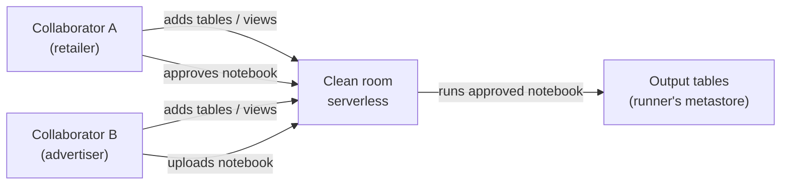

# Clean Rooms

Mastery: `INPUT[inlineSelect(option(new), option(learning), option(solid)):mastery]`

> [!story] Context
> [[OpenSharing]] gives a recipient read access to shared data. Some collaborations require that no party sees the other's raw data, while both still need results computed from the combination, for example measuring how many of a retailer's customers saw an advertiser's campaign. Databricks Clean Rooms provide a controlled environment for this kind of analysis.

> [!eli5] Summary
> A clean room is a shared, locked workspace where several companies place their data. Only analysis that every company has approved can run there, and each company receives the results, not the other companies' records.

> [!analogy]- Analogy: a notary's office
> | Notary's office | Clean room |
> |---|---|
> | Each party brings sealed documents | Each collaborator adds tables, views, or volumes |
> | The procedure is agreed in advance | Notebooks are approved by the other collaborators before they run |
> | The notary reads both documents and issues a certificate | Serverless compute runs the notebook and writes output tables |
> | Neither party takes the other's documents home | Collaborators do not get direct access to each other's raw data |

## Background

Joint analysis between organizations traditionally means one party sends its data to the other, or both send data to a third-party processor. Both approaches move raw data, often including [[PII]], outside the owner's control, which creates privacy and contractual risk.

A clean room keeps each party's data governed by its own [[Unity Catalog]] metastore. The analysis code is reviewed and approved before it runs, and only its outputs leave the room.

## Overview

Databricks Clean Rooms is a Unity Catalog feature in which collaborators share assets into a clean room and run approved notebooks on [[Serverless Compute|serverless compute]].

| Element | Description |
|---|---|
| **Collaborators** | Up to ten organizations per clean room, including the creator. Each needs a Unity Catalog-enabled workspace with serverless compute. |
| **Assets** | Tables, views, volumes, and notebooks that each collaborator adds. Other collaborators can see asset metadata but cannot query another party's data directly. |
| **Notebooks** | The analysis code. Every collaborator except the uploader must approve a notebook before the designated runner can run it. Only the most recent version of a notebook can run. |
| **Auto-approval rules** | Rules that approve notebooks automatically under defined conditions. |
| **Output tables** | Temporary, read-only tables created by a notebook run in the runner's Unity Catalog metastore. By default only the runner can read them. |
| **Shared output** | An option, in Public Preview as of October 2026, that lets a notebook write to a schema that all collaborators can read. It must be enabled when the clean room is created. |
| **Packaged clean rooms** | Prebuilt clean room templates documented separately by Databricks. |

## How it works



Typical procedure:

1. An account admin on each side accepts the serverless terms of service and confirms the workspace is enabled for serverless compute.
2. The creator creates the clean room in Catalog Explorer and adds the other collaborators.
3. Each collaborator adds assets. Add **views** that expose only the columns the analysis needs.
4. One collaborator uploads a notebook. The other collaborators review and approve it.
5. The designated runner runs the notebook. Results appear as output tables.

Prepare a minimal view before adding it to the clean room:

```sql
-- Retailer side: expose only hashed join keys and coarse attributes
CREATE OR REPLACE VIEW prod.cleanroom.customers_for_campaign AS
SELECT
  sha2(lower(trim(email)), 256) AS email_hash,
  region,
  loyalty_tier
FROM prod.crm.customers
WHERE marketing_consent = true;
```

An approved notebook might compute only aggregates:

```sql
-- Inside the clean room notebook (table names are illustrative)
SELECT r.region, count(DISTINCT r.email_hash) AS reached_customers
FROM retailer.customers_for_campaign r
JOIN advertiser.campaign_exposures a USING (email_hash)
GROUP BY r.region
HAVING count(DISTINCT r.email_hash) >= 50;   -- suppress small groups
```

After the run, the runner queries the output table with serverless compute like any other Unity Catalog table.

## Small-business considerations

> [!smallbiz] Small-business considerations
> Most small businesses do not need clean rooms. They become relevant when a larger partner, such as a retailer, media network, or insurer, offers joint analysis and requires that raw customer data is not exchanged. In that case:
> - Confirm that the workspace has serverless compute and Unity Catalog enabled.
> - Share views with hashed identifiers and only the needed columns, never full customer tables.
> - Review every notebook before approving it, including the minimum group size in aggregate outputs.
>
> Clean room runs use serverless compute, billed in [[DBUs]]. See the official [Databricks pricing page](https://www.databricks.com/product/pricing).

## Cloud differences

> [!azure]- Azure Databricks
> - Requirements are the same as on the other clouds: Unity Catalog, serverless compute, and acceptance of the serverless terms.

> [!aws]- Databricks on AWS
> - Data in a firewall-protected S3 bucket is inaccessible to the clean room by default. Options in the docs: move the data to Databricks default storage, allow serverless access to the bucket, or use SecureConnect.

> [!gcp]- Databricks on Google Cloud
> - Requirements are the same as on the other clouds. The GCP docs also document packaged clean rooms.

## Advanced topics

> [!deepdive]- Advanced topics (301–401)
> - **Trust model.** Collaborators trust that approved code does what it says. The approval step is the main control, so review notebooks for row-level outputs, small groups, and joins that could re-identify individuals.
> - **Output limits.** Output tables support tables only, not volumes or views. Querying them requires serverless compute, and the number of output tables per notebook is capped.
> - **Notebook versions.** Only the latest version of a notebook can run, so a change requires re-approval.
> - **Network.** Clean rooms run on serverless compute, so storage behind private networking needs serverless connectivity rules. See [[Serverless Network Security]].
> - **Clean rooms are securables.** A clean room is a metastore-level object, and `BROWSE` can be granted on it directly.

## Common misconceptions

> [!confusion] A clean room is not a share
> With [[OpenSharing]], the recipient can query the shared data directly. In a clean room, collaborators run only approved notebooks and receive only their outputs.

> [!confusion] A clean room does not anonymize data automatically
> Privacy depends on what the approved notebook returns. Aggregation thresholds and column choices are the collaborators' responsibility.

## Recall

What problem do Databricks Clean Rooms solve?::Joint analysis across organizations without any party seeing the others' raw data.
How many collaborators can a clean room have?::Up to ten, including the creator.
What compute do clean rooms run on?::Serverless compute.
Who must approve a notebook before it runs?::Every collaborator except the one who uploaded it.
Which version of a notebook can run?::Only the most recent version.
Where are output tables created by default?::In the runner's Unity Catalog metastore, readable only by the runner.
What is the status of shared output tables as of October 2026?::Public Preview; it must be enabled when the clean room is created.
On AWS, what happens to data in a firewall-protected S3 bucket by default?::It is inaccessible to the clean room until serverless access is allowed, the data is moved to default storage, or SecureConnect is used.

## Next steps

> [!path] Learning path
> **Needs first:** [[OpenSharing]], [[Serverless Compute]], [[Notebooks]]
> **Unlocks next:** [[Databricks Marketplace]]

> [!nextup] Next
> [[Databricks Marketplace]] uses OpenSharing to distribute datasets, models, and other data products from providers to consumers.

> [!sources]- Sources (last verified: 2026-10-25)
> - [What is Databricks Clean Rooms? (AWS)](https://docs.databricks.com/aws/en/clean-rooms/)
> - [Create clean rooms (AWS)](https://docs.databricks.com/aws/en/clean-rooms/create-clean-room)
> - [Create clean rooms (Azure Databricks)](https://learn.microsoft.com/en-us/azure/databricks/clean-rooms/create-clean-room)
> - [Run notebooks in clean rooms (AWS)](https://docs.databricks.com/aws/en/clean-rooms/clean-room-notebook)
> - [Create and work with output tables in Databricks Clean Rooms (AWS)](https://docs.databricks.com/aws/en/clean-rooms/output-tables)
> - [Manage clean rooms (AWS)](https://docs.databricks.com/aws/en/clean-rooms/manage-clean-room)
> - [Manage clean rooms (Azure Databricks)](https://learn.microsoft.com/en-us/azure/databricks/clean-rooms/manage-clean-room)
> - [Packaged clean rooms (Azure Databricks)](https://learn.microsoft.com/en-us/azure/databricks/clean-rooms/packaged-clean-rooms)
> - [Packaged clean rooms (GCP)](https://docs.databricks.com/gcp/en/clean-rooms/packaged-clean-rooms)
> - [Unity Catalog privileges reference (AWS)](https://docs.databricks.com/aws/en/data-governance/unity-catalog/access-control/privileges-reference)
