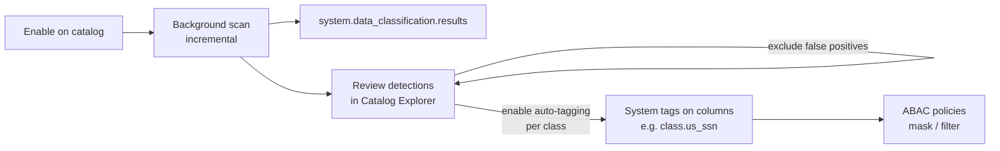

# Data Classification

Mastery: `INPUT[inlineSelect(option(new), option(learning), option(solid)):mastery]`

> [!story] Context
> [[Attribute-Based Access Control]] protects data based on tags, so protection is only as complete as the tagging. [[Databricks Marketplace]] and [[OpenSharing]] also bring in data whose contents you did not design. Data Classification scans catalogs for sensitive data and applies tags, so ABAC policies cover new columns without manual review of every table.

> [!eli5] Summary
> Data Classification reads through your tables and finds columns that look like personal or sensitive information, such as email addresses, phone numbers, or national ID numbers. It reports what it found and can label those columns automatically so that protection rules apply to them.

> [!analogy]- Analogy: a document scanner in a records office
> | Records office | Data Classification |
> |---|---|
> | A clerk scans incoming files for confidential content | A background job scans tables in enabled catalogs |
> | The clerk flags pages for review | Detections are listed for review in Catalog Explorer |
> | Confirmed pages get a "confidential" stamp | Approved classes are applied as tags on columns |
> | Stamped pages go to the locked cabinet | Tagged columns are masked by ABAC policies |

## Background

Manual tagging does not scale. Columns that contain [[PII]] appear in raw ingestion tables, partner feeds, and ad hoc copies, often under names that do not reveal their content. A column named `notes` or `field_7` can contain email addresses. Regulations such as [[GDPR]] and [[HIPAA]] require an organization to know where such data is stored.

Data Classification automates detection inside [[Unity Catalog]] and connects the results to tag-based access control.

## Overview

Data Classification is enabled per catalog. When enabled, Databricks runs a background job that scans the catalog incrementally, detects sensitive data, and assigns **system tags** to matching columns when automatic tagging is turned on.

Status as of October 2026:

| Capability | Status |
|---|---|
| Data Classification | Generally available (announced together with ABAC policies and governed tags) |
| View scanning | Beta. A workspace admin enables it on the **Previews** page. View columns are classified but not tagged by default. |
| Custom classifiers | Beta. Up to 50 per metastore, applied to every catalog with Data Classification enabled. |

Results are stored in the system table `system.data_classification.results`:

- It contains classification results for the **entire metastore**, including **sample values** from detected columns.
- By default only **account admins** can read it. Grant access only to users who may see sensitive sample values from every catalog.
- It can be queried only from **serverless compute**.

Detected classes include names, email addresses, phone numbers, dates of birth, and national identifiers such as the US Social Security number (tag `class.us_ssn`). The full list is on the supported classification tags page.

## How it works



Procedure:

1. In Catalog Explorer, open the catalog, go to the **Details** tab, and select **Enable** next to **Data Classification**.
2. Choose the schema scope: all current and future schemas (default), or only selected schemas. Save to start the scan.
3. Review detections. Mark false positives with the **Exclude** action.
4. Enable automatic tagging for the classes you want. Tags are applied during the next scan, typically within 24 hours.
5. Create [[Attribute-Based Access Control|ABAC]] policies that match those tags.

New tables and columns are typically scanned within 24 hours of creation.

Required privileges:

| Action | Privileges |
|---|---|
| Enable Data Classification on a catalog | Owner of the catalog, or `MANAGE` on it |
| Turn on automatic tagging | `USE CATALOG`, `APPLY TAG`, and `ASSIGN` on the tag |

Query results (from serverless compute, as a user with access):

```sql
-- Inspect the schema first; column names are documented in the reference
DESCRIBE TABLE system.data_classification.results;

-- Then review a sample of results
SELECT *
FROM system.data_classification.results
LIMIT 100;
```

The column names in the results table are documented in the Data Classification reference. Avoid `SELECT *` in shared reports, because the table includes sample values.

Configure catalogs from scripts with the [[Databricks CLI]] `data-classification` command group.

## Small-business considerations

> [!smallbiz] Small-business considerations
> Data Classification is useful for a small team because it finds sensitive columns that nobody documented. A minimal setup:
> 1. Enable it on the catalog that holds raw ingested data, such as `raw`.
> 2. Review the first results and exclude false positives.
> 3. Enable automatic tagging for the classes that matter, such as email, phone, and national IDs.
> 4. Add one ABAC masking policy that matches those tags.
>
> Keep `system.data_classification.results` restricted to account admins, because it contains sample values. For how scans are billed, see the Data Classification documentation and the official [Databricks pricing page](https://www.databricks.com/product/pricing).

## Cloud differences

> [!azure]- Azure Databricks, AWS, and Google Cloud
> The feature, permissions, and results table are documented the same way on all three clouds. Each cloud has its own Data Classification release notes page; check it for regional availability and preview changes.

## Advanced topics

> [!deepdive]- Advanced topics (301–401)
> - **Metastore-wide sensitivity.** The results table spans all catalogs in the metastore. Granting `SELECT` on it effectively grants visibility of sample sensitive values from every enabled catalog.
> - **Detection is not tagging.** Detection results appear first; tags are applied only for classes where automatic tagging is enabled. This separation lets you tune false positives before policies take effect.
> - **Custom classifiers (Beta)** add organization-specific patterns, such as internal customer IDs, up to 50 per metastore.
> - **Secure by default.** The ABAC documentation describes control tags that protect new tables until they are reviewed. Data Classification and control tags together reduce the window in which new sensitive data is unprotected.
> - **Views (Beta).** View columns can be scanned when view scanning is enabled, but they are not tagged by default.
> - **Scan latency.** Expect up to about 24 hours before new tables are classified. For data that must be protected immediately, tag columns manually at creation time.

## Common misconceptions

> [!confusion] Classification does not restrict access by itself
> It detects and tags. Access changes only when a policy, such as an ABAC column mask, matches the tags.

> [!confusion] The results table is not safe to share widely
> It includes sample values of detected sensitive data. Treat it as sensitive.

## Recall

Where are Data Classification results stored?::In the system table `system.data_classification.results`.
Who can read the results table by default?::Account admins.
From which compute can the results table be queried?::Only serverless compute.
At what level is Data Classification enabled?::Per catalog, from the catalog's Details tab in Catalog Explorer.
Which privilege, besides ownership, lets you enable Data Classification on a catalog?::`MANAGE` on the catalog.
Which privileges are needed to turn on automatic tagging?::`USE CATALOG`, `APPLY TAG`, and `ASSIGN` on the tag.
How soon are new tables typically scanned?::Within about 24 hours.
What is the status of custom classifiers as of October 2026, and how many are allowed?::Beta; up to 50 per metastore.
Does Data Classification mask data?::No. It detects and tags; ABAC policies use the tags to mask or filter.

## Next steps

> [!path] Learning path
> **Needs first:** [[Attribute-Based Access Control]], [[Privileges and Grants]], [[PII]]
> **Unlocks next:** [[Attribute-Based Access Control]], [[Compliance Security Profile]]

> [!nextup] Next
> [[Hive Metastore Migration to Unity Catalog]] covers moving tables from the legacy Hive metastore into Unity Catalog so these controls apply to them.

> [!sources]- Sources (last verified: 2026-10-25)
> - [Data Classification (AWS)](https://docs.databricks.com/aws/en/data-governance/unity-catalog/data-classification)
> - [Data Classification (Azure Databricks)](https://learn.microsoft.com/en-us/azure/databricks/data-governance/unity-catalog/data-classification)
> - [Supported classification tags (GCP)](https://docs.databricks.com/gcp/en/data-governance/unity-catalog/data-classification-tags)
> - [Supported classification tags (Azure Databricks)](https://learn.microsoft.com/en-us/azure/databricks/data-governance/unity-catalog/data-classification-tags)
> - [Custom classifiers (AWS)](https://docs.databricks.com/aws/en/data-governance/unity-catalog/data-classification-custom-classifiers)
> - [Data Classification release notes (Azure Databricks)](https://learn.microsoft.com/en-us/azure/databricks/release-notes/data-classification/)
> - [Data Classification release notes (GCP)](https://docs.databricks.com/gcp/en/release-notes/data-classification)
> - [data-classification command group (Databricks CLI, AWS)](https://docs.databricks.com/aws/en/dev-tools/cli/reference/data-classification-commands)
> - [Secure new tables by default with control tags (GCP)](https://docs.databricks.com/gcp/en/data-governance/unity-catalog/abac/secure-by-default)
> - [ABAC policies, governed tags, and data classification are now GA (Databricks blog)](https://www.databricks.com/blog/abac-row-filtering-and-column-masking-policies-governed-tags-and-data-classification-are-now)
