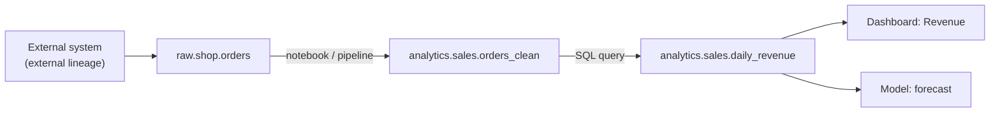

# Data Lineage

Mastery: `INPUT[inlineSelect(option(new), option(learning), option(solid)):mastery]`

> [!story] Context
> [[Attribute-Based Access Control]] controls what each user sees. Governance also requires knowing where data comes from and what depends on it. Before Unity Catalog, this required reading code or running a separate lineage tool. Unity Catalog captures lineage automatically as queries run.

> [!eli5] Summary
> Lineage is a map of where data comes from and where it goes. For any table or report, it shows the tables it was built from and the tables, jobs, and dashboards that use it. Databricks records the map automatically.

> [!analogy]- Analogy: a food supply chain label
> - **The packaged meal** is a dashboard or a gold table.
> - **The label on the back** lists every ingredient and which farm it came from. That is *upstream* lineage.
> - **A product recall** works in the other direction, from one ingredient to every product that contains it. That is *downstream* lineage, also called impact analysis.
> - **The label is printed by the factory machines themselves** as they cook, not written afterwards by a person.

## Background

Lineage supports three common tasks:

1. **Root-cause analysis.** Trace a column back to its source tables.
2. **Impact analysis.** Find every downstream table, job, and dashboard before renaming or dropping a column.
3. **Compliance.** Show where [[PII]] flows, for example for [[GDPR]] or [[HIPAA]] reviews.

Hand-maintained diagrams drift out of date. Lineage captured from executed queries reflects what actually ran.

## Overview

Unity Catalog captures **runtime data lineage** across queries run on Databricks, for all languages (SQL, Python, Scala, R), down to the **column level**. Lineage covers tables, views, [[Volumes|volume]] paths, and the things that read or write them: [[Notebooks]], [[Lakeflow Jobs|jobs]], [[Lakeflow Spark Declarative Pipelines|pipelines]], [[AI-BI Dashboards|dashboards]], queries, and [[Models in Unity Catalog|models]].

You see it in three ways:

| Where | Good for |
|---|---|
| **Catalog Explorer → Lineage tab** on any table | Interactive graph, upstream and downstream, with column drill-down |
| **Lineage system tables** `system.access.table_lineage` and `system.access.column_lineage` | SQL analysis, impact reports, feeding other catalogs |
| **REST API** | Integrations with external catalogs |

**External lineage** extends the graph beyond Databricks. You register *external metadata* objects (for example a Salesforce object, a Kafka topic, or a Tableau dashboard) and add lineage edges between them and Unity Catalog tables, so the map shows the whole journey from source system to BI tool.

## How it works



Lineage is recorded automatically when code runs on Unity Catalog-enabled compute and refers to tables by name. There is nothing to turn on for the UI view. To query it, use the system tables (an admin may need to grant access):

```sql
-- What feeds this table? (upstream, last 90 days)
SELECT DISTINCT source_table_full_name, entity_type, entity_id
FROM system.access.table_lineage
WHERE target_table_full_name = 'analytics.sales.daily_revenue'
  AND event_date >= current_date() - INTERVAL 90 DAYS;

-- What would break if I changed this column? (downstream)
SELECT DISTINCT target_table_full_name, target_column_name
FROM system.access.column_lineage
WHERE source_table_full_name = 'analytics.sales.orders_clean'
  AND source_column_name     = 'amount'
  AND event_date >= current_date() - INTERVAL 90 DAYS;
```

The lineage system tables keep a **rolling one-year window**.

## Small-business considerations

> [!smallbiz] Small-business considerations
> Lineage serves as documentation that maintains itself. To show how a reported figure such as net revenue is calculated, open `analytics.sales.daily_revenue` in Catalog Explorer, select **Lineage**, and follow the graph back to the raw orders table and the notebook that transforms it. Check downstream lineage before renaming or dropping an object to avoid breaking dashboards. Lineage has no separate charge.

## Cloud differences

> [!azure]- Azure Databricks
> - Lineage works the same. Many Azure customers also scan Unity Catalog into **Microsoft Purview**, a separate Microsoft governance product. What Purview can ingest depends on what Unity Catalog records in the lineage system tables; check Microsoft's Purview documentation for its current limits (not verified here).

> [!aws]- Databricks on AWS
> - Nothing differs from the general behaviour.

> [!gcp]- Databricks on Google Cloud
> - Nothing differs from the general behaviour.

## Advanced topics

> [!deepdive]- Advanced topics (301–401)
> - **Best effort, not a guarantee.** The docs say the system tables are a subset of all read and write events, because it is not always possible to capture lineage. Treat it as very good evidence, not proof.
> - **Names, not paths.** Column lineage appears in Catalog Explorer and the API only when both source and target are referenced by table name. Path-based reads are recorded in the column lineage system table with `source_path` or `target_path` instead.
> - **No source, no column lineage.** Writing literal values creates no column lineage event, because there is no source column. Reading a column is captured even if nothing is written.
> - **UDFs.** Table-level lineage is captured through UDFs; column-level lineage through UDFs is not.
> - **External lineage lives elsewhere.** External lineage edges are **not** written to `system.access.table_lineage` or `column_lineage`. Query them through the external lineage APIs or Catalog Explorer.
> - **Permissions.** Users see lineage nodes for objects they lack access to as masked or limited entries, so lineage does not leak table contents.
> - **Workspace scope.** Lineage is aggregated across workspaces attached to the same metastore; lineage audit events use the `lineageTracking` service name.

## Common misconceptions

> [!confusion] Lineage is not an audit log
> Lineage shows how data *flows* between objects. The [[Audit Logs]] show *who did what and when*. You often need both: lineage to see that `salaries` feeds a report, audit to see who opened that report.

> [!confusion] Lineage is not a pipeline definition
> It is a record of what actually ran, not of what was supposed to run. A pipeline that has not run yet has no lineage.

## Recall

What does Unity Catalog lineage capture?::Runtime, column-level lineage across tables, views, volumes, notebooks, jobs, pipelines, dashboards, and models, in all languages.
Which system tables hold lineage?::`system.access.table_lineage` and `system.access.column_lineage`.
How long do the lineage system tables keep data?::A rolling one-year window.
When is column lineage shown in Catalog Explorer?::Only when both source and target are referenced by table name, not by path.
Is column-level lineage captured through UDFs?::No, only table-level lineage.
What is external lineage?::Lineage edges between Unity Catalog objects and registered external metadata objects outside Databricks.
Is external lineage in the lineage system tables?::No. Use the external lineage APIs or Catalog Explorer.
What is downstream lineage used for?::Impact analysis: finding everything that would be affected by changing an object.

## Next steps

> [!path] Learning path
> **Needs first:** [[Unity Catalog]], [[Data Pipeline]]
> **Unlocks next:** [[System Tables]], [[Data Quality Monitoring]]

> [!nextup] Next
> [[Audit Logs]] record which users performed which actions, and when.

> [!sources]- Sources (last verified: 2026-10-25)
> - [Lineage in Unity Catalog (AWS)](https://docs.databricks.com/aws/en/data-governance/unity-catalog/data-lineage)
> - [Lineage in Unity Catalog (Azure Databricks)](https://learn.microsoft.com/en-us/azure/databricks/data-governance/unity-catalog/data-lineage)
> - [Lineage system tables reference (AWS)](https://docs.databricks.com/aws/en/admin/system-tables/lineage)
> - [Lineage system tables reference (Azure Databricks)](https://learn.microsoft.com/en-us/azure/databricks/admin/system-tables/lineage)
> - [External lineage (Azure Databricks)](https://learn.microsoft.com/en-us/azure/databricks/data-governance/unity-catalog/external-lineage)
> - [Audit log system table reference (AWS)](https://docs.databricks.com/aws/en/admin/system-tables/audit-logs)
