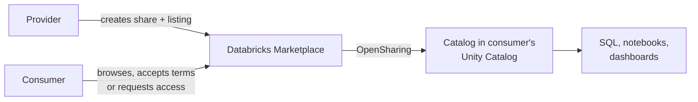

# Databricks Marketplace

Mastery: `INPUT[inlineSelect(option(new), option(learning), option(solid)):mastery]`

> [!story] Context
> [[OpenSharing]] shares data with recipients you already know, and [[Clean Rooms]] support joint analysis with known partners. Databricks Marketplace addresses discovery: finding third-party datasets and models, and publishing your own data products to organizations you have not yet contacted.

> [!eli5] Summary
> Databricks Marketplace is a catalog of ready-made data and models from other companies. You browse it, accept the terms, and the data appears in your workspace as live tables, without downloading files.

> [!analogy]- Analogy: an app store for data
> | App store | Databricks Marketplace |
> |---|---|
> | App listing | A listing for a dataset or model |
> | Free and paid apps | Free listings, and paid or customized listings that need provider approval |
> | Installing an app | Getting a listing, which creates a catalog from a share |
> | Enterprise app catalog | A private exchange, visible only to invited members |

## Background

Buying third-party data traditionally involves negotiating a contract, receiving files over SFTP or an API, building an ingestion pipeline, and repeating the process when the provider publishes updates. Each delivery creates another copy to secure.

Databricks Marketplace lists data products that are delivered through [[OpenSharing]]. The consumer reads the provider's data in place, so updates are visible without a new delivery, and the data is governed by the consumer's [[Unity Catalog]] like any other catalog.

## Overview

| Role | What they do |
|---|---|
| **Consumer** | Browses listings, filters by product type (dataset or ML model), provider, category, and cost (free or paid), and requests or gets products. |
| **Provider** | Publishes listings, either publicly or in a private exchange, and approves requests where required. |

Listing access:

| Listing type | Access |
|---|---|
| **Free** | Marked on the listing tile. Available immediately after the consumer accepts the terms. |
| **Paid or customized** | Usually requires provider approval, typically because a commercial transaction is involved or the provider customizes the product. |

Visibility:

| Scope | Who can see the listing |
|---|---|
| **Public Marketplace** | All consumers can browse and view the listing. |
| **Private exchange** | Only consumers who are members of the exchange can browse, view, and request the listing. Members must be Databricks customers with a workspace attached to a Unity Catalog [[Metastore]], and are invited by metastore identifier. |

Becoming a provider:

- **Public listings** require an application to the Databricks Data Partner Program.
- **Private-exchange-only providers** can use the self-service signup flow in the provider console.

Consumers without a Unity Catalog workspace can use the **Open Marketplace** through external platforms. In that path, only tabular dataset products are available.

## How it works



Procedure for a consumer:

1. In the workspace, open **Marketplace** and search or filter listings.
2. Open a listing and review its description and terms.
3. For a free listing, accept the terms and name the catalog to create. For a paid or customized listing, submit a request and wait for provider approval.
4. Query the new catalog.

After a listing is installed, it is an ordinary read-only catalog:

```sql
-- See providers whose data you have received
SHOW PROVIDERS;

-- Query the catalog created from the listing (name chosen when installing)
SHOW SCHEMAS IN weather_marketplace;
SELECT * FROM weather_marketplace.daily.observations
WHERE station_region = 'Midwest' AND obs_date >= current_date() - INTERVAL 7 DAYS;

-- Govern it like any other catalog
GRANT USE CATALOG ON CATALOG weather_marketplace TO `analysts`;
GRANT USE SCHEMA, SELECT ON CATALOG weather_marketplace TO `analysts`;
```

## Small-business considerations

> [!smallbiz] Small-business considerations
> Marketplace is a low-effort way to enrich internal data. Typical examples are weather, holidays, demographics, geographic reference data, and economic indicators joined to sales data. Start with free listings, because they need no approval and no pipeline.
>
> Check each listing's terms for permitted use, especially before using the data in a product sold to customers. The provider sets the price of paid listings; querying any listing uses your own compute, billed in [[DBUs]].

## Cloud differences

> [!azure]- Azure Databricks
> - Marketplace works the same way in Unity Catalog-enabled workspaces. In legacy Azure Databricks workspaces without Unity Catalog, only tabular dataset products are available.

> [!aws]- Databricks on AWS
> - Databricks Marketplace is separate from AWS Marketplace, which is a way to subscribe to Databricks itself. See [[AWS Marketplace and Billing]].

> [!gcp]- Databricks on Google Cloud
> - Databricks Marketplace is separate from Google Cloud Marketplace, which is a way to subscribe to Databricks itself. See [[Google Cloud Marketplace and Billing]].

## Advanced topics

> [!deepdive]- Advanced topics (301–401)
> - **Cross-cloud delivery:** Delivery uses OpenSharing, which identifies each consumer by a `cloud:region:uuid` sharing identifier, so providers and consumers can be on different clouds or regions. Cross-region reads can create egress charges for the provider.
> - **Private exchanges for B2B distribution:** A company can use a private exchange to distribute standard data products to its own customers or subsidiaries without public listing.
> - **Request management:** Providers review and fulfill requests for paid or customized products in the provider console.
> - **Product types:** Listings include tabular datasets and ML models. Non-Unity Catalog and external-platform consumers receive only tabular datasets.

## Common misconceptions

> [!confusion] Databricks Marketplace is not a cloud marketplace
> AWS Marketplace, Azure Marketplace, and Google Cloud Marketplace sell cloud services, including Databricks subscriptions. Databricks Marketplace distributes data products between Databricks customers and other consumers.

> [!confusion] Getting a listing does not copy the data
> The catalog created from a listing reads the provider's shared data in place. Copy it into your own tables only if you need a snapshot.

## Recall

How are Databricks Marketplace products delivered?::Through OpenSharing; the consumer gets a read-only catalog in Unity Catalog.
What happens when you get a free listing?::Access is immediate after you accept the terms.
Why do paid or customized listings need approval?::A commercial transaction is involved, or the provider customizes the product.
What is a private exchange?::An invite-only group whose listings do not appear in the public Marketplace.
What must private exchange members have?::A Databricks account with a workspace attached to a Unity Catalog metastore.
How does a provider publish public listings?::By applying to the Databricks Data Partner Program.
Which products are available to consumers on external platforms?::Only tabular datasets.
Is Databricks Marketplace the same as AWS or Google Cloud Marketplace?::No. Those sell cloud services; Databricks Marketplace distributes data products.

## Next steps

> [!path] Learning path
> **Needs first:** [[OpenSharing]], [[Catalogs Schemas and Tables]]
> **Unlocks next:** [[Data Classification]]

> [!nextup] Next
> [[Data Classification]] detects sensitive data in your catalogs and applies tags that access policies can use.

> [!sources]- Sources (last verified: 2026-10-25)
> - [What is Databricks Marketplace? (AWS)](https://docs.databricks.com/aws/en/marketplace/)
> - [Access data products in Databricks Marketplace (AWS)](https://docs.databricks.com/aws/en/marketplace/get-started-consumer)
> - [Access data products in Databricks Marketplace (Azure Databricks)](https://learn.microsoft.com/en-us/azure/databricks/marketplace/get-started-consumer)
> - [Access data products using external platforms (AWS)](https://docs.databricks.com/aws/en/marketplace/get-started-consumer-open)
> - [Access data products using external platforms (Azure Databricks)](https://learn.microsoft.com/en-us/azure/databricks/marketplace/get-started-consumer-open)
> - [Create and manage private exchanges (AWS)](https://docs.databricks.com/aws/en/marketplace/private-exchange)
> - [Become a Databricks Marketplace provider (AWS)](https://docs.databricks.com/aws/en/marketplace/become-provider)
> - [Create a Marketplace listing (Azure Databricks)](https://learn.microsoft.com/en-us/azure/databricks/marketplace/create-listing)
> - [Manage requests for your data product (AWS)](https://docs.databricks.com/aws/en/marketplace/manage-requests-provider)
> - [Share data and AI assets securely (AWS)](https://docs.databricks.com/aws/en/data-sharing)
