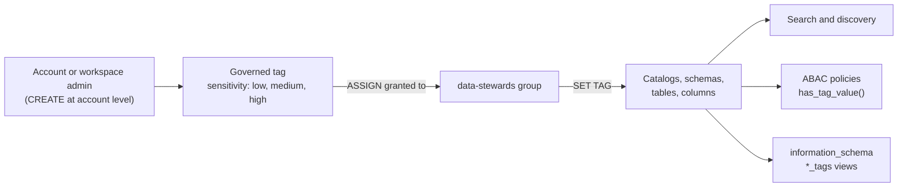

# Governed Tags

Mastery: `INPUT[inlineSelect(option(new), option(learning), option(solid)):mastery]`

A governed tag is an account-level tag key in Unity Catalog with a tag policy that controls its allowed values and who may assign it.

> [!story] Context
> [[Catalog Explorer]] shows tags on catalogs, schemas, tables, and columns. Ordinary tags are free text: anyone who can tag an object can write `PII`, `pii`, or `personal`, and the labels drift apart. Governed tags fix the vocabulary at the account level so that tags can be trusted for search, reporting, and access control.

> [!eli5] Summary
> A governed tag is a label with a fixed list of allowed choices, such as "sensitivity: low, medium, or high", set once for the whole company. Only approved people can put the label on data, so everyone can rely on it, including the security rules that hide sensitive information.

## Background

Unity Catalog has always supported key-value tags on [[Securable Object|securable objects]]. Ungoverned tags have three weaknesses:

- **Inconsistent values:** Nothing stops `pii = Email`, `pii = email`, and `PII = mail` from coexisting. Tag keys are case-sensitive, so these are three different tags.
- **No assignment control:** Anyone with `APPLY TAG` on an object can add or change any tag on it, including a tag a security rule depends on.
- **Workspace drift:** Each team invents its own keys.

Policies that make access decisions from tags, such as [[Attribute-Based Access Control|ABAC]], need tags that are controlled. Governed tags provide that control.

## Overview

When you create a governed tag, you also define its **tag policy**. The policy specifies:

| Setting | What it controls |
|---|---|
| **Tag key** | The name, such as `pii` or `sensitivity`. Unique in the account. |
| **Allowed values** | An optional list of values. If omitted, the tag is key-only. Maximum 500 values per tag. |
| **Description** | Free text explaining when to use the tag. |
| **Permissions** | Who can manage the definition (`MANAGE`) and who can apply it (`ASSIGN`). |

Status and limits as of October 2026:

- Governed tags are **generally available**. Databricks announced GA together with ABAC row filter and column mask policies and [[Data Classification]].
- An account can have at most **1,000 governed tags**.
- An object can carry at most **50 tags**, and a table at most **1,000 column tags** in total.
- Tag keys and values are each limited to **256 characters**. Keys are case-sensitive.
- Governed tags cannot be applied to compute resources (such as SQL warehouses) or jobs. Those use a separate tagging mechanism, covered in [[Tagging for Chargeback]].

### System governed tags

Databricks also ships **system governed tags**. Their keys and values are predefined, and you cannot modify or delete them. [[Data Classification]] applies system tags to columns it detects as sensitive. By default only account admins hold `MANAGE` and `ASSIGN` on the classification system tags, and they can grant those permissions to others.

## How it works



### Permissions

| Permission | Granted on | Lets the holder |
|---|---|---|
| `CREATE` | Account | Create governed tags. Account admins and workspace admins have it by default. The creator receives `MANAGE` on the new tag. |
| `MANAGE` | One governed tag | Edit or delete the tag definition and grant permissions on it. |
| `ASSIGN` | One governed tag | Apply or remove the tag on objects. Account admins have `ASSIGN` on all tags by default. |

To apply a governed tag to an object, you need `ASSIGN` on the tag **and** the usual object requirements: ownership of the object, or `APPLY TAG` on it plus `USE CATALOG` and `USE SCHEMA` on its parents.

### Create a governed tag in the UI

1. In the workspace sidebar, click **Catalog**.
2. Click the **Govern** button (shield icon).
3. Select **Governed Tags**.
4. Click **Create governed tag**.
5. Enter a tag key, such as `sensitivity`.
6. Optionally, enter a description and one or more allowed values.
7. Click **Create**.

### Create and use a governed tag in SQL

`CREATE GOVERNED TAG` requires Databricks Runtime 18.1 or above with Unity Catalog.

```sql
-- Define the tag and its allowed values
CREATE GOVERNED TAG sensitivity
  DESCRIPTION 'Data sensitivity tier'
  VALUES ('low', 'medium', 'high');

-- Key-only tag (no values list)
CREATE GOVERNED TAG certified;

-- Replace the allowed values (SET VALUES replaces the whole list)
ALTER GOVERNED TAG sensitivity SET VALUES ('public', 'low', 'medium', 'high');

-- Apply tags (needs ASSIGN on the tag plus APPLY TAG on the object)
ALTER TABLE sales.orders.customers SET TAGS ('sensitivity' = 'high');
ALTER TABLE sales.orders.customers ALTER COLUMN email SET TAGS ('pii' = 'email');

-- Find tagged tables
SELECT catalog_name, schema_name, table_name, tag_name, tag_value
FROM sales.information_schema.table_tags
WHERE tag_name = 'sensitivity';
```

The same operations are available in the [[Databricks CLI]] through the `tag-policies` command group (for example, `databricks tag-policies create-tag-policy`).

### Behavior with existing tags

- **Converting a key:** If you create a governed tag whose key is already used by ordinary tags, all existing assignments with that key become governed automatically. You do not reassign them.
- **Out-of-policy values:** Existing assignments with values outside the allowed list stay on objects, but nobody can assign those values again.
- **Deleting a governed tag:** The key and its values remain on objects, but they are no longer governed, and anyone who can apply tags can change them.
- **Dropping a column:** Dropping a column that has a governed tag fails. Remove the tag first.

## Small-business considerations

> [!smallbiz] Small-business considerations
> Governed tags have no separate charge. A small company benefits from them as soon as it stores customer data, because one tag drives masking everywhere through [[Attribute-Based Access Control|ABAC]]. A minimal setup:
> 1. Create one governed tag, `pii`, with values such as `email`, `phone`, `address`, and `name`.
> 2. Create one governed tag, `sensitivity`, with values `public`, `internal`, and `confidential`.
> 3. Grant `ASSIGN` on both to a small `data-stewards` group (often one or two people).
> 4. Turn on [[Data Classification]] so Databricks proposes tags for new columns.
>
> Skip governed tags if all data is non-sensitive and one person owns every table. Ordinary tags are enough for search in that case.

## Cloud differences

> [!azure]- Azure Databricks, AWS, and Google Cloud
> Nothing differs. Governed tags are account-level Unity Catalog objects with the same SQL, UI, CLI, and limits on all three clouds. They are not the same as cloud resource tags (Azure tags, AWS tags, Google Cloud labels) on compute, which flow to the cloud bill. See [[Tagging for Chargeback]].

## Advanced topics

> [!deepdive]- Advanced topics (301–401)
> - **Inheritance:** By default, securables inherit tags from their parent catalog or schema. Column tags do **not** inherit from the table, so tag columns directly. ABAC policies match columns with `has_tag()` and `has_tag_value()`. See [[Attribute-Based Access Control]].
> - **Design for unambiguous matches:** If two values could both trigger different column masks on the same column, policy outcomes become hard to predict. Keep values mutually exclusive within a key.
> - **`SET VALUES` is declarative:** `ALTER GOVERNED TAG ... SET VALUES` replaces the full list. Include every value you want to keep.
> - **Automated assignment:** Databricks documents automation for tag assignment, and [[Data Classification]] can apply system tags automatically. Account admins can see every automation.
> - **Views and classification:** Classification tags are not applied to view columns by default, because a tag on a view column can conflict with an existing mask or row filter policy.
> - **Search:** Tag search requires an exact match on the term.
> - **Audit:** Tag changes appear in the [[Audit Logs]], so you can alert when someone removes a tag a policy depends on.

## Common misconceptions

> [!confusion] Governed tags are not ABAC policies
> A governed tag is a label with rules about its values and who may assign it. It does not hide or filter data by itself. An [[Attribute-Based Access Control|ABAC]] policy reads the tag and applies a mask or filter.

> [!confusion] Governed tags are not compute or billing tags
> Cluster, SQL warehouse, and job tags are a separate system used for cost reporting. Governed tags apply to Unity Catalog securable objects only.

> [!confusion] Deleting a governed tag does not remove the tags
> The key and values stay on objects. They become ordinary, ungoverned tags.

## Recall

What is a governed tag?::An account-level Unity Catalog tag key with a tag policy that controls its allowed values and who may assign it.
Which permission is needed to apply a governed tag to an object?::`ASSIGN` on the governed tag, plus `APPLY TAG` on the object (or ownership) and `USE CATALOG`/`USE SCHEMA` on its parents.
Who can create governed tags by default?::Account admins and workspace admins (they hold `CREATE` at the account level).
What is the maximum number of governed tags per account?::1,000.
What is the maximum number of allowed values per governed tag?::500.
What happens to existing tags when you create a governed tag with the same key?::They automatically become governed.
What happens when you delete a governed tag?::The tags stay on objects but become ungoverned.
Do column tags inherit from the table?::No. Apply them to the column directly.
What does `ALTER GOVERNED TAG ... SET VALUES` do to the existing values list?::Replaces it entirely.

## Next steps

> [!path] Learning path
> **Needs first:** [[Catalog Explorer]], [[Privileges and Grants]]
> **Unlocks next:** [[Attribute-Based Access Control]], [[Data Classification]]

> [!nextup] Next
> [[Service Credentials]] covers how Unity Catalog governs access to cloud services other than storage, such as queues and secret stores.

> [!sources]- Sources (last verified: 2026-10-25)
> - [Governed tags (AWS)](https://docs.databricks.com/aws/en/admin/governed-tags/)
> - [Governed tags (Azure Databricks)](https://learn.microsoft.com/en-us/azure/databricks/admin/governed-tags/)
> - [Create and manage governed tags (AWS)](https://docs.databricks.com/aws/en/admin/governed-tags/manage-governed-tags)
> - [Create and manage governed tags (Azure Databricks)](https://learn.microsoft.com/en-us/azure/databricks/admin/governed-tags/manage-governed-tags)
> - [Manage permissions on governed tags (AWS)](https://docs.databricks.com/aws/en/admin/governed-tags/manage-permissions)
> - [Automate tag assignment (AWS)](https://docs.databricks.com/aws/en/admin/governed-tags/automate-tag-assignment)
> - [CREATE GOVERNED TAG (AWS SQL reference)](https://docs.databricks.com/aws/en/sql/language-manual/sql-ref-syntax-ddl-create-governed-tag)
> - [Apply tags to Unity Catalog securable objects (AWS)](https://docs.databricks.com/aws/en/database-objects/tags)
> - [Apply tags to Unity Catalog securable objects (GCP)](https://docs.databricks.com/gcp/en/database-objects/tags)
> - [TABLE_TAGS (AWS SQL reference)](https://docs.databricks.com/aws/en/sql/language-manual/information-schema/table_tags)
> - [tag-policies command group (AWS)](https://docs.databricks.com/aws/en/dev-tools/cli/reference/tag-policies-commands)
> - [Core concepts for ABAC (AWS)](https://docs.databricks.com/aws/en/data-governance/unity-catalog/abac/core-concepts)
> - [Data Classification (AWS)](https://docs.databricks.com/aws/en/data-governance/unity-catalog/data-classification)
> - [ABAC policies, governed tags, and data classification are now GA (Databricks blog)](https://www.databricks.com/blog/abac-row-filtering-and-column-masking-policies-governed-tags-and-data-classification-are-now)
