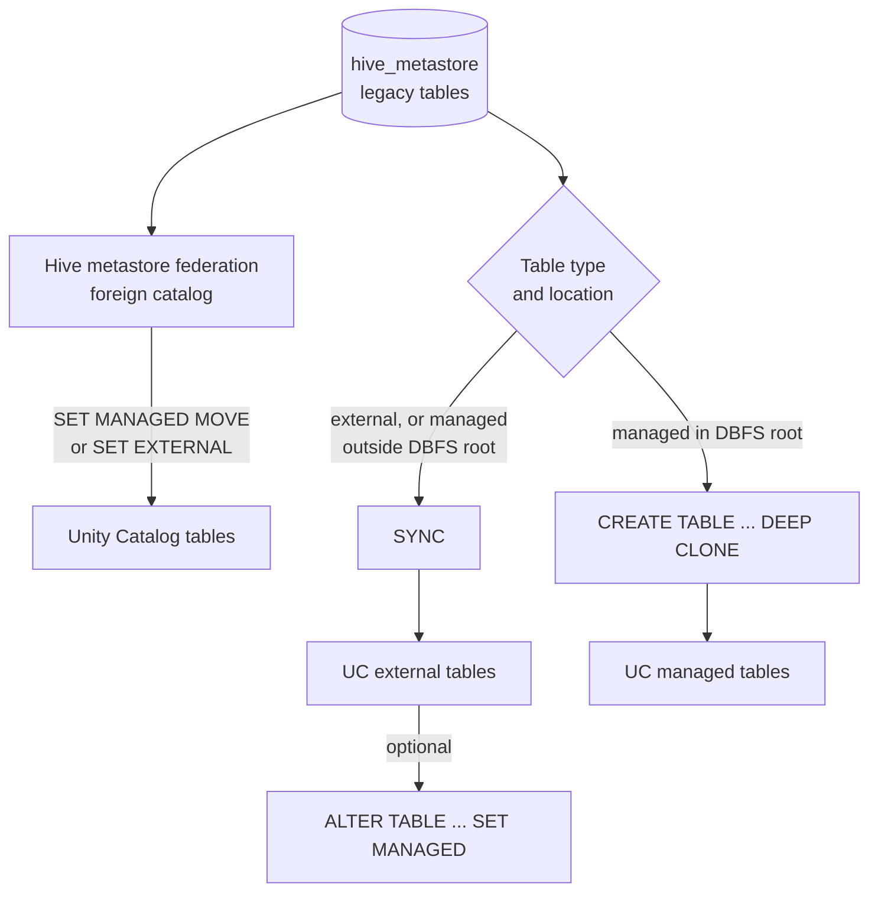

# Hive Metastore Migration to Unity Catalog

Mastery: `INPUT[inlineSelect(option(new), option(learning), option(solid)):mastery]`

> [!story] Context
> The previous notes in this chapter assume data is registered in Unity Catalog. Workspaces created before Unity Catalog, or used without it, keep tables in the legacy per-workspace [[Hive Metastore]], which appears as the `hive_metastore` catalog. Those tables do not receive Unity Catalog grants, lineage, ABAC, or classification until they are upgraded.

> [!eli5] Summary
> Older Databricks workspaces keep their table list in a legacy system that each workspace manages separately. Migration moves those tables into Unity Catalog so that one set of rules, tracking, and auditing applies to them.

> [!bridge]- In Databricks today
> The [[Hive Metastore]] originated in [[Apache Hive]] and was the default table catalog in Databricks workspaces before Unity Catalog. In current workspaces it appears as the `hive_metastore` catalog for backward compatibility. Its role is now held by the Unity Catalog [[Metastore]], and Hive metastore federation lets Unity Catalog govern a legacy or external Hive metastore during migration.

## Background

A workspace that relies on the legacy Hive metastore has the limitations described in [[Unity Catalog]]: per-workspace table lists, workspace-level table access control, cluster-held storage credentials such as [[Instance Profiles|instance profiles]], DBFS mounts, and no automatic lineage. Newer features, including [[Attribute-Based Access Control|ABAC]], [[Data Classification]], and predictive optimization, require Unity Catalog.

Migration involves more than tables. Jobs, notebooks, cluster configurations, groups, and storage access must also move to Unity Catalog equivalents.

## Overview

Databricks documents three main approaches. The current upgrade guide recommends federation first; the table-upgrade page documents `SYNC` and `CLONE` as the direct paths.

| Approach | What it does | Result |
|---|---|---|
| **Hive metastore federation** | Mirrors the Hive metastore (or AWS Glue) as a **foreign catalog** in Unity Catalog. Tables are then upgraded in place. | Governed access immediately; tables converted with `ALTER TABLE ... SET MANAGED MOVE` or `SET EXTERNAL` |
| **`SYNC`** | Registers Hive **external** tables, and managed tables stored outside workspace storage (DBFS root), as Unity Catalog external tables. Can be rerun to keep targets updated. | Unity Catalog external tables over the same files |
| **`CREATE TABLE ... CLONE`** | Copies Hive managed tables stored in workspace storage (DBFS root). Table history is not migrated, so clones are treated as new tables. | Unity Catalog managed tables |

**UCX** is a set of Databricks utilities that automates the upgrade. Its table migration workflow upgrades external tables with `SYNC` and DBFS-root managed tables with `DEEP CLONE`. It also includes a table-mapping step, a principal setup step for storage access, and `enable-hms-federation` and `create-federated-catalog` commands for the federation route. UCX upgrades Hive managed tables only if they are in Delta or Parquet format.

Other assets to move:

| Legacy | Unity Catalog replacement |
|---|---|
| DBFS mounts (`/mnt/...`) | [[Volumes]] and [[Storage Credentials and External Locations\|external locations]] |
| Instance profiles, service principal secrets in Spark config | Storage credentials |
| Workspace-local groups | Account-level groups. See [[Users Groups and Service Principals]]. |
| Table ACLs in `hive_metastore` | Unity Catalog [[Privileges and Grants\|grants]] |
| Two-part names (`db.table`) in code | Three-part names (`catalog.schema.table`) |
| Clusters without Unity Catalog access mode | Standard or dedicated access mode, serverless, or SQL warehouses |

## How it works



Procedure for a direct upgrade:

1. Create or confirm the Unity Catalog [[Metastore]] and attach the workspace.
2. Create storage credentials and external locations for every bucket or container that Hive tables use.
3. Create target catalogs and schemas.
4. Upgrade tables with `SYNC` or `CLONE` (or run UCX).
5. Update code to three-part names and Unity Catalog-capable compute.
6. Recreate permissions as Unity Catalog grants, test, and switch jobs over. See [[Running Old and New in Parallel]] and [[Cutover]].

Preview, then upgrade, a schema of external tables:

```sql
-- Preview what SYNC would do
SYNC SCHEMA prod.sales FROM hive_metastore.sales DRY RUN;

-- Register the external tables in Unity Catalog
SYNC SCHEMA prod.sales FROM hive_metastore.sales;

-- Or one table at a time
SYNC TABLE prod.sales.orders FROM hive_metastore.sales.orders;
```

Copy a managed table stored in the DBFS root:

```sql
CREATE TABLE prod.sales.customers
  DEEP CLONE hive_metastore.sales.customers;
```

Convert an upgraded external Delta table to managed:

```sql
ALTER TABLE prod.sales.orders SET MANAGED;
```

Federation route, after a foreign catalog `hms_fed` mirrors the Hive metastore:

```sql
-- Query legacy tables through Unity Catalog governance
SELECT count(*) FROM hms_fed.sales.orders;

-- Upgrade in place; access to the source table in the external catalog is disabled
ALTER TABLE hms_fed.sales.orders SET MANAGED MOVE;
```

Check the current upgrade guide for the exact federation setup steps and statement options on your runtime.

## Small-business considerations

> [!smallbiz] Small-business considerations
> New accounts start on Unity Catalog, so migration applies only to workspaces created before Unity Catalog or used without it. For a small estate, typically a few dozen tables:
> 1. List what is in `hive_metastore` with `SHOW SCHEMAS IN hive_metastore` and `SHOW TABLES IN hive_metastore.<schema>`.
> 2. Upgrade external tables with `SYNC` and DBFS-root managed tables with `DEEP CLONE`. UCX is optional at this size.
> 3. Replace `/mnt/` paths in notebooks with `/Volumes/` paths.
> 4. Update jobs to three-part names, run old and new side by side for a short period, then stop writing to the old tables.
>
> Migration has no separate charge. Cloning copies data, which uses compute and adds storage until the old copy is removed.

## Cloud differences

> [!azure]- Azure Databricks
> - Storage access moves from service principal secrets or mounts to storage credentials backed by an [[ADLS and Access Connectors|Access Connector]].
> - Group migration usually involves moving from workspace-local groups to account groups synced from Microsoft Entra ID. See [[Microsoft Entra ID Integration]].

> [!aws]- Databricks on AWS
> - Storage access moves from [[Instance Profiles|instance profiles]] to IAM-role storage credentials. See [[S3 Access via Unity Catalog]].
> - Catalog federation also supports **AWS Glue**, so tables registered in Glue can be federated and upgraded in place. See [[Hive Metastore Federation for AWS Glue]].

> [!gcp]- Databricks on Google Cloud
> - Storage access moves to storage credentials backed by a Databricks-generated service account. See [[GCS Access via Unity Catalog]].

## Advanced topics

> [!deepdive]- Advanced topics (301–401)
> - **History.** `CLONE` does not carry table history. Time travel to pre-migration versions is not available on the clone; keep the source until it is no longer needed.
> - **SYNC as a bridge.** `SYNC` can be rerun to keep Unity Catalog external tables aligned with Hive table changes while jobs are moved gradually.
> - **Federation first.** Federating the Hive metastore gives governed access to all legacy tables immediately, then lets you upgrade table by table without a big-bang copy. `SET MANAGED MOVE` disables access to the source table in the external catalog, so update remaining readers first.
> - **UCX scope.** Beyond table migration, UCX includes a table-mapping step, principal and storage setup, and federation commands. Review the UCX documentation for the current command list before planning around it.
> - **Format limits.** Hive managed tables in formats other than Delta or Parquet need manual handling, typically a `CREATE TABLE AS SELECT` into a managed Delta table.
> - **Coexistence.** Databricks documents working with the legacy Hive metastore alongside Unity Catalog, so migration can be incremental.

## Common misconceptions

> [!confusion] Enabling Unity Catalog does not migrate existing tables
> Attaching a workspace to a metastore leaves existing tables in `hive_metastore`. Each table must be upgraded.

> [!confusion] SYNC does not copy data
> `SYNC` registers existing files as Unity Catalog external tables. `CLONE` copies data.

## Recall

How does the legacy Hive metastore appear in a Unity Catalog workspace?::As the `hive_metastore` catalog.
Which command upgrades Hive external tables to Unity Catalog external tables?::`SYNC` (for example `SYNC SCHEMA prod.sales FROM hive_metastore.sales`).
How are Hive managed tables in the DBFS root upgraded?::With `CREATE TABLE ... DEEP CLONE`, producing Unity Catalog managed tables.
Does CLONE migrate table history?::No. Cloned tables are treated as new tables.
What is UCX?::A set of Databricks utilities that automates upgrading a workspace to Unity Catalog.
Which formats must Hive managed tables be in for UCX to upgrade them?::Delta or Parquet.
What does Databricks' current upgrade guide recommend first?::Federating the Hive metastore (or AWS Glue) as a foreign catalog, then upgrading tables in place.
Which statement upgrades a federated foreign table in place to managed?::`ALTER TABLE ... SET MANAGED MOVE`.
What replaces DBFS mounts?::Unity Catalog volumes and external locations.

## Next steps

> [!path] Learning path
> **Needs first:** [[Hive Metastore]], [[Managed vs External Tables]], [[Storage Credentials and External Locations]], [[Lakehouse Federation]]
> **Unlocks next:** [[Migration Strategy Overview]], [[Migrating from Hadoop]], [[Chapter 08 - Data Engineering]]

> [!nextup] Next
> [[Chapter 08 - Data Engineering]] covers how data is ingested into governed tables and kept up to date with pipelines and jobs.

> [!sources]- Sources (last verified: 2026-10-25)
> - [Upgrade a Databricks workspace to Unity Catalog (AWS)](https://docs.databricks.com/aws/en/data-governance/unity-catalog/upgrade/)
> - [Upgrade an Azure Databricks workspace to Unity Catalog](https://learn.microsoft.com/en-us/azure/databricks/data-governance/unity-catalog/upgrade/)
> - [Upgrade Hive tables and views to Unity Catalog (AWS)](https://docs.databricks.com/aws/en/data-governance/unity-catalog/migrate)
> - [Upgrade Hive tables and views to Unity Catalog (Azure Databricks)](https://learn.microsoft.com/en-us/azure/databricks/data-governance/unity-catalog/migrate)
> - [Use the UCX utilities to upgrade your workspace (AWS)](https://docs.databricks.com/aws/en/data-governance/unity-catalog/ucx)
> - [Use the UCX utilities to upgrade your workspace (Azure Databricks)](https://learn.microsoft.com/en-us/azure/databricks/data-governance/unity-catalog/ucx)
> - [SYNC (Azure Databricks SQL reference)](https://learn.microsoft.com/en-us/azure/databricks/sql/language-manual/sql-ref-syntax-aux-sync)
> - [Work with the legacy Hive metastore alongside Unity Catalog (AWS)](https://docs.databricks.com/aws/en/data-governance/unity-catalog/hive-metastore)
> - [Database objects in the legacy Hive metastore (AWS)](https://docs.databricks.com/aws/en/database-objects/hive-metastore)
> - [Convert external or foreign Delta Lake tables to managed tables (AWS)](https://docs.databricks.com/aws/en/tables/convert-to-managed)
