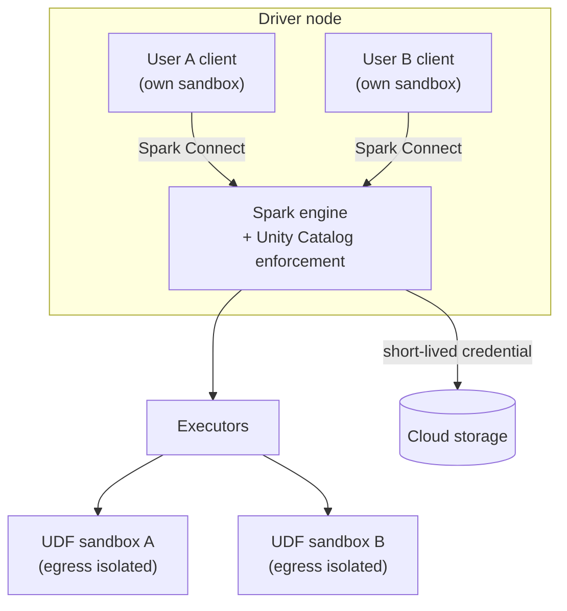

# Lakeguard

Mastery: `INPUT[inlineSelect(option(new), option(learning), option(solid)):mastery]`

Lakeguard is the Databricks isolation layer that separates each user's code from the Spark engine and from other users on shared compute, so that [[Unity Catalog]] permissions, [[Row Filters and Column Masks|row filters, and column masks]] are enforced for SQL, Python, and Scala workloads.

> [!story] Context
> [[Unity Catalog Functions]] run user-written Python inside queries, and many users often share one cluster or SQL warehouse. Fine-grained rules such as masks only hold if one user's code cannot read another user's data or bypass the engine that applies the rules. Lakeguard provides that guarantee on shared compute.

> [!eli5] Summary
> Lakeguard keeps people who share the same computer resources in Databricks from seeing each other's work or data. Each person's code runs in its own sealed box, so the security rules set in Unity Catalog apply to everyone, even on a shared cluster.

## Background

[[Apache Spark]] was designed for trusted users. It has no mechanism for isolating user code: on a classic cluster, all users' code runs in the same [[JVM]] on the [[Driver and Executors|driver]], with the same classpath and access to the same memory and local disk. That creates two problems for governance:

- **Data leakage between users:** One user's code could read objects or files belonging to another user's session.
- **Bypassing fine-grained controls:** If user code can reach the engine's internals or the raw files, it can read rows that a row filter should hide.

Before Lakeguard, fine-grained access control was available mainly for SQL, while general Spark workloads relied on coarser, file-level governance. Workloads that needed the full Spark API ran on clusters assigned to a single user, which cannot be shared.

Databricks announced Unity Catalog Lakeguard on April 25, 2024, describing it as data governance for multi-user Apache Spark clusters across SQL, Python, and Scala. The design is described in the SIGMOD 2025 paper *Databricks Lakeguard: Supporting Fine-grained Access Control and Multi-user Capabilities for Apache Spark Workloads*.

## Overview

Lakeguard is not a product you configure. It is built into the compute types that support sharing:

| Compute | Lakeguard role |
|---|---|
| **Standard** access mode (classic, formerly "shared") | Isolates each user's client code and UDFs. Many users can attach at once. |
| [[Serverless Compute\|Serverless compute]] (notebooks, jobs, pipelines) | Sandboxes all user code. Serverless relies on it. |
| [[SQL Warehouses]] | Sandboxes Python UDFs. |
| **Dedicated** access mode (formerly "single user") | Not shared, so no user isolation is needed. Fine-grained access control is enforced by delegating filtering to Lakeguard-isolated serverless compute. |

See [[Compute Types]] for access modes. The default **Auto** mode selects Standard unless you choose an ML runtime, a GPU instance type, or a Databricks Runtime below 14.3, in which case it selects Dedicated.

## How it works

Lakeguard combines two mechanisms: [[Spark Connect]] to separate client code from the engine, and [[Container|container]] sandboxes to isolate user code.



1. **Client and engine are separated:** Lakeguard uses Spark Connect (introduced in Apache Spark 3.4) to decouple client applications from the driver. Client applications and the driver no longer share a JVM or classpath. User code sends query plans; it does not touch engine internals.
2. **Each client runs in its own sandbox:** Every user's client application runs in an isolated container environment on the driver.
3. **UDFs are sandboxed on executors:** User-defined functions run in isolated sandboxes, and their network egress is isolated. This applies to UDFs on standard compute and to Python UDFs on serverless compute and SQL warehouses. See [[Unity Catalog Functions]].
4. **Only the engine reaches the data:** The engine checks Unity Catalog privileges, applies [[Row Filters and Column Masks|filters and masks]], and reads storage with credentials that Unity Catalog vends. User code never receives raw storage access.

### Fine-grained access control on dedicated compute

A dedicated cluster runs one user's (or one group's) code without Lakeguard client isolation, so it cannot safely apply row filters and masks itself. Instead, it sends the filtering step to serverless compute:

1. A user on dedicated compute queries a table with a row filter, column mask, or ABAC policy, a dynamic view, a view over tables they cannot fully read, or a materialized view or streaming table.
2. The dedicated cluster passes the query to the workspace's serverless compute.
3. Serverless compute, isolated by Lakeguard, applies the filtering.
4. Results return through temporary files in workspace storage. They are marked for deletion after 24 hours and permanently deleted after another 24 hours.

Requirements and limits:

| Item | Requirement |
|---|---|
| Runtime | Databricks Runtime 15.4 LTS or above (ABAC policies need 16.4 or above with fine-grained access control filtering enabled) |
| Workspace | Serverless compute enabled |
| Network | Firewalled workspaces must allow ports 8443 to 8451 |
| Writes | Read-only on 15.4 to 16.2. Writes (including `MERGE INTO` and DataFrame append) on 16.3 and above |
| Streaming | Not supported on tables with row filters or column masks from dedicated compute |
| Runtime 15.3 and below | Cannot read tables with row filters or column masks, or dynamic views |

### What standard compute restricts

Isolation requires limiting some low-level APIs. On standard access mode:

- RDD APIs are not supported. Use DataFrames and Spark SQL.
- In Scala, `sc`, `spark.sparkContext`, and `sqlContext` are not supported. Use the `spark` session.
- A set of Spark configuration properties is blocked (enforced at cluster creation on Databricks Runtime 19 and above).

Databricks recommends dedicated access mode for workloads that need RDD APIs, ML on GPUs, or R.

```python
# Works on standard compute: DataFrame API, governed by Unity Catalog
df = spark.read.table("sales.orders.daily_totals")
df.groupBy("region").sum("revenue").show()

# Fails on standard compute: RDD API is not available
# spark.sparkContext.parallelize([1, 2, 3])
```

## Small-business considerations

> [!smallbiz] Small-business considerations
> Lakeguard has no setting and no separate charge. It matters to a small team for two reasons:
> 1. **One shared cluster is safe:** Use standard access mode (or serverless) so the whole team shares one compute resource, which lowers cost, and Unity Catalog masks still apply per person.
> 2. **Row filters and masks need it:** If you mask customer emails, analysts must use standard, serverless, or SQL warehouse compute, or dedicated compute on Databricks Runtime 15.4 LTS or above with serverless enabled.
>
> Choose dedicated access mode only for a workload that needs RDD APIs, R, or GPUs.

## Cloud differences

> [!azure]- Azure Databricks, AWS, and Google Cloud
> Lakeguard works the same way on all three clouds. The access mode names and the dedicated-compute filtering requirements are identical. The only cloud-specific step is network configuration: if your workspace restricts outbound traffic (for example with [[VNet Injection]] on Azure or a [[Customer-Managed VPC on AWS|customer-managed VPC]]), open ports 8443 to 8451 so dedicated compute can reach serverless filtering.

## Advanced topics

> [!deepdive]- Advanced topics (301–401)
> - **Why Spark Connect matters:** Spark Connect is a client-server protocol (Databricks describes it as JDBC-like) that sends unresolved logical plans to the server. Because the client no longer runs inside the driver JVM, the client's language version and libraries are decoupled from the engine. This also enables independent client upgrades and remote clients such as [[Databricks Connect]].
> - **Defense in depth:** Isolation operates at three points: client sandboxes on the driver, UDF sandboxes on executors, and egress isolation for UDFs. Storage credentials are scoped by Unity Catalog per query, not per cluster.
> - **Serverless dependence:** Serverless compute requires Unity Catalog. Workloads that bypass Unity Catalog (for example, direct cloud-key access to storage) must be changed before they run on serverless.
> - **UDF isolation modes:** Unity Catalog Python UDFs on Databricks Runtime 18.1 and above default to a shared isolation environment, with `STRICT ISOLATION` available for UDFs that modify global state. See [[Unity Catalog Functions]].
> - **Language support history:** Lakeguard-era standard compute added Python UDFs, Scala, and Scala UDFs over several runtime releases in 2023 and 2024. Blog posts and current docs give slightly different version numbers, so check the current standard compute limitations page before planning a migration.
> - **Group-dedicated compute:** Dedicated compute can be assigned to a group instead of a single user. It still uses the dedicated-mode model, including serverless filtering for fine-grained controls.

## Common misconceptions

> [!confusion] Lakeguard is not a separate product to enable
> It is the isolation built into standard access mode, serverless compute, and SQL warehouses. Choosing those compute types turns it on.

> [!confusion] Dedicated compute does not ignore row filters
> On Databricks Runtime 15.4 LTS and above with serverless enabled, dedicated compute enforces row filters and masks by delegating filtering to serverless compute. On older runtimes it refuses to read such tables.

## Recall

What is Lakeguard?::The Databricks isolation layer that separates each user's code from the Spark engine and from other users on shared compute, so Unity Catalog fine-grained controls are enforced.
Which two mechanisms does Lakeguard combine?::Spark Connect (client-engine separation) and container sandboxes for user code.
Which compute types use Lakeguard isolation?::Standard access mode clusters, serverless compute, and SQL warehouses.
How does dedicated compute enforce row filters and column masks?::It delegates the filtering to the workspace's Lakeguard-isolated serverless compute (Databricks Runtime 15.4 LTS and above).
Which ports must firewalled workspaces open for dedicated-compute filtering?::8443 to 8451.
Since which runtime can dedicated compute write to tables with row filters or column masks?::Databricks Runtime 16.3.
Which API family is not supported on standard access mode?::RDD APIs.
When did Databricks announce Unity Catalog Lakeguard?::April 25, 2024.
In which Spark version was Spark Connect introduced?::Apache Spark 3.4.
Which access mode does Auto pick for an ML runtime or GPU instance?::Dedicated.

## Next steps

> [!path] Learning path
> **Needs first:** [[Compute Types]], [[Spark Connect]], [[Row Filters and Column Masks]]
> **Unlocks next:** [[Serverless Compute]], [[Compute Policies]]

> [!nextup] Next
> [[Chapter 08 - Data Engineering]] moves from governing data to bringing it in, cleaning it, and keeping it current with Lakeflow.

> [!sources]- Sources (last verified: 2026-10-25)
> - [How does Databricks enforce user isolation? (AWS)](https://docs.databricks.com/aws/en/compute/lakeguard)
> - [Standard compute overview (AWS)](https://docs.databricks.com/aws/en/compute/standard-overview)
> - [Standard compute requirements and limitations (AWS)](https://docs.databricks.com/aws/en/compute/standard-limitations)
> - [Standard compute requirements and limitations (Azure Databricks)](https://learn.microsoft.com/en-us/azure/databricks/compute/standard-limitations)
> - [Fine-grained access control on dedicated compute (AWS)](https://docs.databricks.com/aws/en/compute/single-user-fgac)
> - [Dedicated compute requirements and limitations (AWS)](https://docs.databricks.com/aws/en/compute/dedicated-limitations)
> - [Classic compute configuration best practices (AWS)](https://docs.databricks.com/aws/en/compute/cluster-config-best-practices)
> - [Classic compute overview (AWS)](https://docs.databricks.com/aws/en/compute/use-compute)
> - [Serverless compute limitations (AWS)](https://docs.databricks.com/aws/en/compute/serverless/limitations)
> - [Unity Catalog Lakeguard: data governance for multi-user Apache Spark clusters (Databricks blog)](https://www.databricks.com/blog/unity-catalog-lakeguard-industry-first-and-only-data-governance-multi-user-apachetm-spark)
> - [Shared clusters in Unity Catalog: cluster libraries, Python UDFs, Scala, and more (Databricks blog)](https://www.databricks.com/blog/shared-clusters-unity-catalog-win-introducing-cluster-libraries-python-udfs-scala-machine)
> - [Databricks at SIGMOD 2025 (Databricks blog)](https://www.databricks.com/blog/databricks-sigmod-2025)
> - [Databricks Lakeguard: Supporting Fine-grained Access Control and Multi-user Capabilities for Apache Spark Workloads (SIGMOD 2025)](https://dl.acm.org/doi/10.1145/3722212.3724433)
> - [SQL and Python user-defined functions (UDFs) in Unity Catalog (AWS)](https://docs.databricks.com/aws/en/udf/unity-catalog)
