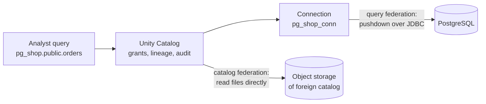

# Lakehouse Federation

Mastery: `INPUT[inlineSelect(option(new), option(learning), option(solid)):mastery]`

> [!story] Context
> The previous notes govern data stored in Databricks. Many organizations also keep data in operational databases and other platforms, such as PostgreSQL, SQL Server, or Snowflake. Lakehouse Federation registers those sources in [[Unity Catalog]] so they can be queried and governed in place.

> [!eli5] Summary
> Lakehouse Federation lets you query data in another database from Databricks without copying it first. Databricks still checks permissions and records who read what.

> [!analogy]- Analogy: an interlibrary loan desk
> - **The connection** is the agreement with the other library: its address and the login your library uses there.
> - **The foreign catalog** is a shelf in your catalog that lists the other library's books, so readers find them in the usual place.
> - **Unity Catalog** still checks your library card before every loan.
> - **Query federation** is asking the other library to look things up and send you only the answer.
> - **Catalog federation** is getting permission to read the other library's books straight off its shelves (its files in object storage).

## Background

Without federation, there are two options:

- **Copy the data first** with an ETL tool, then query it. Setup takes time, and the result is two copies with two sets of permissions.
- **Connect each notebook over JDBC** with credentials in the code. This is quick but ungoverned: no grants, no lineage, and credentials stored in notebooks.

Federation registers the external source once in Unity Catalog. You then query it with the same three-part names, grants, and lineage as native tables. It suits exploration, occasional reporting, and validating a use case before building a pipeline.

## Overview

There are two types:

| | **Query federation** | **Catalog federation** |
|---|---|---|
| **How it reads** | Pushes queries down to the external database over JDBC; the database does the work | Unity Catalog reads the foreign tables' files directly from object storage |
| **Good for** | Operational databases and warehouses | Other catalogs whose data already sits in cloud storage |
| **Sources (per Azure Databricks docs, October 2026)** | MySQL, PostgreSQL, Teradata, Oracle, Amazon Redshift, Salesforce Data 360, Snowflake, Microsoft SQL Server, Azure Synapse, Google BigQuery, and Databricks | Legacy Databricks Hive metastore, external Hive metastores, Salesforce Data 360, Snowflake, Palantir Foundry, Workday Data Connect, and OneLake |
| **Writes** | Read-only | Read-only, except a federated legacy Hive metastore, whose foreign tables are writable |

Two Unity Catalog objects make it work:

1. A **connection**: the source type, host, and credentials. A metastore-level securable.
2. A **foreign catalog**: a catalog that mirrors one database (or catalog) from that connection. Its schemas and tables appear in Catalog Explorer like any other.

## How it works



```sql
-- 1. A connection (keep credentials in a secret scope, not in plain text)
CREATE CONNECTION pg_shop_conn TYPE postgresql
OPTIONS (
  host     'shop-db.example.com',
  port     '5432',
  user     secret('shop_scope', 'pg_user'),
  password secret('shop_scope', 'pg_password')
);

-- 2. A foreign catalog for one database on that connection
CREATE FOREIGN CATALOG IF NOT EXISTS pg_shop
  USING CONNECTION pg_shop_conn
  OPTIONS (database 'shop');

-- 3. Govern it like any catalog
GRANT USE CATALOG ON CATALOG pg_shop TO `analysts`;
GRANT USE SCHEMA, SELECT ON SCHEMA pg_shop.public TO `analysts`;

-- 4. Query, and even join with lakehouse tables
SELECT o.order_id, o.total, c.segment
FROM pg_shop.public.orders o
JOIN analytics.crm.customer_segments c USING (customer_id)
WHERE o.created_at >= current_date() - INTERVAL 7 DAYS;
```

Permissions: creating a connection needs `CREATE CONNECTION` on the metastore. Creating a foreign catalog needs `CREATE CATALOG` on the metastore and either ownership of the connection or `CREATE FOREIGN CATALOG` on it.

## Small-business considerations

> [!smallbiz] Small-business considerations
> Federation is often the quickest way to start. A foreign catalog over the PostgreSQL or MySQL database behind a shop or booking system makes its tables queryable without building a pipeline. Two considerations:
> - **Every query hits the source database:** Frequently refreshed dashboards add load to the production system. Use a read replica if one is available.
> - **Ingest tables that are queried often:** Use [[Lakeflow Connect]] or a scheduled job to land it as a managed table, which is faster and cheaper to query repeatedly.
>
> Federation itself has no separate license; you pay for the Databricks compute that runs the query and any data transfer your cloud charges.

## Cloud differences

The SQL and the two federation types are the same. The **list of sources differs by cloud**, mainly for catalog federation.

> [!azure]- Azure Databricks
> - Query federation supports Azure Synapse and Microsoft SQL Server (including Azure SQL), plus the cross-cloud sources listed above.
> - Catalog federation includes **OneLake**, which lets you read Microsoft Fabric data in place. See [[Microsoft Fabric and OneLake vs Databricks]].

> [!aws]- Databricks on AWS
> - The AWS docs also list **AWS Glue** for catalog federation, so tables registered in Glue can be governed through Unity Catalog. See [[Hive Metastore Federation for AWS Glue]].
> - Amazon Redshift is a query federation source.

> [!gcp]- Databricks on Google Cloud
> - Google BigQuery is a query federation source. See [[BigQuery Integration]].
> - The GCP docs list an additional Google catalog source for catalog federation. Check the GCP page for its current name and status.

## Advanced topics

> [!deepdive]- Advanced topics (301–401)
> - **Requirements:** Query federation needs Unity Catalog and Databricks Runtime 13.3 LTS or above, or a SQL warehouse.
> - **Pushdown:** Query federation pushes supported operations, such as filters, down to the remote database. What is pushed down varies by source; check the per-source page. Joins across sources run in Databricks, so select only the columns and rows you need.
> - **Network reach:** The compute running the query must reach the database: public endpoint with IP allowlists, or private connectivity. For serverless, configure [[Serverless Network Security]].
> - **Federation for migration:** Hive metastore federation mirrors a legacy Hive metastore (or AWS Glue) as a foreign catalog. Databricks' upgrade guide now recommends this as a first step, then upgrading foreign tables in place. See [[Hive Metastore Migration to Unity Catalog]].
> - **Federation vs sharing:** If the other side is also on Databricks, [[OpenSharing]] is usually better than federating over JDBC: it shares data directly, with no database in the path.
> - **Lineage and audit** apply to foreign tables, so federated reads show up in [[Data Lineage]] and [[Audit Logs]].

## Common misconceptions

> [!confusion] Federation is not ingestion
> Federation leaves the data where it is and reads it at query time. [[Ingestion]] tools such as [[Lakeflow Connect]] copy it into the lakehouse on a schedule. Many teams start with federation and graduate to ingestion.

> [!confusion] Query federation vs catalog federation
> Query federation asks a *database engine* to run part of your query. Catalog federation reads a *catalog's files* directly from storage, with Databricks doing all the work.

## Recall

What are the two types of Lakehouse Federation?::Query federation (pushdown to an external database over JDBC) and catalog federation (reading foreign tables' files directly from object storage).
Which two Unity Catalog objects does federation use?::A connection and a foreign catalog.
Which statement creates a foreign catalog?::`CREATE FOREIGN CATALOG <name> USING CONNECTION <conn> OPTIONS (database '<db>');`
Are federated tables writable?::No, they are read-only, except foreign tables in a federated legacy Hive metastore.
Name four query federation sources.::Any of MySQL, PostgreSQL, SQL Server, Snowflake, Oracle, Teradata, Redshift, Synapse, BigQuery, Salesforce Data 360, Databricks.
Name two catalog federation sources.::Any of Hive metastore (legacy or external), AWS Glue (AWS), Snowflake, Salesforce Data 360, Palantir Foundry, Workday Data Connect, OneLake.
What privilege lets someone create a foreign catalog from a connection they do not own?::`CREATE FOREIGN CATALOG` on the connection (plus `CREATE CATALOG` on the metastore).
Where should connection passwords be stored?::In a secret scope, referenced with `secret()`.

## Next steps

> [!path] Learning path
> **Needs first:** [[Catalogs Schemas and Tables]], [[Relational Databases]]
> **Unlocks next:** [[Hive Metastore Migration to Unity Catalog]], [[Migration Strategy Overview]], [[Lakeflow Connect]]

> [!nextup] Next
> [[OpenSharing]] covers the reverse direction: giving partners and customers governed, read-only access to your data.

> [!sources]- Sources (last verified: 2026-10-25)
> - [Connect to external databases and catalogs (AWS)](https://docs.databricks.com/aws/en/query-federation/)
> - [Connect to external databases and catalogs (Azure Databricks)](https://learn.microsoft.com/en-us/azure/databricks/query-federation/)
> - [Connect to external databases and catalogs (GCP)](https://docs.databricks.com/gcp/en/query-federation)
> - [What is query federation? (AWS)](https://docs.databricks.com/aws/en/query-federation/database-federation)
> - [What is query federation? (Azure Databricks)](https://learn.microsoft.com/en-us/azure/databricks/query-federation/database-federation)
> - [Federated queries (Lakehouse Federation) SQL reference (AWS)](https://docs.databricks.com/aws/en/sql/language-manual/sql-ref-federated-queries)
> - [Run federated queries on Microsoft SQL Server (Azure Databricks)](https://learn.microsoft.com/en-us/azure/databricks/query-federation/sql-server)
> - [Upgrade a Databricks workspace to Unity Catalog (AWS)](https://docs.databricks.com/aws/en/data-governance/unity-catalog/upgrade/)
> - [CREATE CONNECTION (AWS SQL reference)](https://docs.databricks.com/aws/en/sql/language-manual/sql-ref-syntax-ddl-create-connection)
> - [Run federated queries on PostgreSQL (AWS)](https://docs.databricks.com/aws/en/query-federation/postgresql)
