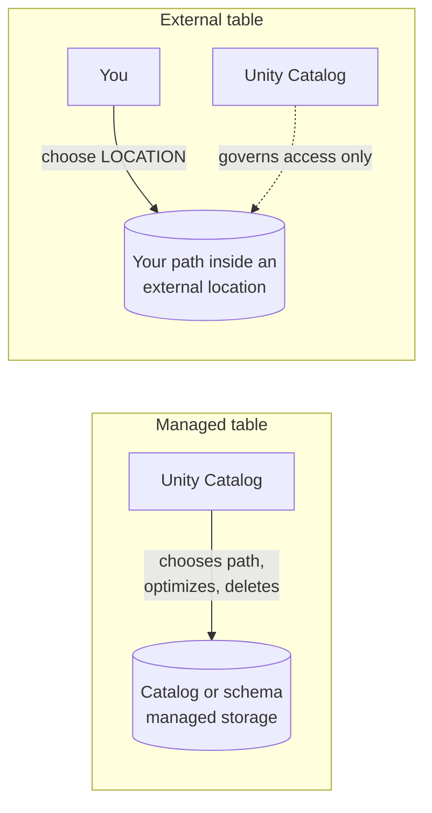

# Managed vs External Tables

Mastery: `INPUT[inlineSelect(option(new), option(learning), option(solid)):mastery]`

> [!story] Context
> [[Catalogs Schemas and Tables]] created a table without a storage path. Unity Catalog assigned one, which makes it a *managed* table. The table type determines who manages the files and what happens when the table is dropped.

> [!eli5] Summary
> For a managed table, Databricks decides where the files go, maintains them, and deletes them when the table is dropped. For an external table, you choose where the files live and you are responsible for them; Databricks only controls who can access them.

> [!analogy]- Analogy: a hotel room vs your own apartment
> - **Managed table = hotel room:** The hotel ([[Unity Catalog]]) picks the room, keeps it tidy (automatic optimization), and when you check out (`DROP TABLE`) the room is cleared after a short grace period.
> - **External table = your apartment:** You choose the building (a path in your own [[Object Storage|object storage]]). The concierge still checks IDs at the door (Unity Catalog governs access), but when you "check out" of the register, your furniture stays exactly where it was.

## Background

[[Apache Hive]] already had managed and external tables, and the distinction was a frequent source of errors: dropping a managed table deleted data that users expected to persist, and dropping an external table left orphaned files. Hive managed tables also lived in a workspace-wide default location (the DBFS root on Databricks) that was hard to secure.

Unity Catalog keeps the two types but makes the trade-off explicit, moves managed storage to locations you control per metastore, catalog, or schema, and adds automatic maintenance that only works when Unity Catalog owns the files.

## Overview

| | **Managed table** | **External table** |
|---|---|---|
| **Who chooses the storage path** | Unity Catalog, inside the managed storage of the schema, catalog, or metastore | You, with a `LOCATION` inside an [[Storage Credentials and External Locations\|external location]] |
| **Who manages lifecycle and layout** | Unity Catalog | You |
| **Formats** | Delta Lake or Apache Iceberg | Delta and other file formats such as Parquet and CSV |
| **`DROP TABLE`** | Removes metadata; data files are deleted after a recovery period (default 7 days). `UNDROP` works in that window. | Removes metadata only. Files stay in your bucket until you delete them. |
| **[[OPTIMIZE and VACUUM\|Predictive optimization]]** | Supported, on by default for new accounts | Not supported |
| **Access by path from other tools** | Not intended; go through Unity Catalog | Possible, but bypasses Unity Catalog governance |
| **Databricks recommendation** | Default and recommended | For data that other systems must also write by path, or during migration |

The docs put it plainly: managed tables are the default and recommended table type, and Unity Catalog manages the data lifecycle, storage location, and optimizations. External tables reference data in cloud storage you manage; Unity Catalog governs access but not lifecycle, optimization, or layout.

### Where managed files go

Managed storage can be set at three levels, and the most specific one wins:

1. **Schema** `MANAGED LOCATION`
2. **Catalog** `MANAGED LOCATION`
3. **Metastore** storage root (optional)

On serverless-first setups, Databricks can also use **default storage** that it manages for you, so you do not need a bucket at all to start.

## How it works



```sql
-- Give a catalog its own managed storage (once, by an admin)
CREATE CATALOG finance
  MANAGED LOCATION 's3://acme-finance-data/managed';

-- Managed table: no LOCATION, Unity Catalog picks the path
CREATE TABLE finance.ledger.entries (
  entry_id BIGINT, account STRING, amount DECIMAL(12,2), posted_at TIMESTAMP
);

-- External table: you name the path (must be inside an external location)
CREATE TABLE finance.landing.bank_exports
  USING PARQUET
  LOCATION 's3://acme-landing/bank/exports/';

-- What kind is it?
DESCRIBE TABLE EXTENDED finance.ledger.entries;   -- Type: MANAGED
DESCRIBE TABLE EXTENDED finance.landing.bank_exports; -- Type: EXTERNAL

-- Dropped a managed table by mistake? Recover it inside the window
DROP TABLE finance.ledger.entries;
UNDROP TABLE finance.ledger.entries;
```

Databricks also supports **converting** an existing external (or foreign) Delta table to managed in place:

```sql
ALTER TABLE finance.landing.bank_exports_delta SET MANAGED;
```

After conversion, Databricks keeps the old files in the external location for 14 days so you can roll back, and predictive optimization is enabled automatically unless you turned it off.

## Small-business considerations

> [!smallbiz] Small-business considerations
> Use managed tables by default. They receive automatic compaction and cleanup without maintenance jobs, which reduces work for a one-person data team. Use external tables only when another system (a vendor's export tool, an old Hadoop job) writes files to a bucket and you want to query them in place. Even then, consider loading them into a managed table with [[Auto Loader]] instead. Storage is billed by your cloud provider, and predictive optimization runs on serverless compute, which shows up in your [[DBUs|DBU]] usage; see the official [Databricks pricing page](https://www.databricks.com/product/pricing) for rates.

## Cloud differences

The two table types and the SQL are identical. Only the paths and the storage service differ.

> [!azure]- Azure Databricks
> - Managed and external paths are ADLS Gen2 URIs: `abfss://<container>@<account>.dfs.core.windows.net/<path>`.
> - The storage is reached through an [[ADLS and Access Connectors|Access Connector]] behind a storage credential.

> [!aws]- Databricks on AWS
> - Paths are S3 URIs: `s3://<bucket>/<path>`, reached through an IAM role. See [[S3 Access via Unity Catalog]].

> [!gcp]- Databricks on Google Cloud
> - Paths are GCS URIs: `gs://<bucket>/<path>`, reached through a Databricks-generated service account. See [[GCS Access via Unity Catalog]].

## Advanced topics

> [!deepdive]- Advanced topics (301–401)
> - **Predictive optimization** runs `OPTIMIZE`, `VACUUM`, and `ANALYZE` for you. It can be set at the account, catalog, schema, or table level, and managed tables inherit the account value. It is on by default for accounts created on or after November 11, 2024, and is rolling out to older accounts.
> - **Never write to managed table paths directly:** Managed tables are meant to be read and written through Unity Catalog. External engines should use the Unity Catalog open APIs or the Iceberg REST catalog, with the `EXTERNAL USE SCHEMA` privilege (Public Preview).
> - **Migration:** Hive external tables usually become Unity Catalog external tables (with `SYNC`), then can be converted to managed with `SET MANAGED`. Hive managed tables in the DBFS root are copied with `DEEP CLONE`. See [[Hive Metastore Migration to Unity Catalog]].
> - **Foreign tables** created by catalog federation are a third kind. They are read-only (except a federated Hive metastore), and conversion to managed sets predictive optimization to `INHERIT`.

## Common misconceptions

> [!confusion] "External" does not mean "outside Unity Catalog"
> An external table is fully governed by Unity Catalog: grants, lineage, and audit all apply. "External" only means *you* manage the files.

> [!confusion] Managed does not mean "stored in Databricks' account"
> Managed tables usually live in **your** cloud storage (the managed location you configured). Only Databricks default storage sits in a Databricks-managed account.

> [!confusion] Dropping an external table frees no space
> The files remain. You must delete them from the bucket yourself.

## Recall

Which table type does Databricks recommend by default?::Managed tables.
What happens to data when you drop a managed table?::Metadata is removed, and the data files are deleted after a recovery period (default 7 days); `UNDROP` can restore it in that window.
What happens to data when you drop an external table?::Nothing; the files stay in your storage until you delete them.
Which table type supports predictive optimization?::Only Unity Catalog managed tables.
Which formats can a managed table use?::Delta Lake or Apache Iceberg.
Where must an external table's LOCATION sit?::Inside an external location you hold the right privileges on.
Which statement converts an external Delta table to managed?::`ALTER TABLE ... SET MANAGED`.
At which levels can managed storage be set?::Metastore, catalog, or schema (most specific wins).

## Next steps

> [!path] Learning path
> **Needs first:** [[Catalogs Schemas and Tables]], [[Object Storage]], [[Delta Lake]]
> **Unlocks next:** [[Storage Credentials and External Locations]], [[Volumes]], [[Hive Metastore Migration to Unity Catalog]]

> [!nextup] Next
> [[Volumes]] covers governance for files that are not tables, such as CSV drops, PDFs, and images.

> [!sources]- Sources (last verified: 2026-10-25)
> - [Unity Catalog managed tables for Delta Lake and Apache Iceberg (AWS)](https://docs.databricks.com/aws/en/tables/managed)
> - [Unity Catalog managed tables (Azure Databricks)](https://learn.microsoft.com/en-us/azure/databricks/tables/managed)
> - [Work with external tables (Azure Databricks)](https://learn.microsoft.com/en-us/azure/databricks/tables/external)
> - [Databricks Unity Catalog table types (AWS)](https://docs.databricks.com/aws/en/tables/types)
> - [Convert external or foreign Delta Lake tables to managed tables (AWS)](https://docs.databricks.com/aws/en/tables/convert-to-managed)
> - [Predictive optimization for Unity Catalog managed tables (AWS)](https://docs.databricks.com/aws/en/optimizations/predictive-optimization)
> - [Predictive optimization (Azure Databricks)](https://learn.microsoft.com/en-us/azure/databricks/optimizations/predictive-optimization)
> - [UNDROP (AWS SQL reference)](https://docs.databricks.com/aws/en/sql/language-manual/sql-ref-syntax-ddl-undrop-table)
