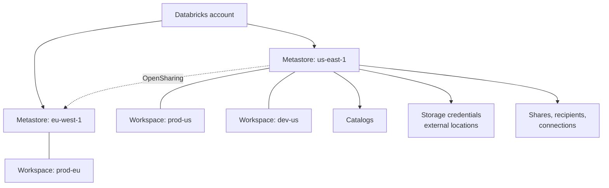

# Metastore

Mastery: `INPUT[inlineSelect(option(new), option(learning), option(solid)):mastery]`

> [!story] Context
> [[Unity Catalog]] defines governance at the account level. The metastore is the object that stores that governance for one cloud region. It replaces the per-workspace [[Hive Metastore]], which kept a separate table list and separate permissions in each workspace.

> [!eli5] Summary
> A metastore is the central register of a company's data in one cloud region. It records what data exists, who can use it, and how to reach the storage where it lives. Every workspace in that region uses the same register.

> [!analogy]- Analogy: a city's land registry
> - **The registry office** is the metastore. It does not hold the houses. It holds the records about them.
> - **The neighbourhoods** are catalogs, the **streets** are schemas, and the **houses** are tables, views, volumes, and models.
> - **The deed on file** says who owns each house and who has a key (privileges).
> - **The branch offices** are workspaces. Every branch in the city looks things up in the same registry.
> - **One registry per city** matches one metastore per cloud [[Region|region]]. A second city has its own registry, and the two exchange records through formal agreements ([[OpenSharing]]).

## Background

In the legacy model each workspace had a built-in [[Hive Metastore]]. This caused three problems:

1. **Duplication.** Two workspaces meant two separate inventories. A table created in `dev` did not exist in `prod` unless someone registered it twice.
2. **Permissions per workspace.** Table access control was set inside each workspace, so the same person could be allowed in one and blocked in the other for the same data.
3. **No home for account-wide objects.** There was no place for objects that span workspaces: shares to partners, connections to outside databases, cloud storage credentials.

The Unity Catalog metastore is an **account-level** object, outside any single workspace. Workspaces are *attached* to it and read all governed objects from it.

## Overview

A metastore is **the top-level container of [[Metadata|metadata]] in Unity Catalog**. It registers metadata about data and AI assets and the permissions that govern access to them. It does not hold your rows: those stay in cloud object storage.

The rules that matter:

| Rule | What it means in practice |
|---|---|
| **One metastore per region** | You need one metastore for each cloud region your organization operates in. All workspaces in that region share it. |
| **A workspace attaches to exactly one** | And it must be a metastore in the same region. |
| **Created by an account admin** | Creating a metastore is an account-level task in the [[Account Console]], not a workspace admin task. |
| **Often created for you** | Accounts created after November 9, 2023 (Azure) have a metastore created automatically and assigned to new workspaces. Check before creating one. |
| **Metastore admin is optional** | The creator becomes metastore admin by default. Databricks recommends handing that role to a group. |

What sits directly under the metastore:

- **Catalogs**, the first level of the [[Three-Level Namespace]]
- **[[Storage Credentials and External Locations]]**, which let Unity Catalog reach cloud storage
- **Shares and recipients** for [[OpenSharing]], and **providers** for data shared with you
- **Connections** for [[Lakehouse Federation]]
- **[[Clean Rooms]]**
- Optional **metastore-level managed storage**

## How it works



Setting up, in order:

1. An account admin opens the [[Account Console]] → **Catalog** and checks whether a metastore already exists for the region.
2. If not, **Create metastore**: give it a name, choose the region that matches your workspaces, and optionally give a storage path for metastore-level managed storage.
3. Assign workspaces to the metastore. New workspaces in the region can be auto-assigned.
4. Hand the metastore admin role to a group such as `uc-admins`.

Once attached, you can ask any workspace which metastore it uses:

```sql
-- Which metastore is this workspace attached to?
SELECT current_metastore();
-- Returns something like aws:us-east-1:19a84bee-54bc-43a2-87de-023d0ec16016

-- Metastore-level privileges are granted ON METASTORE
GRANT CREATE CATALOG ON METASTORE TO `data-platform-admins`;
GRANT CREATE EXTERNAL LOCATION ON METASTORE TO `data-platform-admins`;
```

The `current_metastore()` value matters later: it is the **sharing identifier** another company needs to send you data with [[OpenSharing]].

## Small-business considerations

> [!smallbiz] Small-business considerations
> Most accounts created after late 2023 already have a metastore, created automatically with the first workspace. The remaining tasks are:
> 1. Confirm that it is in the same region as the workspace.
> 2. Assign the metastore admin role to a small group instead of the user who created the account, so administration does not depend on one login.
> 3. Leave metastore-level storage unset unless required. Per-catalog storage is easier to manage (see [[Managed vs External Tables]]).
>
> A second metastore is needed only for a workspace in a second region, which most small businesses do not have.

## Cloud differences

The concept and the one-per-region rule are the same on every cloud. The differences are in what "region" means and how optional metastore storage is reached.

> [!azure]- Azure Databricks
> - Region means an Azure region such as `eastus2`. Workspaces, the metastore, and the [[ADLS and Access Connectors|Access Connector]] behind any metastore storage should share it.
> - Unity Catalog is enabled automatically for accounts created after November 9, 2023, and a metastore is created and assigned for you.
> - The account admin role comes from the Azure Databricks account console, usually granted to a Microsoft Entra ID group. See [[Microsoft Entra ID Integration]].

> [!aws]- Databricks on AWS
> - Region means an AWS region such as `us-east-1`. Optional metastore storage is an S3 path reached through an IAM role. See [[S3 Access via Unity Catalog]].
> - The sharing identifier starts with `aws:`.

> [!gcp]- Databricks on Google Cloud
> - Region means a Google Cloud region such as `us-central1`. Optional metastore storage is a GCS bucket reached through a Databricks-generated service account. See [[GCS Access via Unity Catalog]].
> - The sharing identifier starts with `gcp:`.

## Advanced topics

> [!deepdive]- Advanced topics (301–401)
> - **Metastore-level storage is optional.** Older metastores required a root storage path. Today you can skip it and set managed storage per catalog or schema instead, which keeps business units' files in separate buckets or accounts.
> - **Multi-region companies.** Two regions mean two metastores. Data moves between them through Databricks-to-Databricks [[OpenSharing]] or by replicating pipelines, never by attaching a workspace across regions. Plan [[Disaster Recovery]] the same way.
> - **Metastore admin vs account admin.** Account admins create metastores and assign workspaces. Metastore admins manage the objects inside (catalogs, external locations, ownership). Many teams leave the metastore admin role empty and grant narrower privileges like `CREATE CATALOG` instead. See [[Admin Roles]].
> - **Account-level objects travel with the metastore.** Shares, recipients, connections, and storage credentials are metastore objects, so they are visible from every attached workspace unless you restrict them with workspace bindings.
> - **Audit and system tables are scoped by region.** Many [[System Tables]] are regional, so a two-metastore company queries each region's data from a workspace in that region.

## Common misconceptions

> [!confusion] The metastore is not the Hive metastore
> Every workspace still shows a catalog called `hive_metastore`. That is the **legacy** per-workspace Hive metastore, surfaced for backward compatibility. The Unity Catalog metastore is a different, account-level object. See [[Hive Metastore Migration to Unity Catalog]].

> [!confusion] The metastore does not hold your data
> It holds names, permissions, lineage, and pointers. Rows live as files in cloud storage, either your own buckets or Databricks-managed default storage.

> [!confusion] One per region, not one per workspace
> Creating a second metastore in the same region is not how you separate dev and prod. Use separate catalogs and [[Privileges and Grants|grants]] (or workspace-catalog binding) instead.

## Recall

What is a Unity Catalog metastore?::The account-level, top-level container of metadata and permissions for data and AI assets in one cloud region.
How many metastores should an account have per region?::One. All workspaces in that region share it.
Can a workspace attach to a metastore in another region?::No. A workspace attaches to exactly one metastore in its own region.
Who can create a metastore?::An account admin.
Which SQL function returns the metastore ID used as an OpenSharing sharing identifier?::`current_metastore()`.
Name four kinds of objects that live directly under the metastore.::Catalogs, storage credentials and external locations, shares and recipients, and connections (also clean rooms).
Is metastore-level managed storage required?::No. It is optional; managed storage can be set per catalog or schema instead.
How do two regions' metastores exchange data?::Through Databricks-to-Databricks OpenSharing (or replication), not by attaching workspaces across regions.

## Next steps

> [!path] Learning path
> **Needs first:** [[Unity Catalog]], [[Accounts and Workspaces]]
> **Unlocks next:** [[Three-Level Namespace]], [[Catalogs Schemas and Tables]], [[Storage Credentials and External Locations]]

> [!nextup] Next
> [[Three-Level Namespace]] describes how objects under the metastore are addressed as `catalog.schema.object`.

> [!sources]- Sources (last verified: 2026-10-25)
> - [Create a Unity Catalog metastore (Azure Databricks)](https://learn.microsoft.com/en-us/azure/databricks/data-governance/unity-catalog/create-metastore)
> - [Admin privileges in Unity Catalog (AWS)](https://docs.databricks.com/aws/en/data-governance/unity-catalog/manage-privileges/admin-privileges)
> - [Enable a workspace for Unity Catalog (AWS)](https://docs.databricks.com/aws/en/data-governance/unity-catalog/enable-workspaces)
> - [Unity Catalog best practices (Azure Databricks)](https://learn.microsoft.com/en-us/azure/databricks/data-governance/unity-catalog/best-practices)
> - [Phase 3: Design Unity Catalog architecture (AWS)](https://docs.databricks.com/aws/en/lakehouse-architecture/deployment-guide/unity-catalog)
> - [Phase 3: Design Unity Catalog architecture (GCP)](https://docs.databricks.com/gcp/en/lakehouse-architecture/deployment-guide/unity-catalog)
> - [Create data recipients for OpenSharing (AWS)](https://docs.databricks.com/aws/en/opensharing/create-recipient)
