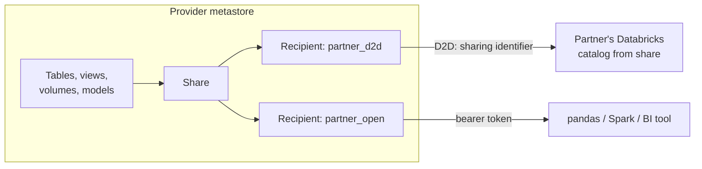

# OpenSharing

Mastery: `INPUT[inlineSelect(option(new), option(learning), option(solid)):mastery]`

> [!story] Context
> [[Lakehouse Federation]] reads data from external systems. OpenSharing covers the reverse direction: giving another organization access to your data. Common alternatives are SFTP drops and scheduled CSV exports, which become stale after delivery and cannot be revoked. OpenSharing gives the recipient read access to the live data.

> [!eli5] Summary
> OpenSharing gives a partner read-only access to selected data without sending them a copy. They always see the current version, and you can revoke access at any time.

> [!renamed] Renamed
> **Delta Sharing → OpenSharing** (announced June 10, 2026). The protocol is now hosted by the [[Linux Foundation]] and its scope widened from Delta tables to data and AI assets. Docs pages moved from `/delta-sharing/` to `/opensharing/`, and some pages still use the old name. Existing shares keep working.

> [!analogy]- Analogy: a shared photo album link
> - **The share** is an album you create and put selected photos (tables, volumes, models) into.
> - **The recipient** is the person you send the link to.
> - **Live updates**: when you add or edit a photo, they see it on their next look. No re-sending.
> - **Revoking the link** cuts them off instantly.
> - **Databricks-to-Databricks** sharing resembles sharing within one photo app, addressed to an account. **Open sharing** resembles a link that works in any viewer.

## Background

File exports have four drawbacks: they become stale, they create untracked copies, they cannot be revoked after delivery, and they fix both sides to one format. Proprietary sharing features only work if both sides use the same vendor.

OpenSharing is an **open protocol**: the provider keeps the data in place, and the recipient reads it directly with a short-lived credential, using Databricks or any client that speaks the protocol. Databricks describes it as an open, vendor-neutral protocol for securely sharing data and AI assets, now including AI models, agent skills, and unstructured data.

## Overview

Three Unity Catalog objects, all at the [[Metastore]] level:

| Object | Side | What it is |
|---|---|---|
| **Share** | Provider | A named, read-only collection of assets: tables, streaming tables, views, materialized views, [[Volumes\|volumes]], and models |
| **Recipient** | Provider | Who you share with |
| **Provider** | Recipient | Who shared with you; you create a catalog from their share |

Two sharing modes:

| | **Databricks-to-Databricks (D2D)** | **Open sharing** |
|---|---|---|
| **Recipient has** | A Unity Catalog-enabled Databricks workspace | Anything: pandas, Spark, BI tools, other platforms |
| **Identified by** | Their metastore's **sharing identifier** (`cloud:region:uuid`) | A token-based credential |
| **Authentication type** | `DATABRICKS` | `TOKEN` (bearer token) |
| **Recipient experience** | Share appears as a provider; they create a catalog from it | Downloads a credential and uses an OpenSharing client or connector |
| **Extra assets** | Views, volumes, models, notebooks | Mainly tables |

## How it works



Provider side:

```sql
-- 1. Create a share and add assets
CREATE SHARE IF NOT EXISTS retailer_stock COMMENT 'Live stock levels for retailers';
ALTER SHARE retailer_stock ADD TABLE prod.inventory.stock_levels;
ALTER SHARE retailer_stock ADD VIEW  prod.inventory.stock_by_store;

-- 2a. Databricks-to-Databricks recipient (they send you SELECT current_metastore())
CREATE RECIPIENT IF NOT EXISTS big_retailer
  USING ID 'aws:us-west-2:19a84bee-54bc-43a2-87de-023d0ec16016'
  COMMENT 'Retailer on Databricks';

-- 2b. Open sharing recipient (no USING ID -> token-based)
CREATE RECIPIENT IF NOT EXISTS small_retailer COMMENT 'Uses pandas';

-- 3. Grant the share
GRANT SELECT ON SHARE retailer_stock TO RECIPIENT big_retailer;
GRANT SELECT ON SHARE retailer_stock TO RECIPIENT small_retailer;

-- Revoke any time
REVOKE SELECT ON SHARE retailer_stock FROM RECIPIENT small_retailer;
```

Recipient side (Databricks-to-Databricks):

```sql
SHOW PROVIDERS;
CREATE CATALOG IF NOT EXISTS supplier_stock USING SHARE acme_supplier.retailer_stock;
SELECT * FROM supplier_stock.inventory.stock_levels;
```

Privileges: `CREATE SHARE` and `CREATE RECIPIENT` on the metastore (or metastore admin).

## Small-business considerations

> [!smallbiz] Small-business considerations
> OpenSharing replaces recurring CSV exports sent by email or SFTP. Typical uses:
> - A wholesaler shares live price lists or stock with resellers.
> - An agency shares campaign results with each client, one share per client.
> - You *receive* data from a supplier or software vendor that offers OpenSharing.
>
> Share a **view** that contains only what the partner should see, never the raw table. The provider pays for storage as usual; the recipient pays for the compute that reads. Account for cloud [[Egress|egress]] charges when the recipient is in another region or cloud.

## Cloud differences

> [!azure]- Azure Databricks, AWS, and Google Cloud
> The protocol, SQL, and objects are identical. D2D sharing works across clouds and regions, because each side is identified by its `cloud:region:uuid` sharing identifier. Data read across regions or clouds may incur egress charges on the provider's cloud bill.

## Advanced topics

> [!deepdive]- Advanced topics (301–401)
> - **One metastore per recipient identifier.** In D2D sharing the shared data can be accessed only on the recipient metastore named by the identifier.
> - **No copies, live reads.** The recipient's compute reads the provider's files through short-lived credentials. Nothing is replicated unless the recipient chooses to copy.
> - **Share views, not tables.** Shared views let you filter rows and columns per partner. Shared tables can also be limited to partitions.
> - **Audit.** Recipient access appears in the provider's [[Audit Logs]], so you can see who read what.
> - **Building blocks.** OpenSharing is the transport under [[Clean Rooms]] and [[Databricks Marketplace]].
> - **Open source.** The protocol has open-source clients and a reference server, so non-Databricks platforms can act as recipients or providers. Databricks' June 2026 materials say the project is hosted by the Linux Foundation and no migration is needed for existing Delta Sharing users.

## Common misconceptions

> [!confusion] OpenSharing is not Lakehouse Federation
> [[Lakehouse Federation]] reads *other systems* from your Databricks. OpenSharing gives *your* data to others. Federation needs a database connection; sharing needs only a share and a recipient.

> [!confusion] Delta Sharing and OpenSharing are the same thing
> OpenSharing is the new name (June 2026) and a broader scope. Older docs, SDKs, and connectors may still say Delta Sharing.

## Recall

What was OpenSharing called before June 2026?::Delta Sharing.
Who hosts the OpenSharing project?::The Linux Foundation.
What are the two OpenSharing modes?::Databricks-to-Databricks sharing and open sharing (token-based, for any client).
How is a Databricks-to-Databricks recipient identified?::By its metastore's sharing identifier, `cloud:region:uuid`, from `current_metastore()`.
What authentication type does a recipient created without USING ID get?::`TOKEN` (open sharing).
Which statement gives a recipient access to a share?::`GRANT SELECT ON SHARE <share> TO RECIPIENT <recipient>;`
Which asset types can a share contain?::Tables, streaming tables, views, materialized views, volumes, and models.
How does a Databricks recipient use a share?::Creates a catalog from it: `CREATE CATALOG c USING SHARE provider.share;`
Which privileges are needed to create shares and recipients?::`CREATE SHARE` and `CREATE RECIPIENT` on the metastore.

## Next steps

> [!path] Learning path
> **Needs first:** [[Metastore]], [[Privileges and Grants]]
> **Unlocks next:** [[Clean Rooms]], [[Databricks Marketplace]]

> [!nextup] Next
> [[Clean Rooms]] let two or more organizations run approved analysis on combined data without either side seeing the other's raw records.

> [!sources]- Sources (last verified: 2026-10-25)
> - [Databricks announces OpenSharing (press release, June 2026)](https://www.databricks.com/company/newsroom/press-releases/databricks-announces-opensharing)
> - [Announcing new OpenSharing and Marketplace capabilities for the AI era (Databricks blog)](https://www.databricks.com/blog/announcing-new-opensharing-and-marketplace-capabilities-ai-era)
> - [What is the OpenSharing Databricks-to-Databricks protocol? (AWS)](https://docs.databricks.com/aws/en/opensharing/share-data-databricks)
> - [Create shares for OpenSharing (AWS)](https://docs.databricks.com/aws/en/opensharing/create-share)
> - [Create shares for OpenSharing (Azure Databricks)](https://learn.microsoft.com/en-us/azure/databricks/opensharing/create-share)
> - [Create data recipients for OpenSharing (AWS)](https://docs.databricks.com/aws/en/opensharing/create-recipient)
> - [Create data recipients for OpenSharing (Azure Databricks)](https://learn.microsoft.com/en-us/azure/databricks/opensharing/create-recipient)
> - [Create a recipient for non-Databricks users using bearer tokens (AWS)](https://docs.databricks.com/aws/en/delta-sharing/create-recipient-token)
> - [Set up OpenSharing for your account (AWS)](https://docs.databricks.com/aws/en/opensharing/set-up)
> - [CREATE RECIPIENT (AWS)](https://docs.databricks.com/aws/en/sql/language-manual/sql-ref-syntax-ddl-create-recipient)
