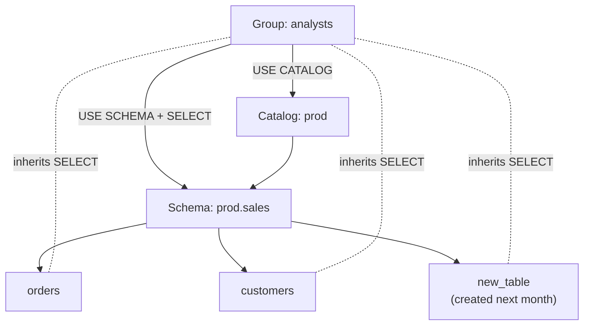

# Privileges and Grants

Mastery: `INPUT[inlineSelect(option(new), option(learning), option(solid)):mastery]`

> [!story] Context
> With [[Storage Credentials and External Locations]], Unity Catalog controls all access to storage. Privileges decide which principals may use each object. In the legacy [[Hive Metastore]], table access control was configured per workspace and only on some cluster types. Unity Catalog applies one SQL permission model to every object in every attached workspace.

> [!eli5] Summary
> Every catalog, table, and file has a list of who may read it, change it, or manage it. Access granted on a container also applies to everything inside it. Permissions are given to groups, so adding a person to a group gives them the right access.

> [!analogy]- Analogy: an office building's access badges
> - **The building, floors, and rooms** are catalogs, schemas, and tables.
> - **Getting past the lobby** is `USE CATALOG`. **Getting onto a floor** is `USE SCHEMA`. Neither lets you open a filing cabinet.
> - **A badge for "all rooms on floor 3"** is a grant on a schema. It covers rooms built later too.
> - **The building directory in the lobby** is `BROWSE`: you can see that a room exists and what it is for, and ask for access, without getting in.
> - **The facilities manager** is the *owner* or someone with `MANAGE`: they hand out badges.

## Background

Governance requires that access is enforced the same way in every workspace and tool. The Unity Catalog permission model provides:

- **Standard SQL**: `GRANT`, `REVOKE`, `SHOW GRANTS`, the same commands analysts know from other databases.
- **One place**: grants are stored in the [[Metastore]] and apply in every attached workspace and through every tool ([[Notebooks]], [[SQL Warehouses]], BI tools via [[JDBC and ODBC]]).
- **Inheritance**: grant once at a catalog or schema, and new tables are covered automatically.
- **Accountability**: every grant and every access is recorded in the [[Audit Logs]].

## Overview

A **privilege** is a right on a **securable object**, granted to a **principal**: a user, a group, or a [[Users Groups and Service Principals|service principal]]. Unity Catalog follows a deny-by-default model: no privilege, no access.

The privileges you will use most:

| Privilege | Granted on | What it allows |
|---|---|---|
| `USE CATALOG` | Catalog | Required to interact with anything inside the catalog. Gives no data access by itself. |
| `USE SCHEMA` | Schema (or catalog) | Required to interact with anything inside the schema. Gives no data access by itself. |
| `BROWSE` | Catalog, external location, clean room... | See that objects exist and read their metadata (name, comment, tags) and request access, without `USE CATALOG`/`USE SCHEMA` and without reading data. |
| `SELECT` | Table, view, schema, catalog | Read rows. |
| `MODIFY` | Table, schema, catalog | Insert, update, delete, merge. |
| `CREATE TABLE`, `CREATE SCHEMA`, `CREATE VOLUME`, `CREATE FUNCTION`, `CREATE MODEL` | The parent container | Create child objects. |
| `READ VOLUME` / `WRITE VOLUME` | Volume | Read or write files. |
| `EXECUTE` | Function, model | Call a function or use a model. |
| `READ FILES` / `WRITE FILES` | External location | Read or write raw files by path. |
| `MANAGE` | Any securable | Manage privileges, transfer ownership, drop the object, without being the owner. |
| `ALL PRIVILEGES` | Any securable | Every applicable privilege, with a few exclusions such as `EXTERNAL USE SCHEMA`. |
| `EXTERNAL USE SCHEMA` | Schema | Lets external engines get temporary credentials through the Unity Catalog or Iceberg REST APIs (Public Preview). Only the catalog owner can grant it. |

### The three rules

1. **Usage on the containers:** To read `prod.sales.orders` you need `USE CATALOG` on `prod`, `USE SCHEMA` on `prod.sales`, and `SELECT` on the table or a parent. `SELECT` alone is not enough.
2. **Inheritance flows down:** A privilege granted on a catalog or schema applies to every current and future object inside it.
3. **Owners and `MANAGE` holders grant:** Every object has one owner, who has all privileges on it and can grant them. `MANAGE` gives the same administrative power without ownership. Users with `MANAGE` do not automatically get data privileges, but they can grant themselves any.

## How it works



```sql
-- Discovery for everyone: see what exists, request access
GRANT BROWSE ON CATALOG prod TO `account users`;

-- Analysts read everything in prod.sales
GRANT USE CATALOG ON CATALOG prod        TO `analysts`;
GRANT USE SCHEMA, SELECT ON SCHEMA prod.sales TO `analysts`;

-- The ingest job writes to it
GRANT USE CATALOG ON CATALOG prod TO `svc-ingest`;
GRANT USE SCHEMA, SELECT, MODIFY, CREATE TABLE ON SCHEMA prod.sales TO `svc-ingest`;

-- A team lead manages the schema without owning it
GRANT MANAGE ON SCHEMA prod.sales TO `sales-data-leads`;

-- Take something away
REVOKE SELECT ON SCHEMA prod.sales FROM `analysts`;

-- Ownership goes to a group
ALTER SCHEMA prod.sales OWNER TO `data-platform`;

-- Who can do what?
SHOW GRANTS ON SCHEMA prod.sales;
SHOW GRANTS `analysts` ON CATALOG prod;
```

## Small-business considerations

> [!smallbiz] Small-business considerations
> Three groups cover most small companies:
>
> | Group | Gets |
> |---|---|
> | `everyone` (the built-in `account users`) | `BROWSE` on all catalogs |
> | `analysts` | `USE CATALOG` + `USE SCHEMA` + `SELECT` on `analytics` |
> | `engineers` | `ALL PRIVILEGES` on `raw` and `sandbox`, `MODIFY` on `analytics` |
>
> Grant to groups, not to individual users. When someone joins, add them to a group; when they leave, remove them from your [[Identity Provider|identity provider]] and [[SCIM Provisioning|SCIM]] removes their access. This applies [[Least Privilege|least privilege]] with little ongoing administration.

## Cloud differences

> [!azure]- Azure Databricks, AWS, and Google Cloud
> The privilege model and SQL are identical on all three clouds. What differs is where your users and groups come from: Microsoft Entra ID on Azure (see [[Microsoft Entra ID Integration]]), or any [[SAML]]/OIDC identity provider with [[SCIM]] on AWS and GCP (see [[SCIM Provisioning]]). The GCP privileges page is sometimes a little behind the AWS and Azure pages on newer privileges, so check it for preview items.

## Advanced topics

> [!deepdive]- Advanced topics (301–401)
> - **Metastore privileges:** `CREATE CATALOG`, `CREATE EXTERNAL LOCATION`, `CREATE CONNECTION`, `CREATE SHARE`, `CREATE RECIPIENT`, and `CREATE PROVIDER` are granted `ON METASTORE` and control who can add top-level objects.
> - **`MANAGE` has reduced usage requirements:** `MANAGE` on a catalog does not require `USE CATALOG`, and on a schema it does not require `USE SCHEMA`.
> - **Views run as the owner:** A user with `SELECT` on a view does not need `SELECT` on its base tables; the view owner does. This is how curated views expose subsets safely.
> - **No explicit `DENY`:** Classic grants are additive. To block access broadly, remove grants or use [[Attribute-Based Access Control|ABAC]] policies, which can exclude principals and cannot be overridden by table owners. ABAC DENY policies are in Beta as of October 2026.
> - **Workspace binding is a second gate:** A user with `SELECT` on a catalog still cannot read it from a workspace the catalog is not bound to.
> - **Compute matters:** Grants are enforced on Unity Catalog-capable compute (standard or dedicated access mode, serverless, SQL warehouses).

## Common misconceptions

> [!confusion] USE CATALOG does not grant data access
> It only lets you "enter the building". You still need `SELECT` (or another data privilege) on the table or a parent.

> [!confusion] BROWSE is not SELECT
> `BROWSE` shows names, descriptions, and tags so people can find data and request it. It never returns rows.

> [!confusion] Workspace admin is not data admin
> Being a workspace admin does not, by itself, let you read every table. Data access comes from Unity Catalog privileges and ownership. See [[Admin Roles]].

## Recall

Which three privileges does a user need to read `prod.sales.orders`?::`USE CATALOG` on `prod`, `USE SCHEMA` on `prod.sales`, and `SELECT` on the table or a parent.
If you grant SELECT on a schema, do tables created later inherit it?::Yes. Grants on a container apply to all current and future objects inside it.
What does BROWSE allow?::Seeing objects and their metadata, and requesting access, without USE CATALOG/USE SCHEMA and without reading data.
What does MANAGE allow?::Managing privileges, transferring ownership, and dropping an object without being its owner.
Who should own catalogs and schemas?::Groups.
Which privilege lets external engines get Unity Catalog credentials through the Iceberg REST API?::`EXTERNAL USE SCHEMA` (Public Preview).
Is EXTERNAL USE SCHEMA included in ALL PRIVILEGES?::No.
Which command shows the grants on a schema?::`SHOW GRANTS ON SCHEMA <catalog>.<schema>;`
Does a user need SELECT on base tables to query a view?::No. The view owner needs it; the user needs SELECT on the view (plus usage on its containers).

## Next steps

> [!path] Learning path
> **Needs first:** [[Catalogs Schemas and Tables]], [[Users Groups and Service Principals]]
> **Unlocks next:** [[Row Filters and Column Masks]], [[Attribute-Based Access Control]], [[Audit Logs]]

> [!nextup] Next
> [[Row Filters and Column Masks]] restrict which rows and column values a user sees after access to a table is granted.

> [!sources]- Sources (last verified: 2026-10-25)
> - [Unity Catalog privileges reference (AWS)](https://docs.databricks.com/aws/en/data-governance/unity-catalog/access-control/privileges-reference)
> - [Unity Catalog privileges reference (Azure Databricks)](https://learn.microsoft.com/en-us/azure/databricks/data-governance/unity-catalog/access-control/privileges-reference)
> - [Unity Catalog privileges reference (GCP)](https://docs.databricks.com/gcp/en/data-governance/unity-catalog/access-control/privileges-reference)
> - [Unity Catalog permissions model concepts (AWS)](https://docs.databricks.com/aws/en/data-governance/unity-catalog/access-control/permissions-concepts)
> - [Unity Catalog permissions model concepts (Azure Databricks)](https://learn.microsoft.com/en-us/azure/databricks/data-governance/unity-catalog/access-control/permissions-concepts)
> - [Manage Unity Catalog object ownership (GCP)](https://docs.databricks.com/gcp/en/data-governance/unity-catalog/manage-privileges/ownership)
> - [Access control in Unity Catalog (AWS)](https://docs.databricks.com/aws/en/data-governance/unity-catalog/access-control/)
