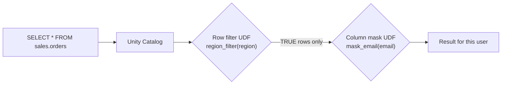

# Row Filters and Column Masks

Mastery: `INPUT[inlineSelect(option(new), option(learning), option(solid)):mastery]`

> [!story] Context
> [[Privileges and Grants]] decide whether a principal can read a table. Many policies are finer-grained: a regional manager sees only that region's rows, and only HR sees full national ID numbers. Before row filters and column masks, teams built a separate view or copy per audience. Row filters and column masks attach the rule to the table.

> [!eli5] Summary
> Two people can query the same table and see different results. One sees every row; the other sees only the rows for their region, with personal details hidden. There is one table, and it applies the rules based on who is asking.

> [!analogy]- Analogy: a smart window
> - **The table** is a room full of filing cabinets.
> - **A row filter** is a smart window that only shows you the cabinets labelled with your region.
> - **A column mask** is frosted glass over certain drawers: you can see the drawer is there, but the contents are blurred unless your badge says otherwise.
> - **The rule** is written once, as a small function, and fitted to the window. Every visitor gets the right view automatically.

## Background

The earlier approach is the **dynamic view**: a view per audience that filters rows and redacts columns. It has three drawbacks:

- Users must be pointed at the view, not the table, and anyone with `SELECT` on the base table bypasses it.
- Each new rule means a new view to keep in sync with table changes.
- Fifty tables means fifty views, each with copied logic.

Row filters and column masks attach the logic **to the table**, so every query through every tool is filtered, and the logic lives in one reusable [[UDF|function]].

## Overview

- A **row filter** is a SQL user-defined function that returns a boolean. It is evaluated for each row; rows where it returns `FALSE` (or `NULL`) are excluded from results.
- A **column mask** is a SQL user-defined function that takes the column value (and optionally other columns) and returns the value to show, such as the real value, a redacted string, or `NULL`.
- Both are bound to one table with `ALTER TABLE` (or at `CREATE TABLE` time) and managed by the table owner or someone with `MANAGE` and `SELECT` on it.
- Inside the function, **identity functions** such as `is_account_group_member('group')` and `current_user()` check who is querying. Those identity checks evaluate as the *invoker*, while the rest of the function runs with the definer's rights.

These are the **table-level** controls. The same building blocks also power **ABAC policies**, which apply one function to many tables by tag. Databricks now recommends [[Attribute-Based Access Control|ABAC]] for consistent coverage across many tables, and table-level filters and masks for one-off cases.

## How it works



A worked example: managers see their own region; admins see everything; only `support` sees full emails.

```sql
-- 1. Row filter: returns TRUE for rows the caller may see
CREATE OR REPLACE FUNCTION gov.policies.region_filter(region STRING)
RETURNS BOOLEAN
RETURN is_account_group_member('admins')
    OR (is_account_group_member('managers_us') AND region = 'US')
    OR (is_account_group_member('managers_eu') AND region = 'EU');

ALTER TABLE prod.sales.orders
  SET ROW FILTER gov.policies.region_filter ON (region);

-- 2. Column mask: returns the value to display
CREATE OR REPLACE FUNCTION gov.policies.mask_email(email STRING)
RETURNS STRING
RETURN CASE
  WHEN is_account_group_member('support') THEN email
  ELSE concat('***@', split_part(email, '@', 2))
END;

ALTER TABLE prod.sales.orders
  ALTER COLUMN customer_email SET MASK gov.policies.mask_email;

-- A mask can read other columns too
ALTER TABLE prod.hr.employees
  ALTER COLUMN ssn SET MASK gov.policies.mask_ssn USING COLUMNS (country);

-- Remove them
ALTER TABLE prod.sales.orders DROP ROW FILTER;
ALTER TABLE prod.sales.orders ALTER COLUMN customer_email DROP MASK;
```

You can also set both at creation time:

```sql
CREATE TABLE prod.sales.orders_v2 (
  order_id BIGINT,
  region STRING,
  customer_email STRING MASK gov.policies.mask_email
) WITH ROW FILTER gov.policies.region_filter ON (region);
```

To assign a filter or mask you need ownership of the table (or `MANAGE` plus `SELECT`), and `EXECUTE` on the function, with `USE CATALOG` and `USE SCHEMA` on its containers.

## Small-business considerations

> [!smallbiz] Small-business considerations
> The most common small-business case is a column mask on [[PII|personal data]]: customer emails, phone numbers, or employee pay. Keep policy functions in one schema, such as `gov.policies`, owned by the group responsible for security. A few masks on the customer table typically cover [[GDPR]]-style need-to-know requirements. Row filters are useful when several branches or franchisees must see only their own data. When the same mask is needed on many tables, use [[Attribute-Based Access Control|ABAC]] instead.

## Cloud differences

> [!azure]- Azure Databricks, AWS, and Google Cloud
> Nothing differs. The functions, `ALTER TABLE` syntax, and compute requirements are identical on all three clouds.

## Advanced topics

> [!deepdive]- Advanced topics (301–401)
> - **Compute.** Filters and masks are enforced on SQL warehouses, serverless, and standard-access-mode clusters. On dedicated (single user) clusters, Databricks enforces them by delegating the filtering to serverless compute, which must be enabled. Older runtimes may be unable to read filtered tables.
> - **Performance.** The function runs per row (filters) or per value (masks). Keep functions simple and deterministic, avoid lookups into large tables where you can, and prefer conditions the optimizer can push down. Databricks publishes a performance guide for row filter and column mask policies.
> - **Mapping tables.** For many users and regions, look up entitlements in a small table (`WHERE region IN (SELECT region FROM gov.policies.user_regions WHERE user = current_user())`) instead of hard-coding groups.
> - **Limits.** Some operations and features have restrictions on tables with filters or masks. Check the current limitations list in the docs before relying on them in a pipeline.
> - **Raw file access bypasses them.** Anyone with `READ FILES` on the underlying external location can read the files directly. Use managed tables and grant raw path access narrowly.
> - **Dynamic views still have a place**: when you want to publish a curated, redacted *product* without touching the base table, or to share a filtered dataset externally.

## Common misconceptions

> [!confusion] A filter is not a WHERE clause users can remove
> It is applied by Unity Catalog on every query. Users cannot turn it off, and they do not need to know it exists.

> [!confusion] A masked column is still there
> The column appears in the schema with its normal name and type. Only the values change. Queries that join or group on a masked column see the masked values.

> [!confusion] Table-level vs ABAC
> Table-level filters and masks are set table by table, by the table owner. [[Attribute-Based Access Control|ABAC]] policies are set once at a catalog or schema, driven by tags, and table owners cannot override them.

## Recall

What is a row filter?::A SQL UDF returning a boolean, bound to a table, that excludes rows where it returns FALSE.
What is a column mask?::A SQL UDF bound to a column that returns the value each caller should see.
Which statement applies a row filter?::`ALTER TABLE t SET ROW FILTER fn ON (col, ...);`
Which statement applies a column mask?::`ALTER TABLE t ALTER COLUMN c SET MASK fn;`
Which function checks group membership inside a filter or mask?::`is_account_group_member('group')`.
What privilege do you need on the function to assign it?::`EXECUTE` (plus USE CATALOG and USE SCHEMA on its containers).
How are filters enforced on dedicated clusters?::By delegating the filtering to serverless compute.
What older pattern do filters and masks replace?::Dynamic views with per-audience logic.

## Next steps

> [!path] Learning path
> **Needs first:** [[Privileges and Grants]], [[UDF]]
> **Unlocks next:** [[Attribute-Based Access Control]], [[Data Classification]]

> [!nextup] Next
> [[Attribute-Based Access Control]] applies the same kind of filter or mask to many tables at once, based on tags.

> [!sources]- Sources (last verified: 2026-10-25)
> - [Row filters and column masks (AWS)](https://docs.databricks.com/aws/en/data-governance/unity-catalog/filters-and-masks/)
> - [Manually apply row filters and column masks (AWS)](https://docs.databricks.com/aws/en/data-governance/unity-catalog/filters-and-masks/manually-apply)
> - [Manually apply row filters and column masks (Azure Databricks)](https://learn.microsoft.com/en-us/azure/databricks/data-governance/unity-catalog/filters-and-masks/manually-apply)
> - [Column mask clause (AWS)](https://docs.databricks.com/aws/en/sql/language-manual/sql-ref-syntax-ddl-column-mask)
> - [ROW FILTER clause (Azure Databricks)](https://learn.microsoft.com/en-us/azure/databricks/sql/language-manual/sql-ref-syntax-ddl-row-filter)
> - [When to use ABAC vs table-level row filters and column masks (Azure Databricks)](https://learn.microsoft.com/en-us/azure/databricks/data-governance/unity-catalog/abac/abac-vs-rls-cm)
> - [Performance considerations for row filter and column mask policies (AWS)](https://docs.databricks.com/aws/en/data-governance/unity-catalog/abac/performance)
