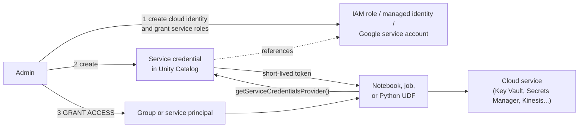

# Service Credentials

Mastery: `INPUT[inlineSelect(option(new), option(learning), option(solid)):mastery]`

A service credential is a Unity Catalog securable object that wraps a long-lived cloud identity (an AWS IAM role, an Azure managed identity, or a Google service account) so that code on Databricks can call external cloud services without handling keys.

> [!story] Context
> [[Governed Tags]] completed the tools for describing and protecting data inside Unity Catalog. Pipelines and functions also call cloud services outside the catalog: secret stores, message queues, serverless functions, and AI APIs. [[Storage Credentials and External Locations|Storage credentials]] cover only cloud storage. Service credentials extend the same governed model to every other cloud service.

> [!eli5] Summary
> A service credential is a stored, approved way for Databricks code to talk to another cloud service, such as a vault that holds passwords. Admins set it up once and decide who may use it, so nobody needs to paste secret keys into notebooks.

## Background

Before service credentials, code that needed to call a cloud service on Databricks used one of these approaches:

- **[[Instance Profiles|Instance profiles]] (AWS) or cluster-level identities:** Attached to a cluster. Every user of the cluster inherited the identity, so access followed the compute, not the person.
- **Keys in [[Secrets Management|secret scopes]]:** An access key stored in a Databricks secret and read at runtime. Keys must be rotated, and anyone who can read the secret holds the key.
- **Keys in code or configuration:** The least safe option.

None of these is governed by Unity Catalog: there is no `GRANT`, no audit trail tied to the user, and no workspace scoping. Databricks describes service credentials as the Unity Catalog alternative to instance profiles, with access tied to users, groups, and service principals instead of to a compute resource.

## Overview

| Property | Value |
|---|---|
| Object type | Unity Catalog securable at the metastore level (`SERVICE CREDENTIAL`) |
| Wraps | AWS IAM role, Azure Databricks access connector (managed identity), or a Databricks-generated Google service account |
| Used for | Cloud services other than storage: for example AWS Secrets Manager, Amazon Kinesis, AWS Lambda, Azure Key Vault, Google Secret Manager |
| Not used for | Managed storage locations or external locations. Use a [[Storage Credentials and External Locations\|storage credential]] instead. |
| Created by | Metastore admins, account admins, or users with `CREATE SERVICE CREDENTIAL` on the metastore |
| Used by | Python and Scala code on supported compute, Unity Catalog Python UDFs, and some connectors |
| Status | Generally available since Databricks Runtime 16.2 (Public Preview in 15.4 LTS). Workspace binding of service credentials became GA on March 12, 2025. |

### Privileges

| Privilege | Effect |
|---|---|
| `ACCESS` | Use the credential to reach the external service. |
| `CREATE CONNECTION` | Use the credential when creating a [[Lakehouse Federation]] connection (also requires `CREATE CONNECTION` on the metastore). |
| `MANAGE` | Manage grants on the credential. |
| `READ METADATA` | View the credential's metadata. |
| `ALL PRIVILEGES` | Implies `ACCESS` and `CREATE CONNECTION`, but not `MANAGE` or `READ METADATA`. |

## How it works



### Set up a service credential

1. In the cloud console, create or choose the identity (see **Cloud differences** for each cloud) and grant it the roles the target service needs.
2. In the workspace sidebar, click **Catalog**.
3. Click **External data**, then the **Credentials** tab.
4. Click **Create credential** and select **Service Credential**.
5. Enter a name and the cloud-specific identity reference, then click **Create**.
6. Complete the cloud-side step for your cloud (AWS trust policy update, or the Google service account role grants).
7. Optionally, on the credential's **Workspaces** tab, bind it to specific workspaces. By default it is usable from every workspace attached to the metastore.

### Grant and review access

```sql
GRANT ACCESS ON SERVICE CREDENTIAL `kv_reader` TO `data-engineers`;
SHOW GRANTS ON SERVICE CREDENTIAL `kv_reader`;
REVOKE ACCESS ON SERVICE CREDENTIAL `kv_reader` FROM `data-engineers`;
```

The `SERVICE` keyword in these statements requires Databricks Runtime 15.4 or above.

### Use it in a notebook or job (Python)

Call `dbutils.credentials.getServiceCredentialsProvider()` with the credential name and pass the result to the cloud SDK. The return type depends on the cloud, so each SDK accepts it directly.

```python
# AWS: read a secret from AWS Secrets Manager
import boto3

provider = dbutils.credentials.getServiceCredentialsProvider("aws_secrets_cred")
session = boto3.Session(botocore_session=provider, region_name="us-east-1")
sm = session.client("secretsmanager")
value = sm.get_secret_value(SecretId="prod/crm/api-key")["SecretString"]
```

You can set a default credential for a compute resource with the `DATABRICKS_DEFAULT_SERVICE_CREDENTIAL_NAME` environment variable. Databricks does not recommend this, because code that names its credential is more portable.

### Use it in a Unity Catalog Python UDF

Inside a UDF, `dbutils` is not available. Declare the credential in the function's `CREDENTIALS` clause; one credential can be marked `DEFAULT` so patched cloud SDKs pick it up automatically. In code, `databricks.service_credentials.getServiceCredentialsProvider()` returns a named credential.

```sql
CREATE OR REPLACE FUNCTION ops.tools.invoke_lambda(payload STRING)
RETURNS STRING
LANGUAGE PYTHON
CREDENTIALS (`lambda_cred` DEFAULT)
ENVIRONMENT (dependencies = '["boto3"]', environment_version = '6')
AS $$
import boto3
client = boto3.Session().client("lambda", region_name="us-east-1")
resp = client.invoke(FunctionName="score-order", Payload=payload)
return resp["Payload"].read().decode("utf-8")
$$;
```

The function creator needs `ACCESS` on the credential. Callers need only `EXECUTE` on the function, except on dedicated compute, where callers also need `ACCESS`. See [[Unity Catalog Functions]].

## Small-business considerations

> [!smallbiz] Small-business considerations
> Service credentials have no separate charge. They matter when your pipelines call a cloud service directly, for example reading an API key from Azure Key Vault or AWS Secrets Manager, or reading a Kinesis stream.
> 1. **Adopt them instead of access keys:** One credential, granted to an `engineers` group, replaces keys copied into notebooks.
> 2. **One credential per service and purpose:** For example `kv_reader` and `kinesis_orders`. This keeps [[Least Privilege|least privilege]] simple.
> 3. **Grant to a service principal for jobs:** Production jobs run as a [[Users Groups and Service Principals|service principal]] that holds `ACCESS`.
>
> Skip service credentials if your workloads read only tables and files. Storage access already goes through storage credentials. For simple API keys, [[Secrets Management|Databricks secrets]] may be enough.

## Cloud differences

Service credentials differ more by cloud than most Unity Catalog objects, because each wraps a different identity type.

> [!azure]- Azure Databricks
> - The credential references an **Access Connector for Azure Databricks**, which holds a system-assigned or user-assigned [[Managed Identity|managed identity]]. This is the same resource type used for storage. See [[ADLS and Access Connectors]].
> - Grant the managed identity an Azure role on the target resource, such as a Key Vault role that allows reading secrets.
> - When you create the credential, enter the access connector's resource ID (and the user-assigned identity ID if you use one).
> - A service principal that creates a service credential from a managed identity must have the account admin role.
> - The Azure docs list Databricks Runtime 16.2 or above for compute that uses service credentials. SQL warehouses are not supported for direct use.
> - Code: pass the provider to an Azure SDK client, or set a default credential and use `DefaultAzureCredential()`.
>
> ```python
> from azure.keyvault.secrets import SecretClient
>
> credential = dbutils.credentials.getServiceCredentialsProvider("kv_reader")
> client = SecretClient(vault_url="https://contoso-kv.vault.azure.net/", credential=credential)
> api_key = client.get_secret("crm-api-key").value
> ```

> [!aws]- Databricks on AWS
> - The credential references an **IAM role** that grants access to the target service (for example `secretsmanager:GetSecretValue`).
> - Setup takes two passes. Create the role with a temporary trust policy and a placeholder external ID. Create the service credential with the role ARN. Then copy the external ID from Databricks into the role's trust policy.
> - The role must be **self-assuming**: its trust policy must also trust the role's own ARN. Databricks has stated that non-self-assuming roles will be prohibited for service credentials.
> - Service credentials replace [[Instance Profiles|instance profiles]] for service access, and they work with Kinesis streaming reads, including on serverless compute. See [[Structured Streaming on Databricks]].
> - Code: pass the provider to `boto3.Session(botocore_session=...)`, as shown above.

> [!gcp]- Databricks on Google Cloud
> - You do not supply an identity. When you create the service credential, **Databricks generates a Google service account** and shows its email address in the dialog. See [[Google Service Accounts]].
> - In the Google Cloud console, grant that service account the roles the target service requires, using its email address as the principal.
> - The docs note that Databricks Runtime 16.1 and below support only Python for service credentials, and SQL warehouses are not supported for direct use.
> - Code: pass the provider as the `credentials` argument of a Google Cloud client library.
>
> ```python
> from google.cloud import secretmanager
>
> credentials = dbutils.credentials.getServiceCredentialsProvider("gsm_reader")
> client = secretmanager.SecretManagerServiceClient(credentials=credentials)
> ```

## Advanced topics

> [!deepdive]- Advanced topics (301–401)
> - **Storage vs service credentials:** Both are Unity Catalog credential objects (the SQL reference documents them together under "Credentials"). Storage credentials are consumed by Unity Catalog itself when it vends access to tables and volumes. Service credentials are consumed by your code. Do not use a service credential for a path that Unity Catalog manages.
> - **UDF version gates:** On classic compute, scalar Unity Catalog Python UDFs that declare credentials need Databricks Runtime 18.1 or above; batch UDFs need 16.3 or above. On serverless compute and pro or serverless SQL warehouses, scalar UDFs with credentials need `environment_version` 6 or above. Python UDTFs do not support service credentials. Check the current docs, because these gates move.
> - **SQL warehouses:** You cannot call `getServiceCredentialsProvider()` from a SQL warehouse directly, but a Unity Catalog Python UDF that declares a credential can run on pro and serverless SQL warehouses within the version gates above.
> - **Workspace binding:** Bind production credentials to production workspaces so that a dev notebook cannot use them, even if the user holds `ACCESS`.
> - **Audit:** Unity Catalog operations such as creating a credential and changing its grants are recorded in the [[Audit Logs]].
> - **Unity Catalog secrets:** Databricks also documents secrets stored as Unity Catalog objects. They complement service credentials: a secret holds a value, while a service credential holds an identity that can request short-lived tokens.

## Common misconceptions

> [!confusion] A service credential is not a storage credential
> Storage credentials govern access to cloud storage paths for tables, volumes, and external locations. Service credentials govern calls to other cloud services. Databricks states that service credentials are not intended for managed or external storage locations.

> [!confusion] A service credential does not hold a secret key
> It references a cloud identity. At runtime, Databricks returns a provider that obtains short-lived tokens for that identity. No long-lived key is shown to the user.

> [!confusion] `dbutils.credentials` does not work inside a UDF
> Use the `CREDENTIALS` clause and `databricks.service_credentials.getServiceCredentialsProvider()` in UDF code.

## Recall

What is a service credential?::A Unity Catalog securable that wraps a cloud identity so code can call external cloud services (not storage) without handling keys.
Which privilege lets a user use a service credential?::`ACCESS`.
Which metastore privilege is needed to create a service credential?::`CREATE SERVICE CREDENTIAL`.
What did service credentials replace on AWS?::Instance profiles attached to clusters, for service access.
On Azure, what does a service credential reference?::An Access Connector for Azure Databricks and its managed identity.
On Google Cloud, where does the service account for a service credential come from?::Databricks generates it when you create the credential.
What extra trust requirement applies to AWS IAM roles for service credentials?::The role must be self-assuming (trust its own ARN), plus trust Databricks with the external ID.
Which function returns a service credential provider in a notebook?::`dbutils.credentials.getServiceCredentialsProvider("<name>")`.
How does a Unity Catalog Python UDF use a service credential?::It declares the credential in the `CREDENTIALS` clause (optionally `DEFAULT`) and calls `databricks.service_credentials.getServiceCredentialsProvider()`.
In which Databricks Runtime did service credentials become GA?::Databricks Runtime 16.2.

## Next steps

> [!path] Learning path
> **Needs first:** [[Storage Credentials and External Locations]], [[Privileges and Grants]]
> **Unlocks next:** [[Unity Catalog Functions]]

> [!nextup] Next
> [[Unity Catalog Functions]] covers the governed SQL and Python functions that can use service credentials and serve as tools for AI agents.

> [!sources]- Sources (last verified: 2026-10-25)
> - [Create service credentials (AWS)](https://docs.databricks.com/aws/en/connect/unity-catalog/cloud-services/service-credentials)
> - [Create service credentials (Azure Databricks)](https://learn.microsoft.com/en-us/azure/databricks/connect/unity-catalog/cloud-services/service-credentials)
> - [Create service credentials (GCP)](https://docs.databricks.com/gcp/en/connect/unity-catalog/cloud-services/service-credentials)
> - [Use Unity Catalog service credentials to connect to external cloud services (AWS)](https://docs.databricks.com/aws/en/connect/unity-catalog/cloud-services/use-service-credentials)
> - [Use Unity Catalog service credentials to connect to external cloud services (Azure Databricks)](https://learn.microsoft.com/en-us/azure/databricks/connect/unity-catalog/cloud-services/use-service-credentials)
> - [Use Unity Catalog service credentials to connect to external cloud services (GCP)](https://docs.databricks.com/gcp/en/connect/unity-catalog/cloud-services/use-service-credentials)
> - [Manage service credentials (AWS)](https://docs.databricks.com/aws/en/connect/unity-catalog/cloud-services/manage-service-credentials)
> - [Unity Catalog privileges reference (AWS)](https://docs.databricks.com/aws/en/data-governance/unity-catalog/access-control/privileges-reference)
> - [Privileges and securable objects in Unity Catalog (AWS SQL reference)](https://docs.databricks.com/aws/en/sql/language-manual/sql-ref-privileges)
> - [Credentials (AWS SQL reference)](https://docs.databricks.com/aws/en/sql/language-manual/sql-ref-storage-credentials)
> - [Databricks Runtime 16.2 release notes (AWS)](https://docs.databricks.com/aws/en/release-notes/runtime/16.2)
> - [Databricks Runtime 15.4 LTS release notes (AWS)](https://docs.databricks.com/aws/en/release-notes/runtime/15.4lts)
> - [March 2025 platform release notes (AWS)](https://docs.databricks.com/aws/en/release-notes/product/2025/march)
> - [Serverless compute release notes (AWS)](https://docs.databricks.com/aws/en/release-notes/serverless)
> - [Python scalar user-defined functions (AWS)](https://docs.databricks.com/aws/en/udf/python)
> - [CREATE FUNCTION (SQL, Python, Scala, and Java) (AWS)](https://docs.databricks.com/aws/en/sql/language-manual/sql-ref-syntax-ddl-create-sql-function)
> - [Secrets in Unity Catalog (AWS)](https://docs.databricks.com/aws/en/security/secrets/unity-catalog-secrets)
