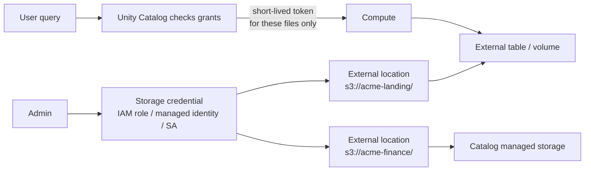

# Storage Credentials and External Locations

Mastery: `INPUT[inlineSelect(option(new), option(learning), option(solid)):mastery]`

> [!story] Context
> [[Volumes]] and external tables point at paths in cloud storage. Before Unity Catalog, clusters reached storage with credentials attached to the cluster, such as [[Instance Profiles|instance profiles]] on AWS or service principal secrets in Spark configuration on Azure. Any code on that cluster could read the whole bucket. Unity Catalog moves the credentials from the cluster into the [[Metastore]].

> [!eli5] Summary
> Unity Catalog holds the keys to the company's cloud storage and keeps a list of which storage paths each key may open. Users never hold the keys. Unity Catalog opens a path for an authorized user for a short time and records the access.

> [!analogy]- Analogy: a building's key cabinet
> - **The storage credential** is a master key kept in a locked cabinet at reception. It is a real cloud identity (an IAM role, a managed identity, a service account).
> - **The external location** is a label on a specific door: "Floor 3, Finance archive. Use master key #2."
> - **The receptionist** is [[Unity Catalog]]. When you ask to enter a room, it checks the guest list ([[Privileges and Grants|grants]]), then opens the door for you for a few minutes. You never hold the key.

## Background

Cluster-held credentials had three problems:

1. **All or nothing.** If a cluster could reach a bucket, every user and every notebook on that cluster could read all of it.
2. **Secrets everywhere.** Keys and client secrets ended up in cluster configs, notebooks, and sometimes in [[Git]].
3. **No audit by person.** Cloud logs showed "the cluster role read this file", not which human did.

With Unity Catalog, the credential lives in the [[Metastore]]. When an authorized user reads a table or volume, Unity Catalog issues the compute a **short-lived, down-scoped credential** for only the files involved, and logs the access against the user.

## Overview

Two securable objects, always used together:

| Object | What it represents | Holds |
|---|---|---|
| **Storage credential** | An authentication method to cloud storage | A cloud identity: an IAM role (AWS), an Access Connector's managed identity (Azure), or a Databricks-generated service account (GCP). Also Cloudflare R2 API tokens. |
| **External location** | A storage path plus the credential that can reach it | A URL like `s3://bucket/path` and the name of a storage credential |

Rules that matter:

- One storage credential can back **many** external locations.
- Every external table, external volume, and managed storage location must sit **inside** an external location.
- Databricks recommends granting **only `CREATE EXTERNAL LOCATION`** on storage credentials, and doing everything else on external locations.

## How it works



The setup has a cloud half and a Databricks half:

1. **In the cloud console:** create the identity (role, connector, or service account) and grant it access to the bucket or container.
2. **In Databricks:** create the storage credential that points at that identity, then the external location, then grant privileges on the location.

```sql
-- (Storage credentials are usually created in Catalog Explorer or via API/Terraform,
--  because they reference cloud identities. They can then be used by name.)

-- External location: path + credential
CREATE EXTERNAL LOCATION IF NOT EXISTS landing_zone
  URL 's3://acme-landing/'
  WITH (STORAGE CREDENTIAL acme_s3_role)
  COMMENT 'Raw vendor and app exports';

-- Delegate use of the location, not the credential
GRANT READ FILES, WRITE FILES     ON EXTERNAL LOCATION landing_zone TO `data-engineers`;
GRANT CREATE EXTERNAL TABLE       ON EXTERNAL LOCATION landing_zone TO `data-engineers`;
GRANT CREATE EXTERNAL VOLUME      ON EXTERNAL LOCATION landing_zone TO `data-engineers`;
GRANT CREATE MANAGED STORAGE      ON EXTERNAL LOCATION landing_zone TO `platform-admins`;

-- Inspect and test
SHOW STORAGE CREDENTIALS;
SHOW EXTERNAL LOCATIONS;
DESCRIBE EXTERNAL LOCATION landing_zone;
LIST 's3://acme-landing/vendor/';
```

To create an external location you need `CREATE EXTERNAL LOCATION` on **both** the metastore and the storage credential it references.

## Small-business considerations

> [!smallbiz] Small-business considerations
> Workspaces that use only managed tables and managed volumes may already have a credential and location configured by an admin, or may use default storage and need none. Create them yourself only when Databricks must read files that already exist in your own bucket, such as exports from an e-commerce platform. Make **one credential per bucket or container**, one external location per top-level folder, and grant `READ FILES` to a group. Do not put storage keys in notebooks; storage credentials replace that practice.

## Cloud differences

The two objects and the SQL are the same. The cloud identity inside the storage credential is completely different on each cloud.

> [!azure]- Azure Databricks
> - The storage credential wraps an **Access Connector for Azure Databricks**, an Azure resource with a system-assigned or user-assigned [[Managed Identity|managed identity]]. Grant that identity a role such as *Storage Blob Data Contributor* on the ADLS Gen2 account or container, then create the credential from the connector's resource ID.
> - External location URLs look like `abfss://<container>@<account>.dfs.core.windows.net/<path>`.
> - Azure Databricks can also create external locations for **Cloudflare R2** buckets using an R2 API token credential.
> - Full walkthrough: [[ADLS and Access Connectors]].

> [!aws]- Databricks on AWS
> - The storage credential holds an **IAM role ARN**. The role's trust policy lets Unity Catalog assume it, using an external ID that Databricks gives you. The AWS setup page walks through the exact trust policy.
> - URLs look like `s3://<bucket>/<path>`.
> - This replaces [[Instance Profiles|instance profiles]] for Unity Catalog data. Full walkthrough: [[S3 Access via Unity Catalog]].

> [!gcp]- Databricks on Google Cloud
> - When you create the storage credential, **Databricks generates a Google [[Google Service Accounts|service account]]** for it. You grant that account roles on the bucket (the docs list *Storage Legacy Bucket Reader* and *Storage Object Admin*).
> - URLs look like `gs://<bucket>/<path>`.
> - Databricks on Google Cloud can also define **read-only** external locations on AWS S3, using an IAM role credential.
> - Full walkthrough: [[GCS Access via Unity Catalog]].

## Advanced topics

> [!deepdive]- Advanced topics (301–401)
> - **Workspace binding.** Storage credentials and external locations can be bound to specific workspaces, so a `prod` bucket is reachable only from the prod workspace. An external location's binding works independently of its credential's binding.
> - **Network rules still apply.** A credential grants identity, not network reach. If the bucket has a firewall or a private endpoint policy, serverless compute needs a network path too. See [[Serverless Network Security]].
> - **Privileges on files vs tables.** `READ FILES` on an external location lets a user read raw files by path, bypassing table-level controls like [[Row Filters and Column Masks|row filters]]. Grant it narrowly, usually only to engineering groups and ingestion service principals.
> - **Infrastructure as code.** In practice teams create credentials and locations with the [[Terraform Provider]] alongside the cloud role, so the two halves never drift.

## Common misconceptions

> [!confusion] Credential vs location
> A **storage credential** is *how* to authenticate. An **external location** is *where* plus *how*. Users should be granted on locations, almost never on credentials.

> [!confusion] An external location is not a table
> It is a governed path. Tables and volumes are created *inside* it.

> [!confusion] This is not the same as a secret scope
> [[Secrets Management|Secret scopes]] store passwords and tokens for code to read. Storage credentials are never readable by users; Unity Catalog uses them on your behalf.

## Recall

What is a storage credential?::A Unity Catalog object that wraps a cloud identity (IAM role, managed identity, or service account) used to authenticate to cloud storage.
What is an external location?::A Unity Catalog object pairing a cloud storage path with a storage credential.
Can one storage credential back several external locations?::Yes.
Which privilege should be the only one granted on storage credentials?::`CREATE EXTERNAL LOCATION`.
What does Unity Catalog give compute when an authorized user reads a table?::A short-lived, down-scoped credential for just the needed files.
On Azure, what identity does a storage credential use?::The managed identity of an Access Connector for Azure Databricks.
On AWS, what does the storage credential hold?::An IAM role ARN that Unity Catalog assumes with an external ID.
On GCP, who creates the service account for a storage credential?::Databricks generates it; you grant it roles on the bucket.
Why grant READ FILES narrowly?::It allows reading raw files by path, which bypasses table-level row filters and column masks.

## Next steps

> [!path] Learning path
> **Needs first:** [[Metastore]], [[Managed vs External Tables]], [[IAM]]
> **Unlocks next:** [[Privileges and Grants]], [[ADLS and Access Connectors]], [[S3 Access via Unity Catalog]], [[GCS Access via Unity Catalog]]

> [!nextup] Next
> [[Privileges and Grants]] covers the permission model that decides which principals can use each object.

> [!sources]- Sources (last verified: 2026-10-25)
> - [Connect to cloud object storage using Unity Catalog (AWS)](https://docs.databricks.com/aws/en/connect/unity-catalog/cloud-storage/)
> - [Create a storage credential and external location for S3 (AWS)](https://docs.databricks.com/aws/en/connect/unity-catalog/cloud-storage/s3/s3-external-location-manual)
> - [Connect to an ADLS Gen2 external location (Azure Databricks)](https://learn.microsoft.com/en-us/azure/databricks/connect/unity-catalog/cloud-storage/external-locations)
> - [Connect to a Cloudflare R2 external location (Azure Databricks)](https://learn.microsoft.com/en-us/azure/databricks/connect/unity-catalog/cloud-storage/external-locations-r2)
> - [Connect to a GCS external location (GCP)](https://docs.databricks.com/gcp/en/connect/unity-catalog/cloud-storage/external-locations-gcs#storage-credential)
> - [Connect to an AWS S3 external location, read-only (GCP)](https://docs.databricks.com/gcp/en/connect/unity-catalog/cloud-storage/s3/s3-external-location-manual)
> - [Manage storage credentials (AWS)](https://docs.databricks.com/aws/en/connect/unity-catalog/cloud-storage/manage-storage-credentials)
> - [Unity Catalog privileges reference (AWS)](https://docs.databricks.com/aws/en/data-governance/unity-catalog/access-control/privileges-reference)
