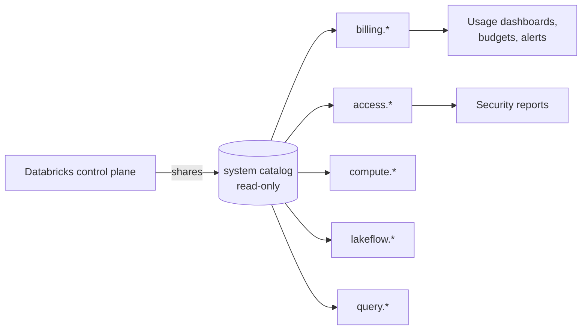

# System Tables

Mastery: `INPUT[inlineSelect(option(new), option(learning), option(solid)):mastery]`

> [!story] Context
> [[Audit Logs]] are available as a table that you query with SQL. Databricks publishes other operational data the same way: billable usage, compute configurations, job runs, and query history. These tables are called system tables.

> [!eli5] Summary
> System tables are records that Databricks keeps about your account, such as usage, cost, jobs, and queries, stored as read-only tables. You query them with SQL like any other table.

> [!analogy]- Analogy: a car's trip computer
> - **Your data tables** are the passengers and cargo.
> - **System tables** are the dashboard readouts: fuel used (billing), engine hours (compute), trip log (jobs), and the black box (audit).
> - **The readouts are read-only.** You cannot edit the fuel gauge, only read it.
> - **You can build your own display** from them: a dashboard, a budget alert, a weekly email.

## Background

Before system tables, cost and operations data were scattered: a usage CSV download in the account console, audit logs delivered to a bucket, cluster events in the UI, job history in the API. Reporting the cost of one team's jobs for a quarter required combining four sources.

System tables consolidate this data in one governed location, queryable with SQL.

## Overview

System tables are a **Databricks-hosted analytical store of your account's operational data**, found in the read-only `system` catalog in Unity Catalog. They are shared with your [[Metastore]] by Databricks, so they are always up to date and cost nothing to store. You pay only for the compute that queries them.

The main tables (not a complete list):

| Table | What it holds | Typical use |
|---|---|---|
| `system.billing.usage` | Every billable usage record, with SKU, [[DBUs\|DBU]] quantity, workspace, and tags; global across regions | Cost reporting, chargeback |
| `system.billing.list_prices` | Historical list price per SKU; a row is added on each price change | Estimating list cost |
| `system.access.audit` | Audit events | Security, compliance |
| `system.access.table_lineage` / `column_lineage` | Lineage events | Impact analysis |
| Workspaces table (`system.access` schema) | Workspaces in the account | Joining IDs to names |
| `system.compute.clusters` | History of cluster configurations (slowly changing) | Who runs what compute |
| `system.lakeflow.jobs`, `job_run_timeline`, `job_task_run_timeline` | Job definitions and runs | Failures, durations, job cost |
| `system.query.history` | Queries on SQL warehouses and serverless | Slow-query hunting |
| `system.data_classification.results` | Sensitive data detections | Privacy reviews |

Most tables have a **free retention period of 365 days** (for example audit, clusters, query history, jobs). Some are regional (workspace-level data) and some global (billing, account events).

## How it works



By default only account admins can read system tables. An admin grants access like any other catalog:

```sql
GRANT USE CATALOG ON CATALOG system TO `finops`;
GRANT USE SCHEMA, SELECT ON SCHEMA system.billing TO `finops`;
```

Cost per workspace and product, last 30 days, at list price:

```sql
SELECT
  u.workspace_id,
  u.billing_origin_product,
  SUM(u.usage_quantity)                       AS dbus,
  SUM(u.usage_quantity * p.pricing.default)   AS list_cost
FROM system.billing.usage u
JOIN system.billing.list_prices p
  ON  u.sku_name = p.sku_name
  AND u.usage_end_time >= p.price_start_time
  AND (p.price_end_time IS NULL OR u.usage_end_time < p.price_end_time)
WHERE u.usage_date >= current_date() - INTERVAL 30 DAYS
GROUP BY ALL
ORDER BY list_cost DESC;
```

Cost by your own tag (see [[Tagging for Chargeback]]):

```sql
SELECT custom_tags['team'] AS team, SUM(usage_quantity) AS dbus
FROM system.billing.usage
WHERE usage_date >= date_trunc('MONTH', current_date())
GROUP BY ALL;
```

Failed jobs yesterday:

```sql
SELECT job_id, run_id, result_state, period_start_time
FROM system.lakeflow.job_run_timeline
WHERE result_state = 'FAILED'
  AND period_start_time >= current_date() - INTERVAL 1 DAY;
```

## Small-business considerations

> [!smallbiz] Small-business considerations
> `system.billing.usage` is the primary table for cost monitoring. Databricks provides prebuilt **usage dashboards** based on it (see [[Budgets and Usage Dashboards]]), which require no SQL. Tag jobs and warehouses with a `team` or `project` tag from the start so usage can be split by project later. List price can differ from the contracted price, and cloud infrastructure is billed separately. See [[How Databricks Pricing Works]] and the official [Databricks pricing page](https://www.databricks.com/product/pricing).

## Cloud differences

> [!azure]- Azure Databricks
> - System tables work the same. Azure also bills Databricks through your Azure invoice, so `system.billing.usage` shows DBUs while **Azure Cost Management** shows the virtual machine and storage cost. You need both for the full picture. See [[Azure Billing and Commit Units]].

> [!aws]- Databricks on AWS
> - System tables work the same. Classic compute VMs and S3 appear on your AWS bill, not in `system.billing.usage`. See [[AWS Marketplace and Billing]].

> [!gcp]- Databricks on Google Cloud
> - System tables work the same. Compute and storage for classic workloads appear on your Google Cloud bill. See [[Google Cloud Marketplace and Billing]].

## Advanced topics

> [!deepdive]- Advanced topics (301–401)
> - **Regional vs global.** `system.billing.usage` is routed to all regions, so you can see global usage from any workspace. Most other tables are regional: query them from a workspace in that region.
> - **Configurable retention (Beta).** Account admins can set a longer retention for system tables from the Previews page. It does not apply to the `system.data_classification`, `system.data_quality_monitoring`, and `system.lakebase` schemas.
> - **Slowly changing dimensions.** Tables like `system.compute.clusters` and `system.lakeflow.jobs` keep one row per change. Use the latest row per ID for "current state" and join on time ranges for history. The latest entry per job is kept even beyond 365 days.
> - **Schemas evolve.** Databricks adds columns and tables over time. Avoid `SELECT *` in saved reports.
> - **Freshness.** System tables are not real time. Expect some delay before recent activity appears.
> - **Attribution.** Each usage record carries metadata such as job, warehouse, and notebook IDs, which lets you attribute cost to the work that caused it.

## Common misconceptions

> [!confusion] System tables are not your tables
> They live in the `system` catalog, are read-only, and are maintained by Databricks. You cannot write to them or drop them.

> [!confusion] list_prices is not your invoice
> `list_prices` holds public list prices. Discounts, commitments, and cloud infrastructure costs are not in it.

## Recall

Where do system tables live?::In the read-only `system` catalog in Unity Catalog.
Which table holds billable usage?::`system.billing.usage`.
Which table holds historical SKU list prices?::`system.billing.list_prices`.
Which table holds audit events?::`system.access.audit`.
Which tables hold job runs?::`system.lakeflow.job_run_timeline` and `system.lakeflow.job_task_run_timeline` (definitions in `system.lakeflow.jobs`).
Which table holds SQL warehouse and serverless queries?::`system.query.history`.
What is the typical free retention period for system tables?::365 days.
Who can read system tables by default?::Account admins, who can grant USE and SELECT to others.
Is system.billing.usage regional or global?::Global; it is routed to all regions.

## Next steps

> [!path] Learning path
> **Needs first:** [[Unity Catalog]], [[SQL]], [[DBUs]]
> **Unlocks next:** [[Budgets and Usage Dashboards]], [[Cost Optimization Checklist]], [[Tagging for Chargeback]]

> [!nextup] Next
> [[Lakehouse Federation]] extends Unity Catalog governance to data stored in external databases and catalogs.

> [!sources]- Sources (last verified: 2026-10-25)
> - [System tables reference (AWS)](https://docs.databricks.com/aws/en/admin/system-tables/)
> - [System tables reference (GCP)](https://docs.databricks.com/gcp/en/admin/system-tables)
> - [Billable usage system table reference (AWS)](https://docs.databricks.com/aws/en/admin/system-tables/billing)
> - [Monitor costs using system tables (AWS)](https://docs.databricks.com/aws/en/admin/usage/system-tables)
> - [Monitor costs using system tables (Azure Databricks)](https://learn.microsoft.com/en-us/azure/databricks/admin/usage/system-tables)
> - [Jobs system table reference (AWS)](https://docs.databricks.com/aws/en/admin/system-tables/jobs)
> - [Monitor job costs and performance with system tables (AWS)](https://docs.databricks.com/aws/en/admin/system-tables/jobs-cost)
> - [Workspaces system table reference (AWS)](https://docs.databricks.com/aws/en/admin/system-tables/workspaces)
> - [Usage dashboards (AWS)](https://docs.databricks.com/aws/en/admin/account-settings/usage)
