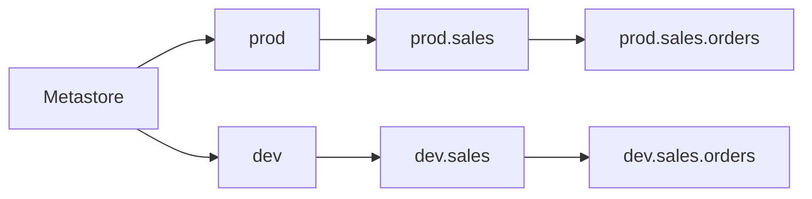

# Three-Level Namespace

Mastery: `INPUT[inlineSelect(option(new), option(learning), option(solid)):mastery]`

> [!story] Context
> The [[Metastore]] is the registry for one region. Every object registered in it has a three-part name. The legacy [[Hive Metastore]] used two levels (`database.table`) per workspace, so the same name could refer to different tables in different workspaces. Unity Catalog adds a catalog level so that one name identifies one object across all attached workspaces.

> [!eli5] Summary
> Every table, file folder, and model has a three-part address: catalog, schema, and name, separated by dots. Anyone in the company who uses the same address reaches the same object.

> [!analogy]- Analogy: a postal address
> - **Country** is the catalog: the biggest grouping, such as `prod` or `finance`.
> - **City** is the schema: a smaller grouping inside it, such as `orders`.
> - **House** is the object: the actual table, view, volume, function, or model, such as `daily_totals`.
> - **Leaving off the country** works when everyone knows which country you mean. That is the *current catalog*. But the full address never fails.

## Background

With two levels (`schema.table`) and one Hive metastore per workspace, names collided. Teams used prefixes such as `prod_sales_orders` and `dev_sales_orders` to separate them, and a typo could write to the wrong one.

The **catalog** level provides a place to separate environments (dev and prod), business units (finance and marketing), or data sources (an outside Postgres database connected through [[Lakehouse Federation]]), while keeping table names short and identical across them.

## Overview

The three-level namespace is the naming scheme Unity Catalog uses to give every data object one unique address. Every object is addressed as:

```text
catalog.schema.object
```

| Level | What it holds | Example |
|---|---|---|
| **Catalog** | Schemas. The first level under the [[Metastore]]. | `prod` |
| **Schema** (also called *database*) | Tables, views, [[Volumes\|volumes]], functions, models | `prod.sales` |
| **Object** | The thing you query, read, or call | `prod.sales.orders` |

The same pattern covers every object type:

- Table or view: `prod.sales.orders`
- Volume (files): `prod.sales.raw_files`, whose files are at `/Volumes/prod/sales/raw_files/...`
- Function: `prod.sales.mask_email`
- Model: `prod.ml.churn_model` (see [[Models in Unity Catalog]])

Names with dashes or other special characters need backticks: `` `my-catalog`.sales.orders ``.

## How it works



You can always write the full name. To save typing, set a **current catalog and schema** for the session, and then one- or two-part names fill in the rest:

```sql
-- Where am I?
SELECT current_catalog(), current_schema();

-- Full name: always works, always unambiguous
SELECT * FROM prod.sales.orders LIMIT 10;

-- Set defaults for this session
USE CATALOG prod;
USE SCHEMA sales;

-- Now these resolve to prod.sales.orders
SELECT * FROM orders LIMIT 10;
SELECT * FROM sales.orders LIMIT 10;

-- Discover what exists
SHOW CATALOGS;
SHOW SCHEMAS IN prod;
SHOW TABLES IN prod.sales;
```

In Python the names are the same strings:

```python
df = spark.table("prod.sales.orders")
df.write.mode("overwrite").saveAsTable("dev.sales.orders_copy")
```

Each workspace has a **default catalog** that sessions start in. New workspaces enabled automatically for Unity Catalog get a *workspace catalog* (named after the workspace) as the default. A workspace admin can change it.

## Small-business considerations

> [!smallbiz] Small-business considerations
> Choose and document a naming pattern before creating objects. Example for a five-person company:
>
> | Catalog | Purpose |
> |---|---|
> | `raw` | Data exactly as it arrived from the shop system, the accounting tool, spreadsheets |
> | `analytics` | Cleaned tables people report on |
> | `sandbox` | Experiments, writable by everyone |
>
> Use fully qualified names in saved queries and jobs (`analytics.sales.daily_totals`). A job that depends on the current catalog fails if the workspace default changes.

## Cloud differences

> [!azure]- Azure Databricks, AWS, and Google Cloud
> Nothing differs. The three-level namespace, the SQL, and the `/Volumes/<catalog>/<schema>/<volume>` path pattern are identical on all three clouds.

## Advanced topics

> [!deepdive]- Advanced topics (301–401)
> - **`hive_metastore` is a catalog too:** In a Unity Catalog workspace the legacy Hive metastore shows up as a catalog named `hive_metastore`, so old tables are `hive_metastore.default.my_table`. Migrating is about moving them to real catalogs. See [[Hive Metastore Migration to Unity Catalog]].
> - **Foreign and shared catalogs use the same addressing:** A catalog created from a [[Lakehouse Federation]] connection (`pg_shop.public.orders`) or from an [[OpenSharing]] share is queried with the same three parts, even though the data lives elsewhere.
> - **Fully qualified names in code:** Jobs and pipelines should either use full names or set the catalog explicitly (for example as a job parameter) so one codebase can run against `dev` and `prod`. This pattern is common in [[Declarative Automation Bundles]].
> - **Names are part of the security model:** Privileges attach to the levels: `USE CATALOG` on the catalog, `USE SCHEMA` on the schema, and `SELECT` on the object (or a parent). See [[Privileges and Grants]].

## Common misconceptions

> [!confusion] "Schema" here is a container, not a column list
> In `catalog.schema.table`, the schema is a folder-like container. A table's [[Schema|schema]] is its columns and types. Databricks also accepts `DATABASE` as a synonym: `CREATE DATABASE` and `CREATE SCHEMA` do the same thing.

> [!confusion] The current catalog is a session setting, not a permission
> `USE CATALOG prod` changes where short names resolve. It is unrelated to the `USE CATALOG` *privilege*, which is what lets you see inside a catalog at all. Same words, different jobs.

## Recall

What are the three levels of the Unity Catalog namespace?::Catalog, schema, and object (table, view, volume, function, or model).
What is the full name of the `orders` table in schema `sales` in catalog `prod`?::`prod.sales.orders`.
What is a synonym for "schema" in Databricks SQL?::Database.
Which statement sets the current catalog for a session?::`USE CATALOG <name>;`
Which functions return the current catalog and schema?::`current_catalog()` and `current_schema()`.
What is the file path pattern for a volume?::`/Volumes/<catalog>/<schema>/<volume>/<path>`.
How does the legacy Hive metastore appear in a Unity Catalog workspace?::As a catalog named `hive_metastore`.
Why add a catalog level above schemas?::So environments, business units, or sources can be separated cleanly while one name means one object everywhere.

## Next steps

> [!path] Learning path
> **Needs first:** [[Metastore]], [[SQL]]
> **Unlocks next:** [[Catalogs Schemas and Tables]], [[Privileges and Grants]], [[Volumes]]

> [!nextup] Next
> [[Catalogs Schemas and Tables]] lists the object types that live at these addresses and common ways to organize catalogs and schemas.

> [!sources]- Sources (last verified: 2026-10-25)
> - [Unity Catalog securable objects reference (AWS)](https://docs.databricks.com/aws/en/data-governance/unity-catalog/securable-objects)
> - [Unity Catalog securable objects reference (Azure Databricks)](https://learn.microsoft.com/en-us/azure/databricks/data-governance/unity-catalog/securable-objects)
> - [Path rules and access in Unity Catalog volumes (Azure Databricks)](https://learn.microsoft.com/en-us/azure/databricks/volumes/paths)
> - [Unity Catalog best practices (Azure Databricks)](https://learn.microsoft.com/en-us/azure/databricks/data-governance/unity-catalog/best-practices)
> - [Database objects in the legacy Hive metastore (AWS)](https://docs.databricks.com/aws/en/database-objects/hive-metastore)
> - [Enable a workspace for Unity Catalog (AWS)](https://docs.databricks.com/aws/en/data-governance/unity-catalog/enable-workspaces)
