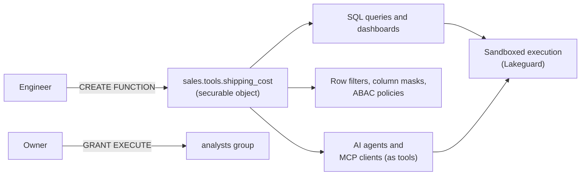

# Unity Catalog Functions

Mastery: `INPUT[inlineSelect(option(new), option(learning), option(solid)):mastery]`

A Unity Catalog function is a SQL or Python [[UDF|user-defined function]] stored as a securable object in a schema (`catalog.schema.function`), so it can be shared, permissioned, audited, and reused across queries, policies, and AI agents.

> [!story] Context
> [[Service Credentials]] let governed code call cloud services. The code itself also needs a governed home. A function defined inside one notebook session disappears when the session ends and cannot be shared or permissioned. Unity Catalog functions register logic once in the catalog, next to the tables it operates on.

> [!eli5] Summary
> A Unity Catalog function is a small, named piece of logic, such as "calculate the shipping cost" or "hide all but the last four digits", saved in the company catalog. Anyone with permission can use it in a query, and AI assistants can use it as a tool, so the same rule gives the same answer everywhere.

## Background

[[Apache Spark]] and Databricks have long supported UDFs. Before Unity Catalog, most UDFs were one of:

- **Session-scoped:** Registered in a notebook or job with `spark.udf.register(...)` or `CREATE TEMPORARY FUNCTION`. They exist only for that session.
- **Workspace-scoped in the legacy [[Hive Metastore]]:** Visible in one workspace, with workspace-level permissions.

Teams copied the same business logic (tax rules, masking rules, cleanup functions) into many notebooks, and the copies drifted. There was no way to grant one group the right to call a function without also exposing its code to everyone.

Unity Catalog functions solve this by making functions first-class [[Securable Object|securable objects]] in the [[Three-Level Namespace]].

## Overview

| Function kind | Language | Returns | Typical use |
|---|---|---|---|
| **SQL scalar UDF** | SQL expression | One value per row | Business rules, formatting, [[Row Filters and Column Masks\|masks and filters]] |
| **SQL table function** | SQL query | A table | Parameterized views |
| **Python scalar UDF** | Python | One value per row | Logic SQL cannot express, parsing, calls to external services |
| **Batch Python UDF** | Python (pandas) | One value per row, processed in batches | Vectorized work, expensive setup reused across rows |
| **Python UDTF** | Python class | A table | Exploding or generating rows |

Shared characteristics:

- **Governed:** Creating a function requires `CREATE FUNCTION` on the schema (plus `USE CATALOG` and `USE SCHEMA`). Calling it requires `EXECUTE` on the function.
- **Runs on Unity Catalog compute:** Python UDFs in Unity Catalog run on pro and serverless SQL warehouses, [[Serverless Compute|serverless compute]], and Unity Catalog-enabled classic compute. User code runs in a sandbox isolated by [[Lakeguard]].
- **Reusable by AI:** Agents can call Unity Catalog functions as tools, and [[Managed MCP Servers]] expose them to agents over the [[Model Context Protocol]].
- **Visible in [[Catalog Explorer]]:** Functions appear under their schema with their signature, comment, owner, and permissions.

## How it works



### A SQL function

```sql
CREATE OR REPLACE FUNCTION sales.tools.shipping_cost(weight_kg DOUBLE, zone STRING)
RETURNS DOUBLE
COMMENT 'Shipping cost in USD for a parcel weight and delivery zone'
RETURN CASE zone
         WHEN 'local'    THEN 4.0 + 0.5 * weight_kg
         WHEN 'national' THEN 7.5 + 0.9 * weight_kg
         ELSE                 15.0 + 1.6 * weight_kg
       END;

GRANT EXECUTE ON FUNCTION sales.tools.shipping_cost TO `analysts`;

SELECT order_id, sales.tools.shipping_cost(weight_kg, zone) AS ship_cost
FROM sales.orders.parcels;
```

The `COMMENT` matters: agents read it to decide when to call the function.

### A Python function

```sql
CREATE OR REPLACE FUNCTION sales.tools.normalize_phone(phone STRING)
RETURNS STRING
LANGUAGE PYTHON
DETERMINISTIC
COMMENT 'Strip formatting from a US phone number and return 10 digits, or NULL'
AS $$
import re
if phone is None:
    return None
digits = re.sub(r"\D", "", phone)
if len(digits) == 11 and digits.startswith("1"):
    digits = digits[1:]
return digits if len(digits) == 10 else None
$$;
```

Mark a function `DETERMINISTIC` only when the same input always gives the same output. Functions that read the clock, generate random values, or call external APIs are not deterministic.

### A batch Python function

Batch UDFs use `PARAMETER STYLE PANDAS` and a `HANDLER` that receives an iterator of pandas Series. Put expensive setup at module level so it runs once, not once per batch.

```sql
CREATE OR REPLACE FUNCTION health.tools.bmi(weight_kg DOUBLE, height_m DOUBLE)
RETURNS DOUBLE
LANGUAGE PYTHON
DETERMINISTIC
PARAMETER STYLE PANDAS
HANDLER 'calculate_bmi'
AS $$
import pandas as pd
from typing import Iterator, Tuple

def calculate_bmi(batches: Iterator[Tuple[pd.Series, pd.Series]]) -> Iterator[pd.Series]:
    for weight, height in batches:
        yield weight / (height * height)
$$;
```

### Dependencies and credentials

The `ENVIRONMENT` clause installs packages, and the `CREDENTIALS` clause gives the function a [[Service Credentials|service credential]]:

```sql
CREATE OR REPLACE FUNCTION ops.tools.lookup_customer(customer_id STRING)
RETURNS STRING
LANGUAGE PYTHON
CREDENTIALS (`crm_api_cred` DEFAULT)
ENVIRONMENT (dependencies = '["boto3"]', environment_version = '6')
AS $$
import boto3
# boto3 picks up the DEFAULT service credential automatically
client = boto3.Session().client("lambda", region_name="us-east-1")
resp = client.invoke(FunctionName="crm-lookup", Payload=customer_id)
return resp["Payload"].read().decode("utf-8")
$$;
```

`dependencies` accepts PyPI packages, wheel files in a Unity Catalog [[Volumes|volume]], or HTTPS wheel URLs. `environment_version` is required whenever the `ENVIRONMENT` clause is present.

### Use a function as an agent tool (Python)

```python
from unitycatalog.ai.core.databricks import DatabricksFunctionClient
from databricks_langchain import UCFunctionToolkit

client = DatabricksFunctionClient()

# Run the function to check it before handing it to an agent
client.execute_function(
    "sales.tools.shipping_cost",
    parameters={"weight_kg": 2.0, "zone": "local"},
)

toolkit = UCFunctionToolkit(function_names=["sales.tools.shipping_cost"])
tools = toolkit.tools  # pass to your agent framework
```

`DatabricksFunctionClient` also offers `create_python_function` to register a Python callable as a Unity Catalog function. Toolkits exist for LangChain/LangGraph (`databricks_langchain`), OpenAI, Anthropic, and LlamaIndex (`unitycatalog.ai.*`).

## Small-business considerations

> [!smallbiz] Small-business considerations
> Unity Catalog functions have no separate charge; they run on the compute that runs the query. For a small team they are the simplest way to stop copying the same formula into many notebooks and dashboards.
> 1. **Start with SQL functions** for business rules (pricing, tax, fiscal calendar). They are fast and easy to read.
> 2. **Keep them in one schema**, such as `main.tools`, and grant `EXECUTE` to `account users` or an `analysts` group.
> 3. **Write a clear `COMMENT`** on every function. It documents the logic for people and tells AI agents when to use it.
>
> Defer Python UDFs until SQL cannot express the logic. Python UDFs are slower than built-in SQL functions, and their sandboxes add start-up time.

## Cloud differences

> [!azure]- Azure Databricks, AWS, and Google Cloud
> The SQL syntax, privileges, and agent tooling are the same on all clouds. Differences appear only inside functions that call cloud services: the `CREDENTIALS` clause references a service credential backed by each cloud's identity (Azure managed identity, AWS IAM role, Google service account). See [[Service Credentials]]. The Azure docs describe outbound TCP/UDP from Python UDFs on serverless or standard compute as allowed on ports 80, 443, and 53.

## Advanced topics

> [!deepdive]- Advanced topics (301–401)
> - **Isolation modes:** On Databricks Runtime 18.1 and above, Python UDFs run by default in a **shared isolation environment**, which is faster and uses less memory. Declare `STRICT ISOLATION` for UDFs that run arbitrary code, write local files, change environment variables, or modify global state. In earlier runtimes, all Unity Catalog Python UDFs run in strict isolation.
> - **Network access on SQL warehouses:** Python UDFs on serverless SQL warehouses have no outbound network access by default, and calls that try it hang. Enable the Public Preview setting **Enable networking for isolated workloads** in Serverless SQL Warehouses, or run network-dependent UDFs on serverless or classic compute.
> - **Memory:** PySpark UDFs on serverless compute are limited to 1 GB each. Exceeding it raises `UDF_PYSPARK_USER_CODE_ERROR.MEMORY_LIMIT_SERVERLESS`.
> - **Native wheels:** Wheels with native extensions must be built for both `aarch64` and `x86_64`, because serverless hardware can change between runs.
> - **Credential gates:** Scalar Python UDFs with credentials need Databricks Runtime 18.1 or above on classic compute, or `environment_version` 6 or above on serverless and SQL warehouses. UDTFs do not support service credentials or custom dependencies.
> - **Owner's rights:** A UDF that declares a service credential runs with its creator's `ACCESS` on that credential. Callers need only `EXECUTE` (on dedicated compute they also need `ACCESS`). Treat `CREATE FUNCTION` plus `ACCESS` as a powerful combination.
> - **Policy functions:** The functions behind [[Row Filters and Column Masks]] and [[Attribute-Based Access Control|ABAC]] policies are ordinary Unity Catalog SQL UDFs. Keep them simple, because they run per row or per value.
> - **Agent execution modes:** `DatabricksFunctionClient` runs functions on serverless compute in production. A local execution mode (`execution_mode="local"`) exists for testing trusted Python functions during development. A SQL warehouse alone is not sufficient for the function client.

## Common misconceptions

> [!confusion] A Unity Catalog function is not a temporary function
> `CREATE TEMPORARY FUNCTION` and `spark.udf.register` create session-scoped functions with no grants. `CREATE FUNCTION catalog.schema.name` creates a governed, persistent object.

> [!confusion] Unity Catalog functions are not AI Functions
> [[AI Functions in SQL|AI Functions]] such as `ai_query` are built-in functions that call models. Unity Catalog functions are your own logic. A Unity Catalog function can call an AI Function inside its body.

## Recall

What is a Unity Catalog function?::A SQL or Python user-defined function stored as a securable object at `catalog.schema.function`, governed by Unity Catalog privileges.
Which privilege is needed to create a function in a schema?::`CREATE FUNCTION` on the schema (plus `USE CATALOG` and `USE SCHEMA`).
Which privilege is needed to call a function?::`EXECUTE` on the function.
Which clauses define a batch Python UDF?::`PARAMETER STYLE PANDAS` and `HANDLER '<function_name>'`.
Which clause adds PyPI dependencies to a Python UDF?::`ENVIRONMENT (dependencies = '[...]', environment_version = '...')`.
Which clause gives a Python UDF a service credential?::The `CREDENTIALS` clause, optionally marking one credential `DEFAULT`.
When should you declare `STRICT ISOLATION`?::When the UDF runs arbitrary code, writes local files, changes environment variables, or modifies global state.
Which Python class wraps Unity Catalog functions as LangChain/LangGraph tools?::`UCFunctionToolkit` from `databricks_langchain`.
Why does a function `COMMENT` matter for agents?::Agents read it to decide when and how to call the function.
What isolates user code in Unity Catalog Python UDFs?::Lakeguard sandboxing.

## Next steps

> [!path] Learning path
> **Needs first:** [[Catalogs Schemas and Tables]], [[Privileges and Grants]], [[SQL]]
> **Unlocks next:** [[Row Filters and Column Masks]], [[Managed MCP Servers]], [[Agent Bricks]]

> [!nextup] Next
> [[Lakeguard]] explains the isolation technology that lets Python UDFs and many users share the same compute safely.

> [!sources]- Sources (last verified: 2026-10-25)
> - [SQL and Python user-defined functions (UDFs) in Unity Catalog (AWS)](https://docs.databricks.com/aws/en/udf/unity-catalog)
> - [SQL and Python user-defined functions (UDFs) in Unity Catalog (Azure Databricks)](https://learn.microsoft.com/en-us/azure/databricks/udf/unity-catalog)
> - [CREATE FUNCTION (SQL, Python, Scala, and Java) (AWS)](https://docs.databricks.com/aws/en/sql/language-manual/sql-ref-syntax-ddl-create-sql-function)
> - [CREATE FUNCTION (SQL, Python, Scala, and Java) (GCP)](https://docs.databricks.com/gcp/en/sql/language-manual/sql-ref-syntax-ddl-create-sql-function)
> - [Batch Python user-defined functions (UDFs) in Unity Catalog (AWS)](https://docs.databricks.com/aws/en/udf/python-batch-udf)
> - [Python scalar user-defined functions (UDFs) (AWS)](https://docs.databricks.com/aws/en/udf/python)
> - [Python scalar user-defined functions (UDFs) (Azure Databricks)](https://learn.microsoft.com/en-us/azure/databricks/udf/python)
> - [Python user-defined table functions (UDTFs) in Unity Catalog (GCP)](https://docs.databricks.com/gcp/en/udf/udtf-unity-catalog)
> - [Create agent tools using Unity Catalog functions (AWS)](https://docs.databricks.com/aws/en/agents/custom-agents/create-custom-tool)
> - [Create AI agent tools using Unity Catalog functions (Azure Databricks)](https://learn.microsoft.com/en-us/azure/databricks/agents/agent-framework/create-custom-tool)
> - [Integrate Unity Catalog tools with third party AI frameworks (GCP)](https://docs.databricks.com/gcp/en/agents/custom-agents/unity-catalog-tool-integration)
> - [Serverless compute limitations (AWS)](https://docs.databricks.com/aws/en/compute/serverless/limitations)
