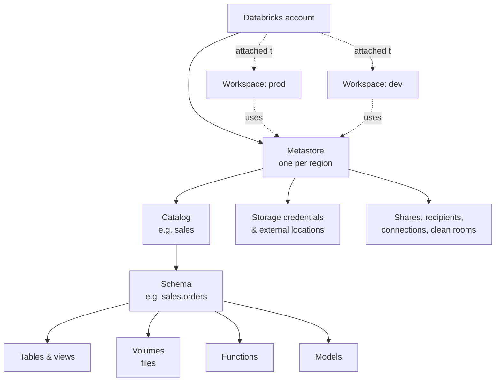

# Unity Catalog

Mastery: `INPUT[inlineSelect(option(new), option(learning), option(solid)):mastery]`

> [!story] Previously
> By the end of [[Chapter 06 - The Databricks Platform|chapter 06]] we had a platform with plenty of power: workspaces, compute, and notebooks on top of [[Delta Lake]] tables. But power is not order. Each workspace kept its own list of tables in an old [[Hive Metastore]], permissions were set workspace by workspace, and nobody could answer "who can see the customer table, and where did this revenue number come from?" Without rules, a lake turns back into a [[Data Swamps|data swamp]].

> [!eli5] In one breath
> Unity Catalog is the front desk and the security guard for all of a company's data. It keeps one list of everything that exists, decides who is allowed to open what, and writes down every visit. It works the same way in every corner of the company.

> [!analogy] Analogy: a public library system
> - **The library card catalog** is the list of every table, file, and model, so people can find things.
> - **The branch libraries** are your workspaces. Each one is a different building, but they share one catalog.
> - **Your library card** is your identity. The type of card decides which rooms you may enter (the [[Privileges and Grants|grants]]).
> - **The restricted archive** is a table protected with [[Row Filters and Column Masks|row filters and column masks]]. You get in, but you only see the pages you are cleared for.
> - **The checkout log** is the [[Audit Logs|audit log]], and the note inside each book saying which older books it was copied from is [[Data Lineage|lineage]].

## Why it exists

Before Unity Catalog, governance on Databricks lived **inside each workspace**:

- Each workspace had its own [[Hive Metastore]]. Two workspaces meant two lists of tables, two sets of permissions, and lots of copying back and forth.
- Access to the actual files in cloud storage was granted to **clusters**, through credentials attached to the compute. Anyone on a cluster that could reach a bucket could read everything in it.
- There was no built-in answer to "where did this column come from?" or "who queried the salary table last week?" Teams bolted on separate catalog, lineage, and audit tools.

For a regulated business (healthcare, finance, anything with [[PII]]) this was a real risk. For a small business it was mostly confusion: three copies of "customers", and no one sure which one is right.

Unity Catalog moved governance **up to the account level**. You define it once and it applies in every workspace, to every kind of asset, through every tool.

## What it actually is

Databricks describes Unity Catalog as a unified and open governance solution for data and AI assets in the lakehouse. In practice it is four jobs in one:

| Job | What it means | Where to go deeper |
|---|---|---|
| **Catalog** | One searchable inventory of tables, views, volumes, functions, and models | [[Catalogs Schemas and Tables]], [[Volumes]], [[Models in Unity Catalog]] |
| **Access control** | Standard SQL `GRANT`/`REVOKE`, plus row-, column-, and tag-based policies | [[Privileges and Grants]], [[Row Filters and Column Masks]], [[Attribute-Based Access Control]] |
| **Observability** | Automatic lineage, audit logs, and operational data as tables | [[Data Lineage]], [[Audit Logs]], [[System Tables]] |
| **Sharing and reach** | Sharing data outward, and governing data that lives in other systems | [[OpenSharing]], [[Clean Rooms]], [[Lakehouse Federation]] |

Two more facts matter:

- **It is the default.** Databricks began automatically enabling new workspaces for Unity Catalog in November 2023. Those workspaces come with a pre-provisioned *workspace catalog* that is set as the default catalog. If you sign up today, you are already using it.
- **It is also open source.** Databricks open-sourced Unity Catalog in June 2024 (Apache 2.0), and the project is hosted by the [[Linux Foundation]]'s LF AI & Data foundation. The open-source server speaks the Apache Iceberg REST catalog API, so other engines can read through it.

## How it works

Everything in Unity Catalog is a **securable object** in one hierarchy. The [[Metastore]] sits at the top, and data lives three levels down: `catalog.schema.object`, the [[Three-Level Namespace]].



Three ideas carry most of the weight:

1. **Identities live at the account.** Users, groups, and service principals are defined once in the account (usually synced from your identity provider) and reused in every workspace. See [[Users Groups and Service Principals]].
2. **Privileges flow downward.** A grant on a catalog applies to every current and future schema and table inside it. To touch anything, you also need `USE CATALOG` and `USE SCHEMA` on the containers above it.
3. **Unity Catalog, not the cluster, holds the storage keys.** Access to cloud storage goes through [[Storage Credentials and External Locations|storage credentials and external locations]]. When an authorized user reads a table, Unity Catalog hands the compute a short-lived credential for just those files.

A small, realistic setup in SQL:

```sql
-- One catalog per environment or business area
CREATE CATALOG IF NOT EXISTS sales;
CREATE SCHEMA  IF NOT EXISTS sales.orders;

-- Grant to groups, never to individuals
GRANT USE CATALOG ON CATALOG sales        TO `analysts`;
GRANT USE SCHEMA  ON SCHEMA  sales.orders TO `analysts`;
GRANT SELECT      ON SCHEMA  sales.orders TO `analysts`;  -- every table, now and future

-- Who has what?
SHOW GRANTS ON SCHEMA sales.orders;
```

> [!smallbiz] For a small business
> You get Unity Catalog without asking, and you should lean into it from day one. Even a three-person company benefits from three habits:
> 1. **A few catalogs, named by purpose**, such as `raw`, `analytics`, and `sandbox`, or `dev` and `prod`.
> 2. **Grants to groups only** (`analysts`, `engineers`), so a new hire is one group membership away from the right access.
> 3. **Lineage as documentation.** When the accountant asks where a number came from, open the table's lineage tab instead of digging through notebooks.
>
> You can skip ABAC, clean rooms, and multi-region metastores until you have a reason to need them. Unity Catalog itself has no separate price. You pay for the compute that queries the data, not for the governance.

## On each cloud

The model (metastore → catalog → schema → object) and the SQL are identical everywhere. What differs is **how Unity Catalog gets permission to reach your cloud storage**:

> [!azure]- Azure Databricks
> - Storage access uses an **Access Connector for Azure Databricks**, an Azure resource with a [[Managed Identity|managed identity]]. You give that identity the *Storage Blob Data Contributor* role on your ADLS Gen2 account, then create a storage credential from the connector's resource ID. See [[ADLS and Access Connectors]].
> - Storage paths look like `abfss://container@account.dfs.core.windows.net/path`.
> - Identities usually come from **Microsoft Entra ID** through automatic identity management or SCIM. See [[Microsoft Entra ID Integration]].
> - Keep the connector, the storage account, the metastore, and the workspaces in the same Azure [[Region|region]].

> [!aws]- Databricks on AWS
> - Storage access uses an **IAM role** that Unity Catalog assumes (with an external ID and a trust policy). The storage credential stores the role ARN. See [[S3 Access via Unity Catalog]].
> - Paths look like `s3://bucket/path`.
> - This replaces the older pattern of attaching [[Instance Profiles|instance profiles]] to clusters.

> [!gcp]- Databricks on Google Cloud
> - When you create a storage credential, **Databricks generates a Google service account** for it. You then grant that account roles on the bucket (the docs list *Storage Legacy Bucket Reader* and *Storage Object Admin*). See [[GCS Access via Unity Catalog]].
> - Paths look like `gs://bucket/path`.

## Going deeper

> [!deepdive]- Expert notes (301–401)
> - **One metastore per region.** An account has one metastore for each cloud region it operates in. Workspaces in that region attach to it, and metastores can auto-assign new workspaces in their region. Cross-region access to data happens through sharing (see [[OpenSharing]]), not by attaching a workspace to a far-away metastore.
> - **Workspace-catalog binding.** By default a catalog is visible from every workspace on its metastore. Binding restricts a catalog to named workspaces (for example, `prod` data only from the prod workspace). Auto-provisioned workspace catalogs start out bound to their own workspace.
> - **Managed storage hierarchy.** Managed tables and volumes can store their files at the metastore, catalog, or schema level. Setting managed storage per catalog is a common way to keep business units' data in separate buckets or accounts. See [[Managed vs External Tables]].
> - **Compute access modes matter.** Unity Catalog is enforced only on compute that supports it. Classic clusters in *standard* access mode (formerly "shared") and *dedicated* mode (formerly "single user") qualify, as do serverless and SQL warehouses. Fine-grained controls such as row filters on dedicated clusters are enforced by delegating the filtering to serverless compute.
> - **Beyond Delta.** Unity Catalog governs managed Apache Iceberg tables, foreign Iceberg tables, and external engines through its Iceberg REST interface. October 2026 release notes describe ABAC policies, row filters, and column masks enforced even when supported external engines read managed tables.
> - **Business semantics.** [[Metric Views]] define KPIs once in the catalog. The 2026 additions (glossary terms, domains) push Unity Catalog toward a semantic layer that BI tools and AI agents can read.
> - **Migration.** Old workspaces may still have tables in the legacy `hive_metastore` catalog. Upgrading them is its own project; see [[Hive Metastore Migration to Unity Catalog]].

## Common confusions

> [!confusion] "Unity Catalog" is not "a catalog"
> **Unity Catalog** is the whole governance system. **A catalog** (lowercase) is one top-level container inside it, like `sales` or `prod`. You can have many catalogs, but there is only one Unity Catalog.

> [!confusion] A Unity Catalog "schema" is not a table's schema
> In `catalog.schema.table`, a *schema* is a folder-like container (also called a database). A table's *schema* is its list of columns and types. Same word, two meanings. See [[Schema]].

> [!confusion] The metastore is not where your data lives
> The [[Metastore]] stores **metadata**: names, permissions, lineage. Your actual rows sit as files in your own cloud storage (or in Databricks-managed default storage for serverless-first setups).

## Recall

What is Unity Catalog in one sentence?::Databricks' account-level governance layer that catalogs, secures, audits, and traces lineage for all data and AI assets across every workspace.
What is the three-level namespace?::`catalog.schema.object`, for example `sales.orders.daily_totals`.
How many metastores should an account have per cloud region?::One.
If you `GRANT SELECT` on a schema, which tables does it cover?::Every current and future table and view in that schema.
Which privileges must a user hold on the containers above a table to query it?::`USE CATALOG` on the catalog and `USE SCHEMA` on the schema, plus `SELECT` on the table (or a parent).
Since when are new workspaces automatically enabled for Unity Catalog?::November 2023 (rolled out gradually).
On Azure, what gives Unity Catalog access to ADLS Gen2?::An Access Connector for Azure Databricks, whose managed identity is granted a storage role.
On AWS, what does a Unity Catalog storage credential hold?::An IAM role that Unity Catalog assumes to reach S3.
Who hosts open-source Unity Catalog?::LF AI & Data, a foundation of the Linux Foundation.
What did Unity Catalog replace?::Per-workspace Hive metastores, plus cluster-level storage credentials such as instance profiles.

## Where next

> [!path] Learning path
> **Needs first:** [[Accounts and Workspaces]], [[Delta Lake]]
> **Unlocks next:** [[Metastore]], [[Privileges and Grants]], [[Data Lineage]]

> [!nextup] Up next in the story
> Unity Catalog's whole hierarchy hangs off one object we have only named so far. What exactly is a [[Metastore]], and why is there one per region?

> [!sources]- Sources (last verified: 2026-10-25)
> - [What is Unity Catalog? (Azure Databricks)](https://learn.microsoft.com/en-us/azure/databricks/data-governance/unity-catalog/)
> - [Unity Catalog securable objects reference (AWS)](https://docs.databricks.com/aws/en/data-governance/unity-catalog/securable-objects)
> - [Unity Catalog permissions model concepts (AWS)](https://docs.databricks.com/aws/en/data-governance/unity-catalog/access-control/permissions-concepts)
> - [Enable a workspace for Unity Catalog (AWS)](https://docs.databricks.com/aws/en/data-governance/unity-catalog/enable-workspaces)
> - [Manage the default catalog (AWS)](https://docs.databricks.com/aws/en/catalogs/default)
> - [Workspace-catalog binding (AWS)](https://docs.databricks.com/aws/en/data-governance/unity-catalog/access-control/workspace-catalog-binding)
> - [Use Azure managed identities in Unity Catalog to access storage](https://learn.microsoft.com/en-us/azure/databricks/connect/unity-catalog/cloud-storage/azure-managed-identities)
> - [Connect to a GCS external location (GCP)](https://docs.databricks.com/gcp/en/connect/unity-catalog/cloud-storage/external-locations-gcs)
> - [October 2026 release notes (AWS)](https://docs.databricks.com/aws/en/release-notes/product/2026/october)
> - [What's new with Unity Catalog at Data + AI Summit 2026](https://www.databricks.com/blog/whats-new-unity-catalog-data-ai-summit-2026)
> - [Unity Catalog open-source project (GitHub)](https://github.com/unitycatalog/unitycatalog)
