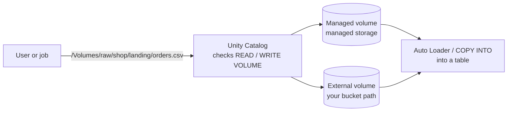

# Volumes

Mastery: `INPUT[inlineSelect(option(new), option(learning), option(solid)):mastery]`

> [!story] Context
> [[Managed vs External Tables]] covers tabular data. Many workloads also use files that are not tables: raw CSV drops, scanned documents, images, model artifacts, and Python wheels. In a traditional [[Data Lakes|data lake]] these files sit in buckets without catalog-level governance. Volumes register them in [[Unity Catalog]].

> [!eli5] Summary
> A volume is a governed folder for files of any type. The same access rules that protect tables decide who can read, add, or delete the files in it.

> [!analogy]- Analogy: a locked filing room next to the library
> - **The library shelves** are tables: neat, indexed, one format.
> - **The filing room** is a volume: boxes of letters, photos, and blueprints in any format.
> - **The room has a sign on the door** with its catalog and schema, so it appears in the same card catalog as the books.
> - **The same librarian** checks your card for both. Permission to read a box is `READ VOLUME`; permission to add one is `WRITE VOLUME`.

## Background

Before volumes, Databricks users reached raw files through cloud paths (`s3://...`) or the old DBFS mounts. Access depended on the credentials attached to the cluster, so any user on a cluster with a mount could read every file under it, and access was not logged per user.

Volumes give files the same treatment as tables: a three-part name, privileges, lineage, and audit, with no cluster-level keys.

## Overview

A **volume** is a Unity Catalog object that represents a logical volume of storage in a cloud object storage location. It lives in a schema, next to tables, and holds **files in any format**: structured (CSV, JSON, Parquet), semi-structured, or unstructured (PDF, PNG, audio, model files).

There are two types, mirroring tables:

| | **Managed volume** | **External volume** |
|---|---|---|
| **Storage** | Inside the schema's (or catalog's, or metastore's) managed storage | A path you choose inside an [[Storage Credentials and External Locations\|external location]] |
| **Best for** | Simple Databricks-managed file storage | Adding governance to files that already exist in your bucket, or that other systems write |
| **`DROP VOLUME`** | Files are deleted | Files stay in cloud storage |
| **Privilege to create** | `CREATE VOLUME` on the schema | Also `CREATE EXTERNAL VOLUME` on the external location |

Every file is addressed with a POSIX-style path:

```text
/Volumes/<catalog>/<schema>/<volume>/<path>/<file-name>
```

You cannot list catalogs or schemas through `/Volumes/<catalog>`. Paths must include the volume name.

## How it works



```sql
-- Managed volume: just a name
CREATE VOLUME IF NOT EXISTS raw.shop.landing
  COMMENT 'Daily CSV drops from the shop system';

-- External volume over files that already exist (path must be in an external location)
CREATE EXTERNAL VOLUME IF NOT EXISTS raw.shop.vendor_feed
  LOCATION 's3://acme-vendor-drop/feed/';

-- Permissions
GRANT READ VOLUME  ON VOLUME raw.shop.landing TO `analysts`;
GRANT WRITE VOLUME ON VOLUME raw.shop.landing TO `ingest-jobs`;

-- Query files directly with SQL
SELECT * FROM read_files('/Volumes/raw/shop/landing/2026-10-24/', format => 'csv', header => true);

-- List files
LIST '/Volumes/raw/shop/landing/';
```

Python sees volumes as ordinary paths, so libraries that expect a filesystem work without changes:

```python
import pandas as pd
df = pd.read_csv("/Volumes/raw/shop/landing/2026-10-24/orders.csv")

```

Typical uses:

- **Landing zone** for [[Ingestion|ingestion]]: files arrive in a volume, then [[Auto Loader]] or [[COPY INTO]] loads them into a table.
- **Unstructured data for AI**: PDFs and images for [[Retrieval-Augmented Generation]] and [[AI Search]].
- **Libraries and init scripts**: wheels and JARs referenced from compute. See [[Libraries and Environments]].
- **Exports**: CSVs written out for a partner or an accountant.

## Small-business considerations

> [!smallbiz] Small-business considerations
> Create one managed volume per source, such as `raw.shop.landing` or `raw.accounting.exports`, and use it as the agreed drop location. Files can be uploaded through Catalog Explorer, so non-technical staff can contribute a spreadsheet without access to cloud storage. A scheduled [[Lakeflow Jobs|job]] then loads new files into a table. Volumes have no separate charge; you pay your cloud provider for storage and Databricks for the compute that reads it.

## Cloud differences

The `/Volumes/...` path and SQL are identical on every cloud. The underlying storage differs.

> [!azure]- Azure Databricks
> - External volume locations are `abfss://` URIs on ADLS Gen2.
> - The docs note that volumes are **not available** in Azure Government regions or in workspaces with FedRAMP compliance.

> [!aws]- Databricks on AWS
> - External volume locations are `s3://` URIs behind an IAM-role storage credential.

> [!gcp]- Databricks on Google Cloud
> - External volume locations are `gs://` URIs behind a Databricks-generated service account.

## Advanced topics

> [!deepdive]- Advanced topics (301–401)
> - **Requirements.** `CREATE VOLUME` needs Databricks Runtime 13.3 LTS or above (or Databricks SQL) and Unity Catalog-enabled compute.
> - **Volumes vs DBFS mounts.** Mounts (`/mnt/...`) and the DBFS root are legacy. They are not governed by Unity Catalog. Migrating mount-based code to `/Volumes/...` paths is a standard step in [[Hive Metastore Migration to Unity Catalog]].
> - **APIs and CLI.** The REST API and the [[Databricks CLI]] (`databricks volumes create` and the rest of the `volumes` command group) manage volumes from scripts and CI.
> - **Lineage.** Reads from volume paths into tables show up in lineage, but column-level lineage requires table names, not paths. See [[Data Lineage]].

## Common misconceptions

> [!confusion] A volume is not a table
> You cannot `SELECT * FROM raw.shop.landing`. You query the files with `read_files()` or load them into a table first.

> [!confusion] An external volume is not a mount
> Both point at a bucket path, but a volume is governed: privileges, audit, and lineage apply, and no cluster holds the keys.

## Recall

What is a Unity Catalog volume?::A governed storage object inside a schema that holds files in any format.
What is the path pattern for volume files?::`/Volumes/<catalog>/<schema>/<volume>/<path>/<file>`.
What are the two volume types?::Managed volumes (in managed storage) and external volumes (at a path in an external location).
What happens to files when you drop an external volume?::They stay in cloud storage.
Which privileges read and write files in a volume?::`READ VOLUME` and `WRITE VOLUME`.
What extra privilege is needed to create an external volume?::`CREATE EXTERNAL VOLUME` on the external location.
How do you query CSV files in a volume with SQL?::With `read_files('/Volumes/...', format => 'csv')`.
What legacy feature do volumes replace?::DBFS mounts and the DBFS root for file access.

## Next steps

> [!path] Learning path
> **Needs first:** [[Managed vs External Tables]], [[Structured vs Unstructured Data]]
> **Unlocks next:** [[Storage Credentials and External Locations]], [[Auto Loader]], [[Retrieval-Augmented Generation]]

> [!nextup] Next
> [[Storage Credentials and External Locations]] explains how Unity Catalog is authorized to reach the cloud storage behind external tables and external volumes.

> [!sources]- Sources (last verified: 2026-10-25)
> - [What are Unity Catalog volumes? (AWS)](https://docs.databricks.com/aws/en/volumes/)
> - [What are Unity Catalog volumes? (Azure Databricks)](https://learn.microsoft.com/en-us/azure/databricks/volumes/)
> - [Create and manage Unity Catalog volumes (AWS)](https://docs.databricks.com/aws/en/volumes/utility-commands)
> - [Create and manage Unity Catalog volumes (GCP)](https://docs.databricks.com/gcp/en/volumes/utility-commands)
> - [Path rules and access in Unity Catalog volumes (Azure Databricks)](https://learn.microsoft.com/en-us/azure/databricks/volumes/paths)
> - [CREATE VOLUME (AWS)](https://docs.databricks.com/aws/en/sql/language-manual/sql-ref-syntax-ddl-create-volume)
> - [volumes command group (Databricks CLI)](https://docs.databricks.com/aws/en/dev-tools/cli/reference/volumes-commands)
