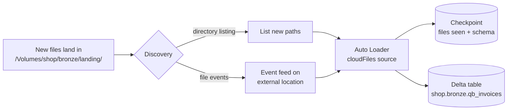

# Auto Loader

Mastery: `INPUT[inlineSelect(option(new), option(learning), option(solid)):mastery]`

> [!story] Context
> [[Lakeflow Connect]] ingests from systems with an API. Much data instead arrives as files in cloud storage: accounting exports, partner CSV drops, JSON logs. A file loader must process each new file exactly once, at scales up to millions of files, and handle schema changes.

> [!eli5] Summary
> Auto Loader watches a storage folder and loads each new file into a table as it arrives. It records which files it has already loaded, so no file is loaded twice, and it adapts when new columns appear in the files.

> [!analogy]- Analogy: an inbox with a processed stamp
> | Inbox | Auto Loader |
> |---|---|
> | Shared folder | Cloud storage path or [[Volumes\|volume]] |
> | Clerk who handles only unstamped files | The `cloudFiles` source |
> | Stamp book of handled files | The [[Checkpoint\|checkpoint]] |
> | Updating the form template when a new field appears | Schema evolution |

## Background

The naive way to load files is "list the folder, compare with what I loaded last time, load the difference". That breaks down fast:

- **Listing is slow and costly.** Listing millions of objects in [[Object Storage|object storage]] every run takes time and API calls.
- **Tracking is error-prone.** Hand-written "already loaded" tables drift, and a failed run can load a file twice.
- **Schemas drift.** A vendor adds a column, and the job either crashes or silently drops it.

Auto Loader solves all three as a [[Structured Streaming]] source called `cloudFiles`. It is the file-ingestion engine behind [[Streaming Tables|streaming tables]] and `read_files` in pipelines.

## Overview

Auto Loader is a Structured Streaming source (`format("cloudFiles")`) that incrementally and efficiently processes new files as they arrive in cloud storage. It supports JSON, CSV, XML, Parquet, Avro, ORC, text, and binary files. It keeps the list of discovered files in a scalable key-value store inside the stream's checkpoint, which gives [[Exactly-Once Processing|exactly-once]] ingestion.

It has two ways to discover new files:

| Mode | How it finds files | When to use |
|---|---|---|
| **Directory listing** (default) | Lists the input path on each run to find new files | Small to medium folders, quick starts |
| **File notification** | Reacts to storage events instead of listing | Large or busy folders. Databricks recommends file notification **using file events** for most workloads |

"File events" means turning on file events on the Unity Catalog [[Storage Credentials and External Locations|external location]]. Databricks then tracks new files for you, and many streams can share that one feed. The older "classic" notification mode (`cloudFiles.useNotifications = true`) sets up a queue per stream in your cloud account.

## How it works



### In Python (a notebook or job)

```python
# Load new QuickBooks CSV exports into a bronze table, then stop.
base = "/Volumes/shop/bronze/landing"

(spark.readStream
    .format("cloudFiles")
    .option("cloudFiles.format", "csv")
    .option("header", "true")
    .option("cloudFiles.schemaLocation", f"{base}/_schemas/qb_invoices")   # enables inference + evolution
    .option("cloudFiles.inferColumnTypes", "true")                        # real types, not all strings
    .option("cloudFiles.schemaHints", "invoice_id STRING, amount DECIMAL(12,2)")
    .load(f"{base}/quickbooks/")
  .writeStream
    .option("checkpointLocation", f"{base}/_checkpoints/qb_invoices")
    .trigger(availableNow=True)          # process everything new, then shut down
    .toTable("shop.bronze.qb_invoices"))
```

`trigger(availableNow=True)` turns a stream into a cheap batch job: it loads every new file since the last run and stops. Run it nightly from a [[Lakeflow Jobs|job]] and you pay only while it runs.

### In SQL (a pipeline or Databricks SQL)

In a [[Lakeflow Spark Declarative Pipelines|pipeline]] or a standalone [[Streaming Tables|streaming table]], `STREAM read_files(...)` uses Auto Loader for you, and the pipeline manages the checkpoint and schema location:

```sql
CREATE OR REFRESH STREAMING TABLE shop.bronze.qb_invoices
AS SELECT *, _metadata.file_path AS source_file
FROM STREAM read_files(
  '/Volumes/shop/bronze/landing/quickbooks/',
  format => 'csv',
  header => true
);
```

### Schema inference and evolution

- Setting `cloudFiles.schemaLocation` turns on inference and evolution. Auto Loader stores schema history in a `_schemas` folder there. You can use the same folder as the checkpoint.
- Inference samples the first files it finds (the docs give 50 GB or 1,000 files, whichever comes first).
- For JSON and CSV, inferred columns are **strings** unless you set `cloudFiles.inferColumnTypes = true`. Use `cloudFiles.schemaHints` to pin types you already know.
- Fields that don't fit the schema go into a `_rescued_data` column instead of being lost.

When a new column appears, the behaviour depends on `cloudFiles.schemaEvolutionMode`:

| Mode | What happens on a new column |
|---|---|
| `addNewColumns` (default when no schema is given) | Stream fails with an `UnknownFieldException`, the schema is updated, and the next restart includes the column |
| `addNewColumnsWithTypeWidening` | Like `addNewColumns`, and also widens types (for example int to long) |
| `rescue` | Schema never changes; new fields go to `_rescued_data` |
| `failOnNewColumns` | Stream fails and stays failed until you change the schema |
| `none` (default when you supply a schema) | New columns are ignored |

The "fail then restart" design is deliberate: it makes schema changes visible. Databricks recommends running Auto Loader streams in [[Lakeflow Jobs]] with retries, so the job restarts automatically after a schema change. Pipelines do this for you.

## Small-business considerations

> [!smallbiz] Small-business considerations
> Auto Loader is the easiest way to handle any system that can only export files. The pattern for our shop: QuickBooks (or the bank, or a supplier) exports a CSV every night into `/Volumes/shop/bronze/landing/quickbooks/`; a nightly job runs Auto Loader with `availableNow`; the files load once each, and the job shuts down. At this scale directory listing is fine. Switch to file events if the folder grows past many thousands of files. Cost is only the compute while the job runs.

## Cloud differences

The code is identical. What differs is where files land and what classic notification mode creates in your account.

> [!azure]- Azure Databricks
> Paths are `abfss://container@account.dfs.core.windows.net/...` on [[Azure Data Lake Storage|ADLS Gen2]], or a volume path. Classic notification mode uses **Azure Event Grid** with **Azure Queue Storage**, and needs permission to create those resources. File events on the external location avoid managing them per stream.

> [!aws]- Databricks on AWS
> Paths are `s3://bucket/...` on [[Amazon S3]]. Classic notification mode uses **Amazon SNS** and **SQS**. File events on the external location are the recommended replacement.

> [!gcp]- Databricks on Google Cloud
> Paths are `gs://bucket/...` on [[Google Cloud Storage]]. Classic notification mode uses **Google Cloud Pub/Sub**. File events on the external location are the recommended replacement.

## Advanced topics

> [!deepdive]- Advanced topics (301–401)
> - **File events vs classic notifications.** With file events, run each stream at least every 7 days to avoid falling back to a full directory listing. Classic notification mode can miss events, so the docs suggest `cloudFiles.backfillInterval` when you have strict completeness or [[SLA]] needs. That setting is not supported with file events.
> - **Partition columns.** Columns inferred from folder names (`/date=2026-10-25/`) are not part of schema evolution. Set `cloudFiles.partitionColumns` explicitly.
> - **Rate limits.** `cloudFiles.maxFilesPerTrigger` and `cloudFiles.maxBytesPerTrigger` cap each micro-batch, which helps with a large first backfill.
> - **File metadata.** `_metadata.file_path`, `_metadata.file_modification_time` and friends are available to every query. Keep the source file path in bronze for debugging.
> - **Do not reuse checkpoints** between different sources or targets. A checkpoint belongs to exactly one query.
> - **Modified files.** Auto Loader by default treats a file path as processed once. If a vendor overwrites a file with the same name, it is not reloaded unless you set `cloudFiles.allowOverwrites`, which can produce duplicates. Prefer unique file names (add a timestamp to every export).

## Common misconceptions

> [!confusion] Auto Loader is not COPY INTO
> Both load files once. [[COPY INTO]] is a SQL command you rerun, best for thousands of files. Auto Loader is a stream with a checkpoint, built for millions of files and schema evolution. Databricks recommends Auto Loader (or streaming tables) for most new work.

> [!confusion] "Streaming" does not mean "always on"
> With `trigger(availableNow=True)` or a scheduled pipeline, Auto Loader runs as a short batch job. The stream only describes how it tracks progress.

## Recall

What is the format name for Auto Loader in Spark?::`cloudFiles`, as in `spark.readStream.format("cloudFiles")`.
What are Auto Loader's two file discovery modes?::Directory listing (default) and file notification; Databricks recommends file notification using file events for most workloads.
Which option turns on schema inference and evolution?::`cloudFiles.schemaLocation`.
By default, what type do inferred CSV and JSON columns get?::String, unless `cloudFiles.inferColumnTypes` is true.
What happens by default when a new column appears?::The stream fails with an UnknownFieldException, the schema is updated, and the restarted stream includes the new column.
Where do values that don't match the schema go?::The `_rescued_data` column.
What trigger makes Auto Loader run as a batch that stops when done?::`trigger(availableNow=True)`.
What does classic notification mode use on AWS, Azure, and GCP?::SNS and SQS on AWS, Event Grid and Queue Storage on Azure, Pub/Sub on GCP.

## Next steps

> [!path] Learning path
> **Needs first:** [[Object Storage]], [[Structured Streaming]], [[Volumes]]
> **Unlocks next:** [[Lakeflow Spark Declarative Pipelines]], [[Streaming Tables]]

> [!nextup] Next
> [[COPY INTO]] covers the SQL-only alternative: a single idempotent command that loads new files from a folder into a table.

> [!sources]- Sources (last verified: 2026-10-25)
> - [What is Auto Loader? (AWS)](https://docs.databricks.com/aws/en/ingestion/cloud-object-storage/auto-loader)
> - [Configure schema inference and evolution in Auto Loader (AWS)](https://docs.databricks.com/aws/en/ingestion/cloud-object-storage/auto-loader/schema)
> - [Configure schema inference and evolution in Auto Loader (Azure)](https://learn.microsoft.com/en-us/azure/databricks/ingestion/cloud-object-storage/auto-loader/schema)
> - [Auto Loader options reference (AWS)](https://docs.databricks.com/aws/en/ingestion/cloud-object-storage/auto-loader/options)
> - [Common data loading patterns (AWS)](https://docs.databricks.com/aws/en/ingestion/cloud-object-storage/auto-loader/patterns)
> - [Configure Auto Loader for production workloads (AWS)](https://docs.databricks.com/aws/en/ingestion/cloud-object-storage/auto-loader/production)
> - [Auto Loader best practices (GCP)](https://docs.databricks.com/gcp/en/ingestion/cloud-object-storage/auto-loader/best-practices)
> - [read_files table-valued function (Azure)](https://learn.microsoft.com/en-us/azure/databricks/sql/language-manual/functions/read_files)
> - **Unconfirmed:** the search budget ran out before these details could be re-checked against official docs, so treat them as unverified: the cloud services used by classic notification mode (SNS/SQS, Event Grid/Queue Storage, Pub/Sub), `cloudFiles.maxFilesPerTrigger`/`maxBytesPerTrigger`, `cloudFiles.allowOverwrites`, the `_rescued_data` column name, the `none` evolution mode, and the full list of supported formats.
