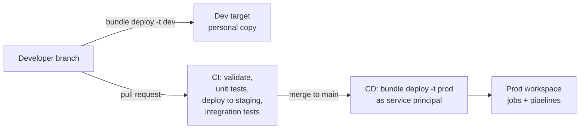

# CI-CD for Data Pipelines

Mastery: `INPUT[inlineSelect(option(new), option(learning), option(solid)):mastery]`

> [!story] Context
> The previous notes built pipelines, jobs, and [[dbt on Databricks|dbt projects]] that run in one workspace. This note covers how to change them safely: develop in isolation, review in [[Git]], test automatically, and deploy the same definition to production with [[CI-CD]].

> [!eli5] Summary
> CI/CD for data means keeping pipeline code and settings in version control and letting an automated process check and release changes. Each change is tried in a safe copy first, then copied to the real system in a repeatable way, so production is never edited by hand.

> [!analogy]- Analogy: a print shop proofing process
> | Print shop | CI/CD for data |
> |---|---|
> | The master file | The Git repository |
> | A proof print checked before the full run | Deploying to a dev or staging target and running tests |
> | The approval stamp | A reviewed and merged pull request |
> | The full print run from the approved file | An automated deployment to the prod target |

## Background

In early Databricks projects, teams edited notebooks directly in the production workspace and created jobs by clicking in the UI. Changes were hard to review, impossible to roll back cleanly, and often differed between environments. Software engineering solved the same problem with version control, automated testing, and [[Infrastructure as Code|infrastructure as code]].

On Databricks, the main tool for this is [[Declarative Automation Bundles]], formerly Databricks Asset Bundles. The docs describe bundles as a way to bring software engineering practices, including source control, code review, testing, and CI/CD, to data and AI projects.

> [!renamed] Renamed
> **Databricks Asset Bundles (DABs)** became **Declarative Automation Bundles** on March 16, 2026. The change is non-breaking: the `databricks bundle` CLI command and existing configuration do not need to change.

## Overview

A typical setup has three parts:

| Part | Tool | Purpose |
|---|---|---|
| **Source of truth** | A Git repository with code and `databricks.yml` | Everything that defines the pipeline, reviewed through pull requests |
| **Environments** | Bundle **targets** such as `dev`, `staging`, `prod`, usually separate workspaces or catalogs | Isolation between development and production |
| **Automation** | A CI system (GitHub Actions, Azure DevOps, GitLab CI) running the [[Databricks CLI]] | Validate, test, and deploy on every change |

Bundles manage [[Lakeflow Jobs]], [[Lakeflow Spark Declarative Pipelines|Lakeflow pipelines]], MLOps stacks, and other resources. Some resource types, such as catalogs, are supported only with the direct deployment engine.

For interactive development inside the workspace, [[Git Folders and Workspace Files|Git folders]] connect a workspace folder to a branch.

## How it works



### Bundle layout

```text
shop-data/
├── databricks.yml
├── resources/
│   ├── shop_etl.pipeline.yml
│   └── nightly.job.yml
├── src/
│   └── pipelines/orders.sql
└── tests/
    └── test_transforms.py
```

`databricks.yml`:

```yaml
bundle:
  name: shop-data

include:
  - resources/*.yml

variables:
  catalog:
    default: shop_dev

targets:
  dev:
    mode: development
    default: true
    workspace:
      host: https://dev-workspace.cloud.databricks.com

  prod:
    mode: production
    workspace:
      host: https://prod-workspace.cloud.databricks.com
    variables:
      catalog: shop
    run_as:
      service_principal_name: 00000000-0000-0000-0000-000000000000
```

`mode: development` prefixes deployed resource names with `[dev <your user name>]`, pauses schedules and triggers, and allows concurrent job runs. `mode: production` checks that pipelines are not in development mode and that the current Git branch matches any branch set in the target. `run_as` with `service_principal_name` (the service principal's application ID) makes deployed jobs run as that service principal, which Databricks recommends for production.

Pipeline definitions reference the variable, so each target writes to its own catalog:

```yaml
resources:
  pipelines:
    shop_etl:
      name: shop-etl
      catalog: ${var.catalog}
      schema: silver
      serverless: true
      libraries:
        - file:
            path: ../src/pipelines/orders.sql
```

### Commands

```bash
databricks bundle validate -t dev          # check configuration
databricks bundle deploy   -t dev          # deploy your personal dev copy
databricks bundle run nightly_shop_refresh -t dev
databricks bundle deploy   -t prod         # production (normally only from CI)
```

`dev` is the default target, so production deploys need the explicit `-t prod`.

### A CI workflow (GitHub Actions)

```yaml
# .github/workflows/deploy.yml
name: deploy
on:
  pull_request:
  push:
    branches: [main]

jobs:
  test-and-deploy:
    runs-on: ubuntu-latest
    env:
      DATABRICKS_HOST: ${{ secrets.DATABRICKS_HOST }}
      DATABRICKS_CLIENT_ID: ${{ secrets.DATABRICKS_CLIENT_ID }}
      DATABRICKS_CLIENT_SECRET: ${{ secrets.DATABRICKS_CLIENT_SECRET }}
    steps:
      - uses: actions/checkout@v4
      - uses: databricks/setup-cli@main
      - run: pip install pytest pyspark
      - run: pytest tests/unit
      - run: databricks bundle validate -t staging
      - run: databricks bundle deploy -t staging
      - if: github.ref == 'refs/heads/main'
        run: databricks bundle deploy -t prod
```

Authenticate CI as a [[Users Groups and Service Principals|service principal]], not with a personal access token tied to a person. The example uses OAuth machine-to-machine credentials (`DATABRICKS_CLIENT_ID` and `DATABRICKS_CLIENT_SECRET`), which the CLI reads through unified authentication. The Databricks GitHub Actions docs also show workload identity federation (`DATABRICKS_AUTH_TYPE: github-oidc`), which removes the stored secret. `databricks/setup-cli` is the Databricks action that installs the CLI. The example assumes a `staging` target in `databricks.yml` in addition to `dev` and `prod`. See [[Authentication - Tokens and OAuth]].

## Small-business considerations

> [!smallbiz] Small-business considerations
> A one-person team does not need three workspaces and a staging environment on day one. A proportionate setup:
> 1. Put the project in a Git repository from the start (`databricks bundle init` creates one from a template).
> 2. Use two targets: `dev` (your personal copy, in a `shop_dev` catalog) and `prod`.
> 3. Deploy to production with `databricks bundle deploy -t prod` from a clean `main` branch, or from a simple CI workflow once a second person joins.
> 4. Run production jobs as a service principal.
>
> This setup also documents the system for whoever joins next. Bundles and the CLI have no separate cost.

## Cloud differences

> [!azure]- Azure Databricks
> Azure teams often use **Azure DevOps Pipelines** instead of GitHub Actions; the steps are the same CLI commands. The Azure Databricks example authenticates a Microsoft Entra ID service principal with an Azure Databricks OAuth secret (OAuth M2M). An Azure Resource Manager service connection or Databricks workload identity federation avoids managing that secret. Workspace hosts have the form `adb-<workspace-id>.<random-number>.azuredatabricks.net`. See [[Microsoft Entra ID Integration]].

> [!aws]- Databricks on AWS
> No bundle differences. Workspace hosts end in `cloud.databricks.com`. Workspaces themselves are often created with the [[Terraform Provider]]; bundles then manage what runs inside them.

> [!gcp]- Databricks on Google Cloud
> No bundle differences. Workspace hosts end in `gcp.databricks.com`.

## Advanced topics

> [!deepdive]- Advanced topics (301–401)
> - **Bundles vs Terraform:** Use the [[Terraform Provider]] for platform infrastructure (workspaces, networking, metastores) and bundles for workloads (jobs, pipelines, dashboards). The direct deployment engine broadens the resource types bundles can manage.
> - **Separate dev and prod:** The bundle FAQ explains why dev and prod targets should stay separate. At minimum use separate catalogs; ideally separate workspaces with workspace-catalog binding (see [[Unity Catalog]]) so production data is reachable only from the production workspace.
> - **Templates:** `databricks bundle init` offers default templates, including `default-minimal`, `default-python`, `default-sql`, `default-scala`, `dbt-sql`, `mlops-stacks`, and `pydabs`. Teams can publish custom templates to standardize new projects.
> - **Data in CI:** Integration tests need realistic data. Use a small, de-identified sample catalog for staging, or shallow clones of production tables where governance allows.
> - **Rollbacks:** Redeploy an earlier Git commit to roll back code. Data changes are rolled back separately, for example with Delta [[Time Travel]] (`RESTORE TABLE`).

## Common misconceptions

> [!confusion] Git folders are not CI/CD
> [[Git Folders and Workspace Files|Git folders]] sync notebooks and files with a branch for development. They do not create jobs or pipelines, run tests, or promote changes between environments. Bundles and a CI system do that.

> [!confusion] "Declarative Automation Bundles" and "Databricks Asset Bundles" are the same product
> The name changed on March 16, 2026. Commands and configuration are unchanged.

## Recall

What were Declarative Automation Bundles called before March 2026?::Databricks Asset Bundles (DABs).
Which file defines a bundle?::`databricks.yml`.
Which command checks a bundle's configuration?::`databricks bundle validate`.
How do you deploy a bundle to production?::`databricks bundle deploy -t prod`.
What is a bundle target?::A named environment (such as dev or prod) with its own workspace, variables, and settings.
Which identity should CI use to deploy?::A service principal with OAuth machine-to-machine credentials.
What should Terraform manage vs bundles?::Terraform manages platform infrastructure; bundles manage workloads such as jobs and pipelines.

## Next steps

> [!path] Learning path
> **Needs first:** [[Declarative Automation Bundles]], [[Git]], [[Lakeflow Jobs]]
> **Unlocks next:** [[Testing Data Pipelines]]

> [!nextup] Next
> [[Testing Data Pipelines]] covers the tests a CI workflow runs: unit tests for transformation logic, data tests on tables, and pipeline expectations.

> [!sources]- Sources (last verified: 2026-10-25)
> - [What are Declarative Automation Bundles? (AWS)](https://docs.databricks.com/aws/en/dev-tools/bundles/)
> - [Declarative Automation Bundles feature release notes (AWS)](https://docs.databricks.com/aws/en/release-notes/dev-tools/bundles)
> - [Declarative Automation Bundles FAQs (AWS)](https://docs.databricks.com/aws/en/dev-tools/bundles/faqs)
> - [Declarative Automation Bundles configuration (AWS)](https://docs.databricks.com/aws/en/dev-tools/bundles/settings)
> - [Declarative Automation Bundles resources (AWS)](https://docs.databricks.com/aws/en/dev-tools/bundles/resources)
> - [Declarative Automation Bundles resources (Azure)](https://learn.microsoft.com/en-us/azure/databricks/dev-tools/bundles/resources)
> - [Configuration reference (AWS)](https://docs.databricks.com/aws/en/dev-tools/bundles/reference)
> - [Declarative Automation Bundles project templates (AWS)](https://docs.databricks.com/aws/en/dev-tools/bundles/templates)
> - [Develop pipelines with Declarative Automation Bundles (AWS)](https://docs.databricks.com/aws/en/dev-tools/bundles/pipelines-tutorial)
> - [Develop a job with Declarative Automation Bundles (Azure)](https://learn.microsoft.com/en-gb/azure/databricks/dev-tools/bundles/jobs-tutorial)
> - [Declarative Automation Bundles deployment modes (AWS)](https://docs.databricks.com/aws/en/dev-tools/bundles/deployment-modes)
> - [Specify a run identity for a Declarative Automation Bundles workflow (AWS)](https://docs.databricks.com/aws/en/dev-tools/bundles/run-as)
> - [GitHub Actions (AWS)](https://docs.databricks.com/aws/en/dev-tools/ci-cd/github)
> - [Authorize service principal access to Databricks with OAuth (AWS)](https://docs.databricks.com/aws/en/dev-tools/auth/oauth-m2m)
> - [Continuous integration and delivery on Azure Databricks using Azure DevOps (Azure)](https://learn.microsoft.com/en-us/azure/databricks/dev-tools/ci-cd/azure-devops)
> - [Get identifiers for workspace objects (AWS)](https://docs.databricks.com/aws/en/workspace/workspace-details)
> - [Get identifiers for workspace objects (GCP)](https://docs.databricks.com/gcp/en/workspace/workspace-details)
