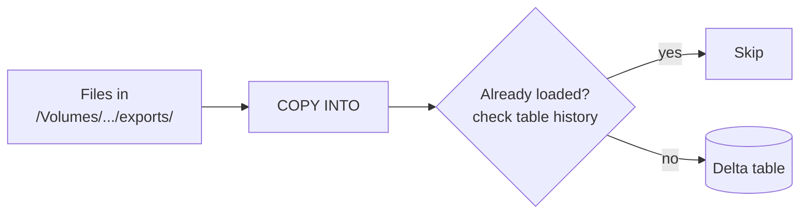

# COPY INTO

Mastery: `INPUT[inlineSelect(option(new), option(learning), option(solid)):mastery]`

> [!story] Context
> [[Auto Loader]] is a streaming source with checkpoints and schema locations. For simpler loads, such as an analyst loading a folder of CSV files from the [[SQL Editor]], a single SQL command is easier to run and maintain.

> [!eli5] Summary
> COPY INTO is a single SQL command that loads the files in a folder into a table. Running it again loads only files that are new since the last run, so rows are not duplicated by reruns.

> [!analogy]- Analogy: a guest list at the door
> | Door and guest list | COPY INTO |
> |---|---|
> | Guests in the queue | Files in the source folder |
> | Doorman who admits guests not yet on the list | The `COPY INTO` command |
> | The list of admitted guests | Load history kept in the table's metadata |
> | Ignoring the list | `COPY_OPTIONS ('force' = 'true')` |

## Background

Before COPY INTO, loading files into a table meant either `INSERT INTO ... SELECT FROM files`, which happily loads the same file twice if you rerun it, or writing a Spark job with your own bookkeeping. Warehouse users from [[Snowflake]] and [[Amazon Redshift|Redshift]] expected a simple `COPY` command. COPY INTO is that command for [[Delta Lake]] tables, with safe reruns built in.

## Overview

`COPY INTO` is a Databricks SQL command that loads data from a file location into a Delta table. The docs call it "a retryable and idempotent operation. Files in the source location that have already been loaded are skipped. This is true even if the files have been modified since they were loaded."

It works on [[SQL Warehouses|SQL warehouses]], [[Serverless Compute|serverless]], and classic compute. Supported formats include CSV, JSON, Avro, ORC, Parquet, text, and binary files.

| Clause | What it does |
|---|---|
| `FROM '<path>'` | Source folder: a [[Volumes|volume]] path or cloud URL. Can be a `SELECT` over the path to transform while loading |
| `FILEFORMAT = CSV` | The file format |
| `FILES = (...)` / `PATTERN = '...'` | Load only named files, or a glob pattern |
| `FORMAT_OPTIONS (...)` | Reader options, such as `'header' = 'true'`, `'inferSchema' = 'true'` |
| `COPY_OPTIONS (...)` | Load behaviour, such as `'mergeSchema' = 'true'` or `'force' = 'true'` |

## How it works



COPY INTO records which files it loaded in the target table's metadata. Each run compares the folder with that record.

### Load a folder of CSVs

```sql
-- 1. A table with no columns yet: COPY INTO will set the schema
CREATE TABLE IF NOT EXISTS shop.bronze.bank_transactions;

-- 2. Load. Rerun this as often as you like; only new files load.
COPY INTO shop.bronze.bank_transactions
FROM '/Volumes/shop/bronze/landing/bank/'
FILEFORMAT = CSV
PATTERN = '*.csv'
FORMAT_OPTIONS ('header' = 'true', 'inferSchema' = 'true', 'mergeSchema' = 'true')
COPY_OPTIONS ('mergeSchema' = 'true');
```

The two `mergeSchema` settings do different jobs. In `FORMAT_OPTIONS` it merges the schemas of the source files with each other. In `COPY_OPTIONS` it lets the target table's schema evolve. If all your files share one schema, Databricks recommends leaving the `FORMAT_OPTIONS` one at its default (`false`).

### Transform while loading

```sql
COPY INTO shop.bronze.bank_transactions
FROM (
  SELECT
    CAST(`Date` AS DATE)             AS txn_date,
    `Description`                    AS description,
    CAST(`Amount` AS DECIMAL(12,2))  AS amount,
    _metadata.file_name              AS source_file
  FROM '/Volumes/shop/bronze/landing/bank/'
)
FILEFORMAT = CSV
FORMAT_OPTIONS ('header' = 'true');
```

### Reload on purpose

```sql
-- Reload a file you fixed by hand (idempotency off for this run)
COPY INTO shop.bronze.bank_transactions
FROM '/Volumes/shop/bronze/landing/bank/'
FILEFORMAT = CSV
FILES = ('2026-10-24.csv')
FORMAT_OPTIONS ('header' = 'true')
COPY_OPTIONS ('force' = 'true');
```

### Comparison with Auto Loader

| | COPY INTO | [[Auto Loader]] / [[Streaming Tables]] |
|---|---|---|
| Interface | One SQL statement | Stream (Python) or `STREAM read_files` (SQL) |
| Scale sweet spot | Thousands of files | Millions of files |
| File tracking | Table metadata | Checkpoint key-value store |
| Schema evolution | `mergeSchema` | Inference, hints, evolution modes, rescued data |
| Best for | Ad hoc and simple scheduled loads, analysts | New production pipelines |

The docs say COPY INTO is a good fit for loading thousands of files, and recommend Auto Loader or streaming tables when you get into millions or need richer schema handling.

## Small-business considerations

> [!smallbiz] Small-business considerations
> COPY INTO is the lowest-effort way to load spreadsheets and exports into Databricks. A bookkeeper can upload monthly bank CSVs to a volume through the UI, and a scheduled SQL query (or a SQL task in a [[Lakeflow Jobs|job]]) runs the `COPY INTO` above every night, with no Python or streaming configuration. If you plan to build a [[Lakeflow Spark Declarative Pipelines|pipeline]], use a [[Streaming Tables|streaming table]] with `read_files` instead, which covers the same case and adds schema evolution.

## Cloud differences

> [!azure]- Azure Databricks
> Nothing differs in the SQL. Point `FROM` at a volume or an `abfss://` path that a Unity Catalog [[Storage Credentials and External Locations|external location]] covers.

> [!aws]- Databricks on AWS
> Same SQL with `s3://` paths. The reference also documents a `WITH (CREDENTIAL ...)` clause on the source, which takes a named storage credential or inline temporary credentials (`AWS_ACCESS_KEY`, `AWS_SECRET_KEY`, `AWS_SESSION_TOKEN`). Use it only when the path is not covered by an external location. Older docs also show loading through an [[Instance Profiles|instance profile]]. With Unity Catalog, use an external location or volume instead.

> [!gcp]- Databricks on Google Cloud
> Same SQL with `gs://` paths covered by an external location or a volume.

## Advanced topics

> [!deepdive]- Advanced topics (301–401)
> - **Concurrency.** Concurrent COPY INTO runs into the same table succeed only if they work on distinct sets of files. Overlapping runs cause transaction conflicts.
> - **Schemaless tables.** A table created with no columns can only be filled by COPY INTO at first. `INSERT INTO` and `MERGE INTO` are not supported on schemaless Delta tables.
> - **Validation.** `VALIDATE 15 ROWS` (or `VALIDATE ALL`), placed after `FILEFORMAT`, checks the data without writing it to the table, which is useful before a big first load. The default is to validate all data to be loaded.
> - **Modified files are skipped** by design, even if their content changed. If an upstream system rewrites files in place, either name files uniquely or use `force` deliberately.
> - **Credentials.** With Unity Catalog, the permission to read the source comes from `READ FILES` on the external location (or on a named storage credential), or from `READ VOLUME` on the volume, not from the compute.

## Common misconceptions

> [!confusion] COPY INTO is not INSERT INTO
> `INSERT INTO ... SELECT * FROM read_files(...)` reloads everything each time. COPY INTO remembers what it already loaded.

> [!confusion] "Idempotent" does not mean "deduplicated"
> COPY INTO skips files it already loaded. It does **not** remove duplicate rows inside or across new files. Deduplicate in silver, for example with [[MERGE and Upserts|MERGE]].

## Recall

What does COPY INTO do with files it has already loaded?::Skips them, even if they were modified since.
How do you force COPY INTO to reload files?::`COPY_OPTIONS ('force' = 'true')`.
What is the difference between `mergeSchema` in FORMAT_OPTIONS and COPY_OPTIONS?::FORMAT_OPTIONS merges schemas across source files; COPY_OPTIONS evolves the target table's schema.
At what scale does Databricks suggest COPY INTO vs Auto Loader?::COPY INTO for thousands of files; Auto Loader or streaming tables for millions.
Can you run INSERT INTO on a schemaless Delta table?::No. Only COPY INTO can write to it until it has a schema.
How do you check data with COPY INTO without writing it?::Add `VALIDATE` (for example `VALIDATE 15 ROWS`).

## Next steps

> [!path] Learning path
> **Needs first:** [[Delta Lake]], [[Volumes]], [[SQL]]
> **Unlocks next:** [[Streaming Tables]], [[Lakeflow Spark Declarative Pipelines]]

> [!nextup] Next
> [[Lakeflow Spark Declarative Pipelines]] covers building the tables downstream of ingestion: declared datasets that the engine orders, refreshes incrementally, and retries.

> [!sources]- Sources (last verified: 2026-10-25)
> - [COPY INTO reference (AWS)](https://docs.databricks.com/aws/en/sql/language-manual/delta-copy-into)
> - [COPY INTO reference (Azure)](https://learn.microsoft.com/en-us/azure/databricks/sql/language-manual/delta-copy-into)
> - [Get started using COPY INTO to load data (AWS)](https://docs.databricks.com/aws/en/ingestion/cloud-object-storage/copy-into/)
> - [Get started using COPY INTO to load data (Azure)](https://learn.microsoft.com/en-us/azure/databricks/ingestion/cloud-object-storage/copy-into/)
> - [Common data loading patterns using COPY INTO (AWS)](https://docs.databricks.com/aws/en/ingestion/cloud-object-storage/copy-into/examples)
> - [Tutorial: COPY INTO with Spark SQL (AWS)](https://docs.databricks.com/aws/en/ingestion/cloud-object-storage/copy-into/tutorial-notebook)
> - [Load data using COPY INTO with an instance profile (AWS)](https://docs.databricks.com/aws/en/ingestion/cloud-object-storage/copy-into/tutorial-dbsql)
> - [Unity Catalog privileges and securable objects (AWS)](https://docs.databricks.com/aws/en/data-governance/unity-catalog/manage-privileges/privileges)
